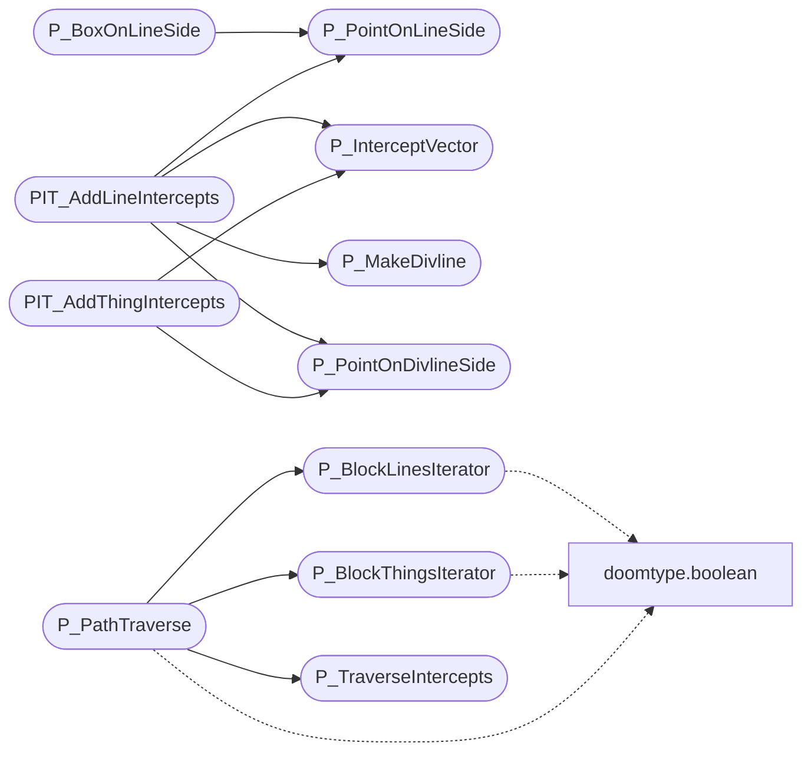

# `progs/doomgeneric/p_maputl.c`

> Source: [progs/doomgeneric/p_maputl.c:1](../../progs/doomgeneric/p_maputl.c#L1) | language `c` | coverage 17.6% | [API index](../index.md)

Copyright(C) 1993-1996 Id Software, Inc.

Copyright(C) 2005-2014 Simon Howard Copyright(C) 2005, 2006 Andrey Budko  This program is free software; you can redistribute it and/or modify it under the terms of the GNU General Public License as published by the Free Software Foundation; either version 2 of the License, or (at your option) any later version.  This program is distributed in the hope that it will be useful, but WITHOUT ANY WARRANTY; without even the implied warranty of MERCHANTABILITY or FITNESS FOR A PARTICULAR PURPOSE.  See the GNU General Public License for more details.  DESCRIPTION: Movement/collision utility functions, as used by function in p_map.c. BLOCKMAP Iterator functions, and some PIT_* functions to use for iteration.

## Contents

- **Structs:** [`intercepts_overrun_t`](#intercepts_overrun_t)
- **Functions:** [`P_AproxDistance`](#p_aproxdistance), [`P_PointOnLineSide`](#p_pointonlineside), [`P_BoxOnLineSide`](#p_boxonlineside), [`P_PointOnDivlineSide`](#p_pointondivlineside), [`P_MakeDivline`](#p_makedivline), [`P_InterceptVector`](#p_interceptvector), [`P_LineOpening`](#p_lineopening), [`P_UnsetThingPosition`](#p_unsetthingposition), [`P_SetThingPosition`](#p_setthingposition), [`P_BlockLinesIterator`](#p_blocklinesiterator), [`P_BlockThingsIterator`](#p_blockthingsiterator), [`PIT_AddLineIntercepts`](#pit_addlineintercepts), [`PIT_AddThingIntercepts`](#pit_addthingintercepts), [`P_TraverseIntercepts`](#p_traverseintercepts), [`P_PathTraverse`](#p_pathtraverse)
- **Variables:** [`bulletslope`](#bulletslope)

## Call Graph

Solid arrows stay in this module, dashed arrows leave it.



## Structs

<a id="intercepts_overrun_t"></a>

### `intercepts_overrun_t`

`struct` | [progs/doomgeneric/p_maputl.c:738](../../progs/doomgeneric/p_maputl.c#L738)

```c
typedef struct
```

---

## Functions

<a id="p_aproxdistance"></a>

### `P_AproxDistance`

`function` | [progs/doomgeneric/p_maputl.c:44](../../progs/doomgeneric/p_maputl.c#L44)

```c
fixed_t P_AproxDistance ( fixed_t dx, fixed_t dy )
```

**Parameters**

| Name | Type | Default | Description |
|---|---|---|---|
| `dx` | `fixed_t` |  |  |
| `dy` | `fixed_t` |  |  |

**Returns:** `fixed_t`

---

<a id="p_pointonlineside"></a>

### `P_PointOnLineSide`

`function` | [progs/doomgeneric/p_maputl.c:61](../../progs/doomgeneric/p_maputl.c#L61)

```c
int P_PointOnLineSide ( fixed_t x, fixed_t y, line_t* line )
```

**Parameters**

| Name | Type | Default | Description |
|---|---|---|---|
| `x` | `fixed_t` |  |  |
| `y` | `fixed_t` |  |  |
| `line` | `line_t*` |  |  |

**Returns:** `int`

*Called by:* [`PIT_AddLineIntercepts`](#pit_addlineintercepts), [`P_BoxOnLineSide`](#p_boxonlineside)

---

<a id="p_boxonlineside"></a>

### `P_BoxOnLineSide`

`function` | [progs/doomgeneric/p_maputl.c:105](../../progs/doomgeneric/p_maputl.c#L105)

```c
int P_BoxOnLineSide ( fixed_t* tmbox, line_t* ld )
```

**Parameters**

| Name | Type | Default | Description |
|---|---|---|---|
| `tmbox` | `fixed_t*` |  |  |
| `ld` | `line_t*` |  |  |

**Returns:** `int`

*Calls:* [`P_PointOnLineSide`](#p_pointonlineside)

---

<a id="p_pointondivlineside"></a>

### `P_PointOnDivlineSide`

`function` | [progs/doomgeneric/p_maputl.c:156](../../progs/doomgeneric/p_maputl.c#L156)

```c
int P_PointOnDivlineSide ( fixed_t x, fixed_t y, divline_t* line )
```

**Parameters**

| Name | Type | Default | Description |
|---|---|---|---|
| `x` | `fixed_t` |  |  |
| `y` | `fixed_t` |  |  |
| `line` | `divline_t*` |  |  |

**Returns:** `int`

*Called by:* [`PIT_AddLineIntercepts`](#pit_addlineintercepts), [`PIT_AddThingIntercepts`](#pit_addthingintercepts)

---

<a id="p_makedivline"></a>

### `P_MakeDivline`

`function` | [progs/doomgeneric/p_maputl.c:206](../../progs/doomgeneric/p_maputl.c#L206)

```c
void P_MakeDivline ( line_t* li, divline_t* dl )
```

**Parameters**

| Name | Type | Default | Description |
|---|---|---|---|
| `li` | `line_t*` |  |  |
| `dl` | `divline_t*` |  |  |

*Called by:* [`PIT_AddLineIntercepts`](#pit_addlineintercepts)

---

<a id="p_interceptvector"></a>

### `P_InterceptVector`

`function` | [progs/doomgeneric/p_maputl.c:226](../../progs/doomgeneric/p_maputl.c#L226)

```c
fixed_t P_InterceptVector ( divline_t* v2, divline_t* v1 )
```

**Parameters**

| Name | Type | Default | Description |
|---|---|---|---|
| `v2` | `divline_t*` |  |  |
| `v1` | `divline_t*` |  |  |

**Returns:** `fixed_t`

*Called by:* [`PIT_AddLineIntercepts`](#pit_addlineintercepts), [`PIT_AddThingIntercepts`](#pit_addthingintercepts)

---

<a id="p_lineopening"></a>

### `P_LineOpening`

`function` | [progs/doomgeneric/p_maputl.c:295](../../progs/doomgeneric/p_maputl.c#L295)

```c
void P_LineOpening (line_t* linedef)
```

**Parameters**

| Name | Type | Default | Description |
|---|---|---|---|
| `linedef` | `line_t*` |  |  |

---

<a id="p_unsetthingposition"></a>

### `P_UnsetThingPosition`

`function` | [progs/doomgeneric/p_maputl.c:342](../../progs/doomgeneric/p_maputl.c#L342)

```c
void P_UnsetThingPosition (mobj_t* thing)
```

P_UnsetThingPosition Unlinks a thing from block map and sectors.

On each position change, BLOCKMAP and other lookups maintaining lists ot things inside these structures need to be updated.

**Parameters**

| Name | Type | Default | Description |
|---|---|---|---|
| `thing` | `mobj_t*` |  |  |

---

<a id="p_setthingposition"></a>

### `P_SetThingPosition`

`function` | [progs/doomgeneric/p_maputl.c:391](../../progs/doomgeneric/p_maputl.c#L391)

```c
void P_SetThingPosition (mobj_t* thing)
```

**Parameters**

| Name | Type | Default | Description |
|---|---|---|---|
| `thing` | `mobj_t*` |  |  |

---

<a id="p_blocklinesiterator"></a>

### `P_BlockLinesIterator`

`function` | [progs/doomgeneric/p_maputl.c:467](../../progs/doomgeneric/p_maputl.c#L467)

```c
boolean P_BlockLinesIterator ( int x, int y, boolean(*func)(line_t*) )
```

**Parameters**

| Name | Type | Default | Description |
|---|---|---|---|
| `x` | `int` |  |  |
| `y` | `int` |  |  |
| `line_t` | `boolean(*func)( *)` |  |  |

**Returns:** `boolean`

*Calls:* [`boolean`](progs.doomgeneric.doomtype.h.md#boolean)

*Called by:* [`P_CheckPosition`](progs.doomgeneric.p_map.c.md#p_checkposition), [`P_PathTraverse`](#p_pathtraverse)

---

<a id="p_blockthingsiterator"></a>

### `P_BlockThingsIterator`

`function` | [progs/doomgeneric/p_maputl.c:508](../../progs/doomgeneric/p_maputl.c#L508)

```c
boolean P_BlockThingsIterator ( int x, int y, boolean(*func)(mobj_t*) )
```

**Parameters**

| Name | Type | Default | Description |
|---|---|---|---|
| `x` | `int` |  |  |
| `y` | `int` |  |  |
| `mobj_t` | `boolean(*func)( *)` |  |  |

**Returns:** `boolean`

*Calls:* [`boolean`](progs.doomgeneric.doomtype.h.md#boolean)

*Called by:* [`A_VileChase`](progs.doomgeneric.p_enemy.c.md#a_vilechase), [`P_ChangeSector`](progs.doomgeneric.p_map.c.md#p_changesector), [`P_CheckPosition`](progs.doomgeneric.p_map.c.md#p_checkposition), [`P_RadiusAttack`](progs.doomgeneric.p_map.c.md#p_radiusattack), [`P_TeleportMove`](progs.doomgeneric.p_map.c.md#p_teleportmove), [`P_PathTraverse`](#p_pathtraverse)

---

<a id="pit_addlineintercepts"></a>

### `PIT_AddLineIntercepts`

`function` | [progs/doomgeneric/p_maputl.c:559](../../progs/doomgeneric/p_maputl.c#L559)

```c
boolean PIT_AddLineIntercepts (line_t* ld)
```

**Parameters**

| Name | Type | Default | Description |
|---|---|---|---|
| `ld` | `line_t*` |  |  |

**Returns:** `boolean`

*Calls:* [`P_InterceptVector`](#p_interceptvector), [`P_MakeDivline`](#p_makedivline), [`P_PointOnDivlineSide`](#p_pointondivlineside), [`P_PointOnLineSide`](#p_pointonlineside)

---

<a id="pit_addthingintercepts"></a>

### `PIT_AddThingIntercepts`

`function` | [progs/doomgeneric/p_maputl.c:614](../../progs/doomgeneric/p_maputl.c#L614)

```c
boolean PIT_AddThingIntercepts (mobj_t* thing)
```

PIT_AddThingIntercepts

**Parameters**

| Name | Type | Default | Description |
|---|---|---|---|
| `thing` | `mobj_t*` |  |  |

**Returns:** `boolean`

*Calls:* [`P_InterceptVector`](#p_interceptvector), [`P_PointOnDivlineSide`](#p_pointondivlineside)

---

<a id="p_traverseintercepts"></a>

### `P_TraverseIntercepts`

`function` | [progs/doomgeneric/p_maputl.c:682](../../progs/doomgeneric/p_maputl.c#L682)

```c
boolean P_TraverseIntercepts ( traverser_t func, fixed_t maxfrac )
```

**Parameters**

| Name | Type | Default | Description |
|---|---|---|---|
| `func` | `traverser_t` |  |  |
| `maxfrac` | `fixed_t` |  |  |

**Returns:** `boolean`

*Called by:* [`P_PathTraverse`](#p_pathtraverse)

---

<a id="p_pathtraverse"></a>

### `P_PathTraverse`

`function` | [progs/doomgeneric/p_maputl.c:861](../../progs/doomgeneric/p_maputl.c#L861)

```c
P_PathTraverse ( fixed_t x1, fixed_t y1, fixed_t x2, fixed_t y2, int flags, boolean (*trav) (intercept_t *))
```

**Parameters**

| Name | Type | Default | Description |
|---|---|---|---|
| `x1` | `fixed_t` |  |  |
| `y1` | `fixed_t` |  |  |
| `x2` | `fixed_t` |  |  |
| `y2` | `fixed_t` |  |  |
| `flags` | `int` |  |  |
| `intercept_t` | `boolean (*trav) ( *)` |  |  |

*Calls:* [`boolean`](progs.doomgeneric.doomtype.h.md#boolean), [`P_BlockLinesIterator`](#p_blocklinesiterator), [`P_BlockThingsIterator`](#p_blockthingsiterator), [`P_TraverseIntercepts`](#p_traverseintercepts)

*Called by:* [`P_AimLineAttack`](progs.doomgeneric.p_map.c.md#p_aimlineattack), [`P_LineAttack`](progs.doomgeneric.p_map.c.md#p_lineattack), [`P_SlideMove`](progs.doomgeneric.p_map.c.md#p_slidemove), [`P_UseLines`](progs.doomgeneric.p_map.c.md#p_uselines)

---

## Variables

<a id="bulletslope"></a>

### `bulletslope`

`variable` `extern` | [progs/doomgeneric/p_maputl.c:731](../../progs/doomgeneric/p_maputl.c#L731)

```c
extern fixed_t bulletslope;
```

---
