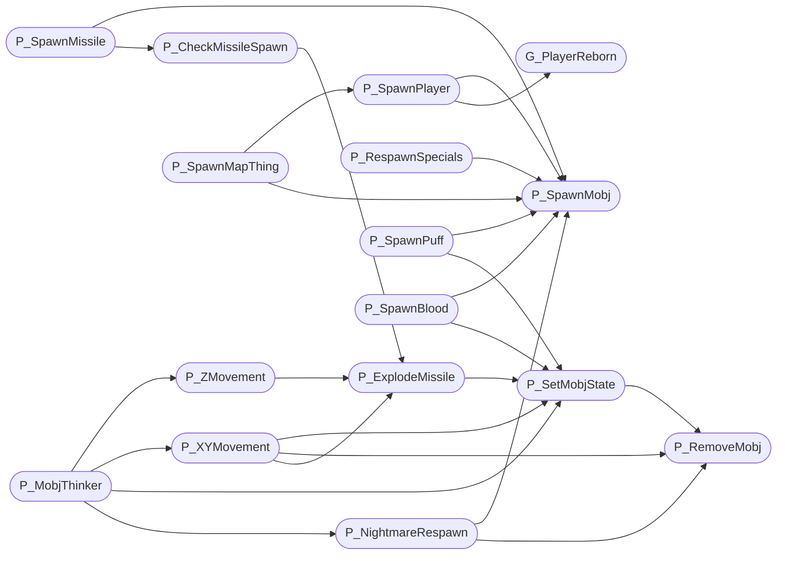

# `progs/doomgeneric/p_mobj.c`

> Source: [progs/doomgeneric/p_mobj.c:1](../../progs/doomgeneric/p_mobj.c#L1) | language `c` | coverage 42.9% | [API index](../index.md)

Copyright(C) 1993-1996 Id Software, Inc.

Copyright(C) 2005-2014 Simon Howard  This program is free software; you can redistribute it and/or modify it under the terms of the GNU General Public License as published by the Free Software Foundation; either version 2 of the License, or (at your option) any later version.  This program is distributed in the hope that it will be useful, but WITHOUT ANY WARRANTY; without even the implied warranty of MERCHANTABILITY or FITNESS FOR A PARTICULAR PURPOSE.  See the GNU General Public License for more details.  DESCRIPTION: Moving object handling. Spawn functions.

## Contents

- **Functions:** [`G_PlayerReborn`](#g_playerreborn), [`P_SetMobjState`](#p_setmobjstate), [`P_ExplodeMissile`](#p_explodemissile), [`P_XYMovement`](#p_xymovement), [`P_ZMovement`](#p_zmovement), [`P_NightmareRespawn`](#p_nightmarerespawn), [`P_MobjThinker`](#p_mobjthinker), [`P_SpawnMobj`](#p_spawnmobj), [`P_RemoveMobj`](#p_removemobj), [`P_RespawnSpecials`](#p_respawnspecials), [`P_SpawnPlayer`](#p_spawnplayer), [`P_SpawnMapThing`](#p_spawnmapthing), [`P_SpawnPuff`](#p_spawnpuff), [`P_SpawnBlood`](#p_spawnblood), [`P_CheckMissileSpawn`](#p_checkmissilespawn), [`P_SubstNullMobj`](#p_substnullmobj), [`P_SpawnMissile`](#p_spawnmissile), [`P_SpawnPlayerMissile`](#p_spawnplayermissile)
- **Macros:** [`STOPSPEED`](#stopspeed), [`FRICTION`](#friction)
- **Variables:** [`attackrange`](#attackrange)

## Call Graph

Solid arrows stay in this module, dashed arrows leave it.



## Functions

<a id="g_playerreborn"></a>

### `G_PlayerReborn`

`function` | [progs/doomgeneric/p_mobj.c:37](../../progs/doomgeneric/p_mobj.c#L37)

```c
void G_PlayerReborn (int player);
```

**Parameters**

| Name | Type | Default | Description |
|---|---|---|---|
| `player` | `int` |  |  |

*Called by:* [`P_SpawnPlayer`](#p_spawnplayer)

---

<a id="p_setmobjstate"></a>

### `P_SetMobjState`

`function` | [progs/doomgeneric/p_mobj.c:48](../../progs/doomgeneric/p_mobj.c#L48)

```c
boolean P_SetMobjState ( mobj_t* mobj, statenum_t state )
```

**Parameters**

| Name | Type | Default | Description |
|---|---|---|---|
| `mobj` | `mobj_t*` |  |  |
| `state` | `statenum_t` |  |  |

**Returns:** `boolean`

*Calls:* [`P_RemoveMobj`](#p_removemobj)

*Called by:* [`A_BrainExplode`](progs.doomgeneric.p_enemy.c.md#a_brainexplode), [`A_BrainScream`](progs.doomgeneric.p_enemy.c.md#a_brainscream), [`A_CPosRefire`](progs.doomgeneric.p_enemy.c.md#a_cposrefire), [`A_Chase`](progs.doomgeneric.p_enemy.c.md#a_chase), [`A_Look`](progs.doomgeneric.p_enemy.c.md#a_look), [`A_SpawnFly`](progs.doomgeneric.p_enemy.c.md#a_spawnfly), [`A_SpidRefire`](progs.doomgeneric.p_enemy.c.md#a_spidrefire), [`A_VileChase`](progs.doomgeneric.p_enemy.c.md#a_vilechase), [`P_DamageMobj`](progs.doomgeneric.p_inter.c.md#p_damagemobj), [`P_KillMobj`](progs.doomgeneric.p_inter.c.md#p_killmobj), [`PIT_ChangeSector`](progs.doomgeneric.p_map.c.md#pit_changesector), [`PIT_CheckThing`](progs.doomgeneric.p_map.c.md#pit_checkthing) and 13 more

---

<a id="p_explodemissile"></a>

### `P_ExplodeMissile`

`function` | [progs/doomgeneric/p_mobj.c:84](../../progs/doomgeneric/p_mobj.c#L84)

```c
void P_ExplodeMissile (mobj_t* mo)
```

P_ExplodeMissile

**Parameters**

| Name | Type | Default | Description |
|---|---|---|---|
| `mo` | `mobj_t*` |  |  |

*Calls:* [`P_Random`](progs.doomgeneric.m_random.h.md#p_random), [`P_SetMobjState`](#p_setmobjstate), [`S_StartSound`](progs.doomgeneric.s_sound.h.md#s_startsound)

*Called by:* [`P_CheckMissileSpawn`](#p_checkmissilespawn), [`P_XYMovement`](#p_xymovement), [`P_ZMovement`](#p_zmovement)

---

<a id="p_xymovement"></a>

### `P_XYMovement`

`function` | [progs/doomgeneric/p_mobj.c:108](../../progs/doomgeneric/p_mobj.c#L108)

```c
void P_XYMovement (mobj_t* mo)
```

**Parameters**

| Name | Type | Default | Description |
|---|---|---|---|
| `mo` | `mobj_t*` |  |  |

*Calls:* [`P_SlideMove`](progs.doomgeneric.p_local.h.md#p_slidemove), [`P_TryMove`](progs.doomgeneric.p_map.c.md#p_trymove), [`P_ExplodeMissile`](#p_explodemissile), [`P_RemoveMobj`](#p_removemobj), [`P_SetMobjState`](#p_setmobjstate)

*Called by:* [`P_MobjThinker`](#p_mobjthinker)

---

<a id="p_zmovement"></a>

### `P_ZMovement`

`function` | [progs/doomgeneric/p_mobj.c:240](../../progs/doomgeneric/p_mobj.c#L240)

```c
void P_ZMovement (mobj_t* mo)
```

P_ZMovement

**Parameters**

| Name | Type | Default | Description |
|---|---|---|---|
| `mo` | `mobj_t*` |  |  |

*Calls:* [`P_AproxDistance`](progs.doomgeneric.p_local.h.md#p_aproxdistance), [`P_ExplodeMissile`](#p_explodemissile), [`S_StartSound`](progs.doomgeneric.s_sound.h.md#s_startsound)

*Called by:* [`P_MobjThinker`](#p_mobjthinker)

---

<a id="p_nightmarerespawn"></a>

### `P_NightmareRespawn`

`function` | [progs/doomgeneric/p_mobj.c:383](../../progs/doomgeneric/p_mobj.c#L383)

```c
void P_NightmareRespawn (mobj_t* mobj)
```

**Parameters**

| Name | Type | Default | Description |
|---|---|---|---|
| `mobj` | `mobj_t*` |  |  |

*Calls:* [`P_CheckPosition`](progs.doomgeneric.p_map.c.md#p_checkposition), [`P_RemoveMobj`](#p_removemobj), [`P_SpawnMobj`](#p_spawnmobj), [`S_StartSound`](progs.doomgeneric.s_sound.h.md#s_startsound)

*Called by:* [`P_MobjThinker`](#p_mobjthinker)

---

<a id="p_mobjthinker"></a>

### `P_MobjThinker`

`function` | [progs/doomgeneric/p_mobj.c:441](../../progs/doomgeneric/p_mobj.c#L441)

```c
void P_MobjThinker (mobj_t* mobj)
```

P_MobjThinker

**Parameters**

| Name | Type | Default | Description |
|---|---|---|---|
| `mobj` | `mobj_t*` |  |  |

*Calls:* [`P_Random`](progs.doomgeneric.m_random.h.md#p_random), [`P_NightmareRespawn`](#p_nightmarerespawn), [`P_SetMobjState`](#p_setmobjstate), [`P_XYMovement`](#p_xymovement), [`P_ZMovement`](#p_zmovement)

---

<a id="p_spawnmobj"></a>

### `P_SpawnMobj`

`function` | [progs/doomgeneric/p_mobj.c:506](../../progs/doomgeneric/p_mobj.c#L506)

```c
mobj_t* P_SpawnMobj ( fixed_t x, fixed_t y, fixed_t z, mobjtype_t type )
```

**Parameters**

| Name | Type | Default | Description |
|---|---|---|---|
| `x` | `fixed_t` |  |  |
| `y` | `fixed_t` |  |  |
| `z` | `fixed_t` |  |  |
| `type` | `mobjtype_t` |  |  |

**Returns:** `mobj_t*`

*Calls:* [`P_Random`](progs.doomgeneric.m_random.h.md#p_random), [`P_AddThinker`](progs.doomgeneric.p_local.h.md#p_addthinker), [`P_SetThingPosition`](progs.doomgeneric.p_local.h.md#p_setthingposition), [`Z_Malloc`](progs.doomgeneric.z_zone.h.md#z_malloc)

*Called by:* [`P_NightmareRespawn`](#p_nightmarerespawn), [`P_RespawnSpecials`](#p_respawnspecials), [`P_SpawnBlood`](#p_spawnblood), [`P_SpawnMapThing`](#p_spawnmapthing), [`P_SpawnMissile`](#p_spawnmissile), [`P_SpawnPlayer`](#p_spawnplayer), [`P_SpawnPlayerMissile`](#p_spawnplayermissile), [`P_SpawnPuff`](#p_spawnpuff)

---

<a id="p_removemobj"></a>

### `P_RemoveMobj`

`function` | [progs/doomgeneric/p_mobj.c:572](../../progs/doomgeneric/p_mobj.c#L572)

```c
void P_RemoveMobj (mobj_t* mobj)
```

**Parameters**

| Name | Type | Default | Description |
|---|---|---|---|
| `mobj` | `mobj_t*` |  |  |

*Calls:* [`P_RemoveThinker`](progs.doomgeneric.p_local.h.md#p_removethinker), [`P_UnsetThingPosition`](progs.doomgeneric.p_local.h.md#p_unsetthingposition), [`S_StopSound`](progs.doomgeneric.s_sound.h.md#s_stopsound)

*Called by:* [`P_NightmareRespawn`](#p_nightmarerespawn), [`P_SetMobjState`](#p_setmobjstate), [`P_XYMovement`](#p_xymovement)

---

<a id="p_respawnspecials"></a>

### `P_RespawnSpecials`

`function` | [progs/doomgeneric/p_mobj.c:604](../../progs/doomgeneric/p_mobj.c#L604)

```c
void P_RespawnSpecials (void)
```

P_RespawnSpecials

*Calls:* [`P_SpawnMobj`](#p_spawnmobj), [`S_StartSound`](progs.doomgeneric.s_sound.h.md#s_startsound)

---

<a id="p_spawnplayer"></a>

### `P_SpawnPlayer`

`function` | [progs/doomgeneric/p_mobj.c:668](../../progs/doomgeneric/p_mobj.c#L668)

```c
void P_SpawnPlayer (mapthing_t* mthing)
```

P_SpawnPlayer Called when a player is spawned on the level.

Most of the player structure stays unchanged between levels.

**Parameters**

| Name | Type | Default | Description |
|---|---|---|---|
| `mthing` | `mapthing_t*` |  |  |

*Calls:* [`HU_Start`](progs.doomgeneric.hu_stuff.h.md#hu_start), [`P_SetupPsprites`](progs.doomgeneric.p_local.h.md#p_setuppsprites), [`G_PlayerReborn`](#g_playerreborn), [`P_SpawnMobj`](#p_spawnmobj), [`ST_Start`](progs.doomgeneric.st_stuff.h.md#st_start)

*Called by:* [`P_SpawnMapThing`](#p_spawnmapthing)

---

<a id="p_spawnmapthing"></a>

### `P_SpawnMapThing`

`function` | [progs/doomgeneric/p_mobj.c:739](../../progs/doomgeneric/p_mobj.c#L739)

```c
void P_SpawnMapThing (mapthing_t* mthing)
```

P_SpawnMapThing The fields of the mapthing should already be in host byte order.

**Parameters**

| Name | Type | Default | Description |
|---|---|---|---|
| `mthing` | `mapthing_t*` |  |  |

*Calls:* [`I_Error`](progs.doomgeneric.i_system.h.md#i_error), [`P_Random`](progs.doomgeneric.m_random.h.md#p_random), [`P_SpawnMobj`](#p_spawnmobj), [`P_SpawnPlayer`](#p_spawnplayer)

---

<a id="p_spawnpuff"></a>

### `P_SpawnPuff`

`function` | [progs/doomgeneric/p_mobj.c:851](../../progs/doomgeneric/p_mobj.c#L851)

```c
void P_SpawnPuff ( fixed_t x, fixed_t y, fixed_t z )
```

**Parameters**

| Name | Type | Default | Description |
|---|---|---|---|
| `x` | `fixed_t` |  |  |
| `y` | `fixed_t` |  |  |
| `z` | `fixed_t` |  |  |

*Calls:* [`P_Random`](progs.doomgeneric.m_random.h.md#p_random), [`P_SetMobjState`](#p_setmobjstate), [`P_SpawnMobj`](#p_spawnmobj)

---

<a id="p_spawnblood"></a>

### `P_SpawnBlood`

`function` | [progs/doomgeneric/p_mobj.c:878](../../progs/doomgeneric/p_mobj.c#L878)

```c
void P_SpawnBlood ( fixed_t x, fixed_t y, fixed_t z, int damage )
```

**Parameters**

| Name | Type | Default | Description |
|---|---|---|---|
| `x` | `fixed_t` |  |  |
| `y` | `fixed_t` |  |  |
| `z` | `fixed_t` |  |  |
| `damage` | `int` |  |  |

*Calls:* [`P_Random`](progs.doomgeneric.m_random.h.md#p_random), [`P_SetMobjState`](#p_setmobjstate), [`P_SpawnMobj`](#p_spawnmobj)

---

<a id="p_checkmissilespawn"></a>

### `P_CheckMissileSpawn`

`function` | [progs/doomgeneric/p_mobj.c:907](../../progs/doomgeneric/p_mobj.c#L907)

```c
void P_CheckMissileSpawn (mobj_t* th)
```

P_CheckMissileSpawn Moves the missile forward a bit and possibly explodes it right there.

**Parameters**

| Name | Type | Default | Description |
|---|---|---|---|
| `th` | `mobj_t*` |  |  |

*Calls:* [`P_Random`](progs.doomgeneric.m_random.h.md#p_random), [`P_TryMove`](progs.doomgeneric.p_map.c.md#p_trymove), [`P_ExplodeMissile`](#p_explodemissile)

*Called by:* [`P_SpawnMissile`](#p_spawnmissile), [`P_SpawnPlayerMissile`](#p_spawnplayermissile)

---

<a id="p_substnullmobj"></a>

### `P_SubstNullMobj`

`function` | [progs/doomgeneric/p_mobj.c:929](../../progs/doomgeneric/p_mobj.c#L929)

```c
mobj_t *P_SubstNullMobj(mobj_t *mobj)
```

**Parameters**

| Name | Type | Default | Description |
|---|---|---|---|
| `mobj` | `mobj_t *` |  |  |

**Returns:** `mobj_t *`

---

<a id="p_spawnmissile"></a>

### `P_SpawnMissile`

`function` | [progs/doomgeneric/p_mobj.c:950](../../progs/doomgeneric/p_mobj.c#L950)

```c
mobj_t* P_SpawnMissile ( mobj_t* source, mobj_t* dest, mobjtype_t type )
```

**Parameters**

| Name | Type | Default | Description |
|---|---|---|---|
| `source` | `mobj_t*` |  |  |
| `dest` | `mobj_t*` |  |  |
| `type` | `mobjtype_t` |  |  |

**Returns:** `mobj_t*`

*Calls:* [`P_Random`](progs.doomgeneric.m_random.h.md#p_random), [`P_AproxDistance`](progs.doomgeneric.p_local.h.md#p_aproxdistance), [`P_CheckMissileSpawn`](#p_checkmissilespawn), [`P_SpawnMobj`](#p_spawnmobj), [`S_StartSound`](progs.doomgeneric.s_sound.h.md#s_startsound)

---

<a id="p_spawnplayermissile"></a>

### `P_SpawnPlayerMissile`

`function` | [progs/doomgeneric/p_mobj.c:996](../../progs/doomgeneric/p_mobj.c#L996)

```c
void P_SpawnPlayerMissile ( mobj_t* source, mobjtype_t type )
```

**Parameters**

| Name | Type | Default | Description |
|---|---|---|---|
| `source` | `mobj_t*` |  |  |
| `type` | `mobjtype_t` |  |  |

*Calls:* [`P_AimLineAttack`](progs.doomgeneric.p_local.h.md#p_aimlineattack), [`P_CheckMissileSpawn`](#p_checkmissilespawn), [`P_SpawnMobj`](#p_spawnmobj), [`S_StartSound`](progs.doomgeneric.s_sound.h.md#s_startsound)

---

## Macros

<a id="stopspeed"></a>

### `STOPSPEED`

`macro` | [progs/doomgeneric/p_mobj.c:105](../../progs/doomgeneric/p_mobj.c#L105)

```c
#define STOPSPEED
```

P_XYMovement

---

<a id="friction"></a>

### `FRICTION`

`macro` | [progs/doomgeneric/p_mobj.c:106](../../progs/doomgeneric/p_mobj.c#L106)

```c
#define FRICTION
```

---

## Variables

<a id="attackrange"></a>

### `attackrange`

`variable` `extern` | [progs/doomgeneric/p_mobj.c:848](../../progs/doomgeneric/p_mobj.c#L848)

```c
extern fixed_t attackrange;
```

P_SpawnPuff

---
