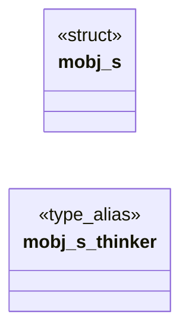

# `progs/doomgeneric/p_mobj.h`

> Source: [progs/doomgeneric/p_mobj.h:1](../../progs/doomgeneric/p_mobj.h#L1) | language `h` | coverage 75.0% | [API index](../index.md)

Copyright(C) 1993-1996 Id Software, Inc.

Copyright(C) 2005-2014 Simon Howard  This program is free software; you can redistribute it and/or modify it under the terms of the GNU General Public License as published by the Free Software Foundation; either version 2 of the License, or (at your option) any later version.  This program is distributed in the hope that it will be useful, but WITHOUT ANY WARRANTY; without even the implied warranty of MERCHANTABILITY or FITNESS FOR A PARTICULAR PURPOSE.  See the GNU General Public License for more details.  DESCRIPTION: Map Objects, MObj, definition and handling.     Basics.  We need the thinker_t stuff.  We need the WAD data structure for Map things,

## Contents

- **Structs:** [`mobj_s`](#mobj_s)
- **Macros:** [`__P_MOBJ__`](#__p_mobj__)

## Type Diagram



## Structs

<a id="mobj_s"></a>

### `mobj_s`

`struct` | [progs/doomgeneric/p_mobj.h:201](../../progs/doomgeneric/p_mobj.h#L201)

```c
typedef struct mobj_s
```

Map Object definition.

**Members**

| Member | Kind | Summary |
|---|---|---|
| [`thinker`](#mobj_s-thinker) | type_alias | Map Object definition. |

<a id="mobj_s-thinker"></a>

#### `mobj_s.thinker`

`type_alias` | [progs/doomgeneric/p_mobj.h:201](../../progs/doomgeneric/p_mobj.h#L201)

```c
typedef struct mobj_s { // List: thinker links. thinker_t thinker;
```

Map Object definition.

---

## Macros

<a id="__p_mobj__"></a>

### `__P_MOBJ__`

`macro` | [progs/doomgeneric/p_mobj.h:21](../../progs/doomgeneric/p_mobj.h#L21)

```c
#define __P_MOBJ__
```

---
