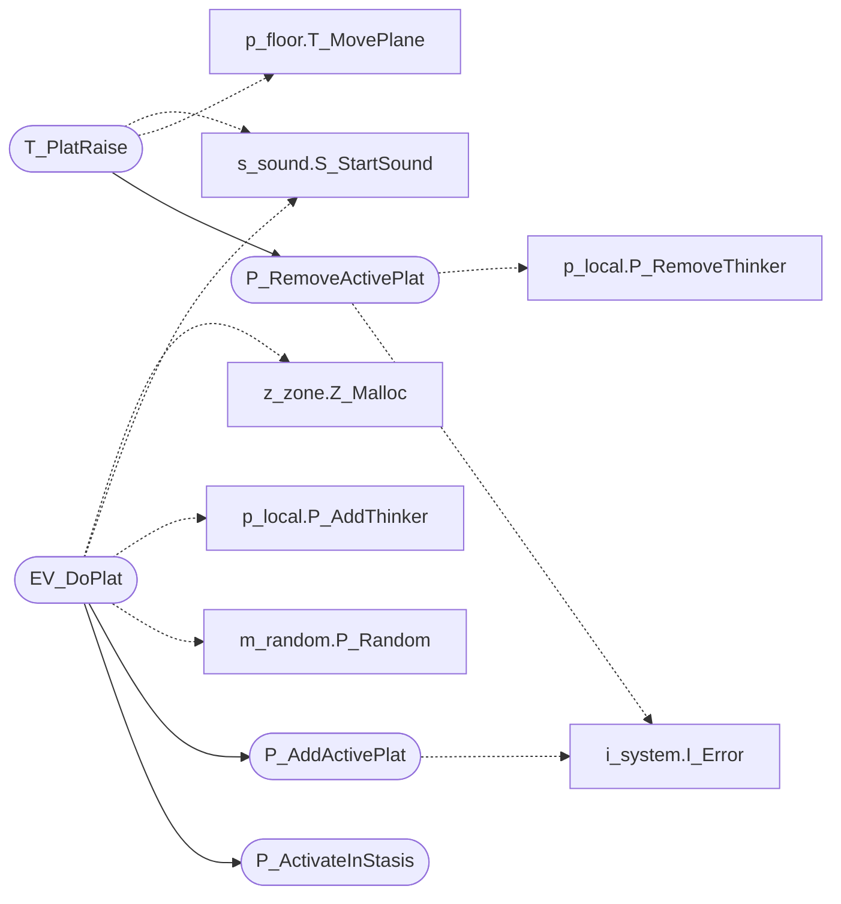

# `progs/doomgeneric/p_plats.c`

> Source: [progs/doomgeneric/p_plats.c:1](../../progs/doomgeneric/p_plats.c#L1) | language `c` | coverage 28.6% | [API index](../index.md)

Copyright(C) 1993-1996 Id Software, Inc.

Copyright(C) 2005-2014 Simon Howard  This program is free software; you can redistribute it and/or modify it under the terms of the GNU General Public License as published by the Free Software Foundation; either version 2 of the License, or (at your option) any later version.  This program is distributed in the hope that it will be useful, but WITHOUT ANY WARRANTY; without even the implied warranty of MERCHANTABILITY or FITNESS FOR A PARTICULAR PURPOSE.  See the GNU General Public License for more details.  DESCRIPTION: Plats (i.e. elevator platforms) code, raising/lowering.       State.

## Contents

- **Functions:** [`T_PlatRaise`](#t_platraise), [`EV_DoPlat`](#ev_doplat), [`P_ActivateInStasis`](#p_activateinstasis), [`EV_StopPlat`](#ev_stopplat), [`P_AddActivePlat`](#p_addactiveplat), [`P_RemoveActivePlat`](#p_removeactiveplat)

## Call Graph

Solid arrows stay in this module, dashed arrows leave it.



## Functions

<a id="t_platraise"></a>

### `T_PlatRaise`

`function` | [progs/doomgeneric/p_plats.c:45](../../progs/doomgeneric/p_plats.c#L45)

```c
void T_PlatRaise(plat_t* plat)
```

Move a plat up and down

**Parameters**

| Name | Type | Default | Description |
|---|---|---|---|
| `plat` | `plat_t*` |  |  |

*Calls:* [`T_MovePlane`](progs.doomgeneric.p_floor.c.md#t_moveplane), [`P_RemoveActivePlat`](#p_removeactiveplat), [`S_StartSound`](progs.doomgeneric.s_sound.h.md#s_startsound)

---

<a id="ev_doplat"></a>

### `EV_DoPlat`

`function` | [progs/doomgeneric/p_plats.c:129](../../progs/doomgeneric/p_plats.c#L129)

```c
int EV_DoPlat ( line_t* line, plattype_e type, int amount )
```

**Parameters**

| Name | Type | Default | Description |
|---|---|---|---|
| `line` | `line_t*` |  |  |
| `type` | `plattype_e` |  |  |
| `amount` | `int` |  |  |

**Returns:** `int`

*Calls:* [`P_Random`](progs.doomgeneric.m_random.h.md#p_random), [`P_AddThinker`](progs.doomgeneric.p_local.h.md#p_addthinker), [`P_ActivateInStasis`](#p_activateinstasis), [`P_AddActivePlat`](#p_addactiveplat), [`S_StartSound`](progs.doomgeneric.s_sound.h.md#s_startsound), [`Z_Malloc`](progs.doomgeneric.z_zone.h.md#z_malloc)

*Called by:* [`P_UseSpecialLine`](progs.doomgeneric.p_switch.c.md#p_usespecialline)

---

<a id="p_activateinstasis"></a>

### `P_ActivateInStasis`

`function` | [progs/doomgeneric/p_plats.c:248](../../progs/doomgeneric/p_plats.c#L248)

```c
void P_ActivateInStasis(int tag)
```

**Parameters**

| Name | Type | Default | Description |
|---|---|---|---|
| `tag` | `int` |  |  |

*Called by:* [`EV_DoPlat`](#ev_doplat)

---

<a id="ev_stopplat"></a>

### `EV_StopPlat`

`function` | [progs/doomgeneric/p_plats.c:263](../../progs/doomgeneric/p_plats.c#L263)

```c
void EV_StopPlat(line_t* line)
```

**Parameters**

| Name | Type | Default | Description |
|---|---|---|---|
| `line` | `line_t*` |  |  |

---

<a id="p_addactiveplat"></a>

### `P_AddActivePlat`

`function` | [progs/doomgeneric/p_plats.c:278](../../progs/doomgeneric/p_plats.c#L278)

```c
void P_AddActivePlat(plat_t* plat)
```

**Parameters**

| Name | Type | Default | Description |
|---|---|---|---|
| `plat` | `plat_t*` |  |  |

*Calls:* [`I_Error`](progs.doomgeneric.i_system.h.md#i_error)

*Called by:* [`EV_DoPlat`](#ev_doplat), [`P_UnArchiveSpecials`](progs.doomgeneric.p_saveg.c.md#p_unarchivespecials)

---

<a id="p_removeactiveplat"></a>

### `P_RemoveActivePlat`

`function` | [progs/doomgeneric/p_plats.c:291](../../progs/doomgeneric/p_plats.c#L291)

```c
void P_RemoveActivePlat(plat_t* plat)
```

**Parameters**

| Name | Type | Default | Description |
|---|---|---|---|
| `plat` | `plat_t*` |  |  |

*Calls:* [`I_Error`](progs.doomgeneric.i_system.h.md#i_error), [`P_RemoveThinker`](progs.doomgeneric.p_local.h.md#p_removethinker)

*Called by:* [`T_PlatRaise`](#t_platraise)

---
