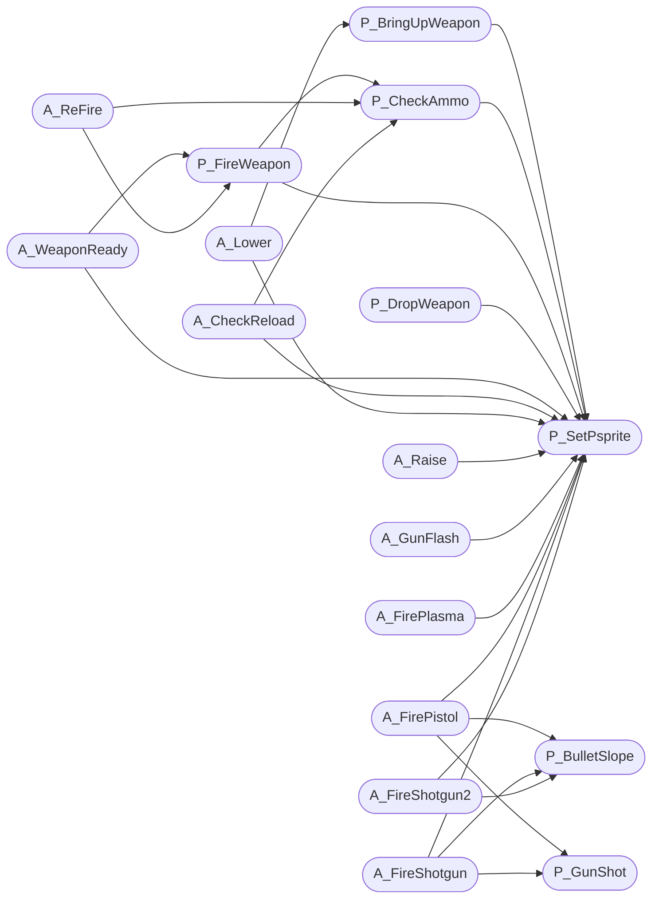

# `progs/doomgeneric/p_pspr.c`

> Source: [progs/doomgeneric/p_pspr.c:1](../../progs/doomgeneric/p_pspr.c#L1) | language `c` | coverage 28.6% | [API index](../index.md)

Copyright(C) 1993-1996 Id Software, Inc.

Copyright(C) 2005-2014 Simon Howard  This program is free software; you can redistribute it and/or modify it under the terms of the GNU General Public License as published by the Free Software Foundation; either version 2 of the License, or (at your option) any later version.  This program is distributed in the hope that it will be useful, but WITHOUT ANY WARRANTY; without even the implied warranty of MERCHANTABILITY or FITNESS FOR A PARTICULAR PURPOSE.  See the GNU General Public License for more details.  DESCRIPTION: Weapon sprite animation, weapon objects. Action functions for weapons.       State.

## Contents

- **Functions:** [`P_SetPsprite`](#p_setpsprite), [`P_CalcSwing`](#p_calcswing), [`P_BringUpWeapon`](#p_bringupweapon), [`P_CheckAmmo`](#p_checkammo), [`P_FireWeapon`](#p_fireweapon), [`P_DropWeapon`](#p_dropweapon), [`A_WeaponReady`](#a_weaponready), [`A_ReFire`](#a_refire), [`A_CheckReload`](#a_checkreload), [`A_Lower`](#a_lower), [`A_Raise`](#a_raise), [`A_GunFlash`](#a_gunflash), [`A_Punch`](#a_punch), [`A_Saw`](#a_saw), [`A_FireMissile`](#a_firemissile), [`A_FireBFG`](#a_firebfg), [`A_FirePlasma`](#a_fireplasma), [`P_BulletSlope`](#p_bulletslope), [`P_GunShot`](#p_gunshot), [`A_FirePistol`](#a_firepistol), [`A_FireShotgun`](#a_fireshotgun), [`A_FireShotgun2`](#a_fireshotgun2), [`A_FireCGun`](#a_firecgun), [`A_Light0`](#a_light0), [`A_Light1`](#a_light1), [`A_Light2`](#a_light2), [`A_BFGSpray`](#a_bfgspray), [`A_BFGsound`](#a_bfgsound), [`P_SetupPsprites`](#p_setuppsprites), [`P_MovePsprites`](#p_movepsprites)
- **Macros:** [`LOWERSPEED`](#lowerspeed), [`RAISESPEED`](#raisespeed), [`WEAPONBOTTOM`](#weaponbottom), [`WEAPONTOP`](#weapontop)

## Call Graph

Solid arrows stay in this module, dashed arrows leave it.



## Functions

<a id="p_setpsprite"></a>

### `P_SetPsprite`

`function` | [progs/doomgeneric/p_pspr.c:50](../../progs/doomgeneric/p_pspr.c#L50)

```c
void P_SetPsprite ( player_t* player, int position, statenum_t stnum )
```

**Parameters**

| Name | Type | Default | Description |
|---|---|---|---|
| `player` | `player_t*` |  |  |
| `position` | `int` |  |  |
| `stnum` | `statenum_t` |  |  |

*Called by:* [`A_CheckReload`](#a_checkreload), [`A_FireCGun`](#a_firecgun), [`A_FirePistol`](#a_firepistol), [`A_FirePlasma`](#a_fireplasma), [`A_FireShotgun`](#a_fireshotgun), [`A_FireShotgun2`](#a_fireshotgun2), [`A_GunFlash`](#a_gunflash), [`A_Lower`](#a_lower), [`A_Raise`](#a_raise), [`A_WeaponReady`](#a_weaponready), [`P_BringUpWeapon`](#p_bringupweapon), [`P_CheckAmmo`](#p_checkammo) and 3 more

---

<a id="p_calcswing"></a>

### `P_CalcSwing`

`function` | [progs/doomgeneric/p_pspr.c:103](../../progs/doomgeneric/p_pspr.c#L103)

```c
void P_CalcSwing (player_t* player)
```

**Parameters**

| Name | Type | Default | Description |
|---|---|---|---|
| `player` | `player_t*` |  |  |

---

<a id="p_bringupweapon"></a>

### `P_BringUpWeapon`

`function` | [progs/doomgeneric/p_pspr.c:129](../../progs/doomgeneric/p_pspr.c#L129)

```c
void P_BringUpWeapon (player_t* player)
```

P_BringUpWeapon Starts bringing the pending weapon up from the bottom of the screen.

Uses player

**Parameters**

| Name | Type | Default | Description |
|---|---|---|---|
| `player` | `player_t*` |  |  |

*Calls:* [`P_SetPsprite`](#p_setpsprite), [`S_StartSound`](progs.doomgeneric.s_sound.h.md#s_startsound)

*Called by:* [`A_Lower`](#a_lower), [`P_SetupPsprites`](#p_setuppsprites)

---

<a id="p_checkammo"></a>

### `P_CheckAmmo`

`function` | [progs/doomgeneric/p_pspr.c:152](../../progs/doomgeneric/p_pspr.c#L152)

```c
boolean P_CheckAmmo (player_t* player)
```

P_CheckAmmo Returns true if there is enough ammo to shoot.

If not, selects the next weapon to use.

**Parameters**

| Name | Type | Default | Description |
|---|---|---|---|
| `player` | `player_t*` |  |  |

**Returns:** `boolean`

*Calls:* [`P_SetPsprite`](#p_setpsprite)

*Called by:* [`A_CheckReload`](#a_checkreload), [`A_ReFire`](#a_refire), [`P_FireWeapon`](#p_fireweapon)

---

<a id="p_fireweapon"></a>

### `P_FireWeapon`

`function` | [progs/doomgeneric/p_pspr.c:237](../../progs/doomgeneric/p_pspr.c#L237)

```c
void P_FireWeapon (player_t* player)
```

P_FireWeapon.

**Parameters**

| Name | Type | Default | Description |
|---|---|---|---|
| `player` | `player_t*` |  |  |

*Calls:* [`P_NoiseAlert`](progs.doomgeneric.p_local.h.md#p_noisealert), [`P_SetMobjState`](progs.doomgeneric.p_mobj.c.md#p_setmobjstate), [`P_CheckAmmo`](#p_checkammo), [`P_SetPsprite`](#p_setpsprite)

*Called by:* [`A_ReFire`](#a_refire), [`A_WeaponReady`](#a_weaponready)

---

<a id="p_dropweapon"></a>

### `P_DropWeapon`

`function` | [progs/doomgeneric/p_pspr.c:256](../../progs/doomgeneric/p_pspr.c#L256)

```c
void P_DropWeapon (player_t* player)
```

P_DropWeapon Player died, so put the weapon away.

**Parameters**

| Name | Type | Default | Description |
|---|---|---|---|
| `player` | `player_t*` |  |  |

*Calls:* [`P_SetPsprite`](#p_setpsprite)

---

<a id="a_weaponready"></a>

### `A_WeaponReady`

`function` | [progs/doomgeneric/p_pspr.c:273](../../progs/doomgeneric/p_pspr.c#L273)

```c
void A_WeaponReady ( player_t* player, pspdef_t* psp )
```

**Parameters**

| Name | Type | Default | Description |
|---|---|---|---|
| `player` | `player_t*` |  |  |
| `psp` | `pspdef_t*` |  |  |

*Calls:* [`P_SetMobjState`](progs.doomgeneric.p_mobj.c.md#p_setmobjstate), [`P_FireWeapon`](#p_fireweapon), [`P_SetPsprite`](#p_setpsprite), [`S_StartSound`](progs.doomgeneric.s_sound.h.md#s_startsound)

---

<a id="a_refire"></a>

### `A_ReFire`

`function` | [progs/doomgeneric/p_pspr.c:334](../../progs/doomgeneric/p_pspr.c#L334)

```c
void A_ReFire ( player_t* player, pspdef_t* psp )
```

A_ReFire The player can re-fire the weapon without lowering it entirely.

**Parameters**

| Name | Type | Default | Description |
|---|---|---|---|
| `player` | `player_t*` |  |  |
| `psp` | `pspdef_t*` |  |  |

*Calls:* [`P_CheckAmmo`](#p_checkammo), [`P_FireWeapon`](#p_fireweapon)

---

<a id="a_checkreload"></a>

### `A_CheckReload`

`function` | [progs/doomgeneric/p_pspr.c:357](../../progs/doomgeneric/p_pspr.c#L357)

```c
void A_CheckReload ( player_t* player, pspdef_t* psp )
```

**Parameters**

| Name | Type | Default | Description |
|---|---|---|---|
| `player` | `player_t*` |  |  |
| `psp` | `pspdef_t*` |  |  |

*Calls:* [`P_CheckAmmo`](#p_checkammo), [`P_SetPsprite`](#p_setpsprite)

---

<a id="a_lower"></a>

### `A_Lower`

`function` | [progs/doomgeneric/p_pspr.c:376](../../progs/doomgeneric/p_pspr.c#L376)

```c
void A_Lower ( player_t* player, pspdef_t* psp )
```

**Parameters**

| Name | Type | Default | Description |
|---|---|---|---|
| `player` | `player_t*` |  |  |
| `psp` | `pspdef_t*` |  |  |

*Calls:* [`P_BringUpWeapon`](#p_bringupweapon), [`P_SetPsprite`](#p_setpsprite)

---

<a id="a_raise"></a>

### `A_Raise`

`function` | [progs/doomgeneric/p_pspr.c:414](../../progs/doomgeneric/p_pspr.c#L414)

```c
void A_Raise ( player_t* player, pspdef_t* psp )
```

**Parameters**

| Name | Type | Default | Description |
|---|---|---|---|
| `player` | `player_t*` |  |  |
| `psp` | `pspdef_t*` |  |  |

*Calls:* [`P_SetPsprite`](#p_setpsprite)

---

<a id="a_gunflash"></a>

### `A_GunFlash`

`function` | [progs/doomgeneric/p_pspr.c:440](../../progs/doomgeneric/p_pspr.c#L440)

```c
void A_GunFlash ( player_t* player, pspdef_t* psp )
```

**Parameters**

| Name | Type | Default | Description |
|---|---|---|---|
| `player` | `player_t*` |  |  |
| `psp` | `pspdef_t*` |  |  |

*Calls:* [`P_SetMobjState`](progs.doomgeneric.p_mobj.c.md#p_setmobjstate), [`P_SetPsprite`](#p_setpsprite)

---

<a id="a_punch"></a>

### `A_Punch`

`function` | [progs/doomgeneric/p_pspr.c:459](../../progs/doomgeneric/p_pspr.c#L459)

```c
void A_Punch ( player_t* player, pspdef_t* psp )
```

**Parameters**

| Name | Type | Default | Description |
|---|---|---|---|
| `player` | `player_t*` |  |  |
| `psp` | `pspdef_t*` |  |  |

*Calls:* [`P_Random`](progs.doomgeneric.m_random.h.md#p_random), [`P_AimLineAttack`](progs.doomgeneric.p_local.h.md#p_aimlineattack), [`P_LineAttack`](progs.doomgeneric.p_local.h.md#p_lineattack), [`S_StartSound`](progs.doomgeneric.s_sound.h.md#s_startsound)

---

<a id="a_saw"></a>

### `A_Saw`

`function` | [progs/doomgeneric/p_pspr.c:493](../../progs/doomgeneric/p_pspr.c#L493)

```c
void A_Saw ( player_t* player, pspdef_t* psp )
```

**Parameters**

| Name | Type | Default | Description |
|---|---|---|---|
| `player` | `player_t*` |  |  |
| `psp` | `pspdef_t*` |  |  |

*Calls:* [`P_Random`](progs.doomgeneric.m_random.h.md#p_random), [`P_AimLineAttack`](progs.doomgeneric.p_local.h.md#p_aimlineattack), [`P_LineAttack`](progs.doomgeneric.p_local.h.md#p_lineattack), [`S_StartSound`](progs.doomgeneric.s_sound.h.md#s_startsound)

---

<a id="a_firemissile"></a>

### `A_FireMissile`

`function` | [progs/doomgeneric/p_pspr.c:559](../../progs/doomgeneric/p_pspr.c#L559)

```c
void A_FireMissile ( player_t* player, pspdef_t* psp )
```

**Parameters**

| Name | Type | Default | Description |
|---|---|---|---|
| `player` | `player_t*` |  |  |
| `psp` | `pspdef_t*` |  |  |

*Calls:* [`P_SpawnPlayerMissile`](progs.doomgeneric.p_local.h.md#p_spawnplayermissile)

---

<a id="a_firebfg"></a>

### `A_FireBFG`

`function` | [progs/doomgeneric/p_pspr.c:572](../../progs/doomgeneric/p_pspr.c#L572)

```c
void A_FireBFG ( player_t* player, pspdef_t* psp )
```

**Parameters**

| Name | Type | Default | Description |
|---|---|---|---|
| `player` | `player_t*` |  |  |
| `psp` | `pspdef_t*` |  |  |

*Calls:* [`P_SpawnPlayerMissile`](progs.doomgeneric.p_local.h.md#p_spawnplayermissile)

---

<a id="a_fireplasma"></a>

### `A_FirePlasma`

`function` | [progs/doomgeneric/p_pspr.c:587](../../progs/doomgeneric/p_pspr.c#L587)

```c
void A_FirePlasma ( player_t* player, pspdef_t* psp )
```

**Parameters**

| Name | Type | Default | Description |
|---|---|---|---|
| `player` | `player_t*` |  |  |
| `psp` | `pspdef_t*` |  |  |

*Calls:* [`P_Random`](progs.doomgeneric.m_random.h.md#p_random), [`P_SpawnPlayerMissile`](progs.doomgeneric.p_local.h.md#p_spawnplayermissile), [`P_SetPsprite`](#p_setpsprite)

---

<a id="p_bulletslope"></a>

### `P_BulletSlope`

`function` | [progs/doomgeneric/p_pspr.c:610](../../progs/doomgeneric/p_pspr.c#L610)

```c
void P_BulletSlope (mobj_t* mo)
```

**Parameters**

| Name | Type | Default | Description |
|---|---|---|---|
| `mo` | `mobj_t*` |  |  |

*Calls:* [`P_AimLineAttack`](progs.doomgeneric.p_local.h.md#p_aimlineattack)

*Called by:* [`A_FireCGun`](#a_firecgun), [`A_FirePistol`](#a_firepistol), [`A_FireShotgun`](#a_fireshotgun), [`A_FireShotgun2`](#a_fireshotgun2)

---

<a id="p_gunshot"></a>

### `P_GunShot`

`function` | [progs/doomgeneric/p_pspr.c:635](../../progs/doomgeneric/p_pspr.c#L635)

```c
void P_GunShot ( mobj_t* mo, boolean accurate )
```

**Parameters**

| Name | Type | Default | Description |
|---|---|---|---|
| `mo` | `mobj_t*` |  |  |
| `accurate` | `boolean` |  |  |

*Calls:* [`P_Random`](progs.doomgeneric.m_random.h.md#p_random), [`P_LineAttack`](progs.doomgeneric.p_local.h.md#p_lineattack)

*Called by:* [`A_FireCGun`](#a_firecgun), [`A_FirePistol`](#a_firepistol), [`A_FireShotgun`](#a_fireshotgun)

---

<a id="a_firepistol"></a>

### `A_FirePistol`

`function` | [progs/doomgeneric/p_pspr.c:656](../../progs/doomgeneric/p_pspr.c#L656)

```c
void A_FirePistol ( player_t* player, pspdef_t* psp )
```

**Parameters**

| Name | Type | Default | Description |
|---|---|---|---|
| `player` | `player_t*` |  |  |
| `psp` | `pspdef_t*` |  |  |

*Calls:* [`P_SetMobjState`](progs.doomgeneric.p_mobj.c.md#p_setmobjstate), [`P_BulletSlope`](#p_bulletslope), [`P_GunShot`](#p_gunshot), [`P_SetPsprite`](#p_setpsprite), [`S_StartSound`](progs.doomgeneric.s_sound.h.md#s_startsound)

---

<a id="a_fireshotgun"></a>

### `A_FireShotgun`

`function` | [progs/doomgeneric/p_pspr.c:678](../../progs/doomgeneric/p_pspr.c#L678)

```c
void A_FireShotgun ( player_t* player, pspdef_t* psp )
```

**Parameters**

| Name | Type | Default | Description |
|---|---|---|---|
| `player` | `player_t*` |  |  |
| `psp` | `pspdef_t*` |  |  |

*Calls:* [`P_SetMobjState`](progs.doomgeneric.p_mobj.c.md#p_setmobjstate), [`P_BulletSlope`](#p_bulletslope), [`P_GunShot`](#p_gunshot), [`P_SetPsprite`](#p_setpsprite), [`S_StartSound`](progs.doomgeneric.s_sound.h.md#s_startsound)

---

<a id="a_fireshotgun2"></a>

### `A_FireShotgun2`

`function` | [progs/doomgeneric/p_pspr.c:705](../../progs/doomgeneric/p_pspr.c#L705)

```c
void A_FireShotgun2 ( player_t* player, pspdef_t* psp )
```

**Parameters**

| Name | Type | Default | Description |
|---|---|---|---|
| `player` | `player_t*` |  |  |
| `psp` | `pspdef_t*` |  |  |

*Calls:* [`P_Random`](progs.doomgeneric.m_random.h.md#p_random), [`P_LineAttack`](progs.doomgeneric.p_local.h.md#p_lineattack), [`P_SetMobjState`](progs.doomgeneric.p_mobj.c.md#p_setmobjstate), [`P_BulletSlope`](#p_bulletslope), [`P_SetPsprite`](#p_setpsprite), [`S_StartSound`](progs.doomgeneric.s_sound.h.md#s_startsound)

---

<a id="a_firecgun"></a>

### `A_FireCGun`

`function` | [progs/doomgeneric/p_pspr.c:742](../../progs/doomgeneric/p_pspr.c#L742)

```c
void A_FireCGun ( player_t* player, pspdef_t* psp )
```

**Parameters**

| Name | Type | Default | Description |
|---|---|---|---|
| `player` | `player_t*` |  |  |
| `psp` | `pspdef_t*` |  |  |

*Calls:* [`P_SetMobjState`](progs.doomgeneric.p_mobj.c.md#p_setmobjstate), [`P_BulletSlope`](#p_bulletslope), [`P_GunShot`](#p_gunshot), [`P_SetPsprite`](#p_setpsprite), [`S_StartSound`](progs.doomgeneric.s_sound.h.md#s_startsound)

---

<a id="a_light0"></a>

### `A_Light0`

`function` | [progs/doomgeneric/p_pspr.c:770](../../progs/doomgeneric/p_pspr.c#L770)

```c
void A_Light0 (player_t *player, pspdef_t *psp)
```

?

**Parameters**

| Name | Type | Default | Description |
|---|---|---|---|
| `player` | `player_t *` |  |  |
| `psp` | `pspdef_t *` |  |  |

---

<a id="a_light1"></a>

### `A_Light1`

`function` | [progs/doomgeneric/p_pspr.c:775](../../progs/doomgeneric/p_pspr.c#L775)

```c
void A_Light1 (player_t *player, pspdef_t *psp)
```

**Parameters**

| Name | Type | Default | Description |
|---|---|---|---|
| `player` | `player_t *` |  |  |
| `psp` | `pspdef_t *` |  |  |

---

<a id="a_light2"></a>

### `A_Light2`

`function` | [progs/doomgeneric/p_pspr.c:780](../../progs/doomgeneric/p_pspr.c#L780)

```c
void A_Light2 (player_t *player, pspdef_t *psp)
```

**Parameters**

| Name | Type | Default | Description |
|---|---|---|---|
| `player` | `player_t *` |  |  |
| `psp` | `pspdef_t *` |  |  |

---

<a id="a_bfgspray"></a>

### `A_BFGSpray`

`function` | [progs/doomgeneric/p_pspr.c:790](../../progs/doomgeneric/p_pspr.c#L790)

```c
void A_BFGSpray (mobj_t* mo)
```

A_BFGSpray Spawn a BFG explosion on every monster in view

**Parameters**

| Name | Type | Default | Description |
|---|---|---|---|
| `mo` | `mobj_t*` |  |  |

*Calls:* [`P_Random`](progs.doomgeneric.m_random.h.md#p_random), [`P_AimLineAttack`](progs.doomgeneric.p_local.h.md#p_aimlineattack), [`P_DamageMobj`](progs.doomgeneric.p_local.h.md#p_damagemobj), [`P_SpawnMobj`](progs.doomgeneric.p_local.h.md#p_spawnmobj)

---

<a id="a_bfgsound"></a>

### `A_BFGsound`

`function` | [progs/doomgeneric/p_pspr.c:827](../../progs/doomgeneric/p_pspr.c#L827)

```c
void A_BFGsound ( player_t* player, pspdef_t* psp )
```

**Parameters**

| Name | Type | Default | Description |
|---|---|---|---|
| `player` | `player_t*` |  |  |
| `psp` | `pspdef_t*` |  |  |

*Calls:* [`S_StartSound`](progs.doomgeneric.s_sound.h.md#s_startsound)

---

<a id="p_setuppsprites"></a>

### `P_SetupPsprites`

`function` | [progs/doomgeneric/p_pspr.c:840](../../progs/doomgeneric/p_pspr.c#L840)

```c
void P_SetupPsprites (player_t* player)
```

P_SetupPsprites Called at start of level for each player.

**Parameters**

| Name | Type | Default | Description |
|---|---|---|---|
| `player` | `player_t*` |  |  |

*Calls:* [`P_BringUpWeapon`](#p_bringupweapon)

---

<a id="p_movepsprites"></a>

### `P_MovePsprites`

`function` | [progs/doomgeneric/p_pspr.c:860](../../progs/doomgeneric/p_pspr.c#L860)

```c
void P_MovePsprites (player_t* player)
```

P_MovePsprites Called every tic by player thinking routine.

**Parameters**

| Name | Type | Default | Description |
|---|---|---|---|
| `player` | `player_t*` |  |  |

*Calls:* [`P_SetPsprite`](#p_setpsprite)

---

## Macros

<a id="lowerspeed"></a>

### `LOWERSPEED`

`macro` | [progs/doomgeneric/p_pspr.c:38](../../progs/doomgeneric/p_pspr.c#L38)

```c
#define LOWERSPEED
```

---

<a id="raisespeed"></a>

### `RAISESPEED`

`macro` | [progs/doomgeneric/p_pspr.c:39](../../progs/doomgeneric/p_pspr.c#L39)

```c
#define RAISESPEED
```

---

<a id="weaponbottom"></a>

### `WEAPONBOTTOM`

`macro` | [progs/doomgeneric/p_pspr.c:41](../../progs/doomgeneric/p_pspr.c#L41)

```c
#define WEAPONBOTTOM
```

---

<a id="weapontop"></a>

### `WEAPONTOP`

`macro` | [progs/doomgeneric/p_pspr.c:42](../../progs/doomgeneric/p_pspr.c#L42)

```c
#define WEAPONTOP
```

---
