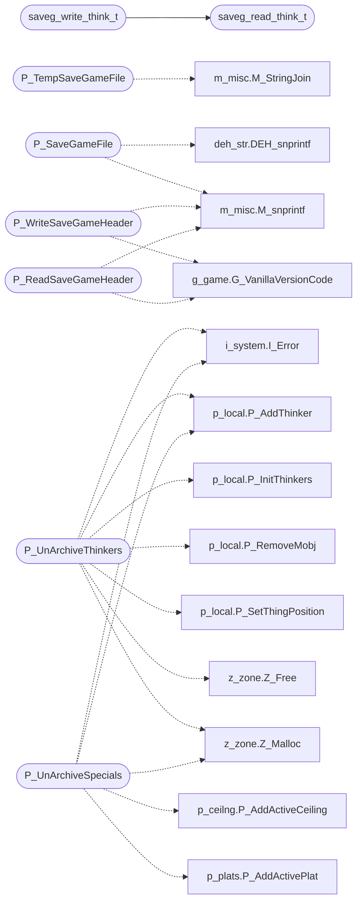

# `progs/doomgeneric/p_saveg.c`

> Source: [progs/doomgeneric/p_saveg.c:1](../../progs/doomgeneric/p_saveg.c#L1) | language `c` | coverage 42.9% | [API index](../index.md)

Copyright(C) 1993-1996 Id Software, Inc.

Copyright(C) 2005-2014 Simon Howard  This program is free software; you can redistribute it and/or modify it under the terms of the GNU General Public License as published by the Free Software Foundation; either version 2 of the License, or (at your option) any later version.  This program is distributed in the hope that it will be useful, but WITHOUT ANY WARRANTY; without even the implied warranty of MERCHANTABILITY or FITNESS FOR A PARTICULAR PURPOSE.  See the GNU General Public License for more details.  DESCRIPTION: Archiving: SaveGame I/O.      State.

## Contents

- **Functions:** [`P_TempSaveGameFile`](#p_tempsavegamefile), [`P_SaveGameFile`](#p_savegamefile), [`P_WriteSaveGameHeader`](#p_writesavegameheader), [`P_ReadSaveGameHeader`](#p_readsavegameheader), [`P_ReadSaveGameEOF`](#p_readsavegameeof), [`P_WriteSaveGameEOF`](#p_writesavegameeof), [`P_ArchivePlayers`](#p_archiveplayers), [`P_UnArchivePlayers`](#p_unarchiveplayers), [`P_ArchiveWorld`](#p_archiveworld), [`P_UnArchiveWorld`](#p_unarchiveworld), [`P_ArchiveThinkers`](#p_archivethinkers), [`P_UnArchiveThinkers`](#p_unarchivethinkers), [`P_ArchiveSpecials`](#p_archivespecials), [`P_UnArchiveSpecials`](#p_unarchivespecials)
- **Macros:** [`SAVEGAME_EOF`](#savegame_eof), [`VERSIONSIZE`](#versionsize), [`saveg_read_enum`](#saveg_read_enum), [`saveg_write_enum`](#saveg_write_enum), [`saveg_read_think_t`](#saveg_read_think_t), [`saveg_write_think_t`](#saveg_write_think_t)

## Call Graph

Solid arrows stay in this module, dashed arrows leave it.



## Functions

<a id="p_tempsavegamefile"></a>

### `P_TempSaveGameFile`

`function` | [progs/doomgeneric/p_saveg.c:47](../../progs/doomgeneric/p_saveg.c#L47)

```c
char *P_TempSaveGameFile(void)
```

**Returns:** `char *`

*Calls:* [`M_StringJoin`](progs.doomgeneric.m_misc.h.md#m_stringjoin)

---

<a id="p_savegamefile"></a>

### `P_SaveGameFile`

`function` | [progs/doomgeneric/p_saveg.c:61](../../progs/doomgeneric/p_saveg.c#L61)

```c
char *P_SaveGameFile(int slot)
```

**Parameters**

| Name | Type | Default | Description |
|---|---|---|---|
| `slot` | `int` |  |  |

**Returns:** `char *`

*Calls:* [`DEH_snprintf`](progs.doomgeneric.deh_str.h.md#deh_snprintf), [`M_snprintf`](progs.doomgeneric.m_misc.h.md#m_snprintf)

---

<a id="p_writesavegameheader"></a>

### `P_WriteSaveGameHeader`

`function` | [progs/doomgeneric/p_saveg.c:1347](../../progs/doomgeneric/p_saveg.c#L1347)

```c
void P_WriteSaveGameHeader(char *description)
```

**Parameters**

| Name | Type | Default | Description |
|---|---|---|---|
| `description` | `char *` |  |  |

*Calls:* [`G_VanillaVersionCode`](progs.doomgeneric.g_game.h.md#g_vanillaversioncode), [`M_snprintf`](progs.doomgeneric.m_misc.h.md#m_snprintf)

---

<a id="p_readsavegameheader"></a>

### `P_ReadSaveGameHeader`

`function` | [progs/doomgeneric/p_saveg.c:1379](../../progs/doomgeneric/p_saveg.c#L1379)

```c
boolean P_ReadSaveGameHeader(void)
```

**Returns:** `boolean`

*Calls:* [`G_VanillaVersionCode`](progs.doomgeneric.g_game.h.md#g_vanillaversioncode), [`M_snprintf`](progs.doomgeneric.m_misc.h.md#m_snprintf)

*Called by:* [`G_DoLoadGame`](progs.doomgeneric.g_game.c.md#g_doloadgame)

---

<a id="p_readsavegameeof"></a>

### `P_ReadSaveGameEOF`

`function` | [progs/doomgeneric/p_saveg.c:1419](../../progs/doomgeneric/p_saveg.c#L1419)

```c
boolean P_ReadSaveGameEOF(void)
```

**Returns:** `boolean`

*Called by:* [`G_DoLoadGame`](progs.doomgeneric.g_game.c.md#g_doloadgame)

---

<a id="p_writesavegameeof"></a>

### `P_WriteSaveGameEOF`

`function` | [progs/doomgeneric/p_saveg.c:1432](../../progs/doomgeneric/p_saveg.c#L1432)

```c
void P_WriteSaveGameEOF(void)
```

---

<a id="p_archiveplayers"></a>

### `P_ArchivePlayers`

`function` | [progs/doomgeneric/p_saveg.c:1440](../../progs/doomgeneric/p_saveg.c#L1440)

```c
void P_ArchivePlayers (void)
```

P_ArchivePlayers

---

<a id="p_unarchiveplayers"></a>

### `P_UnArchivePlayers`

`function` | [progs/doomgeneric/p_saveg.c:1460](../../progs/doomgeneric/p_saveg.c#L1460)

```c
void P_UnArchivePlayers (void)
```

P_UnArchivePlayers

---

<a id="p_archiveworld"></a>

### `P_ArchiveWorld`

`function` | [progs/doomgeneric/p_saveg.c:1484](../../progs/doomgeneric/p_saveg.c#L1484)

```c
void P_ArchiveWorld (void)
```

P_ArchiveWorld

---

<a id="p_unarchiveworld"></a>

### `P_UnArchiveWorld`

`function` | [progs/doomgeneric/p_saveg.c:1532](../../progs/doomgeneric/p_saveg.c#L1532)

```c
void P_UnArchiveWorld (void)
```

P_UnArchiveWorld

---

<a id="p_archivethinkers"></a>

### `P_ArchiveThinkers`

`function` | [progs/doomgeneric/p_saveg.c:1592](../../progs/doomgeneric/p_saveg.c#L1592)

```c
void P_ArchiveThinkers (void)
```

P_ArchiveThinkers

---

<a id="p_unarchivethinkers"></a>

### `P_UnArchiveThinkers`

`function` | [progs/doomgeneric/p_saveg.c:1620](../../progs/doomgeneric/p_saveg.c#L1620)

```c
void P_UnArchiveThinkers (void)
```

P_UnArchiveThinkers

*Calls:* [`I_Error`](progs.doomgeneric.i_system.h.md#i_error), [`P_AddThinker`](progs.doomgeneric.p_local.h.md#p_addthinker), [`P_InitThinkers`](progs.doomgeneric.p_local.h.md#p_initthinkers), [`P_RemoveMobj`](progs.doomgeneric.p_local.h.md#p_removemobj), [`P_SetThingPosition`](progs.doomgeneric.p_local.h.md#p_setthingposition), [`Z_Free`](progs.doomgeneric.z_zone.h.md#z_free), [`Z_Malloc`](progs.doomgeneric.z_zone.h.md#z_malloc)

---

<a id="p_archivespecials"></a>

### `P_ArchiveSpecials`

`function` | [progs/doomgeneric/p_saveg.c:1704](../../progs/doomgeneric/p_saveg.c#L1704)

```c
void P_ArchiveSpecials (void)
```

Things to handle:

T_MoveCeiling, (ceiling_t: sector_t * swizzle), - active list
T_VerticalDoor, (vldoor_t: sector_t * swizzle),
T_MoveFloor, (floormove_t: sector_t * swizzle),
T_LightFlash, (lightflash_t: sector_t * swizzle),
T_StrobeFlash, (strobe_t: sector_t *),
T_Glow, (glow_t: sector_t *),
T_PlatRaise, (plat_t: sector_t *), - active list

---

<a id="p_unarchivespecials"></a>

### `P_UnArchiveSpecials`

`function` | [progs/doomgeneric/p_saveg.c:1793](../../progs/doomgeneric/p_saveg.c#L1793)

```c
void P_UnArchiveSpecials (void)
```

P_UnArchiveSpecials

*Calls:* [`I_Error`](progs.doomgeneric.i_system.h.md#i_error), [`P_AddActiveCeiling`](progs.doomgeneric.p_ceilng.c.md#p_addactiveceiling), [`P_AddThinker`](progs.doomgeneric.p_local.h.md#p_addthinker), [`P_AddActivePlat`](progs.doomgeneric.p_plats.c.md#p_addactiveplat), [`Z_Malloc`](progs.doomgeneric.z_zone.h.md#z_malloc)

---

## Macros

<a id="savegame_eof"></a>

### `SAVEGAME_EOF`

`macro` | [progs/doomgeneric/p_saveg.c:36](../../progs/doomgeneric/p_saveg.c#L36)

```c
#define SAVEGAME_EOF
```

---

<a id="versionsize"></a>

### `VERSIONSIZE`

`macro` | [progs/doomgeneric/p_saveg.c:37](../../progs/doomgeneric/p_saveg.c#L37)

```c
#define VERSIONSIZE
```

---

<a id="saveg_read_enum"></a>

### `saveg_read_enum`

`macro` | [progs/doomgeneric/p_saveg.c:197](../../progs/doomgeneric/p_saveg.c#L197)

```c
#define saveg_read_enum
```

---

<a id="saveg_write_enum"></a>

### `saveg_write_enum`

`macro` | [progs/doomgeneric/p_saveg.c:198](../../progs/doomgeneric/p_saveg.c#L198)

```c
#define saveg_write_enum
```

---

<a id="saveg_read_think_t"></a>

### `saveg_read_think_t`

`macro` | [progs/doomgeneric/p_saveg.c:266](../../progs/doomgeneric/p_saveg.c#L266)

```c
#define saveg_read_think_t
```

*Called by:* [`saveg_write_think_t`](#saveg_write_think_t)

---

<a id="saveg_write_think_t"></a>

### `saveg_write_think_t`

`macro` | [progs/doomgeneric/p_saveg.c:267](../../progs/doomgeneric/p_saveg.c#L267)

```c
#define saveg_write_think_t
```

*Calls:* [`saveg_read_think_t`](#saveg_read_think_t)

---
