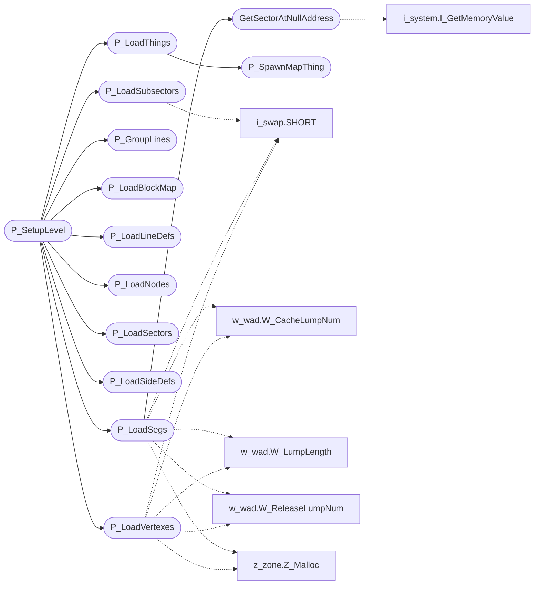

# `progs/doomgeneric/p_setup.c`

> Source: [progs/doomgeneric/p_setup.c:1](../../progs/doomgeneric/p_setup.c#L1) | language `c` | coverage 87.5% | [API index](../index.md)

Copyright(C) 1993-1996 Id Software, Inc.

Copyright(C) 2005-2014 Simon Howard  This program is free software; you can redistribute it and/or modify it under the terms of the GNU General Public License as published by the Free Software Foundation; either version 2 of the License, or (at your option) any later version.  This program is distributed in the hope that it will be useful, but WITHOUT ANY WARRANTY; without even the implied warranty of MERCHANTABILITY or FITNESS FOR A PARTICULAR PURPOSE.  See the GNU General Public License for more details.  DESCRIPTION: Do all the WAD I/O, get map description, set up initial state and misc. LUTs.

## Contents

- **Functions:** [`P_SpawnMapThing`](#p_spawnmapthing), [`P_LoadVertexes`](#p_loadvertexes), [`GetSectorAtNullAddress`](#getsectoratnulladdress), [`P_LoadSegs`](#p_loadsegs), [`P_LoadSubsectors`](#p_loadsubsectors), [`P_LoadSectors`](#p_loadsectors), [`P_LoadNodes`](#p_loadnodes), [`P_LoadThings`](#p_loadthings), [`P_LoadLineDefs`](#p_loadlinedefs), [`P_LoadSideDefs`](#p_loadsidedefs), [`P_LoadBlockMap`](#p_loadblockmap), [`P_GroupLines`](#p_grouplines), [`P_SetupLevel`](#p_setuplevel), [`P_Init`](#p_init)
- **Macros:** [`MAX_DEATHMATCH_STARTS`](#max_deathmatch_starts)

## Call Graph

Solid arrows stay in this module, dashed arrows leave it.



## Functions

<a id="p_spawnmapthing"></a>

### `P_SpawnMapThing`

`function` | [progs/doomgeneric/p_setup.c:44](../../progs/doomgeneric/p_setup.c#L44)

```c
void P_SpawnMapThing (mapthing_t* mthing);
```

**Parameters**

| Name | Type | Default | Description |
|---|---|---|---|
| `mthing` | `mapthing_t*` |  |  |

*Called by:* [`P_LoadThings`](#p_loadthings)

---

<a id="p_loadvertexes"></a>

### `P_LoadVertexes`

`function` | [progs/doomgeneric/p_setup.c:118](../../progs/doomgeneric/p_setup.c#L118)

```c
void P_LoadVertexes (int lump)
```

P_LoadVertexes

**Parameters**

| Name | Type | Default | Description |
|---|---|---|---|
| `lump` | `int` |  |  |

*Calls:* [`SHORT`](progs.doomgeneric.i_swap.h.md#short), [`W_CacheLumpNum`](progs.doomgeneric.w_wad.h.md#w_cachelumpnum), [`W_LumpLength`](progs.doomgeneric.w_wad.h.md#w_lumplength), [`W_ReleaseLumpNum`](progs.doomgeneric.w_wad.h.md#w_releaselumpnum), [`Z_Malloc`](progs.doomgeneric.z_zone.h.md#z_malloc)

*Called by:* [`P_SetupLevel`](#p_setuplevel)

---

<a id="getsectoratnulladdress"></a>

### `GetSectorAtNullAddress`

`function` | [progs/doomgeneric/p_setup.c:153](../../progs/doomgeneric/p_setup.c#L153)

```c
sector_t* GetSectorAtNullAddress(void)
```

GetSectorAtNullAddress

**Returns:** `sector_t*`

*Calls:* [`I_GetMemoryValue`](progs.doomgeneric.i_system.c.md#i_getmemoryvalue)

*Called by:* [`P_LoadSegs`](#p_loadsegs)

---

<a id="p_loadsegs"></a>

### `P_LoadSegs`

`function` | [progs/doomgeneric/p_setup.c:172](../../progs/doomgeneric/p_setup.c#L172)

```c
void P_LoadSegs (int lump)
```

P_LoadSegs

**Parameters**

| Name | Type | Default | Description |
|---|---|---|---|
| `lump` | `int` |  |  |

*Calls:* [`SHORT`](progs.doomgeneric.i_swap.h.md#short), [`GetSectorAtNullAddress`](#getsectoratnulladdress), [`W_CacheLumpNum`](progs.doomgeneric.w_wad.h.md#w_cachelumpnum), [`W_LumpLength`](progs.doomgeneric.w_wad.h.md#w_lumplength), [`W_ReleaseLumpNum`](progs.doomgeneric.w_wad.h.md#w_releaselumpnum), [`Z_Malloc`](progs.doomgeneric.z_zone.h.md#z_malloc)

*Called by:* [`P_SetupLevel`](#p_setuplevel)

---

<a id="p_loadsubsectors"></a>

### `P_LoadSubsectors`

`function` | [progs/doomgeneric/p_setup.c:236](../../progs/doomgeneric/p_setup.c#L236)

```c
void P_LoadSubsectors (int lump)
```

P_LoadSubsectors

**Parameters**

| Name | Type | Default | Description |
|---|---|---|---|
| `lump` | `int` |  |  |

*Calls:* [`SHORT`](progs.doomgeneric.i_swap.h.md#short), [`W_CacheLumpNum`](progs.doomgeneric.w_wad.h.md#w_cachelumpnum), [`W_LumpLength`](progs.doomgeneric.w_wad.h.md#w_lumplength), [`W_ReleaseLumpNum`](progs.doomgeneric.w_wad.h.md#w_releaselumpnum), [`Z_Malloc`](progs.doomgeneric.z_zone.h.md#z_malloc)

*Called by:* [`P_SetupLevel`](#p_setuplevel)

---

<a id="p_loadsectors"></a>

### `P_LoadSectors`

`function` | [progs/doomgeneric/p_setup.c:265](../../progs/doomgeneric/p_setup.c#L265)

```c
void P_LoadSectors (int lump)
```

P_LoadSectors

**Parameters**

| Name | Type | Default | Description |
|---|---|---|---|
| `lump` | `int` |  |  |

*Calls:* [`SHORT`](progs.doomgeneric.i_swap.h.md#short), [`W_CacheLumpNum`](progs.doomgeneric.w_wad.h.md#w_cachelumpnum), [`W_LumpLength`](progs.doomgeneric.w_wad.h.md#w_lumplength), [`W_ReleaseLumpNum`](progs.doomgeneric.w_wad.h.md#w_releaselumpnum), [`Z_Malloc`](progs.doomgeneric.z_zone.h.md#z_malloc)

*Called by:* [`P_SetupLevel`](#p_setuplevel)

---

<a id="p_loadnodes"></a>

### `P_LoadNodes`

`function` | [progs/doomgeneric/p_setup.c:298](../../progs/doomgeneric/p_setup.c#L298)

```c
void P_LoadNodes (int lump)
```

P_LoadNodes

**Parameters**

| Name | Type | Default | Description |
|---|---|---|---|
| `lump` | `int` |  |  |

*Calls:* [`SHORT`](progs.doomgeneric.i_swap.h.md#short), [`W_CacheLumpNum`](progs.doomgeneric.w_wad.h.md#w_cachelumpnum), [`W_LumpLength`](progs.doomgeneric.w_wad.h.md#w_lumplength), [`W_ReleaseLumpNum`](progs.doomgeneric.w_wad.h.md#w_releaselumpnum), [`Z_Malloc`](progs.doomgeneric.z_zone.h.md#z_malloc)

*Called by:* [`P_SetupLevel`](#p_setuplevel)

---

<a id="p_loadthings"></a>

### `P_LoadThings`

`function` | [progs/doomgeneric/p_setup.c:335](../../progs/doomgeneric/p_setup.c#L335)

```c
void P_LoadThings (int lump)
```

P_LoadThings

**Parameters**

| Name | Type | Default | Description |
|---|---|---|---|
| `lump` | `int` |  |  |

*Calls:* [`SHORT`](progs.doomgeneric.i_swap.h.md#short), [`P_SpawnMapThing`](#p_spawnmapthing), [`W_CacheLumpNum`](progs.doomgeneric.w_wad.h.md#w_cachelumpnum), [`W_LumpLength`](progs.doomgeneric.w_wad.h.md#w_lumplength), [`W_ReleaseLumpNum`](progs.doomgeneric.w_wad.h.md#w_releaselumpnum)

*Called by:* [`P_SetupLevel`](#p_setuplevel)

---

<a id="p_loadlinedefs"></a>

### `P_LoadLineDefs`

`function` | [progs/doomgeneric/p_setup.c:392](../../progs/doomgeneric/p_setup.c#L392)

```c
void P_LoadLineDefs (int lump)
```

P_LoadLineDefs Also counts secret lines for intermissions.

**Parameters**

| Name | Type | Default | Description |
|---|---|---|---|
| `lump` | `int` |  |  |

*Calls:* [`SHORT`](progs.doomgeneric.i_swap.h.md#short), [`W_CacheLumpNum`](progs.doomgeneric.w_wad.h.md#w_cachelumpnum), [`W_LumpLength`](progs.doomgeneric.w_wad.h.md#w_lumplength), [`W_ReleaseLumpNum`](progs.doomgeneric.w_wad.h.md#w_releaselumpnum), [`Z_Malloc`](progs.doomgeneric.z_zone.h.md#z_malloc)

*Called by:* [`P_SetupLevel`](#p_setuplevel)

---

<a id="p_loadsidedefs"></a>

### `P_LoadSideDefs`

`function` | [progs/doomgeneric/p_setup.c:473](../../progs/doomgeneric/p_setup.c#L473)

```c
void P_LoadSideDefs (int lump)
```

P_LoadSideDefs

**Parameters**

| Name | Type | Default | Description |
|---|---|---|---|
| `lump` | `int` |  |  |

*Calls:* [`SHORT`](progs.doomgeneric.i_swap.h.md#short), [`W_CacheLumpNum`](progs.doomgeneric.w_wad.h.md#w_cachelumpnum), [`W_LumpLength`](progs.doomgeneric.w_wad.h.md#w_lumplength), [`W_ReleaseLumpNum`](progs.doomgeneric.w_wad.h.md#w_releaselumpnum), [`Z_Malloc`](progs.doomgeneric.z_zone.h.md#z_malloc)

*Called by:* [`P_SetupLevel`](#p_setuplevel)

---

<a id="p_loadblockmap"></a>

### `P_LoadBlockMap`

`function` | [progs/doomgeneric/p_setup.c:504](../../progs/doomgeneric/p_setup.c#L504)

```c
void P_LoadBlockMap (int lump)
```

P_LoadBlockMap

**Parameters**

| Name | Type | Default | Description |
|---|---|---|---|
| `lump` | `int` |  |  |

*Calls:* [`SHORT`](progs.doomgeneric.i_swap.h.md#short), [`W_LumpLength`](progs.doomgeneric.w_wad.h.md#w_lumplength), [`W_ReadLump`](progs.doomgeneric.w_wad.h.md#w_readlump), [`Z_Malloc`](progs.doomgeneric.z_zone.h.md#z_malloc)

*Called by:* [`P_SetupLevel`](#p_setuplevel)

---

<a id="p_grouplines"></a>

### `P_GroupLines`

`function` | [progs/doomgeneric/p_setup.c:545](../../progs/doomgeneric/p_setup.c#L545)

```c
void P_GroupLines (void)
```

P_GroupLines Builds sector line lists and subsector sector numbers.

Finds block bounding boxes for sectors.

*Calls:* [`M_AddToBox`](progs.doomgeneric.m_bbox.h.md#m_addtobox), [`M_ClearBox`](progs.doomgeneric.m_bbox.h.md#m_clearbox), [`Z_Malloc`](progs.doomgeneric.z_zone.h.md#z_malloc)

*Called by:* [`P_SetupLevel`](#p_setuplevel)

---

<a id="p_setuplevel"></a>

### `P_SetupLevel`

`function` | [progs/doomgeneric/p_setup.c:744](../../progs/doomgeneric/p_setup.c#L744)

```c
void P_SetupLevel ( int episode, int map, int playermask, skill_t skill)
```

**Parameters**

| Name | Type | Default | Description |
|---|---|---|---|
| `episode` | `int` |  |  |
| `map` | `int` |  |  |
| `playermask` | `int` |  |  |
| `skill` | `skill_t` |  |  |

*Calls:* [`DEH_snprintf`](progs.doomgeneric.deh_str.h.md#deh_snprintf), [`G_DeathMatchSpawnPlayer`](progs.doomgeneric.g_game.h.md#g_deathmatchspawnplayer), [`P_InitThinkers`](progs.doomgeneric.p_local.h.md#p_initthinkers), [`P_GroupLines`](#p_grouplines), [`P_LoadBlockMap`](#p_loadblockmap), [`P_LoadLineDefs`](#p_loadlinedefs), [`P_LoadNodes`](#p_loadnodes), [`P_LoadSectors`](#p_loadsectors), [`P_LoadSegs`](#p_loadsegs), [`P_LoadSideDefs`](#p_loadsidedefs), [`P_LoadSubsectors`](#p_loadsubsectors), [`P_LoadThings`](#p_loadthings) and 4 more

---

<a id="p_init"></a>

### `P_Init`

`function` | [progs/doomgeneric/p_setup.c:847](../../progs/doomgeneric/p_setup.c#L847)

```c
void P_Init (void)
```

P_Init

*Calls:* [`P_InitSwitchList`](progs.doomgeneric.p_switch.c.md#p_initswitchlist)

---

## Macros

<a id="max_deathmatch_starts"></a>

### `MAX_DEATHMATCH_STARTS`

`macro` | [progs/doomgeneric/p_setup.c:105](../../progs/doomgeneric/p_setup.c#L105)

```c
#define MAX_DEATHMATCH_STARTS
```

Maintain single and multi player starting spots.

---
