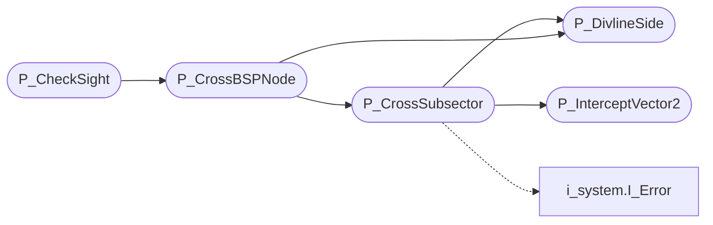

# `progs/doomgeneric/p_sight.c`

> Source: [progs/doomgeneric/p_sight.c:1](../../progs/doomgeneric/p_sight.c#L1) | language `c` | coverage 50.0% | [API index](../index.md)

Copyright(C) 1993-1996 Id Software, Inc.

Copyright(C) 2005-2014 Simon Howard  This program is free software; you can redistribute it and/or modify it under the terms of the GNU General Public License as published by the Free Software Foundation; either version 2 of the License, or (at your option) any later version.  This program is distributed in the hope that it will be useful, but WITHOUT ANY WARRANTY; without even the implied warranty of MERCHANTABILITY or FITNESS FOR A PARTICULAR PURPOSE.  See the GNU General Public License for more details.  DESCRIPTION: LineOfSight/Visibility checks, uses REJECT Lookup Table.       State.   P_CheckSight

## Contents

- **Functions:** [`P_DivlineSide`](#p_divlineside), [`P_InterceptVector2`](#p_interceptvector2), [`P_CrossSubsector`](#p_crosssubsector), [`P_CrossBSPNode`](#p_crossbspnode), [`P_CheckSight`](#p_checksight)

## Call Graph

Solid arrows stay in this module, dashed arrows leave it.



## Functions

<a id="p_divlineside"></a>

### `P_DivlineSide`

`function` | [progs/doomgeneric/p_sight.c:48](../../progs/doomgeneric/p_sight.c#L48)

```c
int P_DivlineSide ( fixed_t x, fixed_t y, divline_t* node )
```

**Parameters**

| Name | Type | Default | Description |
|---|---|---|---|
| `x` | `fixed_t` |  |  |
| `y` | `fixed_t` |  |  |
| `node` | `divline_t*` |  |  |

**Returns:** `int`

*Called by:* [`P_CrossBSPNode`](#p_crossbspnode), [`P_CrossSubsector`](#p_crosssubsector)

---

<a id="p_interceptvector2"></a>

### `P_InterceptVector2`

`function` | [progs/doomgeneric/p_sight.c:102](../../progs/doomgeneric/p_sight.c#L102)

```c
fixed_t P_InterceptVector2 ( divline_t* v2, divline_t* v1 )
```

**Parameters**

| Name | Type | Default | Description |
|---|---|---|---|
| `v2` | `divline_t*` |  |  |
| `v1` | `divline_t*` |  |  |

**Returns:** `fixed_t`

*Called by:* [`P_CrossSubsector`](#p_crosssubsector)

---

<a id="p_crosssubsector"></a>

### `P_CrossSubsector`

`function` | [progs/doomgeneric/p_sight.c:128](../../progs/doomgeneric/p_sight.c#L128)

```c
boolean P_CrossSubsector (int num)
```

P_CrossSubsector Returns true if strace crosses the given subsector successfully.

**Parameters**

| Name | Type | Default | Description |
|---|---|---|---|
| `num` | `int` |  |  |

**Returns:** `boolean`

*Calls:* [`I_Error`](progs.doomgeneric.i_system.h.md#i_error), [`P_DivlineSide`](#p_divlineside), [`P_InterceptVector2`](#p_interceptvector2)

*Called by:* [`P_CrossBSPNode`](#p_crossbspnode)

---

<a id="p_crossbspnode"></a>

### `P_CrossBSPNode`

`function` | [progs/doomgeneric/p_sight.c:258](../../progs/doomgeneric/p_sight.c#L258)

```c
boolean P_CrossBSPNode (int bspnum)
```

P_CrossBSPNode Returns true if strace crosses the given node successfully.

**Parameters**

| Name | Type | Default | Description |
|---|---|---|---|
| `bspnum` | `int` |  |  |

**Returns:** `boolean`

*Calls:* [`P_CrossSubsector`](#p_crosssubsector), [`P_DivlineSide`](#p_divlineside)

*Called by:* [`P_CheckSight`](#p_checksight)

---

<a id="p_checksight"></a>

### `P_CheckSight`

`function` | [progs/doomgeneric/p_sight.c:301](../../progs/doomgeneric/p_sight.c#L301)

```c
boolean P_CheckSight ( mobj_t* t1, mobj_t* t2 )
```

**Parameters**

| Name | Type | Default | Description |
|---|---|---|---|
| `t1` | `mobj_t*` |  |  |
| `t2` | `mobj_t*` |  |  |

**Returns:** `boolean`

*Calls:* [`P_CrossBSPNode`](#p_crossbspnode)

*Called by:* [`A_CPosRefire`](progs.doomgeneric.p_enemy.c.md#a_cposrefire), [`A_Chase`](progs.doomgeneric.p_enemy.c.md#a_chase), [`A_Fire`](progs.doomgeneric.p_enemy.c.md#a_fire), [`A_Look`](progs.doomgeneric.p_enemy.c.md#a_look), [`A_SpidRefire`](progs.doomgeneric.p_enemy.c.md#a_spidrefire), [`A_VileAttack`](progs.doomgeneric.p_enemy.c.md#a_vileattack), [`P_CheckMeleeRange`](progs.doomgeneric.p_enemy.c.md#p_checkmeleerange), [`P_CheckMissileRange`](progs.doomgeneric.p_enemy.c.md#p_checkmissilerange), [`P_LookForPlayers`](progs.doomgeneric.p_enemy.c.md#p_lookforplayers), [`PIT_RadiusAttack`](progs.doomgeneric.p_map.c.md#pit_radiusattack)

---
