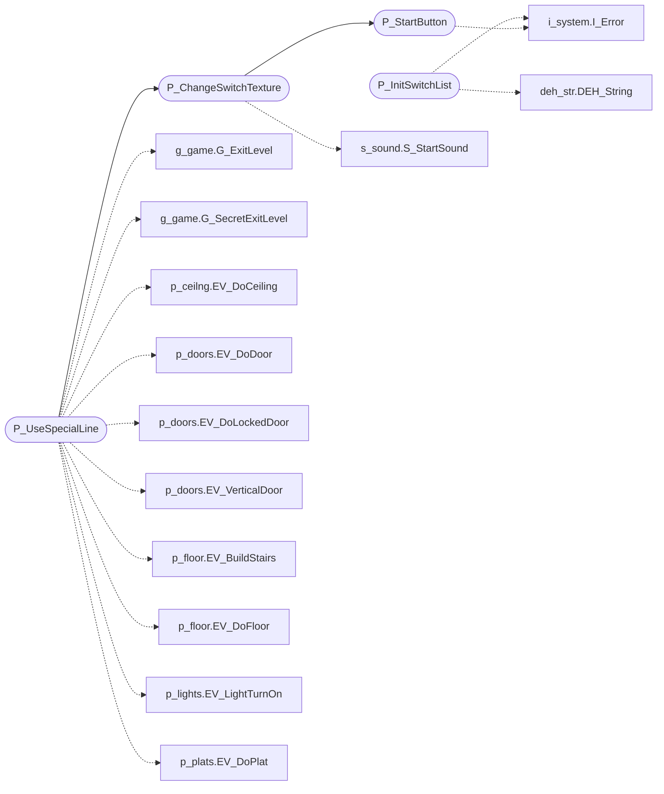

# `progs/doomgeneric/p_switch.c`

> Source: [progs/doomgeneric/p_switch.c:1](../../progs/doomgeneric/p_switch.c#L1) | language `c` | coverage 40.0% | [API index](../index.md)

Copyright(C) 1993-1996 Id Software, Inc.

Copyright(C) 2005-2014 Simon Howard  This program is free software; you can redistribute it and/or modify it under the terms of the GNU General Public License as published by the Free Software Foundation; either version 2 of the License, or (at your option) any later version.  This program is distributed in the hope that it will be useful, but WITHOUT ANY WARRANTY; without even the implied warranty of MERCHANTABILITY or FITNESS FOR A PARTICULAR PURPOSE.  See the GNU General Public License for more details.   DESCRIPTION: Switches, buttons. Two-state animation. Exits.

## Contents

- **Functions:** [`P_InitSwitchList`](#p_initswitchlist), [`P_StartButton`](#p_startbutton), [`P_ChangeSwitchTexture`](#p_changeswitchtexture), [`P_UseSpecialLine`](#p_usespecialline)

## Call Graph

Solid arrows stay in this module, dashed arrows leave it.



## Functions

<a id="p_initswitchlist"></a>

### `P_InitSwitchList`

`function` | [progs/doomgeneric/p_switch.c:101](../../progs/doomgeneric/p_switch.c#L101)

```c
void P_InitSwitchList(void)
```

P_InitSwitchList Only called at game initialization.

*Calls:* [`DEH_String`](progs.doomgeneric.deh_str.h.md#deh_string), [`I_Error`](progs.doomgeneric.i_system.h.md#i_error)

*Called by:* [`P_Init`](progs.doomgeneric.p_setup.c.md#p_init)

---

<a id="p_startbutton"></a>

### `P_StartButton`

`function` | [progs/doomgeneric/p_switch.c:149](../../progs/doomgeneric/p_switch.c#L149)

```c
void P_StartButton ( line_t* line, bwhere_e w, int texture, int time )
```

**Parameters**

| Name | Type | Default | Description |
|---|---|---|---|
| `line` | `line_t*` |  |  |
| `w` | `bwhere_e` |  |  |
| `texture` | `int` |  |  |
| `time` | `int` |  |  |

*Calls:* [`I_Error`](progs.doomgeneric.i_system.h.md#i_error)

*Called by:* [`P_ChangeSwitchTexture`](#p_changeswitchtexture)

---

<a id="p_changeswitchtexture"></a>

### `P_ChangeSwitchTexture`

`function` | [progs/doomgeneric/p_switch.c:195](../../progs/doomgeneric/p_switch.c#L195)

```c
void P_ChangeSwitchTexture ( line_t* line, int useAgain )
```

**Parameters**

| Name | Type | Default | Description |
|---|---|---|---|
| `line` | `line_t*` |  |  |
| `useAgain` | `int` |  |  |

*Calls:* [`P_StartButton`](#p_startbutton), [`S_StartSound`](progs.doomgeneric.s_sound.h.md#s_startsound)

*Called by:* [`P_UseSpecialLine`](#p_usespecialline)

---

<a id="p_usespecialline"></a>

### `P_UseSpecialLine`

`function` | [progs/doomgeneric/p_switch.c:270](../../progs/doomgeneric/p_switch.c#L270)

```c
boolean P_UseSpecialLine ( mobj_t* thing, line_t* line, int side )
```

**Parameters**

| Name | Type | Default | Description |
|---|---|---|---|
| `thing` | `mobj_t*` |  |  |
| `line` | `line_t*` |  |  |
| `side` | `int` |  |  |

**Returns:** `boolean`

*Calls:* [`G_ExitLevel`](progs.doomgeneric.g_game.h.md#g_exitlevel), [`G_SecretExitLevel`](progs.doomgeneric.g_game.h.md#g_secretexitlevel), [`EV_DoCeiling`](progs.doomgeneric.p_ceilng.c.md#ev_doceiling), [`EV_DoDoor`](progs.doomgeneric.p_doors.c.md#ev_dodoor), [`EV_DoLockedDoor`](progs.doomgeneric.p_doors.c.md#ev_dolockeddoor), [`EV_VerticalDoor`](progs.doomgeneric.p_doors.c.md#ev_verticaldoor), [`EV_BuildStairs`](progs.doomgeneric.p_floor.c.md#ev_buildstairs), [`EV_DoFloor`](progs.doomgeneric.p_floor.c.md#ev_dofloor), [`EV_LightTurnOn`](progs.doomgeneric.p_lights.c.md#ev_lightturnon), [`EV_DoPlat`](progs.doomgeneric.p_plats.c.md#ev_doplat), [`P_ChangeSwitchTexture`](#p_changeswitchtexture)

*Called by:* [`P_Move`](progs.doomgeneric.p_enemy.c.md#p_move), [`PTR_UseTraverse`](progs.doomgeneric.p_map.c.md#ptr_usetraverse)

---
