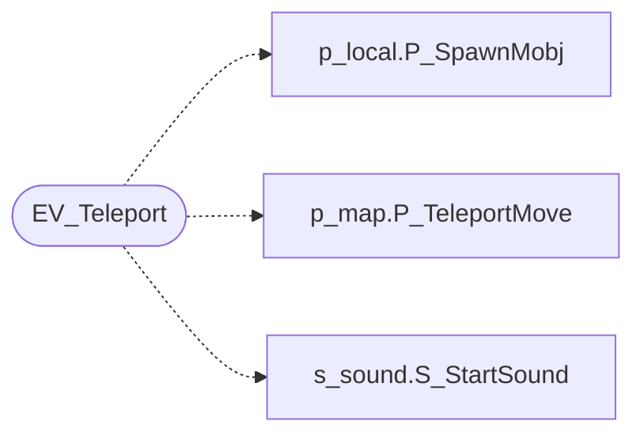

# `progs/doomgeneric/p_telept.c`

> Source: [progs/doomgeneric/p_telept.c:1](../../progs/doomgeneric/p_telept.c#L1) | language `c` | coverage 50.0% | [API index](../index.md)

Copyright(C) 1993-1996 Id Software, Inc.

Copyright(C) 2005-2014 Simon Howard  This program is free software; you can redistribute it and/or modify it under the terms of the GNU General Public License as published by the Free Software Foundation; either version 2 of the License, or (at your option) any later version.  This program is distributed in the hope that it will be useful, but WITHOUT ANY WARRANTY; without even the implied warranty of MERCHANTABILITY or FITNESS FOR A PARTICULAR PURPOSE.  See the GNU General Public License for more details.  DESCRIPTION: Teleportation.          Data.

## Contents

- **Functions:** [`EV_Teleport`](#ev_teleport)

## Call Graph

Solid arrows stay in this module, dashed arrows leave it.



## Functions

<a id="ev_teleport"></a>

### `EV_Teleport`

`function` | [progs/doomgeneric/p_telept.c:42](../../progs/doomgeneric/p_telept.c#L42)

```c
int EV_Teleport ( line_t* line, int side, mobj_t* thing )
```

**Parameters**

| Name | Type | Default | Description |
|---|---|---|---|
| `line` | `line_t*` |  |  |
| `side` | `int` |  |  |
| `thing` | `mobj_t*` |  |  |

**Returns:** `int`

*Calls:* [`P_SpawnMobj`](progs.doomgeneric.p_local.h.md#p_spawnmobj), [`P_TeleportMove`](progs.doomgeneric.p_map.c.md#p_teleportmove), [`S_StartSound`](progs.doomgeneric.s_sound.h.md#s_startsound)

---
