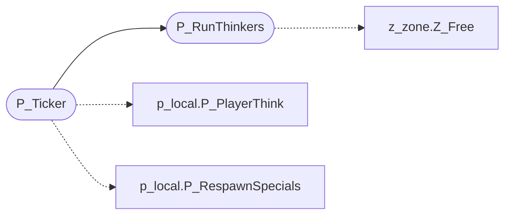

# `progs/doomgeneric/p_tick.c`

> Source: [progs/doomgeneric/p_tick.c:1](../../progs/doomgeneric/p_tick.c#L1) | language `c` | coverage 100.0% | [API index](../index.md)

Copyright(C) 1993-1996 Id Software, Inc.

Copyright(C) 2005-2014 Simon Howard  This program is free software; you can redistribute it and/or modify it under the terms of the GNU General Public License as published by the Free Software Foundation; either version 2 of the License, or (at your option) any later version.  This program is distributed in the hope that it will be useful, but WITHOUT ANY WARRANTY; without even the implied warranty of MERCHANTABILITY or FITNESS FOR A PARTICULAR PURPOSE.  See the GNU General Public License for more details.  DESCRIPTION: Archiving: SaveGame I/O. Thinker, Ticker.

## Contents

- **Functions:** [`P_InitThinkers`](#p_initthinkers), [`P_AddThinker`](#p_addthinker), [`P_RemoveThinker`](#p_removethinker), [`P_AllocateThinker`](#p_allocatethinker), [`P_RunThinkers`](#p_runthinkers), [`P_Ticker`](#p_ticker)

## Call Graph

Solid arrows stay in this module, dashed arrows leave it.



## Functions

<a id="p_initthinkers"></a>

### `P_InitThinkers`

`function` | [progs/doomgeneric/p_tick.c:46](../../progs/doomgeneric/p_tick.c#L46)

```c
void P_InitThinkers (void)
```

P_InitThinkers

---

<a id="p_addthinker"></a>

### `P_AddThinker`

`function` | [progs/doomgeneric/p_tick.c:58](../../progs/doomgeneric/p_tick.c#L58)

```c
void P_AddThinker (thinker_t* thinker)
```

P_AddThinker Adds a new thinker at the end of the list.

**Parameters**

| Name | Type | Default | Description |
|---|---|---|---|
| `thinker` | `thinker_t*` |  |  |

---

<a id="p_removethinker"></a>

### `P_RemoveThinker`

`function` | [progs/doomgeneric/p_tick.c:73](../../progs/doomgeneric/p_tick.c#L73)

```c
void P_RemoveThinker (thinker_t* thinker)
```

P_RemoveThinker Deallocation is lazy -- it will not actually be freed until its thinking turn comes up.

**Parameters**

| Name | Type | Default | Description |
|---|---|---|---|
| `thinker` | `thinker_t*` |  |  |

---

<a id="p_allocatethinker"></a>

### `P_AllocateThinker`

`function` | [progs/doomgeneric/p_tick.c:85](../../progs/doomgeneric/p_tick.c#L85)

```c
void P_AllocateThinker (thinker_t* thinker)
```

P_AllocateThinker Allocates memory and adds a new thinker at the end of the list.

**Parameters**

| Name | Type | Default | Description |
|---|---|---|---|
| `thinker` | `thinker_t*` |  |  |

---

<a id="p_runthinkers"></a>

### `P_RunThinkers`

`function` | [progs/doomgeneric/p_tick.c:94](../../progs/doomgeneric/p_tick.c#L94)

```c
void P_RunThinkers (void)
```

P_RunThinkers

*Calls:* [`Z_Free`](progs.doomgeneric.z_zone.h.md#z_free)

*Called by:* [`P_Ticker`](#p_ticker)

---

<a id="p_ticker"></a>

### `P_Ticker`

`function` | [progs/doomgeneric/p_tick.c:123](../../progs/doomgeneric/p_tick.c#L123)

```c
void P_Ticker (void)
```

Called by C_Ticker, can call G_PlayerExited.

Carries out all thinking of monsters and players.

> **Inherited:** Documentation from [`P_Ticker`](#p_ticker) (progs/doomgeneric/p_tick.h:29).

*Calls:* [`P_PlayerThink`](progs.doomgeneric.p_local.h.md#p_playerthink), [`P_RespawnSpecials`](progs.doomgeneric.p_local.h.md#p_respawnspecials), [`P_RunThinkers`](#p_runthinkers)

---
