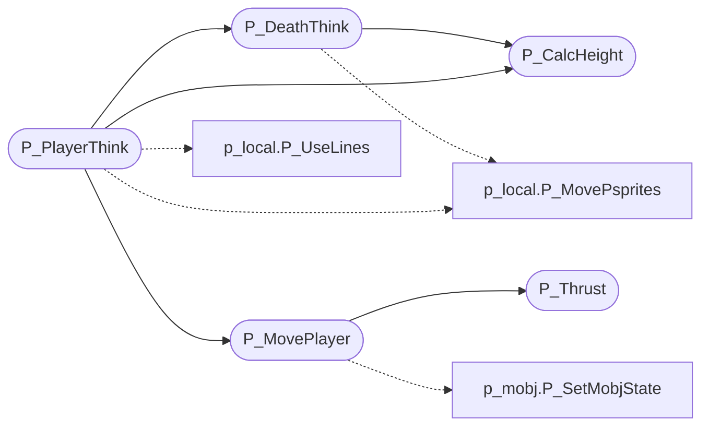

# `progs/doomgeneric/p_user.c`

> Source: [progs/doomgeneric/p_user.c:1](../../progs/doomgeneric/p_user.c#L1) | language `c` | coverage 77.8% | [API index](../index.md)

Copyright(C) 1993-1996 Id Software, Inc.

Copyright(C) 2005-2014 Simon Howard  This program is free software; you can redistribute it and/or modify it under the terms of the GNU General Public License as published by the Free Software Foundation; either version 2 of the License, or (at your option) any later version.  This program is distributed in the hope that it will be useful, but WITHOUT ANY WARRANTY; without even the implied warranty of MERCHANTABILITY or FITNESS FOR A PARTICULAR PURPOSE.  See the GNU General Public License for more details.  DESCRIPTION: Player related stuff. Bobbing POV/weapon, movement. Pending weapon.

## Contents

- **Functions:** [`P_Thrust`](#p_thrust), [`P_CalcHeight`](#p_calcheight), [`P_MovePlayer`](#p_moveplayer), [`P_DeathThink`](#p_deaththink), [`P_PlayerThink`](#p_playerthink)
- **Macros:** [`INVERSECOLORMAP`](#inversecolormap), [`MAXBOB`](#maxbob), [`ANG5`](#ang5)

## Call Graph

Solid arrows stay in this module, dashed arrows leave it.



## Functions

<a id="p_thrust"></a>

### `P_Thrust`

`function` | [progs/doomgeneric/p_user.c:52](../../progs/doomgeneric/p_user.c#L52)

```c
void P_Thrust ( player_t* player, angle_t angle, fixed_t move )
```

**Parameters**

| Name | Type | Default | Description |
|---|---|---|---|
| `player` | `player_t*` |  |  |
| `angle` | `angle_t` |  |  |
| `move` | `fixed_t` |  |  |

*Called by:* [`P_MovePlayer`](#p_moveplayer)

---

<a id="p_calcheight"></a>

### `P_CalcHeight`

`function` | [progs/doomgeneric/p_user.c:70](../../progs/doomgeneric/p_user.c#L70)

```c
void P_CalcHeight (player_t* player)
```

P_CalcHeight Calculate the walking / running height adjustment

**Parameters**

| Name | Type | Default | Description |
|---|---|---|---|
| `player` | `player_t*` |  |  |

*Called by:* [`P_DeathThink`](#p_deaththink), [`P_PlayerThink`](#p_playerthink)

---

<a id="p_moveplayer"></a>

### `P_MovePlayer`

`function` | [progs/doomgeneric/p_user.c:141](../../progs/doomgeneric/p_user.c#L141)

```c
void P_MovePlayer (player_t* player)
```

P_MovePlayer

**Parameters**

| Name | Type | Default | Description |
|---|---|---|---|
| `player` | `player_t*` |  |  |

*Calls:* [`P_SetMobjState`](progs.doomgeneric.p_mobj.c.md#p_setmobjstate), [`P_Thrust`](#p_thrust)

*Called by:* [`P_PlayerThink`](#p_playerthink)

---

<a id="p_deaththink"></a>

### `P_DeathThink`

`function` | [progs/doomgeneric/p_user.c:175](../../progs/doomgeneric/p_user.c#L175)

```c
void P_DeathThink (player_t* player)
```

**Parameters**

| Name | Type | Default | Description |
|---|---|---|---|
| `player` | `player_t*` |  |  |

*Calls:* [`P_MovePsprites`](progs.doomgeneric.p_local.h.md#p_movepsprites), [`P_CalcHeight`](#p_calcheight)

*Called by:* [`P_PlayerThink`](#p_playerthink)

---

<a id="p_playerthink"></a>

### `P_PlayerThink`

`function` | [progs/doomgeneric/p_user.c:229](../../progs/doomgeneric/p_user.c#L229)

```c
void P_PlayerThink (player_t* player)
```

P_PlayerThink

**Parameters**

| Name | Type | Default | Description |
|---|---|---|---|
| `player` | `player_t*` |  |  |

*Calls:* [`P_MovePsprites`](progs.doomgeneric.p_local.h.md#p_movepsprites), [`P_UseLines`](progs.doomgeneric.p_local.h.md#p_uselines), [`P_CalcHeight`](#p_calcheight), [`P_DeathThink`](#p_deaththink), [`P_MovePlayer`](#p_moveplayer)

---

## Macros

<a id="inversecolormap"></a>

### `INVERSECOLORMAP`

`macro` | [progs/doomgeneric/p_user.c:34](../../progs/doomgeneric/p_user.c#L34)

```c
#define INVERSECOLORMAP
```

Index of the special effects (INVUL inverse) map.

---

<a id="maxbob"></a>

### `MAXBOB`

`macro` | [progs/doomgeneric/p_user.c:42](../../progs/doomgeneric/p_user.c#L42)

```c
#define MAXBOB
```

16 pixels of bob

---

<a id="ang5"></a>

### `ANG5`

`macro` | [progs/doomgeneric/p_user.c:173](../../progs/doomgeneric/p_user.c#L173)

```c
#define ANG5
```

P_DeathThink Fall on your face when dying.

Decrease POV height to floor height.

---
