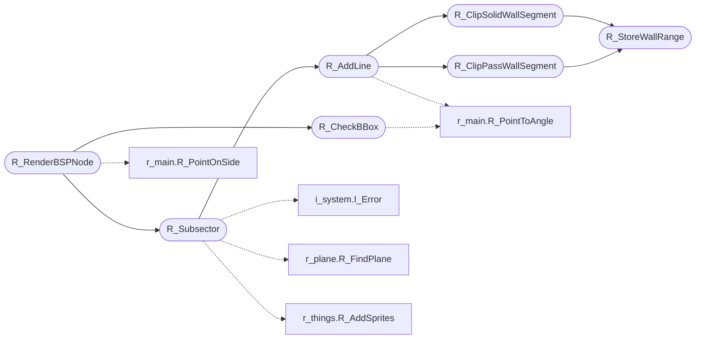

# `progs/doomgeneric/r_bsp.c`

> Source: [progs/doomgeneric/r_bsp.c:1](../../progs/doomgeneric/r_bsp.c#L1) | language `c` | coverage 58.3% | [API index](../index.md)

Copyright(C) 1993-1996 Id Software, Inc.

Copyright(C) 2005-2014 Simon Howard  This program is free software; you can redistribute it and/or modify it under the terms of the GNU General Public License as published by the Free Software Foundation; either version 2 of the License, or (at your option) any later version.  This program is distributed in the hope that it will be useful, but WITHOUT ANY WARRANTY; without even the implied warranty of MERCHANTABILITY or FITNESS FOR A PARTICULAR PURPOSE.  See the GNU General Public License for more details.  DESCRIPTION: BSP traversal, handling of LineSegs for rendering.

## Contents

- **Structs:** [`cliprange_t`](#cliprange_t)
- **Functions:** [`R_StoreWallRange`](#r_storewallrange), [`R_ClearDrawSegs`](#r_cleardrawsegs), [`R_ClipSolidWallSegment`](#r_clipsolidwallsegment), [`R_ClipPassWallSegment`](#r_clippasswallsegment), [`R_ClearClipSegs`](#r_clearclipsegs), [`R_AddLine`](#r_addline), [`R_CheckBBox`](#r_checkbbox), [`R_Subsector`](#r_subsector), [`R_RenderBSPNode`](#r_renderbspnode)
- **Macros:** [`MAXSEGS`](#maxsegs)

## Call Graph

Solid arrows stay in this module, dashed arrows leave it.



## Structs

<a id="cliprange_t"></a>

### `cliprange_t`

`struct` | [progs/doomgeneric/r_bsp.c:73](../../progs/doomgeneric/r_bsp.c#L73)

```c
typedef struct
```

ClipWallSegment Clips the given range of columns and includes it in the new clip list.

---

## Functions

<a id="r_storewallrange"></a>

### `R_StoreWallRange`

`function` | [progs/doomgeneric/r_bsp.c:51](../../progs/doomgeneric/r_bsp.c#L51)

```c
void R_StoreWallRange ( int start, int stop );
```

**Parameters**

| Name | Type | Default | Description |
|---|---|---|---|
| `start` | `int` |  |  |
| `stop` | `int` |  |  |

*Called by:* [`R_ClipPassWallSegment`](#r_clippasswallsegment), [`R_ClipSolidWallSegment`](#r_clipsolidwallsegment)

---

<a id="r_cleardrawsegs"></a>

### `R_ClearDrawSegs`

`function` | [progs/doomgeneric/r_bsp.c:61](../../progs/doomgeneric/r_bsp.c#L61)

```c
void R_ClearDrawSegs (void)
```

R_ClearDrawSegs

---

<a id="r_clipsolidwallsegment"></a>

### `R_ClipSolidWallSegment`

`function` | [progs/doomgeneric/r_bsp.c:97](../../progs/doomgeneric/r_bsp.c#L97)

```c
void R_ClipSolidWallSegment ( int first, int last )
```

**Parameters**

| Name | Type | Default | Description |
|---|---|---|---|
| `first` | `int` |  |  |
| `last` | `int` |  |  |

*Calls:* [`R_StoreWallRange`](#r_storewallrange)

*Called by:* [`R_AddLine`](#r_addline)

---

<a id="r_clippasswallsegment"></a>

### `R_ClipPassWallSegment`

`function` | [progs/doomgeneric/r_bsp.c:190](../../progs/doomgeneric/r_bsp.c#L190)

```c
void R_ClipPassWallSegment ( int first, int last )
```

**Parameters**

| Name | Type | Default | Description |
|---|---|---|---|
| `first` | `int` |  |  |
| `last` | `int` |  |  |

*Calls:* [`R_StoreWallRange`](#r_storewallrange)

*Called by:* [`R_AddLine`](#r_addline)

---

<a id="r_clearclipsegs"></a>

### `R_ClearClipSegs`

`function` | [progs/doomgeneric/r_bsp.c:238](../../progs/doomgeneric/r_bsp.c#L238)

```c
void R_ClearClipSegs (void)
```

R_ClearClipSegs

---

<a id="r_addline"></a>

### `R_AddLine`

`function` | [progs/doomgeneric/r_bsp.c:252](../../progs/doomgeneric/r_bsp.c#L252)

```c
void R_AddLine (seg_t* line)
```

R_AddLine Clips the given segment and adds any visible pieces to the line list.

**Parameters**

| Name | Type | Default | Description |
|---|---|---|---|
| `line` | `seg_t*` |  |  |

*Calls:* [`R_ClipPassWallSegment`](#r_clippasswallsegment), [`R_ClipSolidWallSegment`](#r_clipsolidwallsegment), [`R_PointToAngle`](progs.doomgeneric.r_main.h.md#r_pointtoangle)

*Called by:* [`R_Subsector`](#r_subsector)

---

<a id="r_checkbbox"></a>

### `R_CheckBBox`

`function` | [progs/doomgeneric/r_bsp.c:374](../../progs/doomgeneric/r_bsp.c#L374)

```c
boolean R_CheckBBox (fixed_t* bspcoord)
```

**Parameters**

| Name | Type | Default | Description |
|---|---|---|---|
| `bspcoord` | `fixed_t*` |  |  |

**Returns:** `boolean`

*Calls:* [`R_PointToAngle`](progs.doomgeneric.r_main.h.md#r_pointtoangle)

*Called by:* [`R_RenderBSPNode`](#r_renderbspnode)

---

<a id="r_subsector"></a>

### `R_Subsector`

`function` | [progs/doomgeneric/r_bsp.c:490](../../progs/doomgeneric/r_bsp.c#L490)

```c
void R_Subsector (int num)
```

R_Subsector Determine floor/ceiling planes.

Add sprites of things in sector. Draw one or more line segments.

**Parameters**

| Name | Type | Default | Description |
|---|---|---|---|
| `num` | `int` |  |  |

*Calls:* [`I_Error`](progs.doomgeneric.i_system.h.md#i_error), [`R_AddLine`](#r_addline), [`R_FindPlane`](progs.doomgeneric.r_plane.h.md#r_findplane), [`R_AddSprites`](progs.doomgeneric.r_things.h.md#r_addsprites)

*Called by:* [`R_RenderBSPNode`](#r_renderbspnode)

---

<a id="r_renderbspnode"></a>

### `R_RenderBSPNode`

`function` | [progs/doomgeneric/r_bsp.c:545](../../progs/doomgeneric/r_bsp.c#L545)

```c
void R_RenderBSPNode (int bspnum)
```

RenderBSPNode Renders all subsectors below a given node, traversing subtree recursively.

Just call with BSP root.

**Parameters**

| Name | Type | Default | Description |
|---|---|---|---|
| `bspnum` | `int` |  |  |

*Calls:* [`R_CheckBBox`](#r_checkbbox), [`R_Subsector`](#r_subsector), [`R_PointOnSide`](progs.doomgeneric.r_main.h.md#r_pointonside)

---

## Macros

<a id="maxsegs"></a>

### `MAXSEGS`

`macro` | [progs/doomgeneric/r_bsp.c:81](../../progs/doomgeneric/r_bsp.c#L81)

```c
#define MAXSEGS
```

---
