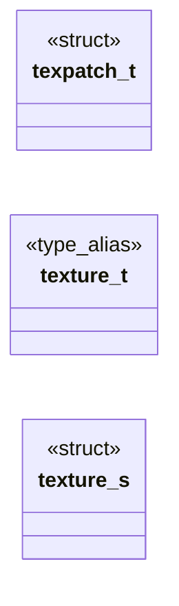
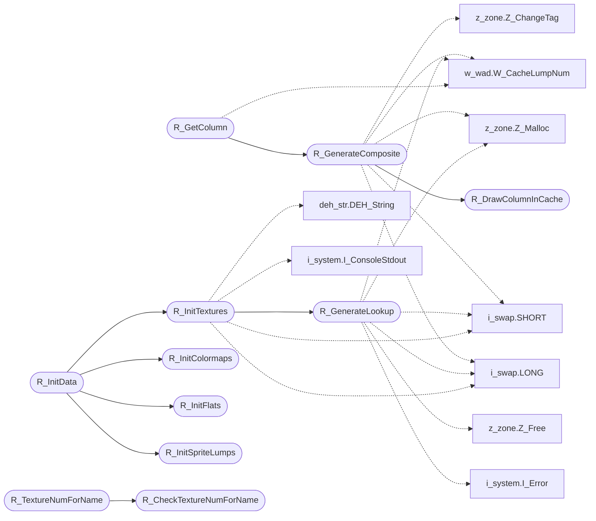

# `progs/doomgeneric/r_data.c`

> Source: [progs/doomgeneric/r_data.c:1](../../progs/doomgeneric/r_data.c#L1) | language `c` | coverage 76.5% | [API index](../index.md)

Copyright(C) 1993-1996 Id Software, Inc.

Copyright(C) 2005-2014 Simon Howard  This program is free software; you can redistribute it and/or modify it under the terms of the GNU General Public License as published by the Free Software Foundation; either version 2 of the License, or (at your option) any later version.  This program is distributed in the hope that it will be useful, but WITHOUT ANY WARRANTY; without even the implied warranty of MERCHANTABILITY or FITNESS FOR A PARTICULAR PURPOSE.  See the GNU General Public License for more details.  DESCRIPTION: Preparation of data for rendering, generation of lookups, caching, retrieval by name.

## Contents

- **Structs:** [`texpatch_t`](#texpatch_t), [`texture_s`](#texture_s)
- **Type Aliases:** [`texture_t`](#texture_t)
- **Functions:** [`R_DrawColumnInCache`](#r_drawcolumnincache), [`R_GenerateComposite`](#r_generatecomposite), [`R_GenerateLookup`](#r_generatelookup), [`R_GetColumn`](#r_getcolumn), [`R_InitTextures`](#r_inittextures), [`R_InitFlats`](#r_initflats), [`R_InitSpriteLumps`](#r_initspritelumps), [`R_InitColormaps`](#r_initcolormaps), [`R_InitData`](#r_initdata), [`R_FlatNumForName`](#r_flatnumforname), [`R_CheckTextureNumForName`](#r_checktexturenumforname), [`R_TextureNumForName`](#r_texturenumforname), [`R_PrecacheLevel`](#r_precachelevel)

## Type Diagram



## Call Graph

Solid arrows stay in this module, dashed arrows leave it.



## Structs

<a id="texpatch_t"></a>

### `texpatch_t`

`struct` | [progs/doomgeneric/r_data.c:89](../../progs/doomgeneric/r_data.c#L89)

```c
typedef struct
```

A single patch from a texture definition, basically a rectangular area within the texture rectangle.

---

<a id="texture_s"></a>

### `texture_s`

`struct` | [progs/doomgeneric/r_data.c:106](../../progs/doomgeneric/r_data.c#L106)

```c
struct texture_s
```

---

## Type Aliases

<a id="texture_t"></a>

### `texture_t`

`type_alias` | [progs/doomgeneric/r_data.c:103](../../progs/doomgeneric/r_data.c#L103)

```c
typedef struct texture_s texture_t;
```

A maptexturedef_t describes a rectangular texture, which is composed of one or more mappatch_t structures that arrange graphic patches.

---

## Functions

<a id="r_drawcolumnincache"></a>

### `R_DrawColumnInCache`

`function` | [progs/doomgeneric/r_data.c:186](../../progs/doomgeneric/r_data.c#L186)

```c
void R_DrawColumnInCache ( column_t* patch, byte* cache, int originy, int cacheheight )
```

**Parameters**

| Name | Type | Default | Description |
|---|---|---|---|
| `patch` | `column_t*` |  |  |
| `cache` | `byte*` |  |  |
| `originy` | `int` |  |  |
| `cacheheight` | `int` |  |  |

*Called by:* [`R_GenerateComposite`](#r_generatecomposite)

---

<a id="r_generatecomposite"></a>

### `R_GenerateComposite`

`function` | [progs/doomgeneric/r_data.c:226](../../progs/doomgeneric/r_data.c#L226)

```c
void R_GenerateComposite (int texnum)
```

R_GenerateComposite Using the texture definition, the composite texture is created from the patches, and each column is cached.

**Parameters**

| Name | Type | Default | Description |
|---|---|---|---|
| `texnum` | `int` |  |  |

*Calls:* [`LONG`](progs.doomgeneric.i_swap.h.md#long), [`SHORT`](progs.doomgeneric.i_swap.h.md#short), [`R_DrawColumnInCache`](#r_drawcolumnincache), [`W_CacheLumpNum`](progs.doomgeneric.w_wad.h.md#w_cachelumpnum), [`Z_ChangeTag`](progs.doomgeneric.z_zone.h.md#z_changetag), [`Z_Malloc`](progs.doomgeneric.z_zone.h.md#z_malloc)

*Called by:* [`R_GetColumn`](#r_getcolumn)

---

<a id="r_generatelookup"></a>

### `R_GenerateLookup`

`function` | [progs/doomgeneric/r_data.c:294](../../progs/doomgeneric/r_data.c#L294)

```c
void R_GenerateLookup (int texnum)
```

R_GenerateLookup

**Parameters**

| Name | Type | Default | Description |
|---|---|---|---|
| `texnum` | `int` |  |  |

*Calls:* [`LONG`](progs.doomgeneric.i_swap.h.md#long), [`SHORT`](progs.doomgeneric.i_swap.h.md#short), [`I_Error`](progs.doomgeneric.i_system.h.md#i_error), [`W_CacheLumpNum`](progs.doomgeneric.w_wad.h.md#w_cachelumpnum), [`Z_Free`](progs.doomgeneric.z_zone.h.md#z_free), [`Z_Malloc`](progs.doomgeneric.z_zone.h.md#z_malloc)

*Called by:* [`R_InitTextures`](#r_inittextures)

---

<a id="r_getcolumn"></a>

### `R_GetColumn`

`function` | [progs/doomgeneric/r_data.c:383](../../progs/doomgeneric/r_data.c#L383)

```c
byte* R_GetColumn ( int tex, int col )
```

**Parameters**

| Name | Type | Default | Description |
|---|---|---|---|
| `tex` | `int` |  |  |
| `col` | `int` |  |  |

**Returns:** `byte*`

*Calls:* [`R_GenerateComposite`](#r_generatecomposite), [`W_CacheLumpNum`](progs.doomgeneric.w_wad.h.md#w_cachelumpnum)

---

<a id="r_inittextures"></a>

### `R_InitTextures`

`function` | [progs/doomgeneric/r_data.c:451](../../progs/doomgeneric/r_data.c#L451)

```c
void R_InitTextures (void)
```

R_InitTextures Initializes the texture list with the textures from the world map.

*Calls:* [`DEH_String`](progs.doomgeneric.deh_str.h.md#deh_string), [`LONG`](progs.doomgeneric.i_swap.h.md#long), [`SHORT`](progs.doomgeneric.i_swap.h.md#short), [`I_ConsoleStdout`](progs.doomgeneric.i_system.c.md#i_consolestdout), [`I_Error`](progs.doomgeneric.i_system.h.md#i_error), [`M_StringCopy`](progs.doomgeneric.m_misc.c.md#m_stringcopy), [`R_GenerateLookup`](#r_generatelookup), [`W_CacheLumpName`](progs.doomgeneric.w_wad.h.md#w_cachelumpname), [`W_CheckNumForName`](progs.doomgeneric.w_wad.h.md#w_checknumforname), [`W_GetNumForName`](progs.doomgeneric.w_wad.h.md#w_getnumforname), [`W_LumpLength`](progs.doomgeneric.w_wad.h.md#w_lumplength), [`W_ReleaseLumpName`](progs.doomgeneric.w_wad.h.md#w_releaselumpname) and 2 more

*Called by:* [`R_InitData`](#r_initdata)

---

<a id="r_initflats"></a>

### `R_InitFlats`

`function` | [progs/doomgeneric/r_data.c:633](../../progs/doomgeneric/r_data.c#L633)

```c
void R_InitFlats (void)
```

R_InitFlats

*Calls:* [`DEH_String`](progs.doomgeneric.deh_str.h.md#deh_string), [`W_GetNumForName`](progs.doomgeneric.w_wad.h.md#w_getnumforname), [`Z_Malloc`](progs.doomgeneric.z_zone.h.md#z_malloc)

*Called by:* [`R_InitData`](#r_initdata)

---

<a id="r_initspritelumps"></a>

### `R_InitSpriteLumps`

`function` | [progs/doomgeneric/r_data.c:655](../../progs/doomgeneric/r_data.c#L655)

```c
void R_InitSpriteLumps (void)
```

R_InitSpriteLumps Finds the width and hoffset of all sprites in the wad, so the sprite does not need to be cached completely just for having the header info ready during rendering.

*Calls:* [`DEH_String`](progs.doomgeneric.deh_str.h.md#deh_string), [`SHORT`](progs.doomgeneric.i_swap.h.md#short), [`W_CacheLumpNum`](progs.doomgeneric.w_wad.h.md#w_cachelumpnum), [`W_GetNumForName`](progs.doomgeneric.w_wad.h.md#w_getnumforname), [`Z_Malloc`](progs.doomgeneric.z_zone.h.md#z_malloc)

*Called by:* [`R_InitData`](#r_initdata)

---

<a id="r_initcolormaps"></a>

### `R_InitColormaps`

`function` | [progs/doomgeneric/r_data.c:685](../../progs/doomgeneric/r_data.c#L685)

```c
void R_InitColormaps (void)
```

R_InitColormaps

*Calls:* [`DEH_String`](progs.doomgeneric.deh_str.h.md#deh_string), [`W_CacheLumpNum`](progs.doomgeneric.w_wad.h.md#w_cachelumpnum), [`W_GetNumForName`](progs.doomgeneric.w_wad.h.md#w_getnumforname)

*Called by:* [`R_InitData`](#r_initdata)

---

<a id="r_initdata"></a>

### `R_InitData`

`function` | [progs/doomgeneric/r_data.c:703](../../progs/doomgeneric/r_data.c#L703)

```c
void R_InitData (void)
```

R_InitData Locates all the lumps that will be used by all views Must be called after W_Init.

*Calls:* [`R_InitColormaps`](#r_initcolormaps), [`R_InitFlats`](#r_initflats), [`R_InitSpriteLumps`](#r_initspritelumps), [`R_InitTextures`](#r_inittextures)

---

<a id="r_flatnumforname"></a>

### `R_FlatNumForName`

`function` | [progs/doomgeneric/r_data.c:720](../../progs/doomgeneric/r_data.c#L720)

```c
int R_FlatNumForName (char* name)
```

R_FlatNumForName Retrieval, get a flat number for a flat name.

**Parameters**

| Name | Type | Default | Description |
|---|---|---|---|
| `name` | `char*` |  |  |

**Returns:** `int`

*Calls:* [`I_Error`](progs.doomgeneric.i_system.h.md#i_error), [`W_CheckNumForName`](progs.doomgeneric.w_wad.h.md#w_checknumforname)

---

<a id="r_checktexturenumforname"></a>

### `R_CheckTextureNumForName`

`function` | [progs/doomgeneric/r_data.c:744](../../progs/doomgeneric/r_data.c#L744)

```c
int R_CheckTextureNumForName (char *name)
```

R_CheckTextureNumForName Check whether texture is available.

Filter out NoTexture indicator.

**Parameters**

| Name | Type | Default | Description |
|---|---|---|---|
| `name` | `char *` |  |  |

**Returns:** `int`

*Calls:* [`strncasecmp`](progs.doomgeneric.doomtype.h.md#strncasecmp), [`W_LumpNameHash`](progs.doomgeneric.w_wad.h.md#w_lumpnamehash)

*Called by:* [`R_TextureNumForName`](#r_texturenumforname)

---

<a id="r_texturenumforname"></a>

### `R_TextureNumForName`

`function` | [progs/doomgeneric/r_data.c:775](../../progs/doomgeneric/r_data.c#L775)

```c
int R_TextureNumForName (char* name)
```

R_TextureNumForName Calls R_CheckTextureNumForName, aborts with error message.

**Parameters**

| Name | Type | Default | Description |
|---|---|---|---|
| `name` | `char*` |  |  |

**Returns:** `int`

*Calls:* [`I_Error`](progs.doomgeneric.i_system.h.md#i_error), [`R_CheckTextureNumForName`](#r_checktexturenumforname)

---

<a id="r_precachelevel"></a>

### `R_PrecacheLevel`

`function` | [progs/doomgeneric/r_data.c:800](../../progs/doomgeneric/r_data.c#L800)

```c
void R_PrecacheLevel (void)
```

*Calls:* [`W_CacheLumpNum`](progs.doomgeneric.w_wad.h.md#w_cachelumpnum), [`Z_Free`](progs.doomgeneric.z_zone.h.md#z_free), [`Z_Malloc`](progs.doomgeneric.z_zone.h.md#z_malloc)

---
