# `progs/doomgeneric/r_defs.h`

> Source: [progs/doomgeneric/r_defs.h:1](../../progs/doomgeneric/r_defs.h#L1) | language `h` | coverage 69.2% | [API index](../index.md)

Copyright(C) 1993-1996 Id Software, Inc.

Copyright(C) 2005-2014 Simon Howard  This program is free software; you can redistribute it and/or modify it under the terms of the GNU General Public License as published by the Free Software Foundation; either version 2 of the License, or (at your option) any later version.  This program is distributed in the hope that it will be useful, but WITHOUT ANY WARRANTY; without even the implied warranty of MERCHANTABILITY or FITNESS FOR A PARTICULAR PURPOSE.  See the GNU General Public License for more details.  DESCRIPTION: Refresh/rendering module, shared data struct definitions.      Screenwidth.  Some more or less basic data types we depend on.

## Contents

- **Structs:** [`vertex_t`](#vertex_t), [`line_s`](#line_s), [`degenmobj_t`](#degenmobj_t), [`sector_t`](#sector_t), [`side_t`](#side_t), [`line_s`](#line_s), [`subsector_s`](#subsector_s), [`seg_t`](#seg_t), [`node_t`](#node_t), [`drawseg_s`](#drawseg_s), [`vissprite_s`](#vissprite_s), [`spriteframe_t`](#spriteframe_t), [`spritedef_t`](#spritedef_t), [`visplane_t`](#visplane_t)
- **Type Aliases:** [`v1`](#v1), [`sector`](#sector), [`lighttable_t`](#lighttable_t), [`curline`](#curline), [`prev`](#prev)
- **Macros:** [`__R_DEFS__`](#__r_defs__), [`SIL_NONE`](#sil_none), [`SIL_BOTTOM`](#sil_bottom), [`SIL_TOP`](#sil_top), [`SIL_BOTH`](#sil_both), [`MAXDRAWSEGS`](#maxdrawsegs)

## Type Diagram

```mermaid
classDiagram
    direction LR
    class vertex_t
    <<struct>> vertex_t
    class line_s
    <<struct>> line_s
    class degenmobj_t
    <<struct>> degenmobj_t
    class sector_t
    <<struct>> sector_t
    class side_t
    <<struct>> side_t
    class v1
    <<type_alias>> v1
    class line_s
    <<struct>> line_s
    class sector
    <<type_alias>> sector
    class subsector_s
    <<struct>> subsector_s
    class seg_t
    <<struct>> seg_t
    class node_t
    <<struct>> node_t
    class lighttable_t
    <<type_alias>> lighttable_t
    class curline
    <<type_alias>> curline
    class drawseg_s
    <<struct>> drawseg_s
    class prev
    <<type_alias>> prev
    class vissprite_s
    <<struct>> vissprite_s
    class spriteframe_t
    <<struct>> spriteframe_t
    class spritedef_t
    <<struct>> spritedef_t
    class visplane_t
    <<struct>> visplane_t
```



## Structs

<a id="vertex_t"></a>

### `vertex_t`

`struct` | [progs/doomgeneric/r_defs.h:67](../../progs/doomgeneric/r_defs.h#L67)

```c
typedef struct
```

Your plain vanilla vertex.

Note: transformed values not buffered locally, like some DOOM-alikes ("wt", "WebView") did.

---

<a id="line_s"></a>

### `line_s`

`struct` | [progs/doomgeneric/r_defs.h:76](../../progs/doomgeneric/r_defs.h#L76)

```c
struct line_s;
```

Forward of LineDefs, for Sectors.

---

<a id="degenmobj_t"></a>

### `degenmobj_t`

`struct` | [progs/doomgeneric/r_defs.h:84](../../progs/doomgeneric/r_defs.h#L84)

```c
typedef struct
```

Each sector has a degenmobj_t in its center for sound origin purposes.

I suppose this does not handle sound from moving objects (doppler), because position is prolly just buffered, not updated.

---

<a id="sector_t"></a>

### `sector_t`

`struct` | [progs/doomgeneric/r_defs.h:97](../../progs/doomgeneric/r_defs.h#L97)

```c
typedef struct
```

The SECTORS record, at runtime.

Stores things/mobjs.

---

<a id="side_t"></a>

### `side_t`

`struct` | [progs/doomgeneric/r_defs.h:140](../../progs/doomgeneric/r_defs.h#L140)

```c
typedef struct
```

---

<a id="line_s"></a>

### `line_s`

`struct` | [progs/doomgeneric/r_defs.h:175](../../progs/doomgeneric/r_defs.h#L175)

```c
typedef struct line_s
```

---

<a id="subsector_s"></a>

### `subsector_s`

`struct` | [progs/doomgeneric/r_defs.h:223](../../progs/doomgeneric/r_defs.h#L223)

```c
typedef struct subsector_s
```

A SubSector.

References a Sector. Basically, this is a list of LineSegs, indicating the visible walls that define (all or some) sides of a convex BSP leaf.

---

<a id="seg_t"></a>

### `seg_t`

`struct` | [progs/doomgeneric/r_defs.h:236](../../progs/doomgeneric/r_defs.h#L236)

```c
typedef struct
```

The LineSeg.

---

<a id="node_t"></a>

### `node_t`

`struct` | [progs/doomgeneric/r_defs.h:261](../../progs/doomgeneric/r_defs.h#L261)

```c
typedef struct
```

BSP node.

---

<a id="drawseg_s"></a>

### `drawseg_s`

`struct` | [progs/doomgeneric/r_defs.h:306](../../progs/doomgeneric/r_defs.h#L306)

```c
typedef struct drawseg_s
```

?

---

<a id="vissprite_s"></a>

### `vissprite_s`

`struct` | [progs/doomgeneric/r_defs.h:338](../../progs/doomgeneric/r_defs.h#L338)

```c
typedef struct vissprite_s
```

A vissprite_t is a thing that will be drawn during a refresh.

I.e. a sprite object that is partly visible.

---

<a id="spriteframe_t"></a>

### `spriteframe_t`

`struct` | [progs/doomgeneric/r_defs.h:390](../../progs/doomgeneric/r_defs.h#L390)

```c
typedef struct
```

Sprites are patches with a special naming convention so they can be recognized by R_InitSprites.

The base name is NNNNFx or NNNNFxFx, with x indicating the rotation, x = 0, 1-7. The sprite and frame specified by a thing_t is range checked at run time. A sprite is a patch_t that is assumed to represent a three dimensional object and may have multiple rotations pre drawn. Horizontal flipping is used to save space, thus NNNNF2F5 defines a mirrored patch. Some sprites will only have one picture used for all views: NNNNF0

---

<a id="spritedef_t"></a>

### `spritedef_t`

`struct` | [progs/doomgeneric/r_defs.h:411](../../progs/doomgeneric/r_defs.h#L411)

```c
typedef struct
```

A sprite definition: a number of animation frames.

---

<a id="visplane_t"></a>

### `visplane_t`

`struct` | [progs/doomgeneric/r_defs.h:423](../../progs/doomgeneric/r_defs.h#L423)

```c
typedef struct
```

Now what is a visplane, anyway?

---

## Type Aliases

<a id="v1"></a>

### `v1`

`type_alias` | [progs/doomgeneric/r_defs.h:172](../../progs/doomgeneric/r_defs.h#L172)

```c
typedef struct line_s { // Vertices, from v1 to v2. vertex_t* v1;
```

---

<a id="sector"></a>

### `sector`

`type_alias` | [progs/doomgeneric/r_defs.h:223](../../progs/doomgeneric/r_defs.h#L223)

```c
typedef struct subsector_s { sector_t* sector;
```

A SubSector.

References a Sector. Basically, this is a list of LineSegs, indicating the visible walls that define (all or some) sides of a convex BSP leaf.

---

<a id="lighttable_t"></a>

### `lighttable_t`

`type_alias` | [progs/doomgeneric/r_defs.h:298](../../progs/doomgeneric/r_defs.h#L298)

```c
typedef byte lighttable_t;
```

This could be wider for >8 bit display.

Indeed, true color support is posibble precalculating 24bpp lightmap/colormap LUT. from darkening PLAYPAL to all black. Could even us emore than 32 levels.

---

<a id="curline"></a>

### `curline`

`type_alias` | [progs/doomgeneric/r_defs.h:306](../../progs/doomgeneric/r_defs.h#L306)

```c
typedef struct drawseg_s { seg_t* curline;
```

?

---

<a id="prev"></a>

### `prev`

`type_alias` | [progs/doomgeneric/r_defs.h:338](../../progs/doomgeneric/r_defs.h#L338)

```c
typedef struct vissprite_s { // Doubly linked list. struct vissprite_s* prev;
```

A vissprite_t is a thing that will be drawn during a refresh.

I.e. a sprite object that is partly visible.

---

## Macros

<a id="__r_defs__"></a>

### `__R_DEFS__`

`macro` | [progs/doomgeneric/r_defs.h:21](../../progs/doomgeneric/r_defs.h#L21)

```c
#define __R_DEFS__
```

---

<a id="sil_none"></a>

### `SIL_NONE`

`macro` | [progs/doomgeneric/r_defs.h:46](../../progs/doomgeneric/r_defs.h#L46)

```c
#define SIL_NONE
```

Silhouette, needed for clipping Segs (mainly) and sprites representing things.

---

<a id="sil_bottom"></a>

### `SIL_BOTTOM`

`macro` | [progs/doomgeneric/r_defs.h:47](../../progs/doomgeneric/r_defs.h#L47)

```c
#define SIL_BOTTOM
```

---

<a id="sil_top"></a>

### `SIL_TOP`

`macro` | [progs/doomgeneric/r_defs.h:48](../../progs/doomgeneric/r_defs.h#L48)

```c
#define SIL_TOP
```

---

<a id="sil_both"></a>

### `SIL_BOTH`

`macro` | [progs/doomgeneric/r_defs.h:49](../../progs/doomgeneric/r_defs.h#L49)

```c
#define SIL_BOTH
```

---

<a id="maxdrawsegs"></a>

### `MAXDRAWSEGS`

`macro` | [progs/doomgeneric/r_defs.h:51](../../progs/doomgeneric/r_defs.h#L51)

```c
#define MAXDRAWSEGS
```

---
