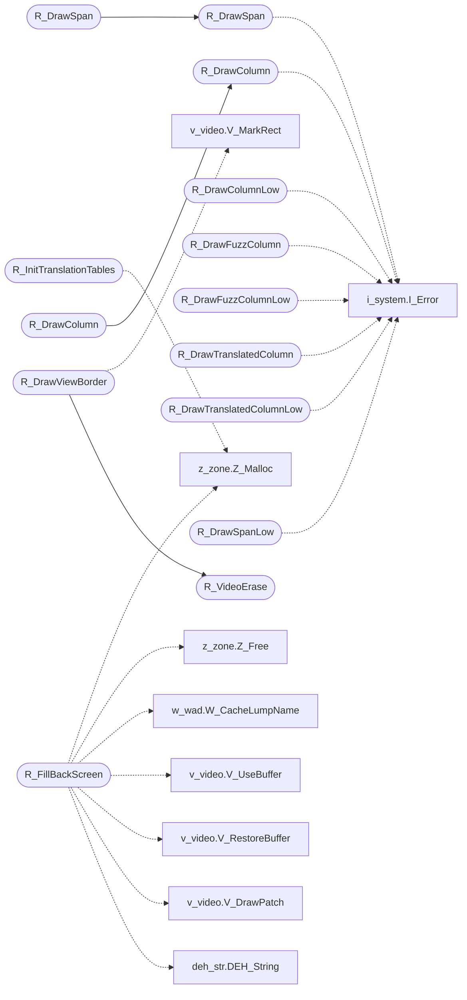

# `progs/doomgeneric/r_draw.c`

> Source: [progs/doomgeneric/r_draw.c:1](../../progs/doomgeneric/r_draw.c#L1) | language `c` | coverage 66.7% | [API index](../index.md)

Copyright(C) 1993-1996 Id Software, Inc.

Copyright(C) 2005-2014 Simon Howard  This program is free software; you can redistribute it and/or modify it under the terms of the GNU General Public License as published by the Free Software Foundation; either version 2 of the License, or (at your option) any later version.  This program is distributed in the hope that it will be useful, but WITHOUT ANY WARRANTY; without even the implied warranty of MERCHANTABILITY or FITNESS FOR A PARTICULAR PURPOSE.  See the GNU General Public License for more details.  DESCRIPTION: The actual span/column drawing functions. Here find the main potential for optimization, e.g. inline assembly, different algorithms.

## Contents

- **Functions:** [`R_DrawColumn`](#r_drawcolumn), [`R_DrawColumn`](#r_drawcolumn), [`R_DrawColumnLow`](#r_drawcolumnlow), [`R_DrawFuzzColumn`](#r_drawfuzzcolumn), [`R_DrawFuzzColumnLow`](#r_drawfuzzcolumnlow), [`R_DrawTranslatedColumn`](#r_drawtranslatedcolumn), [`R_DrawTranslatedColumnLow`](#r_drawtranslatedcolumnlow), [`R_InitTranslationTables`](#r_inittranslationtables), [`R_DrawSpan`](#r_drawspan), [`R_DrawSpan`](#r_drawspan), [`R_DrawSpanLow`](#r_drawspanlow), [`R_InitBuffer`](#r_initbuffer), [`R_FillBackScreen`](#r_fillbackscreen), [`R_VideoErase`](#r_videoerase), [`R_DrawViewBorder`](#r_drawviewborder)
- **Macros:** [`MAXWIDTH`](#maxwidth), [`MAXHEIGHT`](#maxheight), [`SBARHEIGHT`](#sbarheight), [`FUZZTABLE`](#fuzztable), [`FUZZOFF`](#fuzzoff)

## Call Graph

Solid arrows stay in this module, dashed arrows leave it.



## Functions

<a id="r_drawcolumn"></a>

### `R_DrawColumn`

`function` | [progs/doomgeneric/r_draw.c:102](../../progs/doomgeneric/r_draw.c#L102)

```c
void R_DrawColumn (void)
```

A column is a vertical slice/span from a wall texture that, given the DOOM style restrictions on the view orientation, will always have constant z depth.

Thus a special case loop for very fast rendering can be used. It has also been used with Wolfenstein 3D.

*Calls:* [`I_Error`](progs.doomgeneric.i_system.h.md#i_error)

*Called by:* [`R_DrawColumn`](#r_drawcolumn)

---

<a id="r_drawcolumn"></a>

### `R_DrawColumn`

`function` | [progs/doomgeneric/r_draw.c:152](../../progs/doomgeneric/r_draw.c#L152)

```c
void R_DrawColumn (void)
```

UNUSED.

Loop unrolled. if 0

*Calls:* [`R_DrawColumn`](#r_drawcolumn)

---

<a id="r_drawcolumnlow"></a>

### `R_DrawColumnLow`

`function` | [progs/doomgeneric/r_draw.c:208](../../progs/doomgeneric/r_draw.c#L208)

```c
void R_DrawColumnLow (void)
```

*Calls:* [`I_Error`](progs.doomgeneric.i_system.h.md#i_error)

---

<a id="r_drawfuzzcolumn"></a>

### `R_DrawFuzzColumn`

`function` | [progs/doomgeneric/r_draw.c:283](../../progs/doomgeneric/r_draw.c#L283)

```c
void R_DrawFuzzColumn (void)
```

Framebuffer postprocessing.

Creates a fuzzy image by copying pixels from adjacent ones to left and right. Used with an all black colormap, this could create the SHADOW effect, i.e. spectres and invisible players.

*Calls:* [`I_Error`](progs.doomgeneric.i_system.h.md#i_error)

---

<a id="r_drawfuzzcolumnlow"></a>

### `R_DrawFuzzColumnLow`

`function` | [progs/doomgeneric/r_draw.c:342](../../progs/doomgeneric/r_draw.c#L342)

```c
void R_DrawFuzzColumnLow (void)
```

*Calls:* [`I_Error`](progs.doomgeneric.i_system.h.md#i_error)

---

<a id="r_drawtranslatedcolumn"></a>

### `R_DrawTranslatedColumn`

`function` | [progs/doomgeneric/r_draw.c:424](../../progs/doomgeneric/r_draw.c#L424)

```c
void R_DrawTranslatedColumn (void)
```

Draw with color translation tables, for player sprite rendering, Green/Red/Blue/Indigo shirts.

> **Inherited:** Documentation from [`R_DrawTranslatedColumn`](#r_drawtranslatedcolumn) (progs/doomgeneric/r_draw.h:50).

*Calls:* [`I_Error`](progs.doomgeneric.i_system.h.md#i_error)

---

<a id="r_drawtranslatedcolumnlow"></a>

### `R_DrawTranslatedColumnLow`

`function` | [progs/doomgeneric/r_draw.c:468](../../progs/doomgeneric/r_draw.c#L468)

```c
void R_DrawTranslatedColumnLow (void)
```

*Calls:* [`I_Error`](progs.doomgeneric.i_system.h.md#i_error)

---

<a id="r_inittranslationtables"></a>

### `R_InitTranslationTables`

`function` | [progs/doomgeneric/r_draw.c:530](../../progs/doomgeneric/r_draw.c#L530)

```c
void R_InitTranslationTables (void)
```

R_InitTranslationTables Creates the translation tables to map the green color ramp to gray, brown, red.

Assumes a given structure of the PLAYPAL. Could be read from a lump instead.

*Calls:* [`Z_Malloc`](progs.doomgeneric.z_zone.h.md#z_malloc)

---

<a id="r_drawspan"></a>

### `R_DrawSpan`

`function` | [progs/doomgeneric/r_draw.c:590](../../progs/doomgeneric/r_draw.c#L590)

```c
void R_DrawSpan (void)
```

Draws the actual span.

*Calls:* [`I_Error`](progs.doomgeneric.i_system.h.md#i_error)

*Called by:* [`R_DrawSpan`](#r_drawspan)

---

<a id="r_drawspan"></a>

### `R_DrawSpan`

`function` | [progs/doomgeneric/r_draw.c:646](../../progs/doomgeneric/r_draw.c#L646)

```c
void R_DrawSpan (void)
```

UNUSED.

Loop unrolled by 4. if 0

*Calls:* [`R_DrawSpan`](#r_drawspan)

---

<a id="r_drawspanlow"></a>

### `R_DrawSpanLow`

`function` | [progs/doomgeneric/r_draw.c:719](../../progs/doomgeneric/r_draw.c#L719)

```c
void R_DrawSpanLow (void)
```

Again..

*Calls:* [`I_Error`](progs.doomgeneric.i_system.h.md#i_error)

---

<a id="r_initbuffer"></a>

### `R_InitBuffer`

`function` | [progs/doomgeneric/r_draw.c:777](../../progs/doomgeneric/r_draw.c#L777)

```c
void R_InitBuffer ( int width, int height )
```

**Parameters**

| Name | Type | Default | Description |
|---|---|---|---|
| `width` | `int` |  |  |
| `height` | `int` |  |  |

---

<a id="r_fillbackscreen"></a>

### `R_FillBackScreen`

`function` | [progs/doomgeneric/r_draw.c:812](../../progs/doomgeneric/r_draw.c#L812)

```c
void R_FillBackScreen (void)
```

R_FillBackScreen Fills the back screen with a pattern for variable screen sizes Also draws a beveled edge.

*Calls:* [`DEH_String`](progs.doomgeneric.deh_str.h.md#deh_string), [`V_DrawPatch`](progs.doomgeneric.v_video.h.md#v_drawpatch), [`V_RestoreBuffer`](progs.doomgeneric.v_video.h.md#v_restorebuffer), [`V_UseBuffer`](progs.doomgeneric.v_video.h.md#v_usebuffer), [`W_CacheLumpName`](progs.doomgeneric.w_wad.h.md#w_cachelumpname), [`Z_Free`](progs.doomgeneric.z_zone.h.md#z_free), [`Z_Malloc`](progs.doomgeneric.z_zone.h.md#z_malloc)

---

<a id="r_videoerase"></a>

### `R_VideoErase`

`function` | [progs/doomgeneric/r_draw.c:919](../../progs/doomgeneric/r_draw.c#L919)

```c
void R_VideoErase ( unsigned ofs, int count )
```

**Parameters**

| Name | Type | Default | Description |
|---|---|---|---|
| `ofs` | `unsigned` |  |  |
| `count` | `int` |  |  |

*Called by:* [`R_DrawViewBorder`](#r_drawviewborder)

---

<a id="r_drawviewborder"></a>

### `R_DrawViewBorder`

`function` | [progs/doomgeneric/r_draw.c:941](../../progs/doomgeneric/r_draw.c#L941)

```c
void R_DrawViewBorder (void)
```

R_DrawViewBorder Draws the border around the view for different size windows?

*Calls:* [`R_VideoErase`](#r_videoerase), [`V_MarkRect`](progs.doomgeneric.v_video.h.md#v_markrect)

---

## Macros

<a id="maxwidth"></a>

### `MAXWIDTH`

`macro` | [progs/doomgeneric/r_draw.c:41](../../progs/doomgeneric/r_draw.c#L41)

```c
#define MAXWIDTH
```

?

---

<a id="maxheight"></a>

### `MAXHEIGHT`

`macro` | [progs/doomgeneric/r_draw.c:42](../../progs/doomgeneric/r_draw.c#L42)

```c
#define MAXHEIGHT
```

---

<a id="sbarheight"></a>

### `SBARHEIGHT`

`macro` | [progs/doomgeneric/r_draw.c:45](../../progs/doomgeneric/r_draw.c#L45)

```c
#define SBARHEIGHT
```

status bar height at bottom of screen

---

<a id="fuzztable"></a>

### `FUZZTABLE`

`macro` | [progs/doomgeneric/r_draw.c:257](../../progs/doomgeneric/r_draw.c#L257)

```c
#define FUZZTABLE
```

Spectre/Invisibility.

---

<a id="fuzzoff"></a>

### `FUZZOFF`

`macro` | [progs/doomgeneric/r_draw.c:258](../../progs/doomgeneric/r_draw.c#L258)

```c
#define FUZZOFF
```

---
