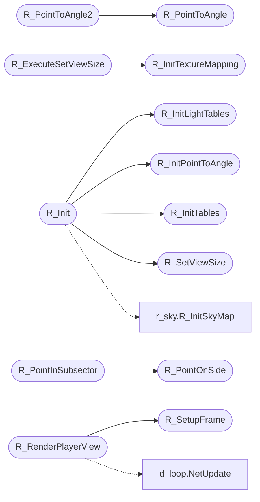

# `progs/doomgeneric/r_main.c`

> Source: [progs/doomgeneric/r_main.c:1](../../progs/doomgeneric/r_main.c#L1) | language `c` | coverage 60.0% | [API index](../index.md)

Copyright(C) 1993-1996 Id Software, Inc.

Copyright(C) 2005-2014 Simon Howard  This program is free software; you can redistribute it and/or modify it under the terms of the GNU General Public License as published by the Free Software Foundation; either version 2 of the License, or (at your option) any later version.  This program is distributed in the hope that it will be useful, but WITHOUT ANY WARRANTY; without even the implied warranty of MERCHANTABILITY or FITNESS FOR A PARTICULAR PURPOSE.  See the GNU General Public License for more details.  DESCRIPTION: Rendering main loop and setup functions, utility functions (BSP, geometry, trigonometry). See tables.c, too.

## Contents

- **Functions:** [`R_AddPointToBox`](#r_addpointtobox), [`R_PointOnSide`](#r_pointonside), [`R_PointOnSegSide`](#r_pointonsegside), [`R_PointToAngle`](#r_pointtoangle), [`R_PointToAngle2`](#r_pointtoangle2), [`R_PointToDist`](#r_pointtodist), [`R_InitPointToAngle`](#r_initpointtoangle), [`R_ScaleFromGlobalAngle`](#r_scalefromglobalangle), [`R_InitTables`](#r_inittables), [`R_InitTextureMapping`](#r_inittexturemapping), [`R_InitLightTables`](#r_initlighttables), [`R_SetViewSize`](#r_setviewsize), [`R_ExecuteSetViewSize`](#r_executesetviewsize), [`R_Init`](#r_init), [`R_PointInSubsector`](#r_pointinsubsector), [`R_SetupFrame`](#r_setupframe), [`R_RenderPlayerView`](#r_renderplayerview)
- **Macros:** [`FIELDOFVIEW`](#fieldofview), [`DISTMAP`](#distmap)
- **Variables:** [`walllights`](#walllights)

## Call Graph

Solid arrows stay in this module, dashed arrows leave it.



## Functions

<a id="r_addpointtobox"></a>

### `R_AddPointToBox`

`function` | [progs/doomgeneric/r_main.c:123](../../progs/doomgeneric/r_main.c#L123)

```c
void R_AddPointToBox ( int x, int y, fixed_t* box )
```

**Parameters**

| Name | Type | Default | Description |
|---|---|---|---|
| `x` | `int` |  |  |
| `y` | `int` |  |  |
| `box` | `fixed_t*` |  |  |

---

<a id="r_pointonside"></a>

### `R_PointOnSide`

`function` | [progs/doomgeneric/r_main.c:146](../../progs/doomgeneric/r_main.c#L146)

```c
int R_PointOnSide ( fixed_t x, fixed_t y, node_t* node )
```

**Parameters**

| Name | Type | Default | Description |
|---|---|---|---|
| `x` | `fixed_t` |  |  |
| `y` | `fixed_t` |  |  |
| `node` | `node_t*` |  |  |

**Returns:** `int`

*Called by:* [`R_PointInSubsector`](#r_pointinsubsector)

---

<a id="r_pointonsegside"></a>

### `R_PointOnSegSide`

`function` | [progs/doomgeneric/r_main.c:199](../../progs/doomgeneric/r_main.c#L199)

```c
int R_PointOnSegSide ( fixed_t x, fixed_t y, seg_t* line )
```

**Parameters**

| Name | Type | Default | Description |
|---|---|---|---|
| `x` | `fixed_t` |  |  |
| `y` | `fixed_t` |  |  |
| `line` | `seg_t*` |  |  |

**Returns:** `int`

---

<a id="r_pointtoangle"></a>

### `R_PointToAngle`

`function` | [progs/doomgeneric/r_main.c:276](../../progs/doomgeneric/r_main.c#L276)

```c
angle_t R_PointToAngle ( fixed_t x, fixed_t y )
```

**Parameters**

| Name | Type | Default | Description |
|---|---|---|---|
| `x` | `fixed_t` |  |  |
| `y` | `fixed_t` |  |  |

**Returns:** `angle_t`

*Called by:* [`R_PointToAngle2`](#r_pointtoangle2)

---

<a id="r_pointtoangle2"></a>

### `R_PointToAngle2`

`function` | [progs/doomgeneric/r_main.c:362](../../progs/doomgeneric/r_main.c#L362)

```c
angle_t R_PointToAngle2 ( fixed_t x1, fixed_t y1, fixed_t x2, fixed_t y2 )
```

**Parameters**

| Name | Type | Default | Description |
|---|---|---|---|
| `x1` | `fixed_t` |  |  |
| `y1` | `fixed_t` |  |  |
| `x2` | `fixed_t` |  |  |
| `y2` | `fixed_t` |  |  |

**Returns:** `angle_t`

*Calls:* [`R_PointToAngle`](#r_pointtoangle)

---

<a id="r_pointtodist"></a>

### `R_PointToDist`

`function` | [progs/doomgeneric/r_main.c:376](../../progs/doomgeneric/r_main.c#L376)

```c
fixed_t R_PointToDist ( fixed_t x, fixed_t y )
```

**Parameters**

| Name | Type | Default | Description |
|---|---|---|---|
| `x` | `fixed_t` |  |  |
| `y` | `fixed_t` |  |  |

**Returns:** `fixed_t`

---

<a id="r_initpointtoangle"></a>

### `R_InitPointToAngle`

`function` | [progs/doomgeneric/r_main.c:422](../../progs/doomgeneric/r_main.c#L422)

```c
void R_InitPointToAngle (void)
```

R_InitPointToAngle

*Called by:* [`R_Init`](#r_init)

---

<a id="r_scalefromglobalangle"></a>

### `R_ScaleFromGlobalAngle`

`function` | [progs/doomgeneric/r_main.c:449](../../progs/doomgeneric/r_main.c#L449)

```c
fixed_t R_ScaleFromGlobalAngle (angle_t visangle)
```

R_ScaleFromGlobalAngle Returns the texture mapping scale for the current line (horizontal span) at the given angle. rw_distance must be calculated first.

**Parameters**

| Name | Type | Default | Description |
|---|---|---|---|
| `visangle` | `angle_t` |  |  |

**Returns:** `fixed_t`

---

<a id="r_inittables"></a>

### `R_InitTables`

`function` | [progs/doomgeneric/r_main.c:505](../../progs/doomgeneric/r_main.c#L505)

```c
void R_InitTables (void)
```

R_InitTables

*Called by:* [`R_Init`](#r_init)

---

<a id="r_inittexturemapping"></a>

### `R_InitTextureMapping`

`function` | [progs/doomgeneric/r_main.c:540](../../progs/doomgeneric/r_main.c#L540)

```c
void R_InitTextureMapping (void)
```

R_InitTextureMapping

*Called by:* [`R_ExecuteSetViewSize`](#r_executesetviewsize)

---

<a id="r_initlighttables"></a>

### `R_InitLightTables`

`function` | [progs/doomgeneric/r_main.c:610](../../progs/doomgeneric/r_main.c#L610)

```c
void R_InitLightTables (void)
```

*Called by:* [`R_Init`](#r_init)

---

<a id="r_setviewsize"></a>

### `R_SetViewSize`

`function` | [progs/doomgeneric/r_main.c:654](../../progs/doomgeneric/r_main.c#L654)

```c
void R_SetViewSize ( int blocks, int detail )
```

Called by M_Responder.

**Parameters**

| Name | Type | Default | Description |
|---|---|---|---|
| `blocks` | `int` |  |  |
| `detail` | `int` |  |  |

> **Inherited:** Documentation from [`R_SetViewSize`](#r_setviewsize) (progs/doomgeneric/r_main.h:158).

*Called by:* [`R_Init`](#r_init)

---

<a id="r_executesetviewsize"></a>

### `R_ExecuteSetViewSize`

`function` | [progs/doomgeneric/r_main.c:667](../../progs/doomgeneric/r_main.c#L667)

```c
void R_ExecuteSetViewSize (void)
```

R_ExecuteSetViewSize

*Calls:* [`R_InitTextureMapping`](#r_inittexturemapping)

---

<a id="r_init"></a>

### `R_Init`

`function` | [progs/doomgeneric/r_main.c:767](../../progs/doomgeneric/r_main.c#L767)

```c
void R_Init (void)
```

Called by startup code.

> **Inherited:** Documentation from [`R_Init`](#r_init) (progs/doomgeneric/r_main.h:155).

*Calls:* [`R_InitLightTables`](#r_initlighttables), [`R_InitPointToAngle`](#r_initpointtoangle), [`R_InitTables`](#r_inittables), [`R_SetViewSize`](#r_setviewsize), [`R_InitSkyMap`](progs.doomgeneric.r_sky.h.md#r_initskymap)

---

<a id="r_pointinsubsector"></a>

### `R_PointInSubsector`

`function` | [progs/doomgeneric/r_main.c:794](../../progs/doomgeneric/r_main.c#L794)

```c
subsector_t* R_PointInSubsector ( fixed_t x, fixed_t y )
```

**Parameters**

| Name | Type | Default | Description |
|---|---|---|---|
| `x` | `fixed_t` |  |  |
| `y` | `fixed_t` |  |  |

**Returns:** `subsector_t*`

*Calls:* [`R_PointOnSide`](#r_pointonside)

---

<a id="r_setupframe"></a>

### `R_SetupFrame`

`function` | [progs/doomgeneric/r_main.c:823](../../progs/doomgeneric/r_main.c#L823)

```c
void R_SetupFrame (player_t* player)
```

R_SetupFrame

**Parameters**

| Name | Type | Default | Description |
|---|---|---|---|
| `player` | `player_t*` |  |  |

*Called by:* [`R_RenderPlayerView`](#r_renderplayerview)

---

<a id="r_renderplayerview"></a>

### `R_RenderPlayerView`

`function` | [progs/doomgeneric/r_main.c:863](../../progs/doomgeneric/r_main.c#L863)

```c
void R_RenderPlayerView (player_t* player)
```

R_RenderView

**Parameters**

| Name | Type | Default | Description |
|---|---|---|---|
| `player` | `player_t*` |  |  |

*Calls:* [`NetUpdate`](progs.doomgeneric.d_loop.h.md#netupdate), [`R_SetupFrame`](#r_setupframe)

---

## Macros

<a id="fieldofview"></a>

### `FIELDOFVIEW`

`macro` | [progs/doomgeneric/r_main.c:43](../../progs/doomgeneric/r_main.c#L43)

```c
#define FIELDOFVIEW
```

Fineangles in the SCREENWIDTH wide window.

---

<a id="distmap"></a>

### `DISTMAP`

`macro` | [progs/doomgeneric/r_main.c:608](../../progs/doomgeneric/r_main.c#L608)

```c
#define DISTMAP
```

R_InitLightTables Only inits the zlight table, because the scalelight table changes with view size.

---

## Variables

<a id="walllights"></a>

### `walllights`

`variable` `extern` | [progs/doomgeneric/r_main.c:54](../../progs/doomgeneric/r_main.c#L54)

```c
extern lighttable_t** walllights;
```

---
