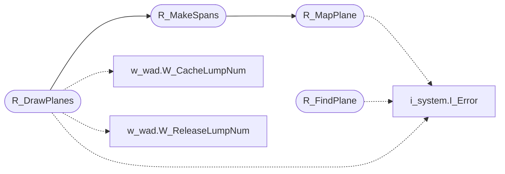

# `progs/doomgeneric/r_plane.c`

> Source: [progs/doomgeneric/r_plane.c:1](../../progs/doomgeneric/r_plane.c#L1) | language `c` | coverage 60.0% | [API index](../index.md)

Copyright(C) 1993-1996 Id Software, Inc.

Copyright(C) 2005-2014 Simon Howard  This program is free software; you can redistribute it and/or modify it under the terms of the GNU General Public License as published by the Free Software Foundation; either version 2 of the License, or (at your option) any later version.  This program is distributed in the hope that it will be useful, but WITHOUT ANY WARRANTY; without even the implied warranty of MERCHANTABILITY or FITNESS FOR A PARTICULAR PURPOSE.  See the GNU General Public License for more details.  DESCRIPTION: Here is a core component: drawing the floors and ceilings, while maintaining a per column clipping list only. Moreover, the sky areas have to be determined.

## Contents

- **Functions:** [`R_InitPlanes`](#r_initplanes), [`R_MapPlane`](#r_mapplane), [`R_ClearPlanes`](#r_clearplanes), [`R_FindPlane`](#r_findplane), [`R_CheckPlane`](#r_checkplane), [`R_MakeSpans`](#r_makespans), [`R_DrawPlanes`](#r_drawplanes)
- **Macros:** [`MAXVISPLANES`](#maxvisplanes), [`MAXOPENINGS`](#maxopenings)

## Call Graph

Solid arrows stay in this module, dashed arrows leave it.



## Functions

<a id="r_initplanes"></a>

### `R_InitPlanes`

`function` | [progs/doomgeneric/r_plane.c:94](../../progs/doomgeneric/r_plane.c#L94)

```c
void R_InitPlanes (void)
```

R_InitPlanes Only at game startup.

---

<a id="r_mapplane"></a>

### `R_MapPlane`

`function` | [progs/doomgeneric/r_plane.c:114](../../progs/doomgeneric/r_plane.c#L114)

```c
void R_MapPlane ( int y, int x1, int x2 )
```

**Parameters**

| Name | Type | Default | Description |
|---|---|---|---|
| `y` | `int` |  |  |
| `x1` | `int` |  |  |
| `x2` | `int` |  |  |

*Calls:* [`I_Error`](progs.doomgeneric.i_system.h.md#i_error)

*Called by:* [`R_MakeSpans`](#r_makespans)

---

<a id="r_clearplanes"></a>

### `R_ClearPlanes`

`function` | [progs/doomgeneric/r_plane.c:178](../../progs/doomgeneric/r_plane.c#L178)

```c
void R_ClearPlanes (void)
```

R_ClearPlanes At begining of frame.

---

<a id="r_findplane"></a>

### `R_FindPlane`

`function` | [progs/doomgeneric/r_plane.c:211](../../progs/doomgeneric/r_plane.c#L211)

```c
visplane_t* R_FindPlane ( fixed_t height, int picnum, int lightlevel )
```

**Parameters**

| Name | Type | Default | Description |
|---|---|---|---|
| `height` | `fixed_t` |  |  |
| `picnum` | `int` |  |  |
| `lightlevel` | `int` |  |  |

**Returns:** `visplane_t*`

*Calls:* [`I_Error`](progs.doomgeneric.i_system.h.md#i_error)

---

<a id="r_checkplane"></a>

### `R_CheckPlane`

`function` | [progs/doomgeneric/r_plane.c:259](../../progs/doomgeneric/r_plane.c#L259)

```c
visplane_t* R_CheckPlane ( visplane_t* pl, int start, int stop )
```

**Parameters**

| Name | Type | Default | Description |
|---|---|---|---|
| `pl` | `visplane_t*` |  |  |
| `start` | `int` |  |  |
| `stop` | `int` |  |  |

**Returns:** `visplane_t*`

---

<a id="r_makespans"></a>

### `R_MakeSpans`

`function` | [progs/doomgeneric/r_plane.c:324](../../progs/doomgeneric/r_plane.c#L324)

```c
void R_MakeSpans ( int x, int t1, int b1, int t2, int b2 )
```

**Parameters**

| Name | Type | Default | Description |
|---|---|---|---|
| `x` | `int` |  |  |
| `t1` | `int` |  |  |
| `b1` | `int` |  |  |
| `t2` | `int` |  |  |
| `b2` | `int` |  |  |

*Calls:* [`R_MapPlane`](#r_mapplane)

*Called by:* [`R_DrawPlanes`](#r_drawplanes)

---

<a id="r_drawplanes"></a>

### `R_DrawPlanes`

`function` | [progs/doomgeneric/r_plane.c:360](../../progs/doomgeneric/r_plane.c#L360)

```c
void R_DrawPlanes (void)
```

R_DrawPlanes At the end of each frame.

*Calls:* [`I_Error`](progs.doomgeneric.i_system.h.md#i_error), [`R_MakeSpans`](#r_makespans), [`W_CacheLumpNum`](progs.doomgeneric.w_wad.h.md#w_cachelumpnum), [`W_ReleaseLumpNum`](progs.doomgeneric.w_wad.h.md#w_releaselumpnum)

---

## Macros

<a id="maxvisplanes"></a>

### `MAXVISPLANES`

`macro` | [progs/doomgeneric/r_plane.c:45](../../progs/doomgeneric/r_plane.c#L45)

```c
#define MAXVISPLANES
```

Here comes the obnoxious "visplane".

---

<a id="maxopenings"></a>

### `MAXOPENINGS`

`macro` | [progs/doomgeneric/r_plane.c:52](../../progs/doomgeneric/r_plane.c#L52)

```c
#define MAXOPENINGS
```

?

---
