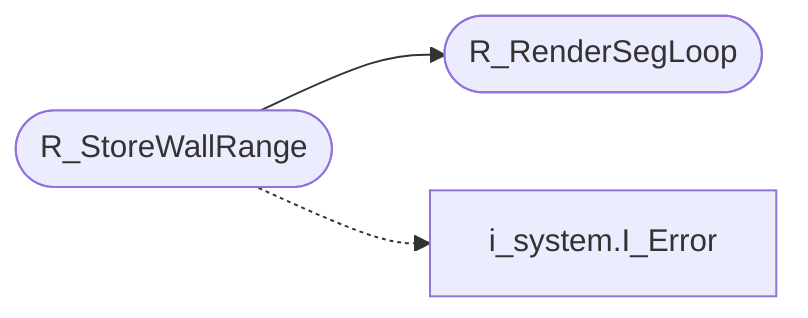

# `progs/doomgeneric/r_segs.c`

> Source: [progs/doomgeneric/r_segs.c:1](../../progs/doomgeneric/r_segs.c#L1) | language `c` | coverage 33.3% | [API index](../index.md)

Copyright(C) 1993-1996 Id Software, Inc.

Copyright(C) 2005-2014 Simon Howard  This program is free software; you can redistribute it and/or modify it under the terms of the GNU General Public License as published by the Free Software Foundation; either version 2 of the License, or (at your option) any later version.  This program is distributed in the hope that it will be useful, but WITHOUT ANY WARRANTY; without even the implied warranty of MERCHANTABILITY or FITNESS FOR A PARTICULAR PURPOSE.  See the GNU General Public License for more details.  DESCRIPTION: All the clipping: columns, horizontal spans, sky columns.

## Contents

- **Functions:** [`R_RenderMaskedSegRange`](#r_rendermaskedsegrange), [`R_RenderSegLoop`](#r_rendersegloop), [`R_StoreWallRange`](#r_storewallrange)
- **Macros:** [`HEIGHTBITS`](#heightbits), [`HEIGHTUNIT`](#heightunit)

## Call Graph

Solid arrows stay in this module, dashed arrows leave it.



## Functions

<a id="r_rendermaskedsegrange"></a>

### `R_RenderMaskedSegRange`

`function` | [progs/doomgeneric/r_segs.c:96](../../progs/doomgeneric/r_segs.c#L96)

```c
void R_RenderMaskedSegRange ( drawseg_t* ds, int x1, int x2 )
```

**Parameters**

| Name | Type | Default | Description |
|---|---|---|---|
| `ds` | `drawseg_t*` |  |  |
| `x1` | `int` |  |  |
| `x2` | `int` |  |  |

---

<a id="r_rendersegloop"></a>

### `R_RenderSegLoop`

`function` | [progs/doomgeneric/r_segs.c:199](../../progs/doomgeneric/r_segs.c#L199)

```c
void R_RenderSegLoop (void)
```

*Called by:* [`R_StoreWallRange`](#r_storewallrange)

---

<a id="r_storewallrange"></a>

### `R_StoreWallRange`

`function` | [progs/doomgeneric/r_segs.c:372](../../progs/doomgeneric/r_segs.c#L372)

```c
void R_StoreWallRange ( int start, int stop )
```

**Parameters**

| Name | Type | Default | Description |
|---|---|---|---|
| `start` | `int` |  |  |
| `stop` | `int` |  |  |

*Calls:* [`I_Error`](progs.doomgeneric.i_system.h.md#i_error), [`R_RenderSegLoop`](#r_rendersegloop)

---

## Macros

<a id="heightbits"></a>

### `HEIGHTBITS`

`macro` | [progs/doomgeneric/r_segs.c:196](../../progs/doomgeneric/r_segs.c#L196)

```c
#define HEIGHTBITS
```

R_RenderSegLoop Draws zero, one, or two textures (and possibly a masked texture) for walls.

Can draw or mark the starting pixel of floor and ceiling textures. CALLED: CORE LOOPING ROUTINE.

---

<a id="heightunit"></a>

### `HEIGHTUNIT`

`macro` | [progs/doomgeneric/r_segs.c:197](../../progs/doomgeneric/r_segs.c#L197)

```c
#define HEIGHTUNIT
```

---
