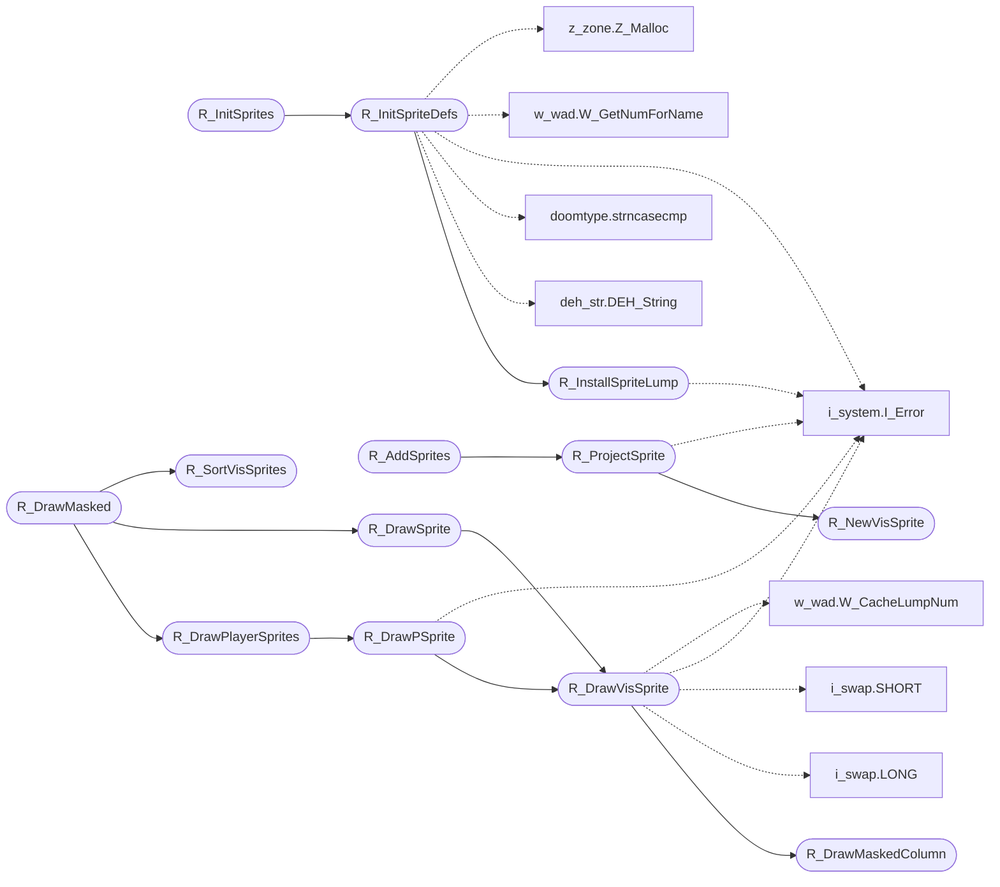

# `progs/doomgeneric/r_things.c`

> Source: [progs/doomgeneric/r_things.c:1](../../progs/doomgeneric/r_things.c#L1) | language `c` | coverage 50.0% | [API index](../index.md)

Copyright(C) 1993-1996 Id Software, Inc.

Copyright(C) 2005-2014 Simon Howard  This program is free software; you can redistribute it and/or modify it under the terms of the GNU General Public License as published by the Free Software Foundation; either version 2 of the License, or (at your option) any later version.  This program is distributed in the hope that it will be useful, but WITHOUT ANY WARRANTY; without even the implied warranty of MERCHANTABILITY or FITNESS FOR A PARTICULAR PURPOSE.  See the GNU General Public License for more details.  DESCRIPTION: Refresh of things, i.e. objects represented by sprites.

## Contents

- **Structs:** [`maskdraw_t`](#maskdraw_t)
- **Functions:** [`R_InstallSpriteLump`](#r_installspritelump), [`R_InitSpriteDefs`](#r_initspritedefs), [`R_InitSprites`](#r_initsprites), [`R_ClearSprites`](#r_clearsprites), [`R_NewVisSprite`](#r_newvissprite), [`R_DrawMaskedColumn`](#r_drawmaskedcolumn), [`R_DrawVisSprite`](#r_drawvissprite), [`R_ProjectSprite`](#r_projectsprite), [`R_AddSprites`](#r_addsprites), [`R_DrawPSprite`](#r_drawpsprite), [`R_DrawPlayerSprites`](#r_drawplayersprites), [`R_SortVisSprites`](#r_sortvissprites), [`R_DrawSprite`](#r_drawsprite), [`R_DrawMasked`](#r_drawmasked)
- **Macros:** [`MINZ`](#minz), [`BASEYCENTER`](#baseycenter)

## Call Graph

Solid arrows stay in this module, dashed arrows leave it.



## Structs

<a id="maskdraw_t"></a>

### `maskdraw_t`

`struct` | [progs/doomgeneric/r_things.c:48](../../progs/doomgeneric/r_things.c#L48)

```c
typedef struct
```

---

## Functions

<a id="r_installspritelump"></a>

### `R_InstallSpriteLump`

`function` | [progs/doomgeneric/r_things.c:100](../../progs/doomgeneric/r_things.c#L100)

```c
void R_InstallSpriteLump ( int lump, unsigned frame, unsigned rotation, boolean flipped )
```

**Parameters**

| Name | Type | Default | Description |
|---|---|---|---|
| `lump` | `int` |  |  |
| `frame` | `unsigned` |  |  |
| `rotation` | `unsigned` |  |  |
| `flipped` | `boolean` |  |  |

*Calls:* [`I_Error`](progs.doomgeneric.i_system.h.md#i_error)

*Called by:* [`R_InitSpriteDefs`](#r_initspritedefs)

---

<a id="r_initspritedefs"></a>

### `R_InitSpriteDefs`

`function` | [progs/doomgeneric/r_things.c:171](../../progs/doomgeneric/r_things.c#L171)

```c
void R_InitSpriteDefs (char** namelist)
```

R_InitSpriteDefs Pass a null terminated list of sprite names (4 chars exactly) to be used.

Builds the sprite rotation matrixes to account for horizontally flipped sprites. Will report an error if the lumps are inconsistant. Only called at startup.

Sprite lump names are 4 characters for the actor,
 a letter for the frame, and a number for the rotation.
A sprite that is flippable will have an additional
 letter/number appended.
The rotation character can be 0 to signify no rotations.

**Parameters**

| Name | Type | Default | Description |
|---|---|---|---|
| `namelist` | `char**` |  |  |

*Calls:* [`DEH_String`](progs.doomgeneric.deh_str.h.md#deh_string), [`strncasecmp`](progs.doomgeneric.doomtype.h.md#strncasecmp), [`I_Error`](progs.doomgeneric.i_system.h.md#i_error), [`R_InstallSpriteLump`](#r_installspritelump), [`W_GetNumForName`](progs.doomgeneric.w_wad.h.md#w_getnumforname), [`Z_Malloc`](progs.doomgeneric.z_zone.h.md#z_malloc)

*Called by:* [`R_InitSprites`](#r_initsprites)

---

<a id="r_initsprites"></a>

### `R_InitSprites`

`function` | [progs/doomgeneric/r_things.c:291](../../progs/doomgeneric/r_things.c#L291)

```c
void R_InitSprites (char** namelist)
```

R_InitSprites Called at program start.

**Parameters**

| Name | Type | Default | Description |
|---|---|---|---|
| `namelist` | `char**` |  |  |

*Calls:* [`R_InitSpriteDefs`](#r_initspritedefs)

---

<a id="r_clearsprites"></a>

### `R_ClearSprites`

`function` | [progs/doomgeneric/r_things.c:309](../../progs/doomgeneric/r_things.c#L309)

```c
void R_ClearSprites (void)
```

R_ClearSprites Called at frame start.

---

<a id="r_newvissprite"></a>

### `R_NewVisSprite`

`function` | [progs/doomgeneric/r_things.c:320](../../progs/doomgeneric/r_things.c#L320)

```c
vissprite_t* R_NewVisSprite (void)
```

**Returns:** `vissprite_t*`

*Called by:* [`R_ProjectSprite`](#r_projectsprite)

---

<a id="r_drawmaskedcolumn"></a>

### `R_DrawMaskedColumn`

`function` | [progs/doomgeneric/r_things.c:343](../../progs/doomgeneric/r_things.c#L343)

```c
void R_DrawMaskedColumn (column_t* column)
```

**Parameters**

| Name | Type | Default | Description |
|---|---|---|---|
| `column` | `column_t*` |  |  |

*Called by:* [`R_DrawVisSprite`](#r_drawvissprite)

---

<a id="r_drawvissprite"></a>

### `R_DrawVisSprite`

`function` | [progs/doomgeneric/r_things.c:389](../../progs/doomgeneric/r_things.c#L389)

```c
void R_DrawVisSprite ( vissprite_t* vis, int x1, int x2 )
```

**Parameters**

| Name | Type | Default | Description |
|---|---|---|---|
| `vis` | `vissprite_t*` |  |  |
| `x1` | `int` |  |  |
| `x2` | `int` |  |  |

*Calls:* [`LONG`](progs.doomgeneric.i_swap.h.md#long), [`SHORT`](progs.doomgeneric.i_swap.h.md#short), [`I_Error`](progs.doomgeneric.i_system.h.md#i_error), [`R_DrawMaskedColumn`](#r_drawmaskedcolumn), [`W_CacheLumpNum`](progs.doomgeneric.w_wad.h.md#w_cachelumpnum)

*Called by:* [`R_DrawPSprite`](#r_drawpsprite), [`R_DrawSprite`](#r_drawsprite)

---

<a id="r_projectsprite"></a>

### `R_ProjectSprite`

`function` | [progs/doomgeneric/r_things.c:444](../../progs/doomgeneric/r_things.c#L444)

```c
void R_ProjectSprite (mobj_t* thing)
```

R_ProjectSprite Generates a vissprite for a thing if it might be visible.

**Parameters**

| Name | Type | Default | Description |
|---|---|---|---|
| `thing` | `mobj_t*` |  |  |

*Calls:* [`I_Error`](progs.doomgeneric.i_system.h.md#i_error), [`R_NewVisSprite`](#r_newvissprite)

*Called by:* [`R_AddSprites`](#r_addsprites)

---

<a id="r_addsprites"></a>

### `R_AddSprites`

`function` | [progs/doomgeneric/r_things.c:605](../../progs/doomgeneric/r_things.c#L605)

```c
void R_AddSprites (sector_t* sec)
```

R_AddSprites During BSP traversal, this adds sprites by sector.

**Parameters**

| Name | Type | Default | Description |
|---|---|---|---|
| `sec` | `sector_t*` |  |  |

*Calls:* [`R_ProjectSprite`](#r_projectsprite)

---

<a id="r_drawpsprite"></a>

### `R_DrawPSprite`

`function` | [progs/doomgeneric/r_things.c:638](../../progs/doomgeneric/r_things.c#L638)

```c
void R_DrawPSprite (pspdef_t* psp)
```

R_DrawPSprite

**Parameters**

| Name | Type | Default | Description |
|---|---|---|---|
| `psp` | `pspdef_t*` |  |  |

*Calls:* [`I_Error`](progs.doomgeneric.i_system.h.md#i_error), [`R_DrawVisSprite`](#r_drawvissprite)

*Called by:* [`R_DrawPlayerSprites`](#r_drawplayersprites)

---

<a id="r_drawplayersprites"></a>

### `R_DrawPlayerSprites`

`function` | [progs/doomgeneric/r_things.c:738](../../progs/doomgeneric/r_things.c#L738)

```c
void R_DrawPlayerSprites (void)
```

R_DrawPlayerSprites

*Calls:* [`R_DrawPSprite`](#r_drawpsprite)

*Called by:* [`R_DrawMasked`](#r_drawmasked)

---

<a id="r_sortvissprites"></a>

### `R_SortVisSprites`

`function` | [progs/doomgeneric/r_things.c:779](../../progs/doomgeneric/r_things.c#L779)

```c
void R_SortVisSprites (void)
```

*Called by:* [`R_DrawMasked`](#r_drawmasked)

---

<a id="r_drawsprite"></a>

### `R_DrawSprite`

`function` | [progs/doomgeneric/r_things.c:837](../../progs/doomgeneric/r_things.c#L837)

```c
void R_DrawSprite (vissprite_t* spr)
```

**Parameters**

| Name | Type | Default | Description |
|---|---|---|---|
| `spr` | `vissprite_t*` |  |  |

*Calls:* [`R_DrawVisSprite`](#r_drawvissprite)

*Called by:* [`R_DrawMasked`](#r_drawmasked)

---

<a id="r_drawmasked"></a>

### `R_DrawMasked`

`function` | [progs/doomgeneric/r_things.c:951](../../progs/doomgeneric/r_things.c#L951)

```c
void R_DrawMasked (void)
```

R_DrawMasked

*Calls:* [`R_DrawPlayerSprites`](#r_drawplayersprites), [`R_DrawSprite`](#r_drawsprite), [`R_SortVisSprites`](#r_sortvissprites)

---

## Macros

<a id="minz"></a>

### `MINZ`

`macro` | [progs/doomgeneric/r_things.c:40](../../progs/doomgeneric/r_things.c#L40)

```c
#define MINZ
```

---

<a id="baseycenter"></a>

### `BASEYCENTER`

`macro` | [progs/doomgeneric/r_things.c:41](../../progs/doomgeneric/r_things.c#L41)

```c
#define BASEYCENTER
```

---
