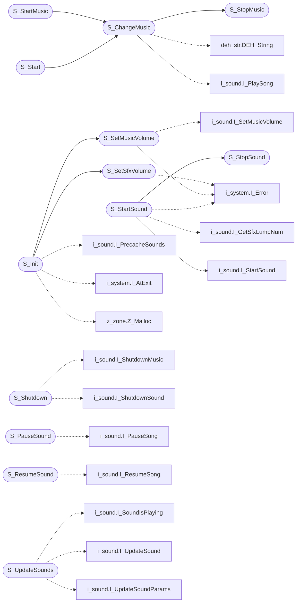

# `progs/doomgeneric/s_sound.c`

> Source: [progs/doomgeneric/s_sound.c:1](../../progs/doomgeneric/s_sound.c#L1) | language `c` | coverage 30.4% | [API index](../index.md)

Copyright(C) 1993-1996 Id Software, Inc.

Copyright(C) 2005-2014 Simon Howard  This program is free software; you can redistribute it and/or modify it under the terms of the GNU General Public License as published by the Free Software Foundation; either version 2 of the License, or (at your option) any later version.  This program is distributed in the hope that it will be useful, but WITHOUT ANY WARRANTY; without even the implied warranty of MERCHANTABILITY or FITNESS FOR A PARTICULAR PURPOSE.  See the GNU General Public License for more details.  DESCRIPTION:  none

## Contents

- **Structs:** [`channel_t`](#channel_t)
- **Functions:** [`S_Init`](#s_init), [`S_Shutdown`](#s_shutdown), [`S_Start`](#s_start), [`S_StopSound`](#s_stopsound), [`S_StartSound`](#s_startsound), [`S_PauseSound`](#s_pausesound), [`S_ResumeSound`](#s_resumesound), [`S_UpdateSounds`](#s_updatesounds), [`S_SetMusicVolume`](#s_setmusicvolume), [`S_SetSfxVolume`](#s_setsfxvolume), [`S_StartMusic`](#s_startmusic), [`S_ChangeMusic`](#s_changemusic), [`S_MusicPlaying`](#s_musicplaying), [`S_StopMusic`](#s_stopmusic)
- **Macros:** [`S_CLIPPING_DIST`](#s_clipping_dist), [`S_CLOSE_DIST`](#s_close_dist), [`S_ATTENUATOR`](#s_attenuator), [`S_STEREO_SWING`](#s_stereo_swing), [`NORM_PITCH`](#norm_pitch), [`NORM_PRIORITY`](#norm_priority), [`NORM_SEP`](#norm_sep)

## Call Graph

Solid arrows stay in this module, dashed arrows leave it.



## Structs

<a id="channel_t"></a>

### `channel_t`

`struct` | [progs/doomgeneric/s_sound.c:66](../../progs/doomgeneric/s_sound.c#L66)

```c
typedef struct
```

---

## Functions

<a id="s_init"></a>

### `S_Init`

`function` | [progs/doomgeneric/s_sound.c:114](../../progs/doomgeneric/s_sound.c#L114)

```c
void S_Init(int sfxVolume, int musicVolume)
```

**Parameters**

| Name | Type | Default | Description |
|---|---|---|---|
| `sfxVolume` | `int` |  |  |
| `musicVolume` | `int` |  |  |

*Calls:* [`I_PrecacheSounds`](progs.doomgeneric.i_sound.h.md#i_precachesounds), [`I_AtExit`](progs.doomgeneric.i_system.h.md#i_atexit), [`S_SetMusicVolume`](#s_setmusicvolume), [`S_SetSfxVolume`](#s_setsfxvolume), [`Z_Malloc`](progs.doomgeneric.z_zone.h.md#z_malloc)

---

<a id="s_shutdown"></a>

### `S_Shutdown`

`function` | [progs/doomgeneric/s_sound.c:146](../../progs/doomgeneric/s_sound.c#L146)

```c
void S_Shutdown(void)
```

*Calls:* [`I_ShutdownMusic`](progs.doomgeneric.i_sound.h.md#i_shutdownmusic), [`I_ShutdownSound`](progs.doomgeneric.i_sound.h.md#i_shutdownsound)

---

<a id="s_start"></a>

### `S_Start`

`function` | [progs/doomgeneric/s_sound.c:191](../../progs/doomgeneric/s_sound.c#L191)

```c
void S_Start(void)
```

*Calls:* [`S_ChangeMusic`](#s_changemusic)

---

<a id="s_stopsound"></a>

### `S_StopSound`

`function` | [progs/doomgeneric/s_sound.c:243](../../progs/doomgeneric/s_sound.c#L243)

```c
void S_StopSound(mobj_t *origin)
```

Stop sound for thing at <origin>

**Parameters**

| Name | Type | Default | Description |
|---|---|---|---|
| `origin` | `mobj_t *` |  |  |

> **Inherited:** Documentation from [`S_StopSound`](#s_stopsound) (progs/doomgeneric/s_sound.h:57).

*Called by:* [`S_StartSound`](#s_startsound)

---

<a id="s_startsound"></a>

### `S_StartSound`

`function` | [progs/doomgeneric/s_sound.c:391](../../progs/doomgeneric/s_sound.c#L391)

```c
void S_StartSound(void *origin_p, int sfx_id)
```

**Parameters**

| Name | Type | Default | Description |
|---|---|---|---|
| `origin_p` | `void *` |  |  |
| `sfx_id` | `int` |  |  |

*Calls:* [`I_GetSfxLumpNum`](progs.doomgeneric.i_sound.h.md#i_getsfxlumpnum), [`I_StartSound`](progs.doomgeneric.i_sound.h.md#i_startsound), [`I_Error`](progs.doomgeneric.i_system.h.md#i_error), [`S_StopSound`](#s_stopsound)

---

<a id="s_pausesound"></a>

### `S_PauseSound`

`function` | [progs/doomgeneric/s_sound.c:482](../../progs/doomgeneric/s_sound.c#L482)

```c
void S_PauseSound(void)
```

Stop and resume music, during game PAUSE.

> **Inherited:** Documentation from [`S_PauseSound`](#s_pausesound) (progs/doomgeneric/s_sound.h:74).

*Calls:* [`I_PauseSong`](progs.doomgeneric.i_sound.h.md#i_pausesong)

---

<a id="s_resumesound"></a>

### `S_ResumeSound`

`function` | [progs/doomgeneric/s_sound.c:491](../../progs/doomgeneric/s_sound.c#L491)

```c
void S_ResumeSound(void)
```

*Calls:* [`I_ResumeSong`](progs.doomgeneric.i_sound.h.md#i_resumesong)

---

<a id="s_updatesounds"></a>

### `S_UpdateSounds`

`function` | [progs/doomgeneric/s_sound.c:504](../../progs/doomgeneric/s_sound.c#L504)

```c
void S_UpdateSounds(mobj_t *listener)
```

Updates music & sounds

**Parameters**

| Name | Type | Default | Description |
|---|---|---|---|
| `listener` | `mobj_t *` |  |  |

> **Inherited:** Documentation from [`S_UpdateSounds`](#s_updatesounds) (progs/doomgeneric/s_sound.h:81).

*Calls:* [`I_SoundIsPlaying`](progs.doomgeneric.i_sound.c.md#i_soundisplaying), [`I_UpdateSound`](progs.doomgeneric.i_sound.h.md#i_updatesound), [`I_UpdateSoundParams`](progs.doomgeneric.i_sound.h.md#i_updatesoundparams)

---

<a id="s_setmusicvolume"></a>

### `S_SetMusicVolume`

`function` | [progs/doomgeneric/s_sound.c:571](../../progs/doomgeneric/s_sound.c#L571)

```c
void S_SetMusicVolume(int volume)
```

**Parameters**

| Name | Type | Default | Description |
|---|---|---|---|
| `volume` | `int` |  |  |

*Calls:* [`I_SetMusicVolume`](progs.doomgeneric.i_sound.h.md#i_setmusicvolume), [`I_Error`](progs.doomgeneric.i_system.h.md#i_error)

*Called by:* [`S_Init`](#s_init)

---

<a id="s_setsfxvolume"></a>

### `S_SetSfxVolume`

`function` | [progs/doomgeneric/s_sound.c:582](../../progs/doomgeneric/s_sound.c#L582)

```c
void S_SetSfxVolume(int volume)
```

**Parameters**

| Name | Type | Default | Description |
|---|---|---|---|
| `volume` | `int` |  |  |

*Calls:* [`I_Error`](progs.doomgeneric.i_system.h.md#i_error)

*Called by:* [`S_Init`](#s_init)

---

<a id="s_startmusic"></a>

### `S_StartMusic`

`function` | [progs/doomgeneric/s_sound.c:596](../../progs/doomgeneric/s_sound.c#L596)

```c
void S_StartMusic(int m_id)
```

Start music using <music_id> from sounds.h

**Parameters**

| Name | Type | Default | Description |
|---|---|---|---|
| `m_id` | `int` |  |  |

> **Inherited:** Documentation from [`S_StartMusic`](#s_startmusic) (progs/doomgeneric/s_sound.h:61).

*Calls:* [`S_ChangeMusic`](#s_changemusic)

---

<a id="s_changemusic"></a>

### `S_ChangeMusic`

`function` | [progs/doomgeneric/s_sound.c:601](../../progs/doomgeneric/s_sound.c#L601)

```c
void S_ChangeMusic(int musicnum, int looping)
```

Start music using <music_id> from sounds.h, and set whether looping

**Parameters**

| Name | Type | Default | Description |
|---|---|---|---|
| `musicnum` | `int` |  |  |
| `looping` | `int` |  |  |

> **Inherited:** Documentation from [`S_ChangeMusic`](#s_changemusic) (progs/doomgeneric/s_sound.h:65).

*Calls:* [`DEH_String`](progs.doomgeneric.deh_str.h.md#deh_string), [`I_PlaySong`](progs.doomgeneric.i_sound.h.md#i_playsong), [`I_RegisterSong`](progs.doomgeneric.i_sound.h.md#i_registersong), [`I_Error`](progs.doomgeneric.i_system.h.md#i_error), [`M_snprintf`](progs.doomgeneric.m_misc.h.md#m_snprintf), [`S_StopMusic`](#s_stopmusic), [`W_CacheLumpNum`](progs.doomgeneric.w_wad.h.md#w_cachelumpnum), [`W_GetNumForName`](progs.doomgeneric.w_wad.h.md#w_getnumforname), [`W_LumpLength`](progs.doomgeneric.w_wad.h.md#w_lumplength)

*Called by:* [`S_Start`](#s_start), [`S_StartMusic`](#s_startmusic)

---

<a id="s_musicplaying"></a>

### `S_MusicPlaying`

`function` | [progs/doomgeneric/s_sound.c:649](../../progs/doomgeneric/s_sound.c#L649)

```c
boolean S_MusicPlaying(void)
```

**Returns:** `boolean`

*Calls:* [`I_MusicIsPlaying`](progs.doomgeneric.i_sound.c.md#i_musicisplaying)

---

<a id="s_stopmusic"></a>

### `S_StopMusic`

`function` | [progs/doomgeneric/s_sound.c:654](../../progs/doomgeneric/s_sound.c#L654)

```c
void S_StopMusic(void)
```

Stops the music fer sure.

> **Inherited:** Documentation from [`S_StopMusic`](#s_stopmusic) (progs/doomgeneric/s_sound.h:71).

*Calls:* [`I_ResumeSong`](progs.doomgeneric.i_sound.h.md#i_resumesong), [`I_StopSong`](progs.doomgeneric.i_sound.h.md#i_stopsong), [`I_UnRegisterSong`](progs.doomgeneric.i_sound.h.md#i_unregistersong), [`W_ReleaseLumpNum`](progs.doomgeneric.w_wad.h.md#w_releaselumpnum)

*Called by:* [`S_ChangeMusic`](#s_changemusic)

---

## Macros

<a id="s_clipping_dist"></a>

### `S_CLIPPING_DIST`

`macro` | [progs/doomgeneric/s_sound.c:44](../../progs/doomgeneric/s_sound.c#L44)

```c
#define S_CLIPPING_DIST
```

---

<a id="s_close_dist"></a>

### `S_CLOSE_DIST`

`macro` | [progs/doomgeneric/s_sound.c:52](../../progs/doomgeneric/s_sound.c#L52)

```c
#define S_CLOSE_DIST
```

---

<a id="s_attenuator"></a>

### `S_ATTENUATOR`

`macro` | [progs/doomgeneric/s_sound.c:56](../../progs/doomgeneric/s_sound.c#L56)

```c
#define S_ATTENUATOR
```

---

<a id="s_stereo_swing"></a>

### `S_STEREO_SWING`

`macro` | [progs/doomgeneric/s_sound.c:60](../../progs/doomgeneric/s_sound.c#L60)

```c
#define S_STEREO_SWING
```

---

<a id="norm_pitch"></a>

### `NORM_PITCH`

`macro` | [progs/doomgeneric/s_sound.c:62](../../progs/doomgeneric/s_sound.c#L62)

```c
#define NORM_PITCH
```

---

<a id="norm_priority"></a>

### `NORM_PRIORITY`

`macro` | [progs/doomgeneric/s_sound.c:63](../../progs/doomgeneric/s_sound.c#L63)

```c
#define NORM_PRIORITY
```

---

<a id="norm_sep"></a>

### `NORM_SEP`

`macro` | [progs/doomgeneric/s_sound.c:64](../../progs/doomgeneric/s_sound.c#L64)

```c
#define NORM_SEP
```

---
