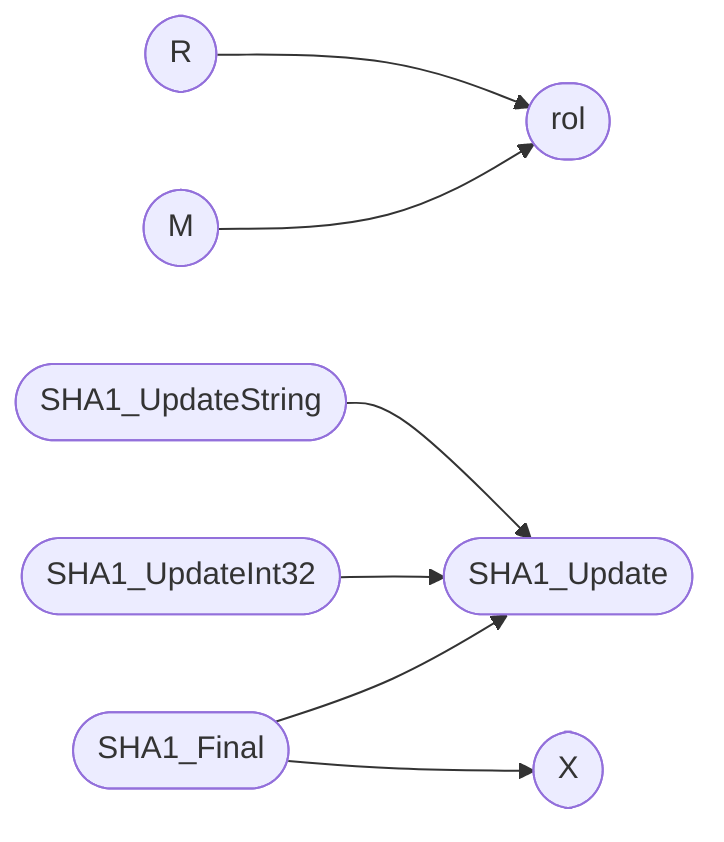

# `progs/doomgeneric/sha1.c`

> Source: [progs/doomgeneric/sha1.c:1](../../progs/doomgeneric/sha1.c#L1) | language `c` | coverage 15.8% | [API index](../index.md)

sha1.c - SHA1 hash function

## Contents

- **Functions:** [`SHA1_Init`](#sha1_init), [`SHA1_Update`](#sha1_update), [`SHA1_Final`](#sha1_final), [`SHA1_UpdateInt32`](#sha1_updateint32), [`SHA1_UpdateString`](#sha1_updatestring)
- **Macros:** [`K1`](#k1), [`K2`](#k2), [`K3`](#k3), [`K4`](#k4), [`F1`](#f1), [`F2`](#f2), [`F3`](#f3), [`F4`](#f4), [`rol`](#rol), [`M`](#m), [`R`](#r), [`X`](#x), [`X`](#x)

## Call Graph

Solid arrows stay in this module, dashed arrows leave it.



## Functions

<a id="sha1_init"></a>

### `SHA1_Init`

`function` | [progs/doomgeneric/sha1.c:40](../../progs/doomgeneric/sha1.c#L40)

```c
void SHA1_Init(sha1_context_t *hd)
```

**Parameters**

| Name | Type | Default | Description |
|---|---|---|---|
| `hd` | `sha1_context_t *` |  |  |

---

<a id="sha1_update"></a>

### `SHA1_Update`

`function` | [progs/doomgeneric/sha1.c:198](../../progs/doomgeneric/sha1.c#L198)

```c
void SHA1_Update(sha1_context_t *hd, byte *inbuf, size_t inlen)
```

Update the message digest with the contents of INBUF with length INLEN.

**Parameters**

| Name | Type | Default | Description |
|---|---|---|---|
| `hd` | `sha1_context_t *` |  |  |
| `inbuf` | `byte *` |  |  |
| `inlen` | `size_t` |  |  |

*Called by:* [`SHA1_Final`](#sha1_final), [`SHA1_UpdateInt32`](#sha1_updateint32), [`SHA1_UpdateString`](#sha1_updatestring)

---

<a id="sha1_final"></a>

### `SHA1_Final`

`function` | [progs/doomgeneric/sha1.c:238](../../progs/doomgeneric/sha1.c#L238)

```c
void SHA1_Final(sha1_digest_t digest, sha1_context_t *hd)
```

**Parameters**

| Name | Type | Default | Description |
|---|---|---|---|
| `digest` | `sha1_digest_t` |  |  |
| `hd` | `sha1_context_t *` |  |  |

*Calls:* [`SHA1_Update`](#sha1_update), [`X`](#x)

---

<a id="sha1_updateint32"></a>

### `SHA1_UpdateInt32`

`function` | [progs/doomgeneric/sha1.c:303](../../progs/doomgeneric/sha1.c#L303)

```c
void SHA1_UpdateInt32(sha1_context_t *context, unsigned int val)
```

**Parameters**

| Name | Type | Default | Description |
|---|---|---|---|
| `context` | `sha1_context_t *` |  |  |
| `val` | `unsigned int` |  |  |

*Calls:* [`SHA1_Update`](#sha1_update)

---

<a id="sha1_updatestring"></a>

### `SHA1_UpdateString`

`function` | [progs/doomgeneric/sha1.c:315](../../progs/doomgeneric/sha1.c#L315)

```c
void SHA1_UpdateString(sha1_context_t *context, char *str)
```

**Parameters**

| Name | Type | Default | Description |
|---|---|---|---|
| `context` | `sha1_context_t *` |  |  |
| `str` | `char *` |  |  |

*Calls:* [`SHA1_Update`](#sha1_update)

---

## Macros

<a id="k1"></a>

### `K1`

`macro` | [progs/doomgeneric/sha1.c:84](../../progs/doomgeneric/sha1.c#L84)

```c
#define K1
```

---

<a id="k2"></a>

### `K2`

`macro` | [progs/doomgeneric/sha1.c:85](../../progs/doomgeneric/sha1.c#L85)

```c
#define K2
```

---

<a id="k3"></a>

### `K3`

`macro` | [progs/doomgeneric/sha1.c:86](../../progs/doomgeneric/sha1.c#L86)

```c
#define K3
```

---

<a id="k4"></a>

### `K4`

`macro` | [progs/doomgeneric/sha1.c:87](../../progs/doomgeneric/sha1.c#L87)

```c
#define K4
```

---

<a id="f1"></a>

### `F1`

`macro` | [progs/doomgeneric/sha1.c:88](../../progs/doomgeneric/sha1.c#L88)

```c
#define F1(x,y,z)
```

---

<a id="f2"></a>

### `F2`

`macro` | [progs/doomgeneric/sha1.c:89](../../progs/doomgeneric/sha1.c#L89)

```c
#define F2(x,y,z)
```

---

<a id="f3"></a>

### `F3`

`macro` | [progs/doomgeneric/sha1.c:90](../../progs/doomgeneric/sha1.c#L90)

```c
#define F3(x,y,z)
```

---

<a id="f4"></a>

### `F4`

`macro` | [progs/doomgeneric/sha1.c:91](../../progs/doomgeneric/sha1.c#L91)

```c
#define F4(x,y,z)
```

---

<a id="rol"></a>

### `rol`

`macro` | [progs/doomgeneric/sha1.c:93](../../progs/doomgeneric/sha1.c#L93)

```c
#define rol(x,n)
```

*Called by:* [`M`](#m), [`R`](#r)

---

<a id="m"></a>

### `M`

`macro` | [progs/doomgeneric/sha1.c:95](../../progs/doomgeneric/sha1.c#L95)

```c
#define M(i)
```

*Calls:* [`rol`](#rol)

---

<a id="r"></a>

### `R`

`macro` | [progs/doomgeneric/sha1.c:99](../../progs/doomgeneric/sha1.c#L99)

```c
#define R(a,b,c,d,e,f,k,m)
```

*Calls:* [`rol`](#rol)

---

<a id="x"></a>

### `X`

`macro` | [progs/doomgeneric/sha1.c:288](../../progs/doomgeneric/sha1.c#L288)

```c
#define X(a)
```

*Called by:* [`SHA1_Final`](#sha1_final)

---

<a id="x"></a>

### `X`

`macro` | [progs/doomgeneric/sha1.c:290](../../progs/doomgeneric/sha1.c#L290)

```c
#define X(a)
```

little endian

---
