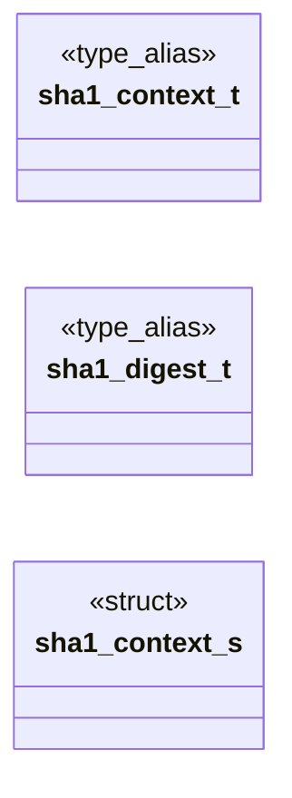

# `progs/doomgeneric/sha1.h`

> Source: [progs/doomgeneric/sha1.h:1](../../progs/doomgeneric/sha1.h#L1) | language `h` | coverage 22.2% | [API index](../index.md)

Copyright(C) 2005-2014 Simon Howard  This program is free software; you can redistribute it and/or modify it under the terms of the GNU General Public License as published by the Free Software Foundation; either version 2 of the License, or (at your option) any later version.

This program is distributed in the hope that it will be useful, but WITHOUT ANY WARRANTY; without even the implied warranty of MERCHANTABILITY or FITNESS FOR A PARTICULAR PURPOSE.  See the GNU General Public License for more details.  DESCRIPTION: SHA-1 digest.

## Contents

- **Structs:** [`sha1_context_s`](#sha1_context_s)
- **Type Aliases:** [`sha1_context_t`](#sha1_context_t), [`sha1_digest_t`](#sha1_digest_t)
- **Functions:** [`SHA1_Init`](#sha1_init), [`SHA1_Update`](#sha1_update), [`SHA1_Final`](#sha1_final), [`SHA1_UpdateInt32`](#sha1_updateint32), [`SHA1_UpdateString`](#sha1_updatestring)

## Type Diagram



## Structs

<a id="sha1_context_s"></a>

### `sha1_context_s`

`struct` | [progs/doomgeneric/sha1.h:26](../../progs/doomgeneric/sha1.h#L26)

```c
struct sha1_context_s
```

---

## Type Aliases

<a id="sha1_context_t"></a>

### `sha1_context_t`

`type_alias` | [progs/doomgeneric/sha1.h:22](../../progs/doomgeneric/sha1.h#L22)

```c
typedef struct sha1_context_s sha1_context_t;
```

include "doomtype.h"

---

<a id="sha1_digest_t"></a>

### `sha1_digest_t`

`type_alias` | [progs/doomgeneric/sha1.h:24](../../progs/doomgeneric/sha1.h#L24)

```c
typedef byte sha1_digest_t[20];
```

---

## Functions

<a id="sha1_init"></a>

### `SHA1_Init`

`function` | [progs/doomgeneric/sha1.h:33](../../progs/doomgeneric/sha1.h#L33)

```c
void SHA1_Init(sha1_context_t *context);
```

**Parameters**

| Name | Type | Default | Description |
|---|---|---|---|
| `context` | `sha1_context_t *` |  |  |

*Called by:* [`W_Checksum`](progs.doomgeneric.w_checksum.c.md#w_checksum)

---

<a id="sha1_update"></a>

### `SHA1_Update`

`function` | [progs/doomgeneric/sha1.h:34](../../progs/doomgeneric/sha1.h#L34)

```c
void SHA1_Update(sha1_context_t *context, byte *buf, size_t len);
```

**Parameters**

| Name | Type | Default | Description |
|---|---|---|---|
| `context` | `sha1_context_t *` |  |  |
| `buf` | `byte *` |  |  |
| `len` | `size_t` |  |  |

---

<a id="sha1_final"></a>

### `SHA1_Final`

`function` | [progs/doomgeneric/sha1.h:35](../../progs/doomgeneric/sha1.h#L35)

```c
void SHA1_Final(sha1_digest_t digest, sha1_context_t *context);
```

**Parameters**

| Name | Type | Default | Description |
|---|---|---|---|
| `digest` | `sha1_digest_t` |  |  |
| `context` | `sha1_context_t *` |  |  |

*Called by:* [`W_Checksum`](progs.doomgeneric.w_checksum.c.md#w_checksum)

---

<a id="sha1_updateint32"></a>

### `SHA1_UpdateInt32`

`function` | [progs/doomgeneric/sha1.h:36](../../progs/doomgeneric/sha1.h#L36)

```c
void SHA1_UpdateInt32(sha1_context_t *context, unsigned int val);
```

**Parameters**

| Name | Type | Default | Description |
|---|---|---|---|
| `context` | `sha1_context_t *` |  |  |
| `val` | `unsigned int` |  |  |

---

<a id="sha1_updatestring"></a>

### `SHA1_UpdateString`

`function` | [progs/doomgeneric/sha1.h:37](../../progs/doomgeneric/sha1.h#L37)

```c
void SHA1_UpdateString(sha1_context_t *context, char *str);
```

**Parameters**

| Name | Type | Default | Description |
|---|---|---|---|
| `context` | `sha1_context_t *` |  |  |
| `str` | `char *` |  |  |

---
