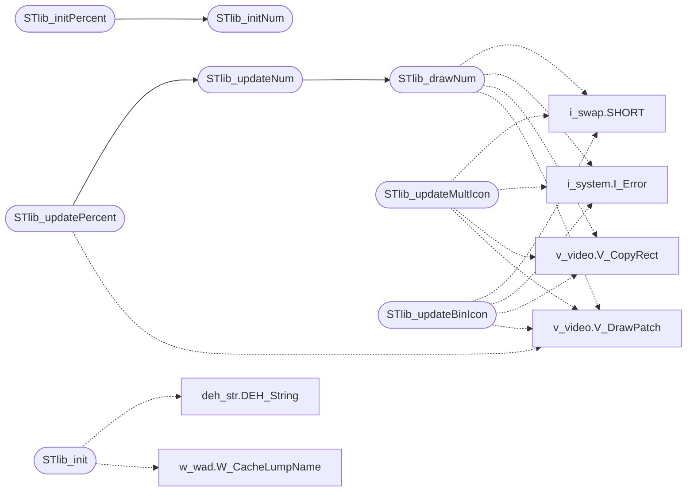

# `progs/doomgeneric/st_lib.c`

> Source: [progs/doomgeneric/st_lib.c:1](../../progs/doomgeneric/st_lib.c#L1) | language `c` | coverage 18.2% | [API index](../index.md)

Copyright(C) 1993-1996 Id Software, Inc.

Copyright(C) 2005-2014 Simon Howard  This program is free software; you can redistribute it and/or modify it under the terms of the GNU General Public License as published by the Free Software Foundation; either version 2 of the License, or (at your option) any later version.  This program is distributed in the hope that it will be useful, but WITHOUT ANY WARRANTY; without even the implied warranty of MERCHANTABILITY or FITNESS FOR A PARTICULAR PURPOSE.  See the GNU General Public License for more details.  DESCRIPTION: The status bar widget code.

## Contents

- **Functions:** [`STlib_init`](#stlib_init), [`STlib_initNum`](#stlib_initnum), [`STlib_drawNum`](#stlib_drawnum), [`STlib_updateNum`](#stlib_updatenum), [`STlib_initPercent`](#stlib_initpercent), [`STlib_updatePercent`](#stlib_updatepercent), [`STlib_initMultIcon`](#stlib_initmulticon), [`STlib_updateMultIcon`](#stlib_updatemulticon), [`STlib_initBinIcon`](#stlib_initbinicon), [`STlib_updateBinIcon`](#stlib_updatebinicon)
- **Variables:** [`automapactive`](#automapactive)

## Call Graph

Solid arrows stay in this module, dashed arrows leave it.



## Functions

<a id="stlib_init"></a>

### `STlib_init`

`function` | [progs/doomgeneric/st_lib.c:51](../../progs/doomgeneric/st_lib.c#L51)

```c
void STlib_init(void)
```

Initializes widget library.

More precisely, initialize STMINUS, everything else is done somewhere else.

> **Inherited:** Documentation from [`STlib_init`](#stlib_init) (progs/doomgeneric/st_lib.h:138).

*Calls:* [`DEH_String`](progs.doomgeneric.deh_str.h.md#deh_string), [`W_CacheLumpName`](progs.doomgeneric.w_wad.h.md#w_cachelumpname)

---

<a id="stlib_initnum"></a>

### `STlib_initNum`

`function` | [progs/doomgeneric/st_lib.c:59](../../progs/doomgeneric/st_lib.c#L59)

```c
STlib_initNum ( st_number_t* n, int x, int y, patch_t** pl, int* num, boolean* on, int width )
```

**Parameters**

| Name | Type | Default | Description |
|---|---|---|---|
| `n` | `st_number_t*` |  |  |
| `x` | `int` |  |  |
| `y` | `int` |  |  |
| `pl` | `patch_t**` |  |  |
| `num` | `int*` |  |  |
| `on` | `boolean*` |  |  |
| `width` | `int` |  |  |

*Called by:* [`STlib_initPercent`](#stlib_initpercent)

---

<a id="stlib_drawnum"></a>

### `STlib_drawNum`

`function` | [progs/doomgeneric/st_lib.c:84](../../progs/doomgeneric/st_lib.c#L84)

```c
void STlib_drawNum ( st_number_t* n, boolean refresh )
```

**Parameters**

| Name | Type | Default | Description |
|---|---|---|---|
| `n` | `st_number_t*` |  |  |
| `refresh` | `boolean` |  |  |

*Calls:* [`SHORT`](progs.doomgeneric.i_swap.h.md#short), [`I_Error`](progs.doomgeneric.i_system.h.md#i_error), [`V_CopyRect`](progs.doomgeneric.v_video.h.md#v_copyrect), [`V_DrawPatch`](progs.doomgeneric.v_video.h.md#v_drawpatch)

*Called by:* [`STlib_updateNum`](#stlib_updatenum)

---

<a id="stlib_updatenum"></a>

### `STlib_updateNum`

`function` | [progs/doomgeneric/st_lib.c:146](../../progs/doomgeneric/st_lib.c#L146)

```c
void STlib_updateNum ( st_number_t* n, boolean refresh )
```

**Parameters**

| Name | Type | Default | Description |
|---|---|---|---|
| `n` | `st_number_t*` |  |  |
| `refresh` | `boolean` |  |  |

*Calls:* [`STlib_drawNum`](#stlib_drawnum)

*Called by:* [`STlib_updatePercent`](#stlib_updatepercent)

---

<a id="stlib_initpercent"></a>

### `STlib_initPercent`

`function` | [progs/doomgeneric/st_lib.c:156](../../progs/doomgeneric/st_lib.c#L156)

```c
STlib_initPercent ( st_percent_t* p, int x, int y, patch_t** pl, int* num, boolean* on, patch_t* percent )
```

**Parameters**

| Name | Type | Default | Description |
|---|---|---|---|
| `p` | `st_percent_t*` |  |  |
| `x` | `int` |  |  |
| `y` | `int` |  |  |
| `pl` | `patch_t**` |  |  |
| `num` | `int*` |  |  |
| `on` | `boolean*` |  |  |
| `percent` | `patch_t*` |  |  |

*Calls:* [`STlib_initNum`](#stlib_initnum)

---

<a id="stlib_updatepercent"></a>

### `STlib_updatePercent`

`function` | [progs/doomgeneric/st_lib.c:173](../../progs/doomgeneric/st_lib.c#L173)

```c
void STlib_updatePercent ( st_percent_t* per, int refresh )
```

**Parameters**

| Name | Type | Default | Description |
|---|---|---|---|
| `per` | `st_percent_t*` |  |  |
| `refresh` | `int` |  |  |

*Calls:* [`STlib_updateNum`](#stlib_updatenum), [`V_DrawPatch`](progs.doomgeneric.v_video.h.md#v_drawpatch)

---

<a id="stlib_initmulticon"></a>

### `STlib_initMultIcon`

`function` | [progs/doomgeneric/st_lib.c:186](../../progs/doomgeneric/st_lib.c#L186)

```c
STlib_initMultIcon ( st_multicon_t* i, int x, int y, patch_t** il, int* inum, boolean* on )
```

**Parameters**

| Name | Type | Default | Description |
|---|---|---|---|
| `i` | `st_multicon_t*` |  |  |
| `x` | `int` |  |  |
| `y` | `int` |  |  |
| `il` | `patch_t**` |  |  |
| `inum` | `int*` |  |  |
| `on` | `boolean*` |  |  |

---

<a id="stlib_updatemulticon"></a>

### `STlib_updateMultIcon`

`function` | [progs/doomgeneric/st_lib.c:205](../../progs/doomgeneric/st_lib.c#L205)

```c
void STlib_updateMultIcon ( st_multicon_t* mi, boolean refresh )
```

**Parameters**

| Name | Type | Default | Description |
|---|---|---|---|
| `mi` | `st_multicon_t*` |  |  |
| `refresh` | `boolean` |  |  |

*Calls:* [`SHORT`](progs.doomgeneric.i_swap.h.md#short), [`I_Error`](progs.doomgeneric.i_system.h.md#i_error), [`V_CopyRect`](progs.doomgeneric.v_video.h.md#v_copyrect), [`V_DrawPatch`](progs.doomgeneric.v_video.h.md#v_drawpatch)

---

<a id="stlib_initbinicon"></a>

### `STlib_initBinIcon`

`function` | [progs/doomgeneric/st_lib.c:236](../../progs/doomgeneric/st_lib.c#L236)

```c
STlib_initBinIcon ( st_binicon_t* b, int x, int y, patch_t* i, boolean* val, boolean* on )
```

**Parameters**

| Name | Type | Default | Description |
|---|---|---|---|
| `b` | `st_binicon_t*` |  |  |
| `x` | `int` |  |  |
| `y` | `int` |  |  |
| `i` | `patch_t*` |  |  |
| `val` | `boolean*` |  |  |
| `on` | `boolean*` |  |  |

---

<a id="stlib_updatebinicon"></a>

### `STlib_updateBinIcon`

`function` | [progs/doomgeneric/st_lib.c:255](../../progs/doomgeneric/st_lib.c#L255)

```c
void STlib_updateBinIcon ( st_binicon_t* bi, boolean refresh )
```

**Parameters**

| Name | Type | Default | Description |
|---|---|---|---|
| `bi` | `st_binicon_t*` |  |  |
| `refresh` | `boolean` |  |  |

*Calls:* [`SHORT`](progs.doomgeneric.i_swap.h.md#short), [`I_Error`](progs.doomgeneric.i_system.h.md#i_error), [`V_CopyRect`](progs.doomgeneric.v_video.h.md#v_copyrect), [`V_DrawPatch`](progs.doomgeneric.v_video.h.md#v_drawpatch)

---

## Variables

<a id="automapactive"></a>

### `automapactive`

`variable` `extern` | [progs/doomgeneric/st_lib.c:40](../../progs/doomgeneric/st_lib.c#L40)

```c
extern boolean automapactive;
```

in AM_map.c

---
