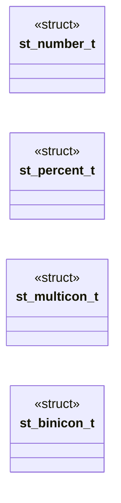

# `progs/doomgeneric/st_lib.h`

> Source: [progs/doomgeneric/st_lib.h:1](../../progs/doomgeneric/st_lib.h#L1) | language `h` | coverage 26.7% | [API index](../index.md)

Copyright(C) 1993-1996 Id Software, Inc.

Copyright(C) 2005-2014 Simon Howard  This program is free software; you can redistribute it and/or modify it under the terms of the GNU General Public License as published by the Free Software Foundation; either version 2 of the License, or (at your option) any later version.  This program is distributed in the hope that it will be useful, but WITHOUT ANY WARRANTY; without even the implied warranty of MERCHANTABILITY or FITNESS FOR A PARTICULAR PURPOSE.  See the GNU General Public License for more details.  DESCRIPTION: The status bar widget code.     We are referring to patches.   Typedefs of widgets   Number widget

## Contents

- **Structs:** [`st_number_t`](#st_number_t), [`st_percent_t`](#st_percent_t), [`st_multicon_t`](#st_multicon_t), [`st_binicon_t`](#st_binicon_t)
- **Functions:** [`STlib_init`](#stlib_init), [`STlib_initNum`](#stlib_initnum), [`STlib_updateNum`](#stlib_updatenum), [`STlib_initPercent`](#stlib_initpercent), [`STlib_updatePercent`](#stlib_updatepercent), [`STlib_initMultIcon`](#stlib_initmulticon), [`STlib_updateMultIcon`](#stlib_updatemulticon), [`STlib_initBinIcon`](#stlib_initbinicon), [`STlib_updateBinIcon`](#stlib_updatebinicon)
- **Macros:** [`__STLIB__`](#__stlib__)

## Type Diagram



## Structs

<a id="st_number_t"></a>

### `st_number_t`

`struct` | [progs/doomgeneric/st_lib.h:32](../../progs/doomgeneric/st_lib.h#L32)

```c
typedef struct
```

---

<a id="st_percent_t"></a>

### `st_percent_t`

`struct` | [progs/doomgeneric/st_lib.h:64](../../progs/doomgeneric/st_lib.h#L64)

```c
typedef struct
```

Percent widget ("child" of number widget, or, more precisely, contains a number widget.)

---

<a id="st_multicon_t"></a>

### `st_multicon_t`

`struct` | [progs/doomgeneric/st_lib.h:77](../../progs/doomgeneric/st_lib.h#L77)

```c
typedef struct
```

Multiple Icon widget

---

<a id="st_binicon_t"></a>

### `st_binicon_t`

`struct` | [progs/doomgeneric/st_lib.h:106](../../progs/doomgeneric/st_lib.h#L106)

```c
typedef struct
```

---

## Functions

<a id="stlib_init"></a>

### `STlib_init`

`function` | [progs/doomgeneric/st_lib.h:138](../../progs/doomgeneric/st_lib.h#L138)

```c
void STlib_init(void);
```

Initializes widget library.

More precisely, initialize STMINUS, everything else is done somewhere else.

*Called by:* [`ST_initData`](progs.doomgeneric.st_stuff.c.md#st_initdata)

---

<a id="stlib_initnum"></a>

### `STlib_initNum`

`function` | [progs/doomgeneric/st_lib.h:144](../../progs/doomgeneric/st_lib.h#L144)

```c
void STlib_initNum ( st_number_t* n, int x, int y, patch_t** pl, int* num, boolean* on, int width );
```

**Parameters**

| Name | Type | Default | Description |
|---|---|---|---|
| `n` | `st_number_t*` |  |  |
| `x` | `int` |  |  |
| `y` | `int` |  |  |
| `pl` | `patch_t**` |  |  |
| `num` | `int*` |  |  |
| `on` | `boolean*` |  |  |
| `width` | `int` |  |  |

*Called by:* [`ST_createWidgets`](progs.doomgeneric.st_stuff.c.md#st_createwidgets)

---

<a id="stlib_updatenum"></a>

### `STlib_updateNum`

`function` | [progs/doomgeneric/st_lib.h:154](../../progs/doomgeneric/st_lib.h#L154)

```c
void STlib_updateNum ( st_number_t* n, boolean refresh );
```

**Parameters**

| Name | Type | Default | Description |
|---|---|---|---|
| `n` | `st_number_t*` |  |  |
| `refresh` | `boolean` |  |  |

*Called by:* [`ST_drawWidgets`](progs.doomgeneric.st_stuff.c.md#st_drawwidgets)

---

<a id="stlib_initpercent"></a>

### `STlib_initPercent`

`function` | [progs/doomgeneric/st_lib.h:161](../../progs/doomgeneric/st_lib.h#L161)

```c
void STlib_initPercent ( st_percent_t* p, int x, int y, patch_t** pl, int* num, boolean* on, patch_t* percent );
```

**Parameters**

| Name | Type | Default | Description |
|---|---|---|---|
| `p` | `st_percent_t*` |  |  |
| `x` | `int` |  |  |
| `y` | `int` |  |  |
| `pl` | `patch_t**` |  |  |
| `num` | `int*` |  |  |
| `on` | `boolean*` |  |  |
| `percent` | `patch_t*` |  |  |

*Called by:* [`ST_createWidgets`](progs.doomgeneric.st_stuff.c.md#st_createwidgets)

---

<a id="stlib_updatepercent"></a>

### `STlib_updatePercent`

`function` | [progs/doomgeneric/st_lib.h:172](../../progs/doomgeneric/st_lib.h#L172)

```c
void STlib_updatePercent ( st_percent_t* per, int refresh );
```

**Parameters**

| Name | Type | Default | Description |
|---|---|---|---|
| `per` | `st_percent_t*` |  |  |
| `refresh` | `int` |  |  |

*Called by:* [`ST_drawWidgets`](progs.doomgeneric.st_stuff.c.md#st_drawwidgets)

---

<a id="stlib_initmulticon"></a>

### `STlib_initMultIcon`

`function` | [progs/doomgeneric/st_lib.h:179](../../progs/doomgeneric/st_lib.h#L179)

```c
void STlib_initMultIcon ( st_multicon_t* mi, int x, int y, patch_t** il, int* inum, boolean* on );
```

**Parameters**

| Name | Type | Default | Description |
|---|---|---|---|
| `mi` | `st_multicon_t*` |  |  |
| `x` | `int` |  |  |
| `y` | `int` |  |  |
| `il` | `patch_t**` |  |  |
| `inum` | `int*` |  |  |
| `on` | `boolean*` |  |  |

*Called by:* [`ST_createWidgets`](progs.doomgeneric.st_stuff.c.md#st_createwidgets)

---

<a id="stlib_updatemulticon"></a>

### `STlib_updateMultIcon`

`function` | [progs/doomgeneric/st_lib.h:189](../../progs/doomgeneric/st_lib.h#L189)

```c
void STlib_updateMultIcon ( st_multicon_t* mi, boolean refresh );
```

**Parameters**

| Name | Type | Default | Description |
|---|---|---|---|
| `mi` | `st_multicon_t*` |  |  |
| `refresh` | `boolean` |  |  |

*Called by:* [`ST_drawWidgets`](progs.doomgeneric.st_stuff.c.md#st_drawwidgets)

---

<a id="stlib_initbinicon"></a>

### `STlib_initBinIcon`

`function` | [progs/doomgeneric/st_lib.h:196](../../progs/doomgeneric/st_lib.h#L196)

```c
void STlib_initBinIcon ( st_binicon_t* b, int x, int y, patch_t* i, boolean* val, boolean* on );
```

**Parameters**

| Name | Type | Default | Description |
|---|---|---|---|
| `b` | `st_binicon_t*` |  |  |
| `x` | `int` |  |  |
| `y` | `int` |  |  |
| `i` | `patch_t*` |  |  |
| `val` | `boolean*` |  |  |
| `on` | `boolean*` |  |  |

*Called by:* [`ST_createWidgets`](progs.doomgeneric.st_stuff.c.md#st_createwidgets)

---

<a id="stlib_updatebinicon"></a>

### `STlib_updateBinIcon`

`function` | [progs/doomgeneric/st_lib.h:205](../../progs/doomgeneric/st_lib.h#L205)

```c
void STlib_updateBinIcon ( st_binicon_t* bi, boolean refresh );
```

**Parameters**

| Name | Type | Default | Description |
|---|---|---|---|
| `bi` | `st_binicon_t*` |  |  |
| `refresh` | `boolean` |  |  |

*Called by:* [`ST_drawWidgets`](progs.doomgeneric.st_stuff.c.md#st_drawwidgets)

---

## Macros

<a id="__stlib__"></a>

### `__STLIB__`

`macro` | [progs/doomgeneric/st_lib.h:20](../../progs/doomgeneric/st_lib.h#L20)

```c
#define __STLIB__
```

---
