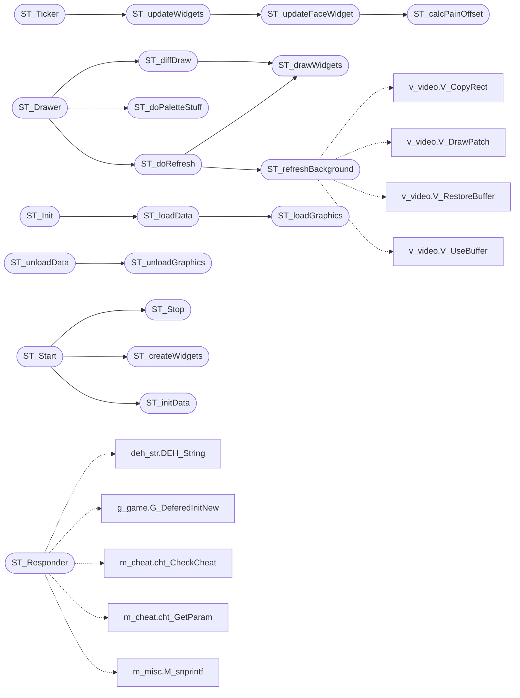

# `progs/doomgeneric/st_stuff.c`

> Source: [progs/doomgeneric/st_stuff.c:1](../../progs/doomgeneric/st_stuff.c#L1) | language `c` | coverage 25.2% | [API index](../index.md)

Copyright(C) 1993-1996 Id Software, Inc.

Copyright(C) 2005-2014 Simon Howard  This program is free software; you can redistribute it and/or modify it under the terms of the GNU General Public License as published by the Free Software Foundation; either version 2 of the License, or (at your option) any later version.  This program is distributed in the hope that it will be useful, but WITHOUT ANY WARRANTY; without even the implied warranty of MERCHANTABILITY or FITNESS FOR A PARTICULAR PURPOSE.  See the GNU General Public License for more details.  DESCRIPTION: Status bar code. Does the face/direction indicator animatin. Does palette indicators as well (red pain/berserk, bright pickup)

## Contents

- **Functions:** [`ST_refreshBackground`](#st_refreshbackground), [`ST_Responder`](#st_responder), [`ST_calcPainOffset`](#st_calcpainoffset), [`ST_updateFaceWidget`](#st_updatefacewidget), [`ST_updateWidgets`](#st_updatewidgets), [`ST_Ticker`](#st_ticker), [`ST_doPaletteStuff`](#st_dopalettestuff), [`ST_drawWidgets`](#st_drawwidgets), [`ST_doRefresh`](#st_dorefresh), [`ST_diffDraw`](#st_diffdraw), [`ST_Drawer`](#st_drawer), [`ST_loadGraphics`](#st_loadgraphics), [`ST_loadData`](#st_loaddata), [`ST_unloadGraphics`](#st_unloadgraphics), [`ST_unloadData`](#st_unloaddata), [`ST_initData`](#st_initdata), [`ST_createWidgets`](#st_createwidgets), [`ST_Start`](#st_start), [`ST_Stop`](#st_stop), [`ST_Init`](#st_init)
- **Macros:** [`STARTREDPALS`](#startredpals), [`STARTBONUSPALS`](#startbonuspals), [`NUMREDPALS`](#numredpals), [`NUMBONUSPALS`](#numbonuspals), [`RADIATIONPAL`](#radiationpal), [`ST_FACEPROBABILITY`](#st_faceprobability), [`ST_TOGGLECHAT`](#st_togglechat), [`ST_X`](#st_x), [`ST_X2`](#st_x2), [`ST_FX`](#st_fx), [`ST_FY`](#st_fy), [`ST_TALLNUMWIDTH`](#st_tallnumwidth), [`ST_NUMPAINFACES`](#st_numpainfaces), [`ST_NUMSTRAIGHTFACES`](#st_numstraightfaces), [`ST_NUMTURNFACES`](#st_numturnfaces), [`ST_NUMSPECIALFACES`](#st_numspecialfaces), [`ST_FACESTRIDE`](#st_facestride), [`ST_NUMEXTRAFACES`](#st_numextrafaces), [`ST_NUMFACES`](#st_numfaces), [`ST_TURNOFFSET`](#st_turnoffset), [`ST_OUCHOFFSET`](#st_ouchoffset), [`ST_EVILGRINOFFSET`](#st_evilgrinoffset), [`ST_RAMPAGEOFFSET`](#st_rampageoffset), [`ST_GODFACE`](#st_godface), [`ST_DEADFACE`](#st_deadface), [`ST_FACESX`](#st_facesx), [`ST_FACESY`](#st_facesy), [`ST_EVILGRINCOUNT`](#st_evilgrincount), [`ST_STRAIGHTFACECOUNT`](#st_straightfacecount), [`ST_TURNCOUNT`](#st_turncount), [`ST_OUCHCOUNT`](#st_ouchcount), [`ST_RAMPAGEDELAY`](#st_rampagedelay), [`ST_MUCHPAIN`](#st_muchpain), [`ST_AMMOWIDTH`](#st_ammowidth), [`ST_AMMOX`](#st_ammox), [`ST_AMMOY`](#st_ammoy), [`ST_HEALTHWIDTH`](#st_healthwidth), [`ST_HEALTHX`](#st_healthx), [`ST_HEALTHY`](#st_healthy), [`ST_ARMSX`](#st_armsx), [`ST_ARMSY`](#st_armsy), [`ST_ARMSBGX`](#st_armsbgx), [`ST_ARMSBGY`](#st_armsbgy), [`ST_ARMSXSPACE`](#st_armsxspace), [`ST_ARMSYSPACE`](#st_armsyspace), [`ST_FRAGSX`](#st_fragsx), [`ST_FRAGSY`](#st_fragsy), [`ST_FRAGSWIDTH`](#st_fragswidth), [`ST_ARMORWIDTH`](#st_armorwidth), [`ST_ARMORX`](#st_armorx), [`ST_ARMORY`](#st_armory), [`ST_KEY0WIDTH`](#st_key0width), [`ST_KEY0HEIGHT`](#st_key0height), [`ST_KEY0X`](#st_key0x), [`ST_KEY0Y`](#st_key0y), [`ST_KEY1WIDTH`](#st_key1width), [`ST_KEY1X`](#st_key1x), [`ST_KEY1Y`](#st_key1y), [`ST_KEY2WIDTH`](#st_key2width), [`ST_KEY2X`](#st_key2x), [`ST_KEY2Y`](#st_key2y), [`ST_AMMO0WIDTH`](#st_ammo0width), [`ST_AMMO0HEIGHT`](#st_ammo0height), [`ST_AMMO0X`](#st_ammo0x), [`ST_AMMO0Y`](#st_ammo0y), [`ST_AMMO1WIDTH`](#st_ammo1width), [`ST_AMMO1X`](#st_ammo1x), [`ST_AMMO1Y`](#st_ammo1y), [`ST_AMMO2WIDTH`](#st_ammo2width), [`ST_AMMO2X`](#st_ammo2x), [`ST_AMMO2Y`](#st_ammo2y), [`ST_AMMO3WIDTH`](#st_ammo3width), [`ST_AMMO3X`](#st_ammo3x), [`ST_AMMO3Y`](#st_ammo3y), [`ST_MAXAMMO0WIDTH`](#st_maxammo0width), [`ST_MAXAMMO0HEIGHT`](#st_maxammo0height), [`ST_MAXAMMO0X`](#st_maxammo0x), [`ST_MAXAMMO0Y`](#st_maxammo0y), [`ST_MAXAMMO1WIDTH`](#st_maxammo1width), [`ST_MAXAMMO1X`](#st_maxammo1x), [`ST_MAXAMMO1Y`](#st_maxammo1y), [`ST_MAXAMMO2WIDTH`](#st_maxammo2width), [`ST_MAXAMMO2X`](#st_maxammo2x), [`ST_MAXAMMO2Y`](#st_maxammo2y), [`ST_MAXAMMO3WIDTH`](#st_maxammo3width), [`ST_MAXAMMO3X`](#st_maxammo3x), [`ST_MAXAMMO3Y`](#st_maxammo3y), [`ST_WEAPON0X`](#st_weapon0x), [`ST_WEAPON0Y`](#st_weapon0y), [`ST_WEAPON1X`](#st_weapon1x), [`ST_WEAPON1Y`](#st_weapon1y), [`ST_WEAPON2X`](#st_weapon2x), [`ST_WEAPON2Y`](#st_weapon2y), [`ST_WEAPON3X`](#st_weapon3x), [`ST_WEAPON3Y`](#st_weapon3y), [`ST_WEAPON4X`](#st_weapon4x), [`ST_WEAPON4Y`](#st_weapon4y), [`ST_WEAPON5X`](#st_weapon5x), [`ST_WEAPON5Y`](#st_weapon5y), [`ST_WPNSX`](#st_wpnsx), [`ST_WPNSY`](#st_wpnsy), [`ST_DETHX`](#st_dethx), [`ST_DETHY`](#st_dethy), [`ST_MSGTEXTX`](#st_msgtextx), [`ST_MSGTEXTY`](#st_msgtexty), [`ST_MSGWIDTH`](#st_msgwidth), [`ST_MSGHEIGHT`](#st_msgheight), [`ST_OUTTEXTX`](#st_outtextx), [`ST_OUTTEXTY`](#st_outtexty), [`ST_OUTWIDTH`](#st_outwidth), [`ST_OUTHEIGHT`](#st_outheight), [`ST_MAPTITLEX`](#st_maptitlex), [`ST_MAPTITLEY`](#st_maptitley), [`ST_MAPHEIGHT`](#st_mapheight)

## Call Graph

Solid arrows stay in this module, dashed arrows leave it.



## Functions

<a id="st_refreshbackground"></a>

### `ST_refreshBackground`

`function` | [progs/doomgeneric/st_stuff.c:416](../../progs/doomgeneric/st_stuff.c#L416)

```c
void ST_refreshBackground(void)
```

*Calls:* [`V_CopyRect`](progs.doomgeneric.v_video.h.md#v_copyrect), [`V_DrawPatch`](progs.doomgeneric.v_video.h.md#v_drawpatch), [`V_RestoreBuffer`](progs.doomgeneric.v_video.h.md#v_restorebuffer), [`V_UseBuffer`](progs.doomgeneric.v_video.h.md#v_usebuffer)

*Called by:* [`ST_doRefresh`](#st_dorefresh)

---

<a id="st_responder"></a>

### `ST_Responder`

`function` | [progs/doomgeneric/st_stuff.c:439](../../progs/doomgeneric/st_stuff.c#L439)

```c
boolean ST_Responder (event_t* ev)
```

**Parameters**

| Name | Type | Default | Description |
|---|---|---|---|
| `ev` | `event_t*` |  |  |

**Returns:** `boolean`

*Calls:* [`DEH_String`](progs.doomgeneric.deh_str.h.md#deh_string), [`G_DeferedInitNew`](progs.doomgeneric.g_game.h.md#g_deferedinitnew), [`cht_CheckCheat`](progs.doomgeneric.m_cheat.h.md#cht_checkcheat), [`cht_GetParam`](progs.doomgeneric.m_cheat.h.md#cht_getparam), [`M_snprintf`](progs.doomgeneric.m_misc.h.md#m_snprintf), [`P_GivePower`](progs.doomgeneric.p_inter.c.md#p_givepower), [`S_ChangeMusic`](progs.doomgeneric.s_sound.h.md#s_changemusic)

*Called by:* [`AM_Stop`](progs.doomgeneric.am_map.c.md#am_stop), [`AM_initVariables`](progs.doomgeneric.am_map.c.md#am_initvariables), [`G_Responder`](progs.doomgeneric.g_game.c.md#g_responder)

---

<a id="st_calcpainoffset"></a>

### `ST_calcPainOffset`

`function` | [progs/doomgeneric/st_stuff.c:665](../../progs/doomgeneric/st_stuff.c#L665)

```c
int ST_calcPainOffset(void)
```

**Returns:** `int`

*Called by:* [`ST_updateFaceWidget`](#st_updatefacewidget)

---

<a id="st_updatefacewidget"></a>

### `ST_updateFaceWidget`

`function` | [progs/doomgeneric/st_stuff.c:688](../../progs/doomgeneric/st_stuff.c#L688)

```c
void ST_updateFaceWidget(void)
```

This is a not-very-pretty routine which handles the face states and their timing. the precedence of expressions is: dead > evil grin > turned head > straight ahead

*Calls:* [`ST_calcPainOffset`](#st_calcpainoffset)

*Called by:* [`ST_updateWidgets`](#st_updatewidgets)

---

<a id="st_updatewidgets"></a>

### `ST_updateWidgets`

`function` | [progs/doomgeneric/st_stuff.c:860](../../progs/doomgeneric/st_stuff.c#L860)

```c
void ST_updateWidgets(void)
```

*Calls:* [`ST_updateFaceWidget`](#st_updatefacewidget)

*Called by:* [`ST_Ticker`](#st_ticker)

---

<a id="st_ticker"></a>

### `ST_Ticker`

`function` | [progs/doomgeneric/st_stuff.c:924](../../progs/doomgeneric/st_stuff.c#L924)

```c
void ST_Ticker (void)
```

Called by main loop.

> **Inherited:** Documentation from [`ST_Ticker`](#st_ticker) (progs/doomgeneric/st_stuff.h:43).

*Calls:* [`M_Random`](progs.doomgeneric.m_random.h.md#m_random), [`ST_updateWidgets`](#st_updatewidgets)

---

<a id="st_dopalettestuff"></a>

### `ST_doPaletteStuff`

`function` | [progs/doomgeneric/st_stuff.c:936](../../progs/doomgeneric/st_stuff.c#L936)

```c
void ST_doPaletteStuff(void)
```

*Calls:* [`I_SetPalette`](progs.doomgeneric.i_video.h.md#i_setpalette), [`W_CacheLumpNum`](progs.doomgeneric.w_wad.h.md#w_cachelumpnum)

*Called by:* [`ST_Drawer`](#st_drawer)

---

<a id="st_drawwidgets"></a>

### `ST_drawWidgets`

`function` | [progs/doomgeneric/st_stuff.c:1001](../../progs/doomgeneric/st_stuff.c#L1001)

```c
void ST_drawWidgets(boolean refresh)
```

**Parameters**

| Name | Type | Default | Description |
|---|---|---|---|
| `refresh` | `boolean` |  |  |

*Calls:* [`STlib_updateBinIcon`](progs.doomgeneric.st_lib.h.md#stlib_updatebinicon), [`STlib_updateMultIcon`](progs.doomgeneric.st_lib.h.md#stlib_updatemulticon), [`STlib_updateNum`](progs.doomgeneric.st_lib.h.md#stlib_updatenum), [`STlib_updatePercent`](progs.doomgeneric.st_lib.h.md#stlib_updatepercent)

*Called by:* [`ST_diffDraw`](#st_diffdraw), [`ST_doRefresh`](#st_dorefresh)

---

<a id="st_dorefresh"></a>

### `ST_doRefresh`

`function` | [progs/doomgeneric/st_stuff.c:1036](../../progs/doomgeneric/st_stuff.c#L1036)

```c
void ST_doRefresh(void)
```

*Calls:* [`ST_drawWidgets`](#st_drawwidgets), [`ST_refreshBackground`](#st_refreshbackground)

*Called by:* [`ST_Drawer`](#st_drawer)

---

<a id="st_diffdraw"></a>

### `ST_diffDraw`

`function` | [progs/doomgeneric/st_stuff.c:1049](../../progs/doomgeneric/st_stuff.c#L1049)

```c
void ST_diffDraw(void)
```

*Calls:* [`ST_drawWidgets`](#st_drawwidgets)

*Called by:* [`ST_Drawer`](#st_drawer)

---

<a id="st_drawer"></a>

### `ST_Drawer`

`function` | [progs/doomgeneric/st_stuff.c:1055](../../progs/doomgeneric/st_stuff.c#L1055)

```c
void ST_Drawer (boolean fullscreen, boolean refresh)
```

Called by main loop.

**Parameters**

| Name | Type | Default | Description |
|---|---|---|---|
| `fullscreen` | `boolean` |  |  |
| `refresh` | `boolean` |  |  |

> **Inherited:** Documentation from [`ST_Drawer`](#st_drawer) (progs/doomgeneric/st_stuff.h:46).

*Calls:* [`ST_diffDraw`](#st_diffdraw), [`ST_doPaletteStuff`](#st_dopalettestuff), [`ST_doRefresh`](#st_dorefresh)

---

<a id="st_loadgraphics"></a>

### `ST_loadGraphics`

`function` | [progs/doomgeneric/st_stuff.c:1167](../../progs/doomgeneric/st_stuff.c#L1167)

```c
void ST_loadGraphics(void)
```

*Called by:* [`ST_loadData`](#st_loaddata)

---

<a id="st_loaddata"></a>

### `ST_loadData`

`function` | [progs/doomgeneric/st_stuff.c:1172](../../progs/doomgeneric/st_stuff.c#L1172)

```c
void ST_loadData(void)
```

*Calls:* [`DEH_String`](progs.doomgeneric.deh_str.h.md#deh_string), [`ST_loadGraphics`](#st_loadgraphics), [`W_GetNumForName`](progs.doomgeneric.w_wad.h.md#w_getnumforname)

*Called by:* [`ST_Init`](#st_init)

---

<a id="st_unloadgraphics"></a>

### `ST_unloadGraphics`

`function` | [progs/doomgeneric/st_stuff.c:1184](../../progs/doomgeneric/st_stuff.c#L1184)

```c
void ST_unloadGraphics(void)
```

*Called by:* [`ST_unloadData`](#st_unloaddata)

---

<a id="st_unloaddata"></a>

### `ST_unloadData`

`function` | [progs/doomgeneric/st_stuff.c:1189](../../progs/doomgeneric/st_stuff.c#L1189)

```c
void ST_unloadData(void)
```

*Calls:* [`ST_unloadGraphics`](#st_unloadgraphics)

---

<a id="st_initdata"></a>

### `ST_initData`

`function` | [progs/doomgeneric/st_stuff.c:1194](../../progs/doomgeneric/st_stuff.c#L1194)

```c
void ST_initData(void)
```

*Calls:* [`STlib_init`](progs.doomgeneric.st_lib.h.md#stlib_init)

*Called by:* [`ST_Start`](#st_start)

---

<a id="st_createwidgets"></a>

### `ST_createWidgets`

`function` | [progs/doomgeneric/st_stuff.c:1227](../../progs/doomgeneric/st_stuff.c#L1227)

```c
void ST_createWidgets(void)
```

*Calls:* [`STlib_initBinIcon`](progs.doomgeneric.st_lib.h.md#stlib_initbinicon), [`STlib_initMultIcon`](progs.doomgeneric.st_lib.h.md#stlib_initmulticon), [`STlib_initNum`](progs.doomgeneric.st_lib.h.md#stlib_initnum), [`STlib_initPercent`](progs.doomgeneric.st_lib.h.md#stlib_initpercent)

*Called by:* [`ST_Start`](#st_start)

---

<a id="st_start"></a>

### `ST_Start`

`function` | [progs/doomgeneric/st_stuff.c:1389](../../progs/doomgeneric/st_stuff.c#L1389)

```c
void ST_Start (void)
```

Called when the console player is spawned on each level.

> **Inherited:** Documentation from [`ST_Start`](#st_start) (progs/doomgeneric/st_stuff.h:49).

*Calls:* [`ST_Stop`](#st_stop), [`ST_createWidgets`](#st_createwidgets), [`ST_initData`](#st_initdata)

---

<a id="st_stop"></a>

### `ST_Stop`

`function` | [progs/doomgeneric/st_stuff.c:1401](../../progs/doomgeneric/st_stuff.c#L1401)

```c
void ST_Stop (void)
```

*Calls:* [`I_SetPalette`](progs.doomgeneric.i_video.h.md#i_setpalette), [`W_CacheLumpNum`](progs.doomgeneric.w_wad.h.md#w_cachelumpnum)

*Called by:* [`ST_Start`](#st_start)

---

<a id="st_init"></a>

### `ST_Init`

`function` | [progs/doomgeneric/st_stuff.c:1411](../../progs/doomgeneric/st_stuff.c#L1411)

```c
void ST_Init (void)
```

Called by startup code.

> **Inherited:** Documentation from [`ST_Init`](#st_init) (progs/doomgeneric/st_stuff.h:52).

*Calls:* [`ST_loadData`](#st_loaddata), [`Z_Malloc`](progs.doomgeneric.z_zone.h.md#z_malloc)

---

## Macros

<a id="startredpals"></a>

### `STARTREDPALS`

`macro` | [progs/doomgeneric/st_stuff.c:68](../../progs/doomgeneric/st_stuff.c#L68)

```c
#define STARTREDPALS
```

Palette indices.

For damage/bonus red-/gold-shifts

---

<a id="startbonuspals"></a>

### `STARTBONUSPALS`

`macro` | [progs/doomgeneric/st_stuff.c:69](../../progs/doomgeneric/st_stuff.c#L69)

```c
#define STARTBONUSPALS
```

---

<a id="numredpals"></a>

### `NUMREDPALS`

`macro` | [progs/doomgeneric/st_stuff.c:70](../../progs/doomgeneric/st_stuff.c#L70)

```c
#define NUMREDPALS
```

---

<a id="numbonuspals"></a>

### `NUMBONUSPALS`

`macro` | [progs/doomgeneric/st_stuff.c:71](../../progs/doomgeneric/st_stuff.c#L71)

```c
#define NUMBONUSPALS
```

---

<a id="radiationpal"></a>

### `RADIATIONPAL`

`macro` | [progs/doomgeneric/st_stuff.c:73](../../progs/doomgeneric/st_stuff.c#L73)

```c
#define RADIATIONPAL
```

Radiation suit, green shift.

---

<a id="st_faceprobability"></a>

### `ST_FACEPROBABILITY`

`macro` | [progs/doomgeneric/st_stuff.c:77](../../progs/doomgeneric/st_stuff.c#L77)

```c
#define ST_FACEPROBABILITY
```

N/256*100% probability that the normal face state will change

---

<a id="st_togglechat"></a>

### `ST_TOGGLECHAT`

`macro` | [progs/doomgeneric/st_stuff.c:80](../../progs/doomgeneric/st_stuff.c#L80)

```c
#define ST_TOGGLECHAT
```

For Responder

---

<a id="st_x"></a>

### `ST_X`

`macro` | [progs/doomgeneric/st_stuff.c:83](../../progs/doomgeneric/st_stuff.c#L83)

```c
#define ST_X
```

Location of status bar

---

<a id="st_x2"></a>

### `ST_X2`

`macro` | [progs/doomgeneric/st_stuff.c:84](../../progs/doomgeneric/st_stuff.c#L84)

```c
#define ST_X2
```

---

<a id="st_fx"></a>

### `ST_FX`

`macro` | [progs/doomgeneric/st_stuff.c:86](../../progs/doomgeneric/st_stuff.c#L86)

```c
#define ST_FX
```

---

<a id="st_fy"></a>

### `ST_FY`

`macro` | [progs/doomgeneric/st_stuff.c:87](../../progs/doomgeneric/st_stuff.c#L87)

```c
#define ST_FY
```

---

<a id="st_tallnumwidth"></a>

### `ST_TALLNUMWIDTH`

`macro` | [progs/doomgeneric/st_stuff.c:91](../../progs/doomgeneric/st_stuff.c#L91)

```c
#define ST_TALLNUMWIDTH
```

Should be set to patch width for tall numbers later on

---

<a id="st_numpainfaces"></a>

### `ST_NUMPAINFACES`

`macro` | [progs/doomgeneric/st_stuff.c:94](../../progs/doomgeneric/st_stuff.c#L94)

```c
#define ST_NUMPAINFACES
```

Number of status faces.

---

<a id="st_numstraightfaces"></a>

### `ST_NUMSTRAIGHTFACES`

`macro` | [progs/doomgeneric/st_stuff.c:95](../../progs/doomgeneric/st_stuff.c#L95)

```c
#define ST_NUMSTRAIGHTFACES
```

---

<a id="st_numturnfaces"></a>

### `ST_NUMTURNFACES`

`macro` | [progs/doomgeneric/st_stuff.c:96](../../progs/doomgeneric/st_stuff.c#L96)

```c
#define ST_NUMTURNFACES
```

---

<a id="st_numspecialfaces"></a>

### `ST_NUMSPECIALFACES`

`macro` | [progs/doomgeneric/st_stuff.c:97](../../progs/doomgeneric/st_stuff.c#L97)

```c
#define ST_NUMSPECIALFACES
```

---

<a id="st_facestride"></a>

### `ST_FACESTRIDE`

`macro` | [progs/doomgeneric/st_stuff.c:99](../../progs/doomgeneric/st_stuff.c#L99)

```c
#define ST_FACESTRIDE
```

---

<a id="st_numextrafaces"></a>

### `ST_NUMEXTRAFACES`

`macro` | [progs/doomgeneric/st_stuff.c:102](../../progs/doomgeneric/st_stuff.c#L102)

```c
#define ST_NUMEXTRAFACES
```

---

<a id="st_numfaces"></a>

### `ST_NUMFACES`

`macro` | [progs/doomgeneric/st_stuff.c:104](../../progs/doomgeneric/st_stuff.c#L104)

```c
#define ST_NUMFACES
```

---

<a id="st_turnoffset"></a>

### `ST_TURNOFFSET`

`macro` | [progs/doomgeneric/st_stuff.c:107](../../progs/doomgeneric/st_stuff.c#L107)

```c
#define ST_TURNOFFSET
```

---

<a id="st_ouchoffset"></a>

### `ST_OUCHOFFSET`

`macro` | [progs/doomgeneric/st_stuff.c:108](../../progs/doomgeneric/st_stuff.c#L108)

```c
#define ST_OUCHOFFSET
```

---

<a id="st_evilgrinoffset"></a>

### `ST_EVILGRINOFFSET`

`macro` | [progs/doomgeneric/st_stuff.c:109](../../progs/doomgeneric/st_stuff.c#L109)

```c
#define ST_EVILGRINOFFSET
```

---

<a id="st_rampageoffset"></a>

### `ST_RAMPAGEOFFSET`

`macro` | [progs/doomgeneric/st_stuff.c:110](../../progs/doomgeneric/st_stuff.c#L110)

```c
#define ST_RAMPAGEOFFSET
```

---

<a id="st_godface"></a>

### `ST_GODFACE`

`macro` | [progs/doomgeneric/st_stuff.c:111](../../progs/doomgeneric/st_stuff.c#L111)

```c
#define ST_GODFACE
```

---

<a id="st_deadface"></a>

### `ST_DEADFACE`

`macro` | [progs/doomgeneric/st_stuff.c:112](../../progs/doomgeneric/st_stuff.c#L112)

```c
#define ST_DEADFACE
```

---

<a id="st_facesx"></a>

### `ST_FACESX`

`macro` | [progs/doomgeneric/st_stuff.c:114](../../progs/doomgeneric/st_stuff.c#L114)

```c
#define ST_FACESX
```

---

<a id="st_facesy"></a>

### `ST_FACESY`

`macro` | [progs/doomgeneric/st_stuff.c:115](../../progs/doomgeneric/st_stuff.c#L115)

```c
#define ST_FACESY
```

---

<a id="st_evilgrincount"></a>

### `ST_EVILGRINCOUNT`

`macro` | [progs/doomgeneric/st_stuff.c:117](../../progs/doomgeneric/st_stuff.c#L117)

```c
#define ST_EVILGRINCOUNT
```

---

<a id="st_straightfacecount"></a>

### `ST_STRAIGHTFACECOUNT`

`macro` | [progs/doomgeneric/st_stuff.c:118](../../progs/doomgeneric/st_stuff.c#L118)

```c
#define ST_STRAIGHTFACECOUNT
```

---

<a id="st_turncount"></a>

### `ST_TURNCOUNT`

`macro` | [progs/doomgeneric/st_stuff.c:119](../../progs/doomgeneric/st_stuff.c#L119)

```c
#define ST_TURNCOUNT
```

---

<a id="st_ouchcount"></a>

### `ST_OUCHCOUNT`

`macro` | [progs/doomgeneric/st_stuff.c:120](../../progs/doomgeneric/st_stuff.c#L120)

```c
#define ST_OUCHCOUNT
```

---

<a id="st_rampagedelay"></a>

### `ST_RAMPAGEDELAY`

`macro` | [progs/doomgeneric/st_stuff.c:121](../../progs/doomgeneric/st_stuff.c#L121)

```c
#define ST_RAMPAGEDELAY
```

---

<a id="st_muchpain"></a>

### `ST_MUCHPAIN`

`macro` | [progs/doomgeneric/st_stuff.c:123](../../progs/doomgeneric/st_stuff.c#L123)

```c
#define ST_MUCHPAIN
```

---

<a id="st_ammowidth"></a>

### `ST_AMMOWIDTH`

`macro` | [progs/doomgeneric/st_stuff.c:135](../../progs/doomgeneric/st_stuff.c#L135)

```c
#define ST_AMMOWIDTH
```

AMMO number pos.

---

<a id="st_ammox"></a>

### `ST_AMMOX`

`macro` | [progs/doomgeneric/st_stuff.c:136](../../progs/doomgeneric/st_stuff.c#L136)

```c
#define ST_AMMOX
```

---

<a id="st_ammoy"></a>

### `ST_AMMOY`

`macro` | [progs/doomgeneric/st_stuff.c:137](../../progs/doomgeneric/st_stuff.c#L137)

```c
#define ST_AMMOY
```

---

<a id="st_healthwidth"></a>

### `ST_HEALTHWIDTH`

`macro` | [progs/doomgeneric/st_stuff.c:140](../../progs/doomgeneric/st_stuff.c#L140)

```c
#define ST_HEALTHWIDTH
```

HEALTH number pos.

---

<a id="st_healthx"></a>

### `ST_HEALTHX`

`macro` | [progs/doomgeneric/st_stuff.c:141](../../progs/doomgeneric/st_stuff.c#L141)

```c
#define ST_HEALTHX
```

---

<a id="st_healthy"></a>

### `ST_HEALTHY`

`macro` | [progs/doomgeneric/st_stuff.c:142](../../progs/doomgeneric/st_stuff.c#L142)

```c
#define ST_HEALTHY
```

---

<a id="st_armsx"></a>

### `ST_ARMSX`

`macro` | [progs/doomgeneric/st_stuff.c:145](../../progs/doomgeneric/st_stuff.c#L145)

```c
#define ST_ARMSX
```

Weapon pos.

---

<a id="st_armsy"></a>

### `ST_ARMSY`

`macro` | [progs/doomgeneric/st_stuff.c:146](../../progs/doomgeneric/st_stuff.c#L146)

```c
#define ST_ARMSY
```

---

<a id="st_armsbgx"></a>

### `ST_ARMSBGX`

`macro` | [progs/doomgeneric/st_stuff.c:147](../../progs/doomgeneric/st_stuff.c#L147)

```c
#define ST_ARMSBGX
```

---

<a id="st_armsbgy"></a>

### `ST_ARMSBGY`

`macro` | [progs/doomgeneric/st_stuff.c:148](../../progs/doomgeneric/st_stuff.c#L148)

```c
#define ST_ARMSBGY
```

---

<a id="st_armsxspace"></a>

### `ST_ARMSXSPACE`

`macro` | [progs/doomgeneric/st_stuff.c:149](../../progs/doomgeneric/st_stuff.c#L149)

```c
#define ST_ARMSXSPACE
```

---

<a id="st_armsyspace"></a>

### `ST_ARMSYSPACE`

`macro` | [progs/doomgeneric/st_stuff.c:150](../../progs/doomgeneric/st_stuff.c#L150)

```c
#define ST_ARMSYSPACE
```

---

<a id="st_fragsx"></a>

### `ST_FRAGSX`

`macro` | [progs/doomgeneric/st_stuff.c:153](../../progs/doomgeneric/st_stuff.c#L153)

```c
#define ST_FRAGSX
```

Frags pos.

---

<a id="st_fragsy"></a>

### `ST_FRAGSY`

`macro` | [progs/doomgeneric/st_stuff.c:154](../../progs/doomgeneric/st_stuff.c#L154)

```c
#define ST_FRAGSY
```

---

<a id="st_fragswidth"></a>

### `ST_FRAGSWIDTH`

`macro` | [progs/doomgeneric/st_stuff.c:155](../../progs/doomgeneric/st_stuff.c#L155)

```c
#define ST_FRAGSWIDTH
```

---

<a id="st_armorwidth"></a>

### `ST_ARMORWIDTH`

`macro` | [progs/doomgeneric/st_stuff.c:158](../../progs/doomgeneric/st_stuff.c#L158)

```c
#define ST_ARMORWIDTH
```

ARMOR number pos.

---

<a id="st_armorx"></a>

### `ST_ARMORX`

`macro` | [progs/doomgeneric/st_stuff.c:159](../../progs/doomgeneric/st_stuff.c#L159)

```c
#define ST_ARMORX
```

---

<a id="st_armory"></a>

### `ST_ARMORY`

`macro` | [progs/doomgeneric/st_stuff.c:160](../../progs/doomgeneric/st_stuff.c#L160)

```c
#define ST_ARMORY
```

---

<a id="st_key0width"></a>

### `ST_KEY0WIDTH`

`macro` | [progs/doomgeneric/st_stuff.c:163](../../progs/doomgeneric/st_stuff.c#L163)

```c
#define ST_KEY0WIDTH
```

Key icon positions.

---

<a id="st_key0height"></a>

### `ST_KEY0HEIGHT`

`macro` | [progs/doomgeneric/st_stuff.c:164](../../progs/doomgeneric/st_stuff.c#L164)

```c
#define ST_KEY0HEIGHT
```

---

<a id="st_key0x"></a>

### `ST_KEY0X`

`macro` | [progs/doomgeneric/st_stuff.c:165](../../progs/doomgeneric/st_stuff.c#L165)

```c
#define ST_KEY0X
```

---

<a id="st_key0y"></a>

### `ST_KEY0Y`

`macro` | [progs/doomgeneric/st_stuff.c:166](../../progs/doomgeneric/st_stuff.c#L166)

```c
#define ST_KEY0Y
```

---

<a id="st_key1width"></a>

### `ST_KEY1WIDTH`

`macro` | [progs/doomgeneric/st_stuff.c:167](../../progs/doomgeneric/st_stuff.c#L167)

```c
#define ST_KEY1WIDTH
```

---

<a id="st_key1x"></a>

### `ST_KEY1X`

`macro` | [progs/doomgeneric/st_stuff.c:168](../../progs/doomgeneric/st_stuff.c#L168)

```c
#define ST_KEY1X
```

---

<a id="st_key1y"></a>

### `ST_KEY1Y`

`macro` | [progs/doomgeneric/st_stuff.c:169](../../progs/doomgeneric/st_stuff.c#L169)

```c
#define ST_KEY1Y
```

---

<a id="st_key2width"></a>

### `ST_KEY2WIDTH`

`macro` | [progs/doomgeneric/st_stuff.c:170](../../progs/doomgeneric/st_stuff.c#L170)

```c
#define ST_KEY2WIDTH
```

---

<a id="st_key2x"></a>

### `ST_KEY2X`

`macro` | [progs/doomgeneric/st_stuff.c:171](../../progs/doomgeneric/st_stuff.c#L171)

```c
#define ST_KEY2X
```

---

<a id="st_key2y"></a>

### `ST_KEY2Y`

`macro` | [progs/doomgeneric/st_stuff.c:172](../../progs/doomgeneric/st_stuff.c#L172)

```c
#define ST_KEY2Y
```

---

<a id="st_ammo0width"></a>

### `ST_AMMO0WIDTH`

`macro` | [progs/doomgeneric/st_stuff.c:175](../../progs/doomgeneric/st_stuff.c#L175)

```c
#define ST_AMMO0WIDTH
```

Ammunition counter.

---

<a id="st_ammo0height"></a>

### `ST_AMMO0HEIGHT`

`macro` | [progs/doomgeneric/st_stuff.c:176](../../progs/doomgeneric/st_stuff.c#L176)

```c
#define ST_AMMO0HEIGHT
```

---

<a id="st_ammo0x"></a>

### `ST_AMMO0X`

`macro` | [progs/doomgeneric/st_stuff.c:177](../../progs/doomgeneric/st_stuff.c#L177)

```c
#define ST_AMMO0X
```

---

<a id="st_ammo0y"></a>

### `ST_AMMO0Y`

`macro` | [progs/doomgeneric/st_stuff.c:178](../../progs/doomgeneric/st_stuff.c#L178)

```c
#define ST_AMMO0Y
```

---

<a id="st_ammo1width"></a>

### `ST_AMMO1WIDTH`

`macro` | [progs/doomgeneric/st_stuff.c:179](../../progs/doomgeneric/st_stuff.c#L179)

```c
#define ST_AMMO1WIDTH
```

---

<a id="st_ammo1x"></a>

### `ST_AMMO1X`

`macro` | [progs/doomgeneric/st_stuff.c:180](../../progs/doomgeneric/st_stuff.c#L180)

```c
#define ST_AMMO1X
```

---

<a id="st_ammo1y"></a>

### `ST_AMMO1Y`

`macro` | [progs/doomgeneric/st_stuff.c:181](../../progs/doomgeneric/st_stuff.c#L181)

```c
#define ST_AMMO1Y
```

---

<a id="st_ammo2width"></a>

### `ST_AMMO2WIDTH`

`macro` | [progs/doomgeneric/st_stuff.c:182](../../progs/doomgeneric/st_stuff.c#L182)

```c
#define ST_AMMO2WIDTH
```

---

<a id="st_ammo2x"></a>

### `ST_AMMO2X`

`macro` | [progs/doomgeneric/st_stuff.c:183](../../progs/doomgeneric/st_stuff.c#L183)

```c
#define ST_AMMO2X
```

---

<a id="st_ammo2y"></a>

### `ST_AMMO2Y`

`macro` | [progs/doomgeneric/st_stuff.c:184](../../progs/doomgeneric/st_stuff.c#L184)

```c
#define ST_AMMO2Y
```

---

<a id="st_ammo3width"></a>

### `ST_AMMO3WIDTH`

`macro` | [progs/doomgeneric/st_stuff.c:185](../../progs/doomgeneric/st_stuff.c#L185)

```c
#define ST_AMMO3WIDTH
```

---

<a id="st_ammo3x"></a>

### `ST_AMMO3X`

`macro` | [progs/doomgeneric/st_stuff.c:186](../../progs/doomgeneric/st_stuff.c#L186)

```c
#define ST_AMMO3X
```

---

<a id="st_ammo3y"></a>

### `ST_AMMO3Y`

`macro` | [progs/doomgeneric/st_stuff.c:187](../../progs/doomgeneric/st_stuff.c#L187)

```c
#define ST_AMMO3Y
```

---

<a id="st_maxammo0width"></a>

### `ST_MAXAMMO0WIDTH`

`macro` | [progs/doomgeneric/st_stuff.c:191](../../progs/doomgeneric/st_stuff.c#L191)

```c
#define ST_MAXAMMO0WIDTH
```

Indicate maximum ammunition.

Only needed because backpack exists.

---

<a id="st_maxammo0height"></a>

### `ST_MAXAMMO0HEIGHT`

`macro` | [progs/doomgeneric/st_stuff.c:192](../../progs/doomgeneric/st_stuff.c#L192)

```c
#define ST_MAXAMMO0HEIGHT
```

---

<a id="st_maxammo0x"></a>

### `ST_MAXAMMO0X`

`macro` | [progs/doomgeneric/st_stuff.c:193](../../progs/doomgeneric/st_stuff.c#L193)

```c
#define ST_MAXAMMO0X
```

---

<a id="st_maxammo0y"></a>

### `ST_MAXAMMO0Y`

`macro` | [progs/doomgeneric/st_stuff.c:194](../../progs/doomgeneric/st_stuff.c#L194)

```c
#define ST_MAXAMMO0Y
```

---

<a id="st_maxammo1width"></a>

### `ST_MAXAMMO1WIDTH`

`macro` | [progs/doomgeneric/st_stuff.c:195](../../progs/doomgeneric/st_stuff.c#L195)

```c
#define ST_MAXAMMO1WIDTH
```

---

<a id="st_maxammo1x"></a>

### `ST_MAXAMMO1X`

`macro` | [progs/doomgeneric/st_stuff.c:196](../../progs/doomgeneric/st_stuff.c#L196)

```c
#define ST_MAXAMMO1X
```

---

<a id="st_maxammo1y"></a>

### `ST_MAXAMMO1Y`

`macro` | [progs/doomgeneric/st_stuff.c:197](../../progs/doomgeneric/st_stuff.c#L197)

```c
#define ST_MAXAMMO1Y
```

---

<a id="st_maxammo2width"></a>

### `ST_MAXAMMO2WIDTH`

`macro` | [progs/doomgeneric/st_stuff.c:198](../../progs/doomgeneric/st_stuff.c#L198)

```c
#define ST_MAXAMMO2WIDTH
```

---

<a id="st_maxammo2x"></a>

### `ST_MAXAMMO2X`

`macro` | [progs/doomgeneric/st_stuff.c:199](../../progs/doomgeneric/st_stuff.c#L199)

```c
#define ST_MAXAMMO2X
```

---

<a id="st_maxammo2y"></a>

### `ST_MAXAMMO2Y`

`macro` | [progs/doomgeneric/st_stuff.c:200](../../progs/doomgeneric/st_stuff.c#L200)

```c
#define ST_MAXAMMO2Y
```

---

<a id="st_maxammo3width"></a>

### `ST_MAXAMMO3WIDTH`

`macro` | [progs/doomgeneric/st_stuff.c:201](../../progs/doomgeneric/st_stuff.c#L201)

```c
#define ST_MAXAMMO3WIDTH
```

---

<a id="st_maxammo3x"></a>

### `ST_MAXAMMO3X`

`macro` | [progs/doomgeneric/st_stuff.c:202](../../progs/doomgeneric/st_stuff.c#L202)

```c
#define ST_MAXAMMO3X
```

---

<a id="st_maxammo3y"></a>

### `ST_MAXAMMO3Y`

`macro` | [progs/doomgeneric/st_stuff.c:203](../../progs/doomgeneric/st_stuff.c#L203)

```c
#define ST_MAXAMMO3Y
```

---

<a id="st_weapon0x"></a>

### `ST_WEAPON0X`

`macro` | [progs/doomgeneric/st_stuff.c:206](../../progs/doomgeneric/st_stuff.c#L206)

```c
#define ST_WEAPON0X
```

pistol

---

<a id="st_weapon0y"></a>

### `ST_WEAPON0Y`

`macro` | [progs/doomgeneric/st_stuff.c:207](../../progs/doomgeneric/st_stuff.c#L207)

```c
#define ST_WEAPON0Y
```

---

<a id="st_weapon1x"></a>

### `ST_WEAPON1X`

`macro` | [progs/doomgeneric/st_stuff.c:210](../../progs/doomgeneric/st_stuff.c#L210)

```c
#define ST_WEAPON1X
```

shotgun

---

<a id="st_weapon1y"></a>

### `ST_WEAPON1Y`

`macro` | [progs/doomgeneric/st_stuff.c:211](../../progs/doomgeneric/st_stuff.c#L211)

```c
#define ST_WEAPON1Y
```

---

<a id="st_weapon2x"></a>

### `ST_WEAPON2X`

`macro` | [progs/doomgeneric/st_stuff.c:214](../../progs/doomgeneric/st_stuff.c#L214)

```c
#define ST_WEAPON2X
```

chain gun

---

<a id="st_weapon2y"></a>

### `ST_WEAPON2Y`

`macro` | [progs/doomgeneric/st_stuff.c:215](../../progs/doomgeneric/st_stuff.c#L215)

```c
#define ST_WEAPON2Y
```

---

<a id="st_weapon3x"></a>

### `ST_WEAPON3X`

`macro` | [progs/doomgeneric/st_stuff.c:218](../../progs/doomgeneric/st_stuff.c#L218)

```c
#define ST_WEAPON3X
```

missile launcher

---

<a id="st_weapon3y"></a>

### `ST_WEAPON3Y`

`macro` | [progs/doomgeneric/st_stuff.c:219](../../progs/doomgeneric/st_stuff.c#L219)

```c
#define ST_WEAPON3Y
```

---

<a id="st_weapon4x"></a>

### `ST_WEAPON4X`

`macro` | [progs/doomgeneric/st_stuff.c:222](../../progs/doomgeneric/st_stuff.c#L222)

```c
#define ST_WEAPON4X
```

plasma gun

---

<a id="st_weapon4y"></a>

### `ST_WEAPON4Y`

`macro` | [progs/doomgeneric/st_stuff.c:223](../../progs/doomgeneric/st_stuff.c#L223)

```c
#define ST_WEAPON4Y
```

---

<a id="st_weapon5x"></a>

### `ST_WEAPON5X`

`macro` | [progs/doomgeneric/st_stuff.c:226](../../progs/doomgeneric/st_stuff.c#L226)

```c
#define ST_WEAPON5X
```

bfg

---

<a id="st_weapon5y"></a>

### `ST_WEAPON5Y`

`macro` | [progs/doomgeneric/st_stuff.c:227](../../progs/doomgeneric/st_stuff.c#L227)

```c
#define ST_WEAPON5Y
```

---

<a id="st_wpnsx"></a>

### `ST_WPNSX`

`macro` | [progs/doomgeneric/st_stuff.c:230](../../progs/doomgeneric/st_stuff.c#L230)

```c
#define ST_WPNSX
```

WPNS title

---

<a id="st_wpnsy"></a>

### `ST_WPNSY`

`macro` | [progs/doomgeneric/st_stuff.c:231](../../progs/doomgeneric/st_stuff.c#L231)

```c
#define ST_WPNSY
```

---

<a id="st_dethx"></a>

### `ST_DETHX`

`macro` | [progs/doomgeneric/st_stuff.c:234](../../progs/doomgeneric/st_stuff.c#L234)

```c
#define ST_DETHX
```

DETH title

---

<a id="st_dethy"></a>

### `ST_DETHY`

`macro` | [progs/doomgeneric/st_stuff.c:235](../../progs/doomgeneric/st_stuff.c#L235)

```c
#define ST_DETHY
```

---

<a id="st_msgtextx"></a>

### `ST_MSGTEXTX`

`macro` | [progs/doomgeneric/st_stuff.c:241](../../progs/doomgeneric/st_stuff.c#L241)

```c
#define ST_MSGTEXTX
```

Incoming messages window location UNUSED #define ST_MSGTEXTX        (viewwindowx) #define ST_MSGTEXTY        (viewwindowy+viewheight-18)

---

<a id="st_msgtexty"></a>

### `ST_MSGTEXTY`

`macro` | [progs/doomgeneric/st_stuff.c:242](../../progs/doomgeneric/st_stuff.c#L242)

```c
#define ST_MSGTEXTY
```

---

<a id="st_msgwidth"></a>

### `ST_MSGWIDTH`

`macro` | [progs/doomgeneric/st_stuff.c:244](../../progs/doomgeneric/st_stuff.c#L244)

```c
#define ST_MSGWIDTH
```

Dimensions given in characters.

---

<a id="st_msgheight"></a>

### `ST_MSGHEIGHT`

`macro` | [progs/doomgeneric/st_stuff.c:246](../../progs/doomgeneric/st_stuff.c#L246)

```c
#define ST_MSGHEIGHT
```

Or shall I say, in lines?

---

<a id="st_outtextx"></a>

### `ST_OUTTEXTX`

`macro` | [progs/doomgeneric/st_stuff.c:248](../../progs/doomgeneric/st_stuff.c#L248)

```c
#define ST_OUTTEXTX
```

---

<a id="st_outtexty"></a>

### `ST_OUTTEXTY`

`macro` | [progs/doomgeneric/st_stuff.c:249](../../progs/doomgeneric/st_stuff.c#L249)

```c
#define ST_OUTTEXTY
```

---

<a id="st_outwidth"></a>

### `ST_OUTWIDTH`

`macro` | [progs/doomgeneric/st_stuff.c:252](../../progs/doomgeneric/st_stuff.c#L252)

```c
#define ST_OUTWIDTH
```

Width, in characters again.

---

<a id="st_outheight"></a>

### `ST_OUTHEIGHT`

`macro` | [progs/doomgeneric/st_stuff.c:254](../../progs/doomgeneric/st_stuff.c#L254)

```c
#define ST_OUTHEIGHT
```

Height, in lines.

---

<a id="st_maptitlex"></a>

### `ST_MAPTITLEX`

`macro` | [progs/doomgeneric/st_stuff.c:256](../../progs/doomgeneric/st_stuff.c#L256)

```c
#define ST_MAPTITLEX
```

---

<a id="st_maptitley"></a>

### `ST_MAPTITLEY`

`macro` | [progs/doomgeneric/st_stuff.c:259](../../progs/doomgeneric/st_stuff.c#L259)

```c
#define ST_MAPTITLEY
```

---

<a id="st_mapheight"></a>

### `ST_MAPHEIGHT`

`macro` | [progs/doomgeneric/st_stuff.c:260](../../progs/doomgeneric/st_stuff.c#L260)

```c
#define ST_MAPHEIGHT
```

---
