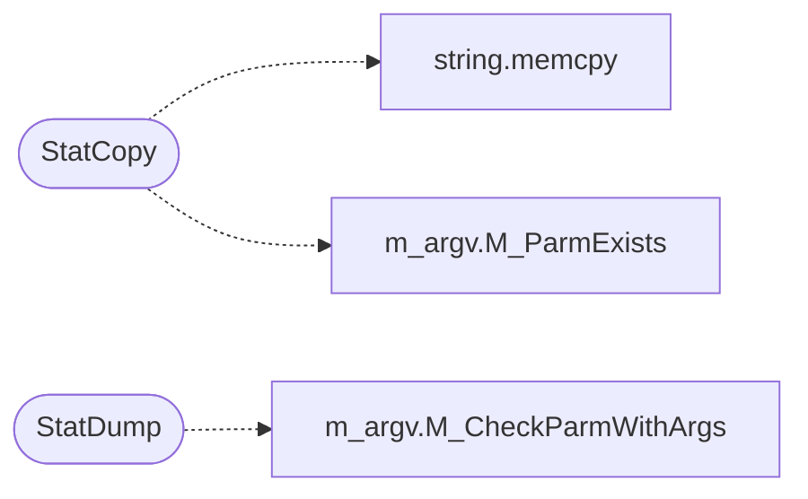

# `progs/doomgeneric/statdump.c`

> Source: [progs/doomgeneric/statdump.c:1](../../progs/doomgeneric/statdump.c#L1) | language `c` | coverage 0.0% | [API index](../index.md)

## Contents

- **Functions:** [`StatCopy`](#statcopy), [`StatDump`](#statdump)
- **Macros:** [`MAX_CAPTURES`](#max_captures)

## Call Graph

Solid arrows stay in this module, dashed arrows leave it.



## Functions

<a id="statcopy"></a>

### `StatCopy`

`function` | [progs/doomgeneric/statdump.c:333](../../progs/doomgeneric/statdump.c#L333)

```c
void StatCopy(wbstartstruct_t *stats)
```

**Parameters**

| Name | Type | Default | Description |
|---|---|---|---|
| `stats` | `wbstartstruct_t *` |  |  |

*Calls:* [`memcpy`](kernel.string.c.md#memcpy), [`M_ParmExists`](progs.doomgeneric.m_argv.c.md#m_parmexists)

---

<a id="statdump"></a>

### `StatDump`

`function` | [progs/doomgeneric/statdump.c:343](../../progs/doomgeneric/statdump.c#L343)

```c
void StatDump(void)
```

*Calls:* [`M_CheckParmWithArgs`](progs.doomgeneric.m_argv.h.md#m_checkparmwithargs)

---

## Macros

<a id="max_captures"></a>

### `MAX_CAPTURES`

`macro` | [progs/doomgeneric/statdump.c:56](../../progs/doomgeneric/statdump.c#L56)

```c
#define MAX_CAPTURES
```

---
