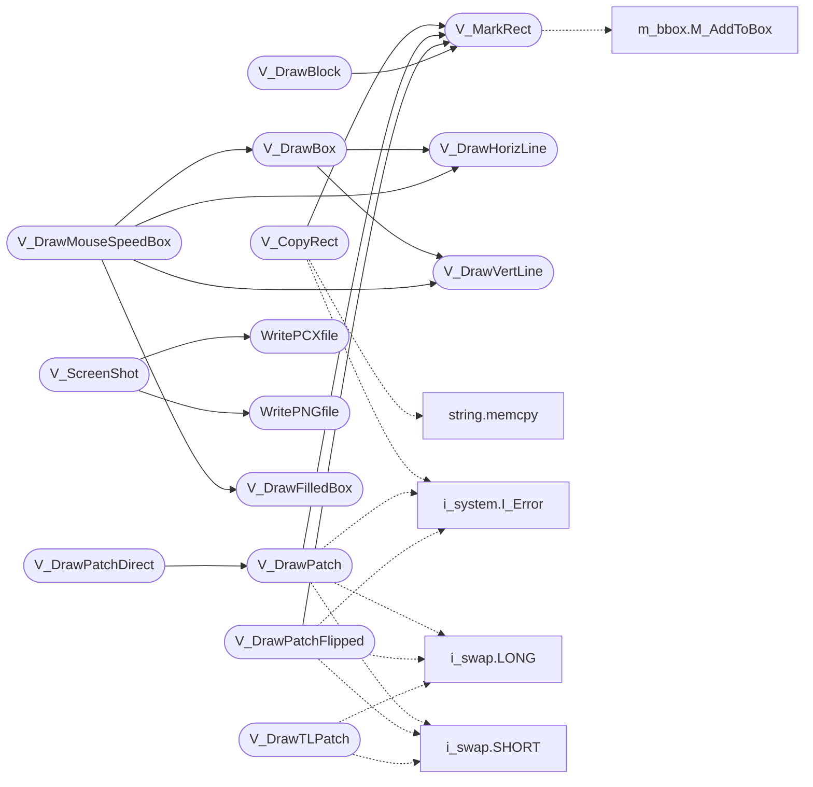

# `progs/doomgeneric/v_video.c`

> Source: [progs/doomgeneric/v_video.c:1](../../progs/doomgeneric/v_video.c#L1) | language `c` | coverage 20.7% | [API index](../index.md)

Copyright(C) 1993-1996 Id Software, Inc.

Copyright(C) 1993-2008 Raven Software Copyright(C) 2005-2014 Simon Howard  This program is free software; you can redistribute it and/or modify it under the terms of the GNU General Public License as published by the Free Software Foundation; either version 2 of the License, or (at your option) any later version.  This program is distributed in the hope that it will be useful, but WITHOUT ANY WARRANTY; without even the implied warranty of MERCHANTABILITY or FITNESS FOR A PARTICULAR PURPOSE.  See the GNU General Public License for more details.  DESCRIPTION: Gamma correction LUT stuff. Functions to draw patches (by post) directly to screen. Functions to blit a block to the screen.

## Contents

- **Functions:** [`V_MarkRect`](#v_markrect), [`V_CopyRect`](#v_copyrect), [`V_SetPatchClipCallback`](#v_setpatchclipcallback), [`V_DrawPatch`](#v_drawpatch), [`V_DrawPatchFlipped`](#v_drawpatchflipped), [`V_DrawPatchDirect`](#v_drawpatchdirect), [`V_DrawTLPatch`](#v_drawtlpatch), [`V_DrawXlaPatch`](#v_drawxlapatch), [`V_DrawAltTLPatch`](#v_drawalttlpatch), [`V_DrawShadowedPatch`](#v_drawshadowedpatch), [`V_LoadTintTable`](#v_loadtinttable), [`V_LoadXlaTable`](#v_loadxlatable), [`V_DrawBlock`](#v_drawblock), [`V_DrawFilledBox`](#v_drawfilledbox), [`V_DrawHorizLine`](#v_drawhorizline), [`V_DrawVertLine`](#v_drawvertline), [`V_DrawBox`](#v_drawbox), [`V_DrawRawScreen`](#v_drawrawscreen), [`V_Init`](#v_init), [`V_UseBuffer`](#v_usebuffer), [`V_RestoreBuffer`](#v_restorebuffer), [`WritePCXfile`](#writepcxfile), [`WritePNGfile`](#writepngfile), [`V_ScreenShot`](#v_screenshot), [`V_DrawMouseSpeedBox`](#v_drawmousespeedbox)
- **Macros:** [`RANGECHECK`](#rangecheck), [`MOUSE_SPEED_BOX_WIDTH`](#mouse_speed_box_width), [`MOUSE_SPEED_BOX_HEIGHT`](#mouse_speed_box_height)
- **Variables:** [`png_screenshots`](#png_screenshots), [`usemouse`](#usemouse)

## Call Graph

Solid arrows stay in this module, dashed arrows leave it.



## Functions

<a id="v_markrect"></a>

### `V_MarkRect`

`function` | [progs/doomgeneric/v_video.c:69](../../progs/doomgeneric/v_video.c#L69)

```c
void V_MarkRect(int x, int y, int width, int height)
```

V_MarkRect

**Parameters**

| Name | Type | Default | Description |
|---|---|---|---|
| `x` | `int` |  |  |
| `y` | `int` |  |  |
| `width` | `int` |  |  |
| `height` | `int` |  |  |

*Calls:* [`M_AddToBox`](progs.doomgeneric.m_bbox.h.md#m_addtobox)

*Called by:* [`V_CopyRect`](#v_copyrect), [`V_DrawBlock`](#v_drawblock), [`V_DrawPatch`](#v_drawpatch), [`V_DrawPatchFlipped`](#v_drawpatchflipped)

---

<a id="v_copyrect"></a>

### `V_CopyRect`

`function` | [progs/doomgeneric/v_video.c:85](../../progs/doomgeneric/v_video.c#L85)

```c
void V_CopyRect(int srcx, int srcy, byte *source, int width, int height, int destx, int desty)
```

V_CopyRect

**Parameters**

| Name | Type | Default | Description |
|---|---|---|---|
| `srcx` | `int` |  |  |
| `srcy` | `int` |  |  |
| `source` | `byte *` |  |  |
| `width` | `int` |  |  |
| `height` | `int` |  |  |
| `destx` | `int` |  |  |
| `desty` | `int` |  |  |

*Calls:* [`memcpy`](kernel.string.c.md#memcpy), [`I_Error`](progs.doomgeneric.i_system.h.md#i_error), [`V_MarkRect`](#v_markrect)

---

<a id="v_setpatchclipcallback"></a>

### `V_SetPatchClipCallback`

`function` | [progs/doomgeneric/v_video.c:129](../../progs/doomgeneric/v_video.c#L129)

```c
void V_SetPatchClipCallback(vpatchclipfunc_t func)
```

V_SetPatchClipCallback

haleyjd 08/28/10: Added for Strife support.
By calling this function, you can setup runtime error checking for patch
clipping. Strife never caused errors by drawing patches partway off-screen.
Some versions of vanilla DOOM also behaved differently than the default
implementation, so this could possibly be extended to those as well for
accurate emulation.

**Parameters**

| Name | Type | Default | Description |
|---|---|---|---|
| `func` | `vpatchclipfunc_t` |  |  |

---

<a id="v_drawpatch"></a>

### `V_DrawPatch`

`function` | [progs/doomgeneric/v_video.c:139](../../progs/doomgeneric/v_video.c#L139)

```c
void V_DrawPatch(int x, int y, patch_t *patch)
```

**Parameters**

| Name | Type | Default | Description |
|---|---|---|---|
| `x` | `int` |  |  |
| `y` | `int` |  |  |
| `patch` | `patch_t *` |  |  |

*Calls:* [`LONG`](progs.doomgeneric.i_swap.h.md#long), [`SHORT`](progs.doomgeneric.i_swap.h.md#short), [`I_Error`](progs.doomgeneric.i_system.h.md#i_error), [`V_MarkRect`](#v_markrect)

*Called by:* [`V_DrawPatchDirect`](#v_drawpatchdirect)

---

<a id="v_drawpatchflipped"></a>

### `V_DrawPatchFlipped`

`function` | [progs/doomgeneric/v_video.c:203](../../progs/doomgeneric/v_video.c#L203)

```c
void V_DrawPatchFlipped(int x, int y, patch_t *patch)
```

**Parameters**

| Name | Type | Default | Description |
|---|---|---|---|
| `x` | `int` |  |  |
| `y` | `int` |  |  |
| `patch` | `patch_t *` |  |  |

*Calls:* [`LONG`](progs.doomgeneric.i_swap.h.md#long), [`SHORT`](progs.doomgeneric.i_swap.h.md#short), [`I_Error`](progs.doomgeneric.i_system.h.md#i_error), [`V_MarkRect`](#v_markrect)

---

<a id="v_drawpatchdirect"></a>

### `V_DrawPatchDirect`

`function` | [progs/doomgeneric/v_video.c:268](../../progs/doomgeneric/v_video.c#L268)

```c
void V_DrawPatchDirect(int x, int y, patch_t *patch)
```

**Parameters**

| Name | Type | Default | Description |
|---|---|---|---|
| `x` | `int` |  |  |
| `y` | `int` |  |  |
| `patch` | `patch_t *` |  |  |

*Calls:* [`V_DrawPatch`](#v_drawpatch)

---

<a id="v_drawtlpatch"></a>

### `V_DrawTLPatch`

`function` | [progs/doomgeneric/v_video.c:279](../../progs/doomgeneric/v_video.c#L279)

```c
void V_DrawTLPatch(int x, int y, patch_t * patch)
```

**Parameters**

| Name | Type | Default | Description |
|---|---|---|---|
| `x` | `int` |  |  |
| `y` | `int` |  |  |
| `patch` | `patch_t *` |  |  |

*Calls:* [`LONG`](progs.doomgeneric.i_swap.h.md#long), [`SHORT`](progs.doomgeneric.i_swap.h.md#short), [`I_Error`](progs.doomgeneric.i_system.h.md#i_error)

---

<a id="v_drawxlapatch"></a>

### `V_DrawXlaPatch`

`function` | [progs/doomgeneric/v_video.c:329](../../progs/doomgeneric/v_video.c#L329)

```c
void V_DrawXlaPatch(int x, int y, patch_t * patch)
```

**Parameters**

| Name | Type | Default | Description |
|---|---|---|---|
| `x` | `int` |  |  |
| `y` | `int` |  |  |
| `patch` | `patch_t *` |  |  |

*Calls:* [`LONG`](progs.doomgeneric.i_swap.h.md#long), [`SHORT`](progs.doomgeneric.i_swap.h.md#short)

---

<a id="v_drawalttlpatch"></a>

### `V_DrawAltTLPatch`

`function` | [progs/doomgeneric/v_video.c:378](../../progs/doomgeneric/v_video.c#L378)

```c
void V_DrawAltTLPatch(int x, int y, patch_t * patch)
```

**Parameters**

| Name | Type | Default | Description |
|---|---|---|---|
| `x` | `int` |  |  |
| `y` | `int` |  |  |
| `patch` | `patch_t *` |  |  |

*Calls:* [`LONG`](progs.doomgeneric.i_swap.h.md#long), [`SHORT`](progs.doomgeneric.i_swap.h.md#short), [`I_Error`](progs.doomgeneric.i_system.h.md#i_error)

---

<a id="v_drawshadowedpatch"></a>

### `V_DrawShadowedPatch`

`function` | [progs/doomgeneric/v_video.c:428](../../progs/doomgeneric/v_video.c#L428)

```c
void V_DrawShadowedPatch(int x, int y, patch_t *patch)
```

**Parameters**

| Name | Type | Default | Description |
|---|---|---|---|
| `x` | `int` |  |  |
| `y` | `int` |  |  |
| `patch` | `patch_t *` |  |  |

*Calls:* [`LONG`](progs.doomgeneric.i_swap.h.md#long), [`SHORT`](progs.doomgeneric.i_swap.h.md#short), [`I_Error`](progs.doomgeneric.i_system.h.md#i_error)

---

<a id="v_loadtinttable"></a>

### `V_LoadTintTable`

`function` | [progs/doomgeneric/v_video.c:482](../../progs/doomgeneric/v_video.c#L482)

```c
void V_LoadTintTable(void)
```

*Calls:* [`W_CacheLumpName`](progs.doomgeneric.w_wad.h.md#w_cachelumpname)

---

<a id="v_loadxlatable"></a>

### `V_LoadXlaTable`

`function` | [progs/doomgeneric/v_video.c:493](../../progs/doomgeneric/v_video.c#L493)

```c
void V_LoadXlaTable(void)
```

*Calls:* [`W_CacheLumpName`](progs.doomgeneric.w_wad.h.md#w_cachelumpname)

---

<a id="v_drawblock"></a>

### `V_DrawBlock`

`function` | [progs/doomgeneric/v_video.c:503](../../progs/doomgeneric/v_video.c#L503)

```c
void V_DrawBlock(int x, int y, int width, int height, byte *src)
```

**Parameters**

| Name | Type | Default | Description |
|---|---|---|---|
| `x` | `int` |  |  |
| `y` | `int` |  |  |
| `width` | `int` |  |  |
| `height` | `int` |  |  |
| `src` | `byte *` |  |  |

*Calls:* [`memcpy`](kernel.string.c.md#memcpy), [`I_Error`](progs.doomgeneric.i_system.h.md#i_error), [`V_MarkRect`](#v_markrect)

---

<a id="v_drawfilledbox"></a>

### `V_DrawFilledBox`

`function` | [progs/doomgeneric/v_video.c:529](../../progs/doomgeneric/v_video.c#L529)

```c
void V_DrawFilledBox(int x, int y, int w, int h, int c)
```

**Parameters**

| Name | Type | Default | Description |
|---|---|---|---|
| `x` | `int` |  |  |
| `y` | `int` |  |  |
| `w` | `int` |  |  |
| `h` | `int` |  |  |
| `c` | `int` |  |  |

*Called by:* [`V_DrawMouseSpeedBox`](#v_drawmousespeedbox)

---

<a id="v_drawhorizline"></a>

### `V_DrawHorizLine`

`function` | [progs/doomgeneric/v_video.c:549](../../progs/doomgeneric/v_video.c#L549)

```c
void V_DrawHorizLine(int x, int y, int w, int c)
```

**Parameters**

| Name | Type | Default | Description |
|---|---|---|---|
| `x` | `int` |  |  |
| `y` | `int` |  |  |
| `w` | `int` |  |  |
| `c` | `int` |  |  |

*Called by:* [`V_DrawBox`](#v_drawbox), [`V_DrawMouseSpeedBox`](#v_drawmousespeedbox)

---

<a id="v_drawvertline"></a>

### `V_DrawVertLine`

`function` | [progs/doomgeneric/v_video.c:562](../../progs/doomgeneric/v_video.c#L562)

```c
void V_DrawVertLine(int x, int y, int h, int c)
```

**Parameters**

| Name | Type | Default | Description |
|---|---|---|---|
| `x` | `int` |  |  |
| `y` | `int` |  |  |
| `h` | `int` |  |  |
| `c` | `int` |  |  |

*Called by:* [`V_DrawBox`](#v_drawbox), [`V_DrawMouseSpeedBox`](#v_drawmousespeedbox)

---

<a id="v_drawbox"></a>

### `V_DrawBox`

`function` | [progs/doomgeneric/v_video.c:576](../../progs/doomgeneric/v_video.c#L576)

```c
void V_DrawBox(int x, int y, int w, int h, int c)
```

**Parameters**

| Name | Type | Default | Description |
|---|---|---|---|
| `x` | `int` |  |  |
| `y` | `int` |  |  |
| `w` | `int` |  |  |
| `h` | `int` |  |  |
| `c` | `int` |  |  |

*Calls:* [`V_DrawHorizLine`](#v_drawhorizline), [`V_DrawVertLine`](#v_drawvertline)

*Called by:* [`V_DrawMouseSpeedBox`](#v_drawmousespeedbox)

---

<a id="v_drawrawscreen"></a>

### `V_DrawRawScreen`

`function` | [progs/doomgeneric/v_video.c:589](../../progs/doomgeneric/v_video.c#L589)

```c
void V_DrawRawScreen(byte *raw)
```

**Parameters**

| Name | Type | Default | Description |
|---|---|---|---|
| `raw` | `byte *` |  |  |

*Calls:* [`memcpy`](kernel.string.c.md#memcpy)

---

<a id="v_init"></a>

### `V_Init`

`function` | [progs/doomgeneric/v_video.c:597](../../progs/doomgeneric/v_video.c#L597)

```c
void V_Init (void)
```

V_Init

---

<a id="v_usebuffer"></a>

### `V_UseBuffer`

`function` | [progs/doomgeneric/v_video.c:606](../../progs/doomgeneric/v_video.c#L606)

```c
void V_UseBuffer(byte *buffer)
```

**Parameters**

| Name | Type | Default | Description |
|---|---|---|---|
| `buffer` | `byte *` |  |  |

---

<a id="v_restorebuffer"></a>

### `V_RestoreBuffer`

`function` | [progs/doomgeneric/v_video.c:613](../../progs/doomgeneric/v_video.c#L613)

```c
void V_RestoreBuffer(void)
```

---

<a id="writepcxfile"></a>

### `WritePCXfile`

`function` | [progs/doomgeneric/v_video.c:653](../../progs/doomgeneric/v_video.c#L653)

```c
void WritePCXfile(char *filename, byte *data, int width, int height, byte *palette)
```

**Parameters**

| Name | Type | Default | Description |
|---|---|---|---|
| `filename` | `char *` |  |  |
| `data` | `byte *` |  |  |
| `width` | `int` |  |  |
| `height` | `int` |  |  |
| `palette` | `byte *` |  |  |

*Calls:* [`memset`](kernel.string.c.md#memset), [`SHORT`](progs.doomgeneric.i_swap.h.md#short), [`M_WriteFile`](progs.doomgeneric.m_misc.c.md#m_writefile), [`Z_Free`](progs.doomgeneric.z_zone.h.md#z_free), [`Z_Malloc`](progs.doomgeneric.z_zone.h.md#z_malloc)

*Called by:* [`V_ScreenShot`](#v_screenshot)

---

<a id="writepngfile"></a>

### `WritePNGfile`

`function` | [progs/doomgeneric/v_video.c:721](../../progs/doomgeneric/v_video.c#L721)

```c
void WritePNGfile(char *filename, byte *data, int width, int height, byte *palette)
```

**Parameters**

| Name | Type | Default | Description |
|---|---|---|---|
| `filename` | `char *` |  |  |
| `data` | `byte *` |  |  |
| `width` | `int` |  |  |
| `height` | `int` |  |  |
| `palette` | `byte *` |  |  |

*Called by:* [`V_ScreenShot`](#v_screenshot)

---

<a id="v_screenshot"></a>

### `V_ScreenShot`

`function` | [progs/doomgeneric/v_video.c:791](../../progs/doomgeneric/v_video.c#L791)

```c
void V_ScreenShot(char *format)
```

**Parameters**

| Name | Type | Default | Description |
|---|---|---|---|
| `format` | `char *` |  |  |

*Calls:* [`DEH_String`](progs.doomgeneric.deh_str.h.md#deh_string), [`I_Error`](progs.doomgeneric.i_system.h.md#i_error), [`M_FileExists`](progs.doomgeneric.m_misc.c.md#m_fileexists), [`M_snprintf`](progs.doomgeneric.m_misc.h.md#m_snprintf), [`WritePCXfile`](#writepcxfile), [`WritePNGfile`](#writepngfile), [`W_CacheLumpName`](progs.doomgeneric.w_wad.h.md#w_cachelumpname)

---

<a id="v_drawmousespeedbox"></a>

### `V_DrawMouseSpeedBox`

`function` | [progs/doomgeneric/v_video.c:846](../../progs/doomgeneric/v_video.c#L846)

```c
void V_DrawMouseSpeedBox(int speed)
```

**Parameters**

| Name | Type | Default | Description |
|---|---|---|---|
| `speed` | `int` |  |  |

*Calls:* [`I_GetPaletteIndex`](progs.doomgeneric.i_video.h.md#i_getpaletteindex), [`V_DrawBox`](#v_drawbox), [`V_DrawFilledBox`](#v_drawfilledbox), [`V_DrawHorizLine`](#v_drawhorizline), [`V_DrawVertLine`](#v_drawvertline)

---

## Macros

<a id="rangecheck"></a>

### `RANGECHECK`

`macro` | [progs/doomgeneric/v_video.c:46](../../progs/doomgeneric/v_video.c#L46)

```c
#define RANGECHECK
```

TODO: There are separate RANGECHECK defines for different games, but this is common code.

Fix this.

---

<a id="mouse_speed_box_width"></a>

### `MOUSE_SPEED_BOX_WIDTH`

`macro` | [progs/doomgeneric/v_video.c:843](../../progs/doomgeneric/v_video.c#L843)

```c
#define MOUSE_SPEED_BOX_WIDTH
```

---

<a id="mouse_speed_box_height"></a>

### `MOUSE_SPEED_BOX_HEIGHT`

`macro` | [progs/doomgeneric/v_video.c:844](../../progs/doomgeneric/v_video.c#L844)

```c
#define MOUSE_SPEED_BOX_HEIGHT
```

---

## Variables

<a id="png_screenshots"></a>

### `png_screenshots`

`variable` `extern` | [progs/doomgeneric/v_video.c:800](../../progs/doomgeneric/v_video.c#L800)

```c
extern int png_screenshots;
```

ifdef HAVE_LIBPNG

---

<a id="usemouse"></a>

### `usemouse`

`variable` `extern` | [progs/doomgeneric/v_video.c:848](../../progs/doomgeneric/v_video.c#L848)

```c
extern int usemouse;
```

---
