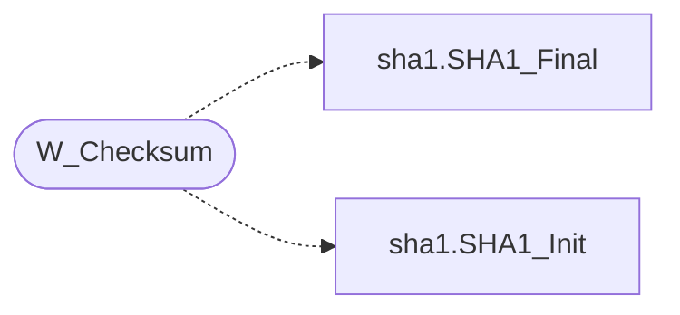

# `progs/doomgeneric/w_checksum.c`

> Source: [progs/doomgeneric/w_checksum.c:1](../../progs/doomgeneric/w_checksum.c#L1) | language `c` | coverage 50.0% | [API index](../index.md)

Copyright(C) 1993-1996 Id Software, Inc.

Copyright(C) 2005-2014 Simon Howard  This program is free software; you can redistribute it and/or modify it under the terms of the GNU General Public License as published by the Free Software Foundation; either version 2 of the License, or (at your option) any later version.  This program is distributed in the hope that it will be useful, but WITHOUT ANY WARRANTY; without even the implied warranty of MERCHANTABILITY or FITNESS FOR A PARTICULAR PURPOSE.  See the GNU General Public License for more details.  DESCRIPTION: Generate a checksum of the WAD directory.

## Contents

- **Functions:** [`W_Checksum`](#w_checksum)

## Call Graph

Solid arrows stay in this module, dashed arrows leave it.



## Functions

<a id="w_checksum"></a>

### `W_Checksum`

`function` | [progs/doomgeneric/w_checksum.c:68](../../progs/doomgeneric/w_checksum.c#L68)

```c
void W_Checksum(sha1_digest_t digest)
```

**Parameters**

| Name | Type | Default | Description |
|---|---|---|---|
| `digest` | `sha1_digest_t` |  |  |

*Calls:* [`SHA1_Final`](progs.doomgeneric.sha1.h.md#sha1_final), [`SHA1_Init`](progs.doomgeneric.sha1.h.md#sha1_init)

---
