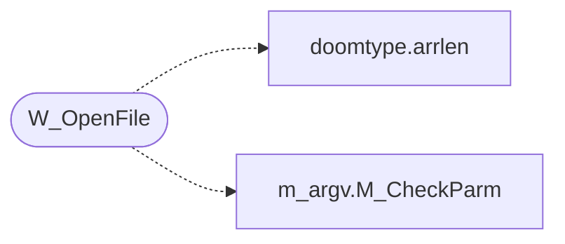

# `progs/doomgeneric/w_file.c`

> Source: [progs/doomgeneric/w_file.c:1](../../progs/doomgeneric/w_file.c#L1) | language `c` | coverage 25.0% | [API index](../index.md)

Copyright(C) 1993-1996 Id Software, Inc.

Copyright(C) 2005-2014 Simon Howard  This program is free software; you can redistribute it and/or modify it under the terms of the GNU General Public License as published by the Free Software Foundation; either version 2 of the License, or (at your option) any later version.  This program is distributed in the hope that it will be useful, but WITHOUT ANY WARRANTY; without even the implied warranty of MERCHANTABILITY or FITNESS FOR A PARTICULAR PURPOSE.  See the GNU General Public License for more details.  DESCRIPTION: WAD I/O functions.

## Contents

- **Functions:** [`W_OpenFile`](#w_openfile), [`W_CloseFile`](#w_closefile), [`W_Read`](#w_read)
- **Variables:** [`stdc_wad_file`](#stdc_wad_file), [`win32_wad_file`](#win32_wad_file), [`posix_wad_file`](#posix_wad_file)

## Call Graph

Solid arrows stay in this module, dashed arrows leave it.



## Functions

<a id="w_openfile"></a>

### `W_OpenFile`

`function` | [progs/doomgeneric/w_file.c:53](../../progs/doomgeneric/w_file.c#L53)

```c
wad_file_t *W_OpenFile(char *path)
```

**Parameters**

| Name | Type | Default | Description |
|---|---|---|---|
| `path` | `char *` |  |  |

**Returns:** `wad_file_t *`

*Calls:* [`arrlen`](progs.doomgeneric.doomtype.h.md#arrlen), [`M_CheckParm`](progs.doomgeneric.m_argv.h.md#m_checkparm)

---

<a id="w_closefile"></a>

### `W_CloseFile`

`function` | [progs/doomgeneric/w_file.c:85](../../progs/doomgeneric/w_file.c#L85)

```c
void W_CloseFile(wad_file_t *wad)
```

**Parameters**

| Name | Type | Default | Description |
|---|---|---|---|
| `wad` | `wad_file_t *` |  |  |

---

<a id="w_read"></a>

### `W_Read`

`function` | [progs/doomgeneric/w_file.c:90](../../progs/doomgeneric/w_file.c#L90)

```c
size_t W_Read(wad_file_t *wad, unsigned int offset, void *buffer, size_t buffer_len)
```

**Parameters**

| Name | Type | Default | Description |
|---|---|---|---|
| `wad` | `wad_file_t *` |  |  |
| `offset` | `unsigned int` |  |  |
| `buffer` | `void *` |  |  |
| `buffer_len` | `size_t` |  |  |

**Returns:** `size_t`

---

## Variables

<a id="stdc_wad_file"></a>

### `stdc_wad_file`

`variable` `extern` | [progs/doomgeneric/w_file.c:28](../../progs/doomgeneric/w_file.c#L28)

```c
extern wad_file_class_t stdc_wad_file;
```

---

<a id="win32_wad_file"></a>

### `win32_wad_file`

`variable` `extern` | [progs/doomgeneric/w_file.c:32](../../progs/doomgeneric/w_file.c#L32)

```c
extern wad_file_class_t win32_wad_file;
```

ifdef _WIN32

---

<a id="posix_wad_file"></a>

### `posix_wad_file`

`variable` `extern` | [progs/doomgeneric/w_file.c:37](../../progs/doomgeneric/w_file.c#L37)

```c
extern wad_file_class_t posix_wad_file;
```

ifdef HAVE_MMAP

---
