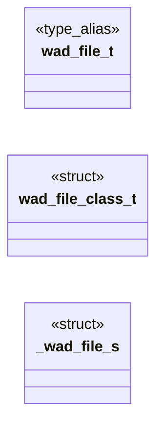

# `progs/doomgeneric/w_file.h`

> Source: [progs/doomgeneric/w_file.h:1](../../progs/doomgeneric/w_file.h#L1) | language `h` | coverage 25.0% | [API index](../index.md)

Copyright(C) 1993-1996 Id Software, Inc.

Copyright(C) 2005-2014 Simon Howard  This program is free software; you can redistribute it and/or modify it under the terms of the GNU General Public License as published by the Free Software Foundation; either version 2 of the License, or (at your option) any later version.  This program is distributed in the hope that it will be useful, but WITHOUT ANY WARRANTY; without even the implied warranty of MERCHANTABILITY or FITNESS FOR A PARTICULAR PURPOSE.  See the GNU General Public License for more details.  DESCRIPTION: WAD I/O functions.

## Contents

- **Structs:** [`wad_file_class_t`](#wad_file_class_t), [`_wad_file_s`](#_wad_file_s)
- **Type Aliases:** [`wad_file_t`](#wad_file_t)
- **Functions:** [`W_OpenFile`](#w_openfile), [`W_CloseFile`](#w_closefile), [`W_Read`](#w_read)
- **Macros:** [`__W_FILE__`](#__w_file__)

## Type Diagram



## Structs

<a id="wad_file_class_t"></a>

### `wad_file_class_t`

`struct` | [progs/doomgeneric/w_file.h:28](../../progs/doomgeneric/w_file.h#L28)

```c
typedef struct
```

---

<a id="_wad_file_s"></a>

### `_wad_file_s`

`struct` | [progs/doomgeneric/w_file.h:46](../../progs/doomgeneric/w_file.h#L46)

```c
struct _wad_file_s
```

---

## Type Aliases

<a id="wad_file_t"></a>

### `wad_file_t`

`type_alias` | [progs/doomgeneric/w_file.h:25](../../progs/doomgeneric/w_file.h#L25)

```c
typedef struct _wad_file_s wad_file_t;
```

include <stdio.h> include "doomtype.h"

---

## Functions

<a id="w_openfile"></a>

### `W_OpenFile`

`function` | [progs/doomgeneric/w_file.h:65](../../progs/doomgeneric/w_file.h#L65)

```c
wad_file_t *W_OpenFile(char *path);
```

**Parameters**

| Name | Type | Default | Description |
|---|---|---|---|
| `path` | `char *` |  |  |

**Returns:** `wad_file_t *`

---

<a id="w_closefile"></a>

### `W_CloseFile`

`function` | [progs/doomgeneric/w_file.h:69](../../progs/doomgeneric/w_file.h#L69)

```c
void W_CloseFile(wad_file_t *wad);
```

**Parameters**

| Name | Type | Default | Description |
|---|---|---|---|
| `wad` | `wad_file_t *` |  |  |

---

<a id="w_read"></a>

### `W_Read`

`function` | [progs/doomgeneric/w_file.h:75](../../progs/doomgeneric/w_file.h#L75)

```c
size_t W_Read(wad_file_t *wad, unsigned int offset, void *buffer, size_t buffer_len);
```

**Parameters**

| Name | Type | Default | Description |
|---|---|---|---|
| `wad` | `wad_file_t *` |  |  |
| `offset` | `unsigned int` |  |  |
| `buffer` | `void *` |  |  |
| `buffer_len` | `size_t` |  |  |

**Returns:** `size_t`

---

## Macros

<a id="__w_file__"></a>

### `__W_FILE__`

`macro` | [progs/doomgeneric/w_file.h:21](../../progs/doomgeneric/w_file.h#L21)

```c
#define __W_FILE__
```

---
