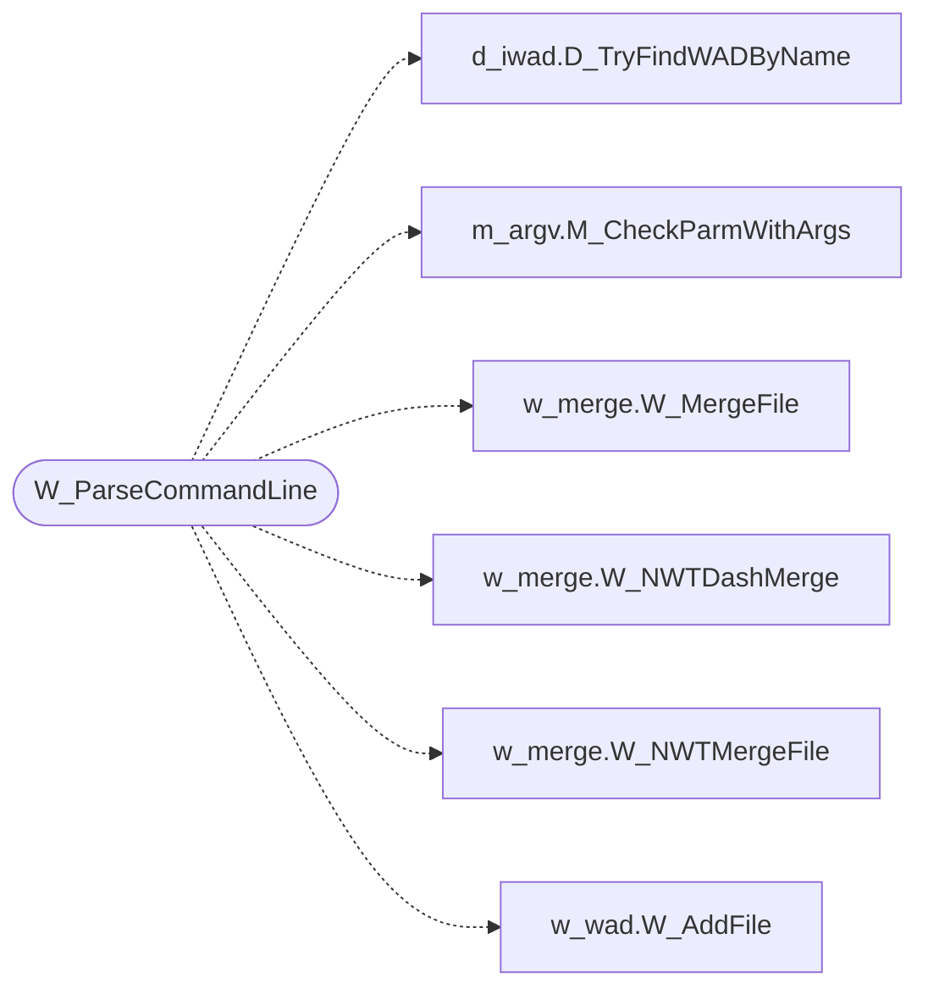

# `progs/doomgeneric/w_main.c`

> Source: [progs/doomgeneric/w_main.c:1](../../progs/doomgeneric/w_main.c#L1) | language `c` | coverage 50.0% | [API index](../index.md)

Copyright(C) 1993-1996 Id Software, Inc.

Copyright(C) 2005-2014 Simon Howard  This program is free software; you can redistribute it and/or modify it under the terms of the GNU General Public License as published by the Free Software Foundation; either version 2 of the License, or (at your option) any later version.  This program is distributed in the hope that it will be useful, but WITHOUT ANY WARRANTY; without even the implied warranty of MERCHANTABILITY or FITNESS FOR A PARTICULAR PURPOSE.  See the GNU General Public License for more details.  DESCRIPTION: Common code to parse command line, identifying WAD files to load.    Parse the command line, merging WAD files that are sppecified. Returns true if at least one file was added.

## Contents

- **Functions:** [`W_ParseCommandLine`](#w_parsecommandline)

## Call Graph

Solid arrows stay in this module, dashed arrows leave it.



## Functions

<a id="w_parsecommandline"></a>

### `W_ParseCommandLine`

`function` | [progs/doomgeneric/w_main.c:30](../../progs/doomgeneric/w_main.c#L30)

```c
boolean W_ParseCommandLine(void)
```

**Returns:** `boolean`

*Calls:* [`D_TryFindWADByName`](progs.doomgeneric.d_iwad.h.md#d_tryfindwadbyname), [`M_CheckParmWithArgs`](progs.doomgeneric.m_argv.h.md#m_checkparmwithargs), [`W_MergeFile`](progs.doomgeneric.w_merge.h.md#w_mergefile), [`W_NWTDashMerge`](progs.doomgeneric.w_merge.h.md#w_nwtdashmerge), [`W_NWTMergeFile`](progs.doomgeneric.w_merge.h.md#w_nwtmergefile), [`W_AddFile`](progs.doomgeneric.w_wad.h.md#w_addfile)

*Called by:* [`D_DoomMain`](progs.doomgeneric.d_main.c.md#d_doommain)

---
