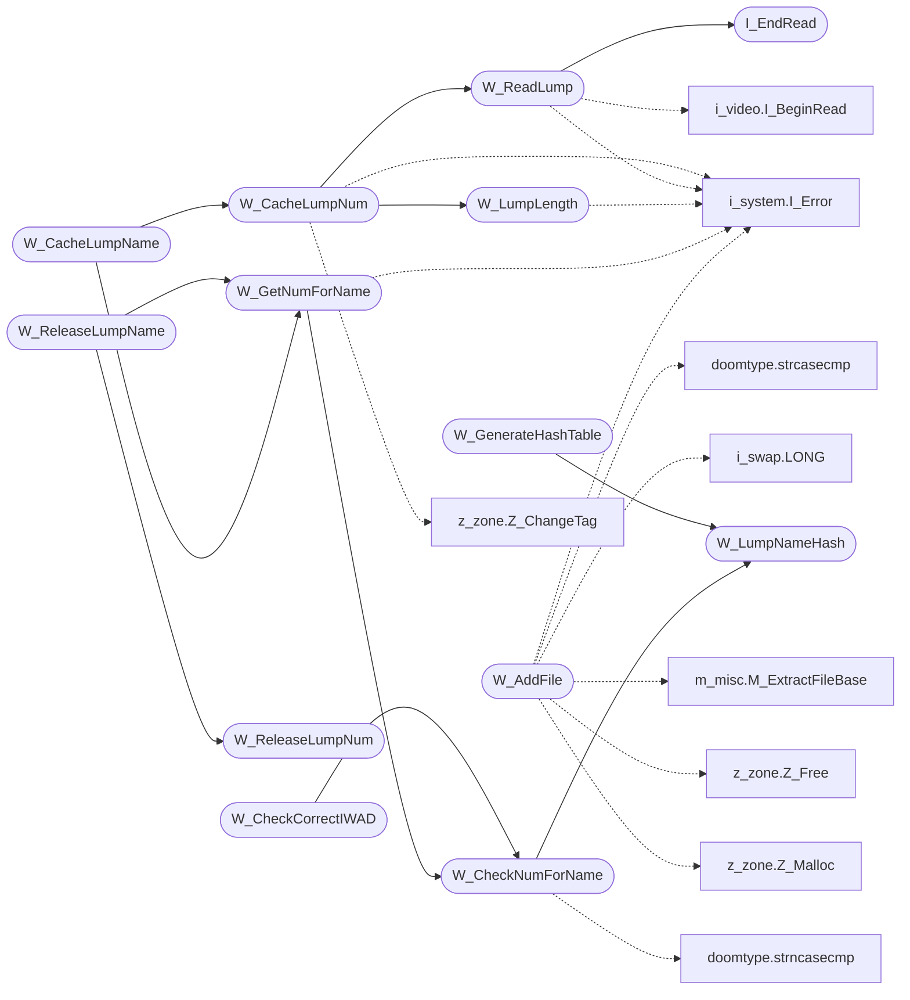

# `progs/doomgeneric/w_wad.c`

> Source: [progs/doomgeneric/w_wad.c:1](../../progs/doomgeneric/w_wad.c#L1) | language `c` | coverage 37.5% | [API index](../index.md)

Copyright(C) 1993-1996 Id Software, Inc.

Copyright(C) 2005-2014 Simon Howard  This program is free software; you can redistribute it and/or modify it under the terms of the GNU General Public License as published by the Free Software Foundation; either version 2 of the License, or (at your option) any later version.  This program is distributed in the hope that it will be useful, but WITHOUT ANY WARRANTY; without even the implied warranty of MERCHANTABILITY or FITNESS FOR A PARTICULAR PURPOSE.  See the GNU General Public License for more details.  DESCRIPTION: Handles WAD file header, directory, lump I/O.

## Contents

- **Functions:** [`I_EndRead`](#i_endread), [`W_LumpNameHash`](#w_lumpnamehash), [`W_AddFile`](#w_addfile), [`W_NumLumps`](#w_numlumps), [`W_CheckNumForName`](#w_checknumforname), [`W_GetNumForName`](#w_getnumforname), [`W_LumpLength`](#w_lumplength), [`W_ReadLump`](#w_readlump), [`W_CacheLumpNum`](#w_cachelumpnum), [`W_CacheLumpName`](#w_cachelumpname), [`W_ReleaseLumpNum`](#w_releaselumpnum), [`W_ReleaseLumpName`](#w_releaselumpname), [`W_Profile`](#w_profile), [`W_GenerateHashTable`](#w_generatehashtable), [`W_CheckCorrectIWAD`](#w_checkcorrectiwad)

## Call Graph

Solid arrows stay in this module, dashed arrows leave it.



## Functions

<a id="i_endread"></a>

### `I_EndRead`

`function` | [progs/doomgeneric/w_wad.c:39](../../progs/doomgeneric/w_wad.c#L39)

```c
void I_EndRead (void);
```

*Called by:* [`W_ReadLump`](#w_readlump)

---

<a id="w_lumpnamehash"></a>

### `W_LumpNameHash`

`function` | [progs/doomgeneric/w_wad.c:72](../../progs/doomgeneric/w_wad.c#L72)

```c
unsigned int W_LumpNameHash(const char *s)
```

**Parameters**

| Name | Type | Default | Description |
|---|---|---|---|
| `s` | `char *` |  |  |

**Returns:** `unsigned int`

*Called by:* [`W_CheckNumForName`](#w_checknumforname), [`W_GenerateHashTable`](#w_generatehashtable)

---

<a id="w_addfile"></a>

### `W_AddFile`

`function` | [progs/doomgeneric/w_wad.c:141](../../progs/doomgeneric/w_wad.c#L141)

```c
wad_file_t *W_AddFile (char *filename)
```

**Parameters**

| Name | Type | Default | Description |
|---|---|---|---|
| `filename` | `char *` |  |  |

**Returns:** `wad_file_t *`

*Calls:* [`strcasecmp`](progs.doomgeneric.doomtype.h.md#strcasecmp), [`LONG`](progs.doomgeneric.i_swap.h.md#long), [`I_Error`](progs.doomgeneric.i_system.h.md#i_error), [`M_ExtractFileBase`](progs.doomgeneric.m_misc.h.md#m_extractfilebase), [`Z_Free`](progs.doomgeneric.z_zone.h.md#z_free), [`Z_Malloc`](progs.doomgeneric.z_zone.h.md#z_malloc)

---

<a id="w_numlumps"></a>

### `W_NumLumps`

`function` | [progs/doomgeneric/w_wad.c:246](../../progs/doomgeneric/w_wad.c#L246)

```c
int W_NumLumps (void)
```

W_NumLumps

**Returns:** `int`

---

<a id="w_checknumforname"></a>

### `W_CheckNumForName`

`function` | [progs/doomgeneric/w_wad.c:258](../../progs/doomgeneric/w_wad.c#L258)

```c
int W_CheckNumForName (char* name)
```

**Parameters**

| Name | Type | Default | Description |
|---|---|---|---|
| `name` | `char*` |  |  |

**Returns:** `int`

*Calls:* [`strncasecmp`](progs.doomgeneric.doomtype.h.md#strncasecmp), [`W_LumpNameHash`](#w_lumpnamehash)

*Called by:* [`W_CheckCorrectIWAD`](#w_checkcorrectiwad), [`W_GetNumForName`](#w_getnumforname)

---

<a id="w_getnumforname"></a>

### `W_GetNumForName`

`function` | [progs/doomgeneric/w_wad.c:308](../../progs/doomgeneric/w_wad.c#L308)

```c
int W_GetNumForName (char* name)
```

W_GetNumForName Calls W_CheckNumForName, but bombs out if not found.

**Parameters**

| Name | Type | Default | Description |
|---|---|---|---|
| `name` | `char*` |  |  |

**Returns:** `int`

*Calls:* [`I_Error`](progs.doomgeneric.i_system.h.md#i_error), [`W_CheckNumForName`](#w_checknumforname)

*Called by:* [`W_CacheLumpName`](#w_cachelumpname), [`W_ReleaseLumpName`](#w_releaselumpname)

---

<a id="w_lumplength"></a>

### `W_LumpLength`

`function` | [progs/doomgeneric/w_wad.c:327](../../progs/doomgeneric/w_wad.c#L327)

```c
int W_LumpLength (unsigned int lump)
```

W_LumpLength Returns the buffer size needed to load the given lump.

**Parameters**

| Name | Type | Default | Description |
|---|---|---|---|
| `lump` | `unsigned int` |  |  |

**Returns:** `int`

*Calls:* [`I_Error`](progs.doomgeneric.i_system.h.md#i_error)

*Called by:* [`W_CacheLumpNum`](#w_cachelumpnum)

---

<a id="w_readlump"></a>

### `W_ReadLump`

`function` | [progs/doomgeneric/w_wad.c:344](../../progs/doomgeneric/w_wad.c#L344)

```c
void W_ReadLump(unsigned int lump, void *dest)
```

W_ReadLump Loads the lump into the given buffer, which must be >= W_LumpLength().

**Parameters**

| Name | Type | Default | Description |
|---|---|---|---|
| `lump` | `unsigned int` |  |  |
| `dest` | `void *` |  |  |

*Calls:* [`I_Error`](progs.doomgeneric.i_system.h.md#i_error), [`I_BeginRead`](progs.doomgeneric.i_video.h.md#i_beginread), [`I_EndRead`](#i_endread)

*Called by:* [`W_CacheLumpNum`](#w_cachelumpnum)

---

<a id="w_cachelumpnum"></a>

### `W_CacheLumpNum`

`function` | [progs/doomgeneric/w_wad.c:384](../../progs/doomgeneric/w_wad.c#L384)

```c
void *W_CacheLumpNum(int lumpnum, int tag)
```

**Parameters**

| Name | Type | Default | Description |
|---|---|---|---|
| `lumpnum` | `int` |  |  |
| `tag` | `int` |  |  |

**Returns:** `void *`

*Calls:* [`I_Error`](progs.doomgeneric.i_system.h.md#i_error), [`W_LumpLength`](#w_lumplength), [`W_ReadLump`](#w_readlump), [`Z_ChangeTag`](progs.doomgeneric.z_zone.h.md#z_changetag), [`Z_Malloc`](progs.doomgeneric.z_zone.h.md#z_malloc)

*Called by:* [`W_CacheLumpName`](#w_cachelumpname)

---

<a id="w_cachelumpname"></a>

### `W_CacheLumpName`

`function` | [progs/doomgeneric/w_wad.c:431](../../progs/doomgeneric/w_wad.c#L431)

```c
void *W_CacheLumpName(char *name, int tag)
```

W_CacheLumpName

**Parameters**

| Name | Type | Default | Description |
|---|---|---|---|
| `name` | `char *` |  |  |
| `tag` | `int` |  |  |

**Returns:** `void *`

*Calls:* [`W_CacheLumpNum`](#w_cachelumpnum), [`W_GetNumForName`](#w_getnumforname)

---

<a id="w_releaselumpnum"></a>

### `W_ReleaseLumpNum`

`function` | [progs/doomgeneric/w_wad.c:446](../../progs/doomgeneric/w_wad.c#L446)

```c
void W_ReleaseLumpNum(int lumpnum)
```

**Parameters**

| Name | Type | Default | Description |
|---|---|---|---|
| `lumpnum` | `int` |  |  |

*Calls:* [`I_Error`](progs.doomgeneric.i_system.h.md#i_error), [`Z_ChangeTag`](progs.doomgeneric.z_zone.h.md#z_changetag)

*Called by:* [`W_ReleaseLumpName`](#w_releaselumpname)

---

<a id="w_releaselumpname"></a>

### `W_ReleaseLumpName`

`function` | [progs/doomgeneric/w_wad.c:467](../../progs/doomgeneric/w_wad.c#L467)

```c
void W_ReleaseLumpName(char *name)
```

**Parameters**

| Name | Type | Default | Description |
|---|---|---|---|
| `name` | `char *` |  |  |

*Calls:* [`W_GetNumForName`](#w_getnumforname), [`W_ReleaseLumpNum`](#w_releaselumpnum)

---

<a id="w_profile"></a>

### `W_Profile`

`function` | [progs/doomgeneric/w_wad.c:480](../../progs/doomgeneric/w_wad.c#L480)

```c
void W_Profile (void)
```

---

<a id="w_generatehashtable"></a>

### `W_GenerateHashTable`

`function` | [progs/doomgeneric/w_wad.c:541](../../progs/doomgeneric/w_wad.c#L541)

```c
void W_GenerateHashTable(void)
```

*Calls:* [`W_LumpNameHash`](#w_lumpnamehash), [`Z_Free`](progs.doomgeneric.z_zone.h.md#z_free), [`Z_Malloc`](progs.doomgeneric.z_zone.h.md#z_malloc)

---

<a id="w_checkcorrectiwad"></a>

### `W_CheckCorrectIWAD`

`function` | [progs/doomgeneric/w_wad.c:588](../../progs/doomgeneric/w_wad.c#L588)

```c
void W_CheckCorrectIWAD(GameMission_t mission)
```

**Parameters**

| Name | Type | Default | Description |
|---|---|---|---|
| `mission` | `GameMission_t` |  |  |

*Calls:* [`D_SuggestGameName`](progs.doomgeneric.d_iwad.h.md#d_suggestgamename), [`arrlen`](progs.doomgeneric.doomtype.h.md#arrlen), [`I_Error`](progs.doomgeneric.i_system.h.md#i_error), [`W_CheckNumForName`](#w_checknumforname)

---
