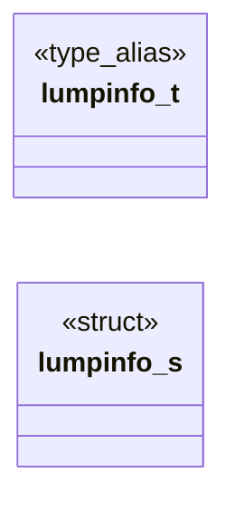

# `progs/doomgeneric/w_wad.h`

> Source: [progs/doomgeneric/w_wad.h:1](../../progs/doomgeneric/w_wad.h#L1) | language `h` | coverage 12.5% | [API index](../index.md)

Copyright(C) 1993-1996 Id Software, Inc.

Copyright(C) 2005-2014 Simon Howard  This program is free software; you can redistribute it and/or modify it under the terms of the GNU General Public License as published by the Free Software Foundation; either version 2 of the License, or (at your option) any later version.  This program is distributed in the hope that it will be useful, but WITHOUT ANY WARRANTY; without even the implied warranty of MERCHANTABILITY or FITNESS FOR A PARTICULAR PURPOSE.  See the GNU General Public License for more details.  DESCRIPTION: WAD I/O functions.

## Contents

- **Structs:** [`lumpinfo_s`](#lumpinfo_s)
- **Type Aliases:** [`lumpinfo_t`](#lumpinfo_t)
- **Functions:** [`W_AddFile`](#w_addfile), [`W_CheckNumForName`](#w_checknumforname), [`W_GetNumForName`](#w_getnumforname), [`W_LumpLength`](#w_lumplength), [`W_ReadLump`](#w_readlump), [`W_CacheLumpNum`](#w_cachelumpnum), [`W_CacheLumpName`](#w_cachelumpname), [`W_GenerateHashTable`](#w_generatehashtable), [`W_LumpNameHash`](#w_lumpnamehash), [`W_ReleaseLumpNum`](#w_releaselumpnum), [`W_ReleaseLumpName`](#w_releaselumpname), [`W_CheckCorrectIWAD`](#w_checkcorrectiwad)
- **Macros:** [`__W_WAD__`](#__w_wad__)
- **Variables:** [`lumpinfo`](#lumpinfo), [`numlumps`](#numlumps)

## Type Diagram



## Structs

<a id="lumpinfo_s"></a>

### `lumpinfo_s`

`struct` | [progs/doomgeneric/w_wad.h:41](../../progs/doomgeneric/w_wad.h#L41)

```c
struct lumpinfo_s
```

---

## Type Aliases

<a id="lumpinfo_t"></a>

### `lumpinfo_t`

`type_alias` | [progs/doomgeneric/w_wad.h:38](../../progs/doomgeneric/w_wad.h#L38)

```c
typedef struct lumpinfo_s lumpinfo_t;
```

WADFILE I/O related stuff.

---

## Functions

<a id="w_addfile"></a>

### `W_AddFile`

`function` | [progs/doomgeneric/w_wad.h:58](../../progs/doomgeneric/w_wad.h#L58)

```c
wad_file_t *W_AddFile (char *filename);
```

**Parameters**

| Name | Type | Default | Description |
|---|---|---|---|
| `filename` | `char *` |  |  |

**Returns:** `wad_file_t *`

*Called by:* [`W_ParseCommandLine`](progs.doomgeneric.w_main.c.md#w_parsecommandline)

---

<a id="w_checknumforname"></a>

### `W_CheckNumForName`

`function` | [progs/doomgeneric/w_wad.h:60](../../progs/doomgeneric/w_wad.h#L60)

```c
int W_CheckNumForName (char* name);
```

**Parameters**

| Name | Type | Default | Description |
|---|---|---|---|
| `name` | `char*` |  |  |

**Returns:** `int`

*Called by:* [`D_DoAdvanceDemo`](progs.doomgeneric.d_main.c.md#d_doadvancedemo), [`D_DoomMain`](progs.doomgeneric.d_main.c.md#d_doommain), [`D_IdentifyVersion`](progs.doomgeneric.d_main.c.md#d_identifyversion), [`D_SetGameDescription`](progs.doomgeneric.d_main.c.md#d_setgamedescription), [`G_SecretExitLevel`](progs.doomgeneric.g_game.c.md#g_secretexitlevel), [`R_FlatNumForName`](progs.doomgeneric.r_data.c.md#r_flatnumforname), [`R_InitTextures`](progs.doomgeneric.r_data.c.md#r_inittextures)

---

<a id="w_getnumforname"></a>

### `W_GetNumForName`

`function` | [progs/doomgeneric/w_wad.h:61](../../progs/doomgeneric/w_wad.h#L61)

```c
int W_GetNumForName (char* name);
```

**Parameters**

| Name | Type | Default | Description |
|---|---|---|---|
| `name` | `char*` |  |  |

**Returns:** `int`

*Called by:* [`P_SetupLevel`](progs.doomgeneric.p_setup.c.md#p_setuplevel), [`R_InitColormaps`](progs.doomgeneric.r_data.c.md#r_initcolormaps), [`R_InitFlats`](progs.doomgeneric.r_data.c.md#r_initflats), [`R_InitSpriteLumps`](progs.doomgeneric.r_data.c.md#r_initspritelumps), [`R_InitTextures`](progs.doomgeneric.r_data.c.md#r_inittextures), [`R_InitSpriteDefs`](progs.doomgeneric.r_things.c.md#r_initspritedefs), [`S_ChangeMusic`](progs.doomgeneric.s_sound.c.md#s_changemusic), [`ST_loadData`](progs.doomgeneric.st_stuff.c.md#st_loaddata)

---

<a id="w_lumplength"></a>

### `W_LumpLength`

`function` | [progs/doomgeneric/w_wad.h:63](../../progs/doomgeneric/w_wad.h#L63)

```c
int W_LumpLength (unsigned int lump);
```

**Parameters**

| Name | Type | Default | Description |
|---|---|---|---|
| `lump` | `unsigned int` |  |  |

**Returns:** `int`

*Called by:* [`P_LoadBlockMap`](progs.doomgeneric.p_setup.c.md#p_loadblockmap), [`P_LoadLineDefs`](progs.doomgeneric.p_setup.c.md#p_loadlinedefs), [`P_LoadNodes`](progs.doomgeneric.p_setup.c.md#p_loadnodes), [`P_LoadSectors`](progs.doomgeneric.p_setup.c.md#p_loadsectors), [`P_LoadSegs`](progs.doomgeneric.p_setup.c.md#p_loadsegs), [`P_LoadSideDefs`](progs.doomgeneric.p_setup.c.md#p_loadsidedefs), [`P_LoadSubsectors`](progs.doomgeneric.p_setup.c.md#p_loadsubsectors), [`P_LoadThings`](progs.doomgeneric.p_setup.c.md#p_loadthings), [`P_LoadVertexes`](progs.doomgeneric.p_setup.c.md#p_loadvertexes), [`R_InitTextures`](progs.doomgeneric.r_data.c.md#r_inittextures), [`S_ChangeMusic`](progs.doomgeneric.s_sound.c.md#s_changemusic)

---

<a id="w_readlump"></a>

### `W_ReadLump`

`function` | [progs/doomgeneric/w_wad.h:64](../../progs/doomgeneric/w_wad.h#L64)

```c
void W_ReadLump (unsigned int lump, void *dest);
```

**Parameters**

| Name | Type | Default | Description |
|---|---|---|---|
| `lump` | `unsigned int` |  |  |
| `dest` | `void *` |  |  |

*Called by:* [`P_LoadBlockMap`](progs.doomgeneric.p_setup.c.md#p_loadblockmap)

---

<a id="w_cachelumpnum"></a>

### `W_CacheLumpNum`

`function` | [progs/doomgeneric/w_wad.h:66](../../progs/doomgeneric/w_wad.h#L66)

```c
void* W_CacheLumpNum (int lump, int tag);
```

**Parameters**

| Name | Type | Default | Description |
|---|---|---|---|
| `lump` | `int` |  |  |
| `tag` | `int` |  |  |

**Returns:** `void*`

*Called by:* [`F_CastDrawer`](progs.doomgeneric.f_finale.c.md#f_castdrawer), [`P_LoadLineDefs`](progs.doomgeneric.p_setup.c.md#p_loadlinedefs), [`P_LoadNodes`](progs.doomgeneric.p_setup.c.md#p_loadnodes), [`P_LoadSectors`](progs.doomgeneric.p_setup.c.md#p_loadsectors), [`P_LoadSegs`](progs.doomgeneric.p_setup.c.md#p_loadsegs), [`P_LoadSideDefs`](progs.doomgeneric.p_setup.c.md#p_loadsidedefs), [`P_LoadSubsectors`](progs.doomgeneric.p_setup.c.md#p_loadsubsectors), [`P_LoadThings`](progs.doomgeneric.p_setup.c.md#p_loadthings), [`P_LoadVertexes`](progs.doomgeneric.p_setup.c.md#p_loadvertexes), [`R_GenerateComposite`](progs.doomgeneric.r_data.c.md#r_generatecomposite), [`R_GenerateLookup`](progs.doomgeneric.r_data.c.md#r_generatelookup), [`R_GetColumn`](progs.doomgeneric.r_data.c.md#r_getcolumn) and 8 more

---

<a id="w_cachelumpname"></a>

### `W_CacheLumpName`

`function` | [progs/doomgeneric/w_wad.h:67](../../progs/doomgeneric/w_wad.h#L67)

```c
void* W_CacheLumpName (char* name, int tag);
```

**Parameters**

| Name | Type | Default | Description |
|---|---|---|---|
| `name` | `char*` |  |  |
| `tag` | `int` |  |  |

**Returns:** `void*`

*Called by:* [`AM_loadPics`](progs.doomgeneric.am_map.c.md#am_loadpics), [`D_Display`](progs.doomgeneric.d_main.c.md#d_display), [`D_PageDrawer`](progs.doomgeneric.d_main.c.md#d_pagedrawer), [`F_BunnyScroll`](progs.doomgeneric.f_finale.c.md#f_bunnyscroll), [`F_CastDrawer`](progs.doomgeneric.f_finale.c.md#f_castdrawer), [`F_TextWrite`](progs.doomgeneric.f_finale.c.md#f_textwrite), [`G_DoPlayDemo`](progs.doomgeneric.g_game.c.md#g_doplaydemo), [`HU_Init`](progs.doomgeneric.hu_stuff.c.md#hu_init), [`M_DrawEmptyCell`](progs.doomgeneric.m_menu.c.md#m_drawemptycell), [`M_DrawEpisode`](progs.doomgeneric.m_menu.c.md#m_drawepisode), [`M_DrawLoad`](progs.doomgeneric.m_menu.c.md#m_drawload), [`M_DrawMainMenu`](progs.doomgeneric.m_menu.c.md#m_drawmainmenu) and 18 more

---

<a id="w_generatehashtable"></a>

### `W_GenerateHashTable`

`function` | [progs/doomgeneric/w_wad.h:69](../../progs/doomgeneric/w_wad.h#L69)

```c
void W_GenerateHashTable(void);
```

*Called by:* [`D_DoomMain`](progs.doomgeneric.d_main.c.md#d_doommain)

---

<a id="w_lumpnamehash"></a>

### `W_LumpNameHash`

`function` `extern` | [progs/doomgeneric/w_wad.h:71](../../progs/doomgeneric/w_wad.h#L71)

```c
extern unsigned int W_LumpNameHash(const char *s);
```

**Parameters**

| Name | Type | Default | Description |
|---|---|---|---|
| `s` | `char *` |  |  |

**Returns:** `unsigned int`

*Called by:* [`R_CheckTextureNumForName`](progs.doomgeneric.r_data.c.md#r_checktexturenumforname)

---

<a id="w_releaselumpnum"></a>

### `W_ReleaseLumpNum`

`function` | [progs/doomgeneric/w_wad.h:73](../../progs/doomgeneric/w_wad.h#L73)

```c
void W_ReleaseLumpNum(int lump);
```

**Parameters**

| Name | Type | Default | Description |
|---|---|---|---|
| `lump` | `int` |  |  |

*Called by:* [`P_LoadLineDefs`](progs.doomgeneric.p_setup.c.md#p_loadlinedefs), [`P_LoadNodes`](progs.doomgeneric.p_setup.c.md#p_loadnodes), [`P_LoadSectors`](progs.doomgeneric.p_setup.c.md#p_loadsectors), [`P_LoadSegs`](progs.doomgeneric.p_setup.c.md#p_loadsegs), [`P_LoadSideDefs`](progs.doomgeneric.p_setup.c.md#p_loadsidedefs), [`P_LoadSubsectors`](progs.doomgeneric.p_setup.c.md#p_loadsubsectors), [`P_LoadThings`](progs.doomgeneric.p_setup.c.md#p_loadthings), [`P_LoadVertexes`](progs.doomgeneric.p_setup.c.md#p_loadvertexes), [`R_DrawPlanes`](progs.doomgeneric.r_plane.c.md#r_drawplanes), [`S_StopMusic`](progs.doomgeneric.s_sound.c.md#s_stopmusic)

---

<a id="w_releaselumpname"></a>

### `W_ReleaseLumpName`

`function` | [progs/doomgeneric/w_wad.h:74](../../progs/doomgeneric/w_wad.h#L74)

```c
void W_ReleaseLumpName(char *name);
```

**Parameters**

| Name | Type | Default | Description |
|---|---|---|---|
| `name` | `char *` |  |  |

*Called by:* [`AM_unloadPics`](progs.doomgeneric.am_map.c.md#am_unloadpics), [`G_CheckDemoStatus`](progs.doomgeneric.g_game.c.md#g_checkdemostatus), [`R_InitTextures`](progs.doomgeneric.r_data.c.md#r_inittextures)

---

<a id="w_checkcorrectiwad"></a>

### `W_CheckCorrectIWAD`

`function` | [progs/doomgeneric/w_wad.h:76](../../progs/doomgeneric/w_wad.h#L76)

```c
void W_CheckCorrectIWAD(GameMission_t mission);
```

**Parameters**

| Name | Type | Default | Description |
|---|---|---|---|
| `mission` | `GameMission_t` |  |  |

*Called by:* [`D_DoomMain`](progs.doomgeneric.d_main.c.md#d_doommain)

---

## Macros

<a id="__w_wad__"></a>

### `__W_WAD__`

`macro` | [progs/doomgeneric/w_wad.h:21](../../progs/doomgeneric/w_wad.h#L21)

```c
#define __W_WAD__
```

---

## Variables

<a id="lumpinfo"></a>

### `lumpinfo`

`variable` `extern` | [progs/doomgeneric/w_wad.h:55](../../progs/doomgeneric/w_wad.h#L55)

```c
extern lumpinfo_t *lumpinfo;
```

---

<a id="numlumps"></a>

### `numlumps`

`variable` `extern` | [progs/doomgeneric/w_wad.h:56](../../progs/doomgeneric/w_wad.h#L56)

```c
extern unsigned int numlumps;
```

---
