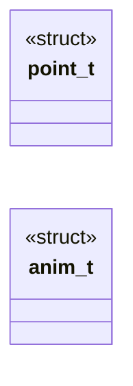
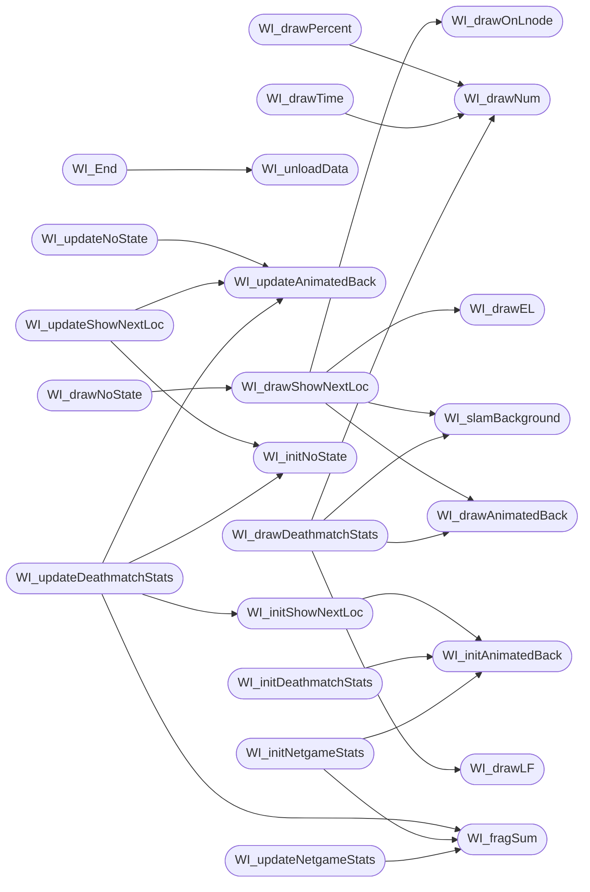

# `progs/doomgeneric/wi_stuff.c`

> Source: [progs/doomgeneric/wi_stuff.c:1](../../progs/doomgeneric/wi_stuff.c#L1) | language `c` | coverage 25.8% | [API index](../index.md)

Copyright(C) 1993-1996 Id Software, Inc.

Copyright(C) 2005-2014 Simon Howard  This program is free software; you can redistribute it and/or modify it under the terms of the GNU General Public License as published by the Free Software Foundation; either version 2 of the License, or (at your option) any later version.  This program is distributed in the hope that it will be useful, but WITHOUT ANY WARRANTY; without even the implied warranty of MERCHANTABILITY or FITNESS FOR A PARTICULAR PURPOSE.  See the GNU General Public License for more details.  DESCRIPTION: Intermission screens.

## Contents

- **Structs:** [`point_t`](#point_t), [`anim_t`](#anim_t)
- **Functions:** [`WI_slamBackground`](#wi_slambackground), [`WI_Responder`](#wi_responder), [`WI_drawLF`](#wi_drawlf), [`WI_drawEL`](#wi_drawel), [`WI_drawOnLnode`](#wi_drawonlnode), [`WI_initAnimatedBack`](#wi_initanimatedback), [`WI_updateAnimatedBack`](#wi_updateanimatedback), [`WI_drawAnimatedBack`](#wi_drawanimatedback), [`WI_drawNum`](#wi_drawnum), [`WI_drawPercent`](#wi_drawpercent), [`WI_drawTime`](#wi_drawtime), [`WI_End`](#wi_end), [`WI_initNoState`](#wi_initnostate), [`WI_updateNoState`](#wi_updatenostate), [`WI_initShowNextLoc`](#wi_initshownextloc), [`WI_updateShowNextLoc`](#wi_updateshownextloc), [`WI_drawShowNextLoc`](#wi_drawshownextloc), [`WI_drawNoState`](#wi_drawnostate), [`WI_fragSum`](#wi_fragsum), [`WI_initDeathmatchStats`](#wi_initdeathmatchstats), [`WI_updateDeathmatchStats`](#wi_updatedeathmatchstats), [`WI_drawDeathmatchStats`](#wi_drawdeathmatchstats), [`WI_initNetgameStats`](#wi_initnetgamestats), [`WI_updateNetgameStats`](#wi_updatenetgamestats), [`WI_drawNetgameStats`](#wi_drawnetgamestats), [`WI_initStats`](#wi_initstats), [`WI_updateStats`](#wi_updatestats), [`WI_drawStats`](#wi_drawstats), [`WI_checkForAccelerate`](#wi_checkforaccelerate), [`WI_Ticker`](#wi_ticker), [`WI_loadData`](#wi_loaddata), [`WI_unloadData`](#wi_unloaddata), [`WI_Drawer`](#wi_drawer), [`WI_initVariables`](#wi_initvariables), [`WI_Start`](#wi_start)
- **Macros:** [`NUMEPISODES`](#numepisodes), [`NUMMAPS`](#nummaps), [`WI_TITLEY`](#wi_titley), [`WI_SPACINGY`](#wi_spacingy), [`SP_STATSX`](#sp_statsx), [`SP_STATSY`](#sp_statsy), [`SP_TIMEX`](#sp_timex), [`SP_TIMEY`](#sp_timey), [`NG_STATSY`](#ng_statsy), [`NG_STATSX`](#ng_statsx), [`NG_SPACINGX`](#ng_spacingx), [`DM_MATRIXX`](#dm_matrixx), [`DM_MATRIXY`](#dm_matrixy), [`DM_SPACINGX`](#dm_spacingx), [`DM_TOTALSX`](#dm_totalsx), [`DM_KILLERSX`](#dm_killersx), [`DM_KILLERSY`](#dm_killersy), [`DM_VICTIMSX`](#dm_victimsx), [`DM_VICTIMSY`](#dm_victimsy), [`ANIM`](#anim), [`SP_KILLS`](#sp_kills), [`SP_ITEMS`](#sp_items), [`SP_SECRET`](#sp_secret), [`SP_FRAGS`](#sp_frags), [`SP_TIME`](#sp_time), [`SP_PAR`](#sp_par), [`SP_PAUSE`](#sp_pause), [`SHOWNEXTLOCDELAY`](#shownextlocdelay)

## Type Diagram



## Call Graph

Solid arrows stay in this module, dashed arrows leave it.



## Structs

<a id="point_t"></a>

### `point_t`

`struct` | [progs/doomgeneric/wi_stuff.c:117](../../progs/doomgeneric/wi_stuff.c#L117)

```c
typedef struct
```

---

<a id="anim_t"></a>

### `anim_t`

`struct` | [progs/doomgeneric/wi_stuff.c:129](../../progs/doomgeneric/wi_stuff.c#L129)

```c
typedef struct
```

Animation.

There is another anim_t used in p_spec.

---

## Functions

<a id="wi_slambackground"></a>

### `WI_slamBackground`

`function` | [progs/doomgeneric/wi_stuff.c:402](../../progs/doomgeneric/wi_stuff.c#L402)

```c
void WI_slamBackground(void)
```

slam background

*Calls:* [`V_DrawPatch`](progs.doomgeneric.v_video.h.md#v_drawpatch)

*Called by:* [`WI_drawDeathmatchStats`](#wi_drawdeathmatchstats), [`WI_drawNetgameStats`](#wi_drawnetgamestats), [`WI_drawShowNextLoc`](#wi_drawshownextloc), [`WI_drawStats`](#wi_drawstats)

---

<a id="wi_responder"></a>

### `WI_Responder`

`function` | [progs/doomgeneric/wi_stuff.c:409](../../progs/doomgeneric/wi_stuff.c#L409)

```c
boolean WI_Responder(event_t* ev)
```

The ticker is used to detect keys because of timing issues in netgames.

**Parameters**

| Name | Type | Default | Description |
|---|---|---|---|
| `ev` | `event_t*` |  |  |

**Returns:** `boolean`

---

<a id="wi_drawlf"></a>

### `WI_drawLF`

`function` | [progs/doomgeneric/wi_stuff.c:416](../../progs/doomgeneric/wi_stuff.c#L416)

```c
void WI_drawLF(void)
```

Draws "<Levelname> Finished!"

*Calls:* [`SHORT`](progs.doomgeneric.i_swap.h.md#short), [`V_DrawPatch`](progs.doomgeneric.v_video.h.md#v_drawpatch)

*Called by:* [`WI_drawDeathmatchStats`](#wi_drawdeathmatchstats), [`WI_drawNetgameStats`](#wi_drawnetgamestats), [`WI_drawStats`](#wi_drawstats)

---

<a id="wi_drawel"></a>

### `WI_drawEL`

`function` | [progs/doomgeneric/wi_stuff.c:452](../../progs/doomgeneric/wi_stuff.c#L452)

```c
void WI_drawEL(void)
```

Draws "Entering <LevelName>"

*Calls:* [`SHORT`](progs.doomgeneric.i_swap.h.md#short), [`V_DrawPatch`](progs.doomgeneric.v_video.h.md#v_drawpatch)

*Called by:* [`WI_drawShowNextLoc`](#wi_drawshownextloc)

---

<a id="wi_drawonlnode"></a>

### `WI_drawOnLnode`

`function` | [progs/doomgeneric/wi_stuff.c:471](../../progs/doomgeneric/wi_stuff.c#L471)

```c
void WI_drawOnLnode ( int n, patch_t* c[] )
```

**Parameters**

| Name | Type | Default | Description |
|---|---|---|---|
| `n` | `int` |  |  |
| `c` | `patch_t* []` |  |  |

*Calls:* [`SHORT`](progs.doomgeneric.i_swap.h.md#short), [`V_DrawPatch`](progs.doomgeneric.v_video.h.md#v_drawpatch)

*Called by:* [`WI_drawShowNextLoc`](#wi_drawshownextloc)

---

<a id="wi_initanimatedback"></a>

### `WI_initAnimatedBack`

`function` | [progs/doomgeneric/wi_stuff.c:519](../../progs/doomgeneric/wi_stuff.c#L519)

```c
void WI_initAnimatedBack(void)
```

*Calls:* [`M_Random`](progs.doomgeneric.m_random.h.md#m_random)

*Called by:* [`WI_initDeathmatchStats`](#wi_initdeathmatchstats), [`WI_initNetgameStats`](#wi_initnetgamestats), [`WI_initShowNextLoc`](#wi_initshownextloc), [`WI_initStats`](#wi_initstats)

---

<a id="wi_updateanimatedback"></a>

### `WI_updateAnimatedBack`

`function` | [progs/doomgeneric/wi_stuff.c:548](../../progs/doomgeneric/wi_stuff.c#L548)

```c
void WI_updateAnimatedBack(void)
```

*Calls:* [`M_Random`](progs.doomgeneric.m_random.h.md#m_random)

*Called by:* [`WI_updateDeathmatchStats`](#wi_updatedeathmatchstats), [`WI_updateNetgameStats`](#wi_updatenetgamestats), [`WI_updateNoState`](#wi_updatenostate), [`WI_updateShowNextLoc`](#wi_updateshownextloc), [`WI_updateStats`](#wi_updatestats)

---

<a id="wi_drawanimatedback"></a>

### `WI_drawAnimatedBack`

`function` | [progs/doomgeneric/wi_stuff.c:599](../../progs/doomgeneric/wi_stuff.c#L599)

```c
void WI_drawAnimatedBack(void)
```

*Calls:* [`V_DrawPatch`](progs.doomgeneric.v_video.h.md#v_drawpatch)

*Called by:* [`WI_drawDeathmatchStats`](#wi_drawdeathmatchstats), [`WI_drawNetgameStats`](#wi_drawnetgamestats), [`WI_drawShowNextLoc`](#wi_drawshownextloc), [`WI_drawStats`](#wi_drawstats)

---

<a id="wi_drawnum"></a>

### `WI_drawNum`

`function` | [progs/doomgeneric/wi_stuff.c:628](../../progs/doomgeneric/wi_stuff.c#L628)

```c
int WI_drawNum ( int x, int y, int n, int digits )
```

**Parameters**

| Name | Type | Default | Description |
|---|---|---|---|
| `x` | `int` |  |  |
| `y` | `int` |  |  |
| `n` | `int` |  |  |
| `digits` | `int` |  |  |

**Returns:** `int`

*Calls:* [`SHORT`](progs.doomgeneric.i_swap.h.md#short), [`V_DrawPatch`](progs.doomgeneric.v_video.h.md#v_drawpatch)

*Called by:* [`WI_drawDeathmatchStats`](#wi_drawdeathmatchstats), [`WI_drawNetgameStats`](#wi_drawnetgamestats), [`WI_drawPercent`](#wi_drawpercent), [`WI_drawTime`](#wi_drawtime)

---

<a id="wi_drawpercent"></a>

### `WI_drawPercent`

`function` | [progs/doomgeneric/wi_stuff.c:685](../../progs/doomgeneric/wi_stuff.c#L685)

```c
void WI_drawPercent ( int x, int y, int p )
```

**Parameters**

| Name | Type | Default | Description |
|---|---|---|---|
| `x` | `int` |  |  |
| `y` | `int` |  |  |
| `p` | `int` |  |  |

*Calls:* [`V_DrawPatch`](progs.doomgeneric.v_video.h.md#v_drawpatch), [`WI_drawNum`](#wi_drawnum)

*Called by:* [`WI_drawNetgameStats`](#wi_drawnetgamestats), [`WI_drawStats`](#wi_drawstats)

---

<a id="wi_drawtime"></a>

### `WI_drawTime`

`function` | [progs/doomgeneric/wi_stuff.c:704](../../progs/doomgeneric/wi_stuff.c#L704)

```c
void WI_drawTime ( int x, int y, int t )
```

**Parameters**

| Name | Type | Default | Description |
|---|---|---|---|
| `x` | `int` |  |  |
| `y` | `int` |  |  |
| `t` | `int` |  |  |

*Calls:* [`SHORT`](progs.doomgeneric.i_swap.h.md#short), [`V_DrawPatch`](progs.doomgeneric.v_video.h.md#v_drawpatch), [`WI_drawNum`](#wi_drawnum)

*Called by:* [`WI_drawStats`](#wi_drawstats)

---

<a id="wi_end"></a>

### `WI_End`

`function` | [progs/doomgeneric/wi_stuff.c:740](../../progs/doomgeneric/wi_stuff.c#L740)

```c
void WI_End(void)
```

Shut down the intermission screen

> **Inherited:** Documentation from [`WI_End`](#wi_end) (progs/doomgeneric/wi_stuff.h:46).

*Calls:* [`WI_unloadData`](#wi_unloaddata)

---

<a id="wi_initnostate"></a>

### `WI_initNoState`

`function` | [progs/doomgeneric/wi_stuff.c:746](../../progs/doomgeneric/wi_stuff.c#L746)

```c
void WI_initNoState(void)
```

*Called by:* [`WI_updateDeathmatchStats`](#wi_updatedeathmatchstats), [`WI_updateNetgameStats`](#wi_updatenetgamestats), [`WI_updateShowNextLoc`](#wi_updateshownextloc), [`WI_updateStats`](#wi_updatestats)

---

<a id="wi_updatenostate"></a>

### `WI_updateNoState`

`function` | [progs/doomgeneric/wi_stuff.c:753](../../progs/doomgeneric/wi_stuff.c#L753)

```c
void WI_updateNoState(void)
```

*Calls:* [`G_WorldDone`](progs.doomgeneric.g_game.h.md#g_worlddone), [`WI_updateAnimatedBack`](#wi_updateanimatedback)

*Called by:* [`WI_Ticker`](#wi_ticker)

---

<a id="wi_initshownextloc"></a>

### `WI_initShowNextLoc`

`function` | [progs/doomgeneric/wi_stuff.c:772](../../progs/doomgeneric/wi_stuff.c#L772)

```c
void WI_initShowNextLoc(void)
```

*Calls:* [`WI_initAnimatedBack`](#wi_initanimatedback)

*Called by:* [`WI_updateDeathmatchStats`](#wi_updatedeathmatchstats), [`WI_updateNetgameStats`](#wi_updatenetgamestats), [`WI_updateStats`](#wi_updatestats)

---

<a id="wi_updateshownextloc"></a>

### `WI_updateShowNextLoc`

`function` | [progs/doomgeneric/wi_stuff.c:781](../../progs/doomgeneric/wi_stuff.c#L781)

```c
void WI_updateShowNextLoc(void)
```

*Calls:* [`WI_initNoState`](#wi_initnostate), [`WI_updateAnimatedBack`](#wi_updateanimatedback)

*Called by:* [`WI_Ticker`](#wi_ticker)

---

<a id="wi_drawshownextloc"></a>

### `WI_drawShowNextLoc`

`function` | [progs/doomgeneric/wi_stuff.c:791](../../progs/doomgeneric/wi_stuff.c#L791)

```c
void WI_drawShowNextLoc(void)
```

*Calls:* [`WI_drawAnimatedBack`](#wi_drawanimatedback), [`WI_drawEL`](#wi_drawel), [`WI_drawOnLnode`](#wi_drawonlnode), [`WI_slamBackground`](#wi_slambackground)

*Called by:* [`WI_Drawer`](#wi_drawer), [`WI_drawNoState`](#wi_drawnostate)

---

<a id="wi_drawnostate"></a>

### `WI_drawNoState`

`function` | [progs/doomgeneric/wi_stuff.c:832](../../progs/doomgeneric/wi_stuff.c#L832)

```c
void WI_drawNoState(void)
```

*Calls:* [`WI_drawShowNextLoc`](#wi_drawshownextloc)

*Called by:* [`WI_Drawer`](#wi_drawer)

---

<a id="wi_fragsum"></a>

### `WI_fragSum`

`function` | [progs/doomgeneric/wi_stuff.c:838](../../progs/doomgeneric/wi_stuff.c#L838)

```c
int WI_fragSum(int playernum)
```

**Parameters**

| Name | Type | Default | Description |
|---|---|---|---|
| `playernum` | `int` |  |  |

**Returns:** `int`

*Called by:* [`WI_initNetgameStats`](#wi_initnetgamestats), [`WI_updateDeathmatchStats`](#wi_updatedeathmatchstats), [`WI_updateNetgameStats`](#wi_updatenetgamestats)

---

<a id="wi_initdeathmatchstats"></a>

### `WI_initDeathmatchStats`

`function` | [progs/doomgeneric/wi_stuff.c:869](../../progs/doomgeneric/wi_stuff.c#L869)

```c
void WI_initDeathmatchStats(void)
```

*Calls:* [`WI_initAnimatedBack`](#wi_initanimatedback)

*Called by:* [`WI_Start`](#wi_start)

---

<a id="wi_updatedeathmatchstats"></a>

### `WI_updateDeathmatchStats`

`function` | [progs/doomgeneric/wi_stuff.c:898](../../progs/doomgeneric/wi_stuff.c#L898)

```c
void WI_updateDeathmatchStats(void)
```

*Calls:* [`S_StartSound`](progs.doomgeneric.s_sound.h.md#s_startsound), [`WI_fragSum`](#wi_fragsum), [`WI_initNoState`](#wi_initnostate), [`WI_initShowNextLoc`](#wi_initshownextloc), [`WI_updateAnimatedBack`](#wi_updateanimatedback)

*Called by:* [`WI_Ticker`](#wi_ticker)

---

<a id="wi_drawdeathmatchstats"></a>

### `WI_drawDeathmatchStats`

`function` | [progs/doomgeneric/wi_stuff.c:1001](../../progs/doomgeneric/wi_stuff.c#L1001)

```c
void WI_drawDeathmatchStats(void)
```

*Calls:* [`SHORT`](progs.doomgeneric.i_swap.h.md#short), [`V_DrawPatch`](progs.doomgeneric.v_video.h.md#v_drawpatch), [`WI_drawAnimatedBack`](#wi_drawanimatedback), [`WI_drawLF`](#wi_drawlf), [`WI_drawNum`](#wi_drawnum), [`WI_slamBackground`](#wi_slambackground)

*Called by:* [`WI_Drawer`](#wi_drawer)

---

<a id="wi_initnetgamestats"></a>

### `WI_initNetgameStats`

`function` | [progs/doomgeneric/wi_stuff.c:1089](../../progs/doomgeneric/wi_stuff.c#L1089)

```c
void WI_initNetgameStats(void)
```

*Calls:* [`WI_fragSum`](#wi_fragsum), [`WI_initAnimatedBack`](#wi_initanimatedback)

*Called by:* [`WI_Start`](#wi_start)

---

<a id="wi_updatenetgamestats"></a>

### `WI_updateNetgameStats`

`function` | [progs/doomgeneric/wi_stuff.c:1117](../../progs/doomgeneric/wi_stuff.c#L1117)

```c
void WI_updateNetgameStats(void)
```

*Calls:* [`S_StartSound`](progs.doomgeneric.s_sound.h.md#s_startsound), [`WI_fragSum`](#wi_fragsum), [`WI_initNoState`](#wi_initnostate), [`WI_initShowNextLoc`](#wi_initshownextloc), [`WI_updateAnimatedBack`](#wi_updateanimatedback)

*Called by:* [`WI_Ticker`](#wi_ticker)

---

<a id="wi_drawnetgamestats"></a>

### `WI_drawNetgameStats`

`function` | [progs/doomgeneric/wi_stuff.c:1272](../../progs/doomgeneric/wi_stuff.c#L1272)

```c
void WI_drawNetgameStats(void)
```

*Calls:* [`SHORT`](progs.doomgeneric.i_swap.h.md#short), [`V_DrawPatch`](progs.doomgeneric.v_video.h.md#v_drawpatch), [`WI_drawAnimatedBack`](#wi_drawanimatedback), [`WI_drawLF`](#wi_drawlf), [`WI_drawNum`](#wi_drawnum), [`WI_drawPercent`](#wi_drawpercent), [`WI_slamBackground`](#wi_slambackground)

*Called by:* [`WI_Drawer`](#wi_drawer)

---

<a id="wi_initstats"></a>

### `WI_initStats`

`function` | [progs/doomgeneric/wi_stuff.c:1329](../../progs/doomgeneric/wi_stuff.c#L1329)

```c
void WI_initStats(void)
```

*Calls:* [`WI_initAnimatedBack`](#wi_initanimatedback)

*Called by:* [`WI_Start`](#wi_start)

---

<a id="wi_updatestats"></a>

### `WI_updateStats`

`function` | [progs/doomgeneric/wi_stuff.c:1341](../../progs/doomgeneric/wi_stuff.c#L1341)

```c
void WI_updateStats(void)
```

*Calls:* [`S_StartSound`](progs.doomgeneric.s_sound.h.md#s_startsound), [`WI_initNoState`](#wi_initnostate), [`WI_initShowNextLoc`](#wi_initshownextloc), [`WI_updateAnimatedBack`](#wi_updateanimatedback)

*Called by:* [`WI_Ticker`](#wi_ticker)

---

<a id="wi_drawstats"></a>

### `WI_drawStats`

`function` | [progs/doomgeneric/wi_stuff.c:1447](../../progs/doomgeneric/wi_stuff.c#L1447)

```c
void WI_drawStats(void)
```

*Calls:* [`SHORT`](progs.doomgeneric.i_swap.h.md#short), [`V_DrawPatch`](progs.doomgeneric.v_video.h.md#v_drawpatch), [`WI_drawAnimatedBack`](#wi_drawanimatedback), [`WI_drawLF`](#wi_drawlf), [`WI_drawPercent`](#wi_drawpercent), [`WI_drawTime`](#wi_drawtime), [`WI_slamBackground`](#wi_slambackground)

*Called by:* [`WI_Drawer`](#wi_drawer)

---

<a id="wi_checkforaccelerate"></a>

### `WI_checkForAccelerate`

`function` | [progs/doomgeneric/wi_stuff.c:1481](../../progs/doomgeneric/wi_stuff.c#L1481)

```c
void WI_checkForAccelerate(void)
```

*Called by:* [`WI_Ticker`](#wi_ticker)

---

<a id="wi_ticker"></a>

### `WI_Ticker`

`function` | [progs/doomgeneric/wi_stuff.c:1514](../../progs/doomgeneric/wi_stuff.c#L1514)

```c
void WI_Ticker(void)
```

Updates stuff each tick

*Calls:* [`S_ChangeMusic`](progs.doomgeneric.s_sound.h.md#s_changemusic), [`WI_checkForAccelerate`](#wi_checkforaccelerate), [`WI_updateDeathmatchStats`](#wi_updatedeathmatchstats), [`WI_updateNetgameStats`](#wi_updatenetgamestats), [`WI_updateNoState`](#wi_updatenostate), [`WI_updateShowNextLoc`](#wi_updateshownextloc), [`WI_updateStats`](#wi_updatestats)

---

<a id="wi_loaddata"></a>

### `WI_loadData`

`function` | [progs/doomgeneric/wi_stuff.c:1709](../../progs/doomgeneric/wi_stuff.c#L1709)

```c
void WI_loadData(void)
```

*Calls:* [`DEH_String`](progs.doomgeneric.deh_str.h.md#deh_string), [`W_CacheLumpName`](progs.doomgeneric.w_wad.h.md#w_cachelumpname), [`Z_Malloc`](progs.doomgeneric.z_zone.h.md#z_malloc)

*Called by:* [`WI_Start`](#wi_start)

---

<a id="wi_unloaddata"></a>

### `WI_unloadData`

`function` | [progs/doomgeneric/wi_stuff.c:1741](../../progs/doomgeneric/wi_stuff.c#L1741)

```c
void WI_unloadData(void)
```

*Called by:* [`WI_End`](#wi_end)

---

<a id="wi_drawer"></a>

### `WI_Drawer`

`function` | [progs/doomgeneric/wi_stuff.c:1752](../../progs/doomgeneric/wi_stuff.c#L1752)

```c
void WI_Drawer (void)
```

Called by main loop, draws the intermission directly into the screen buffer.

> **Inherited:** Documentation from [`WI_Drawer`](#wi_drawer) (progs/doomgeneric/wi_stuff.h:40).

*Calls:* [`WI_drawDeathmatchStats`](#wi_drawdeathmatchstats), [`WI_drawNetgameStats`](#wi_drawnetgamestats), [`WI_drawNoState`](#wi_drawnostate), [`WI_drawShowNextLoc`](#wi_drawshownextloc), [`WI_drawStats`](#wi_drawstats)

---

<a id="wi_initvariables"></a>

### `WI_initVariables`

`function` | [progs/doomgeneric/wi_stuff.c:1776](../../progs/doomgeneric/wi_stuff.c#L1776)

```c
void WI_initVariables(wbstartstruct_t* wbstartstruct)
```

**Parameters**

| Name | Type | Default | Description |
|---|---|---|---|
| `wbstartstruct` | `wbstartstruct_t*` |  |  |

*Called by:* [`WI_Start`](#wi_start)

---

<a id="wi_start"></a>

### `WI_Start`

`function` | [progs/doomgeneric/wi_stuff.c:1818](../../progs/doomgeneric/wi_stuff.c#L1818)

```c
void WI_Start(wbstartstruct_t* wbstartstruct)
```

Setup for an intermission screen.

**Parameters**

| Name | Type | Default | Description |
|---|---|---|---|
| `wbstartstruct` | `wbstartstruct_t*` |  |  |

> **Inherited:** Documentation from [`WI_Start`](#wi_start) (progs/doomgeneric/wi_stuff.h:43).

*Calls:* [`WI_initDeathmatchStats`](#wi_initdeathmatchstats), [`WI_initNetgameStats`](#wi_initnetgamestats), [`WI_initStats`](#wi_initstats), [`WI_initVariables`](#wi_initvariables), [`WI_loadData`](#wi_loaddata)

---

## Macros

<a id="numepisodes"></a>

### `NUMEPISODES`

`macro` | [progs/doomgeneric/wi_stuff.c:61](../../progs/doomgeneric/wi_stuff.c#L61)

```c
#define NUMEPISODES
```

Different vetween registered DOOM (1994) and Ultimate DOOM - Final edition (retail, 1995?).

This is supposedly ignored for commercial release (aka DOOM II), which had 34 maps in one episode. So there.

---

<a id="nummaps"></a>

### `NUMMAPS`

`macro` | [progs/doomgeneric/wi_stuff.c:62](../../progs/doomgeneric/wi_stuff.c#L62)

```c
#define NUMMAPS
```

---

<a id="wi_titley"></a>

### `WI_TITLEY`

`macro` | [progs/doomgeneric/wi_stuff.c:75](../../progs/doomgeneric/wi_stuff.c#L75)

```c
#define WI_TITLEY
```

GLOBAL LOCATIONS

---

<a id="wi_spacingy"></a>

### `WI_SPACINGY`

`macro` | [progs/doomgeneric/wi_stuff.c:76](../../progs/doomgeneric/wi_stuff.c#L76)

```c
#define WI_SPACINGY
```

---

<a id="sp_statsx"></a>

### `SP_STATSX`

`macro` | [progs/doomgeneric/wi_stuff.c:79](../../progs/doomgeneric/wi_stuff.c#L79)

```c
#define SP_STATSX
```

SINGPLE-PLAYER STUFF

---

<a id="sp_statsy"></a>

### `SP_STATSY`

`macro` | [progs/doomgeneric/wi_stuff.c:80](../../progs/doomgeneric/wi_stuff.c#L80)

```c
#define SP_STATSY
```

---

<a id="sp_timex"></a>

### `SP_TIMEX`

`macro` | [progs/doomgeneric/wi_stuff.c:82](../../progs/doomgeneric/wi_stuff.c#L82)

```c
#define SP_TIMEX
```

---

<a id="sp_timey"></a>

### `SP_TIMEY`

`macro` | [progs/doomgeneric/wi_stuff.c:83](../../progs/doomgeneric/wi_stuff.c#L83)

```c
#define SP_TIMEY
```

---

<a id="ng_statsy"></a>

### `NG_STATSY`

`macro` | [progs/doomgeneric/wi_stuff.c:87](../../progs/doomgeneric/wi_stuff.c#L87)

```c
#define NG_STATSY
```

NET GAME STUFF

---

<a id="ng_statsx"></a>

### `NG_STATSX`

`macro` | [progs/doomgeneric/wi_stuff.c:88](../../progs/doomgeneric/wi_stuff.c#L88)

```c
#define NG_STATSX
```

---

<a id="ng_spacingx"></a>

### `NG_SPACINGX`

`macro` | [progs/doomgeneric/wi_stuff.c:90](../../progs/doomgeneric/wi_stuff.c#L90)

```c
#define NG_SPACINGX
```

---

<a id="dm_matrixx"></a>

### `DM_MATRIXX`

`macro` | [progs/doomgeneric/wi_stuff.c:94](../../progs/doomgeneric/wi_stuff.c#L94)

```c
#define DM_MATRIXX
```

DEATHMATCH STUFF

---

<a id="dm_matrixy"></a>

### `DM_MATRIXY`

`macro` | [progs/doomgeneric/wi_stuff.c:95](../../progs/doomgeneric/wi_stuff.c#L95)

```c
#define DM_MATRIXY
```

---

<a id="dm_spacingx"></a>

### `DM_SPACINGX`

`macro` | [progs/doomgeneric/wi_stuff.c:97](../../progs/doomgeneric/wi_stuff.c#L97)

```c
#define DM_SPACINGX
```

---

<a id="dm_totalsx"></a>

### `DM_TOTALSX`

`macro` | [progs/doomgeneric/wi_stuff.c:99](../../progs/doomgeneric/wi_stuff.c#L99)

```c
#define DM_TOTALSX
```

---

<a id="dm_killersx"></a>

### `DM_KILLERSX`

`macro` | [progs/doomgeneric/wi_stuff.c:101](../../progs/doomgeneric/wi_stuff.c#L101)

```c
#define DM_KILLERSX
```

---

<a id="dm_killersy"></a>

### `DM_KILLERSY`

`macro` | [progs/doomgeneric/wi_stuff.c:102](../../progs/doomgeneric/wi_stuff.c#L102)

```c
#define DM_KILLERSY
```

---

<a id="dm_victimsx"></a>

### `DM_VICTIMSX`

`macro` | [progs/doomgeneric/wi_stuff.c:103](../../progs/doomgeneric/wi_stuff.c#L103)

```c
#define DM_VICTIMSX
```

---

<a id="dm_victimsy"></a>

### `DM_VICTIMSY`

`macro` | [progs/doomgeneric/wi_stuff.c:104](../../progs/doomgeneric/wi_stuff.c#L104)

```c
#define DM_VICTIMSY
```

---

<a id="anim"></a>

### `ANIM`

`macro` | [progs/doomgeneric/wi_stuff.c:222](../../progs/doomgeneric/wi_stuff.c#L222)

```c
#define ANIM(type, period, nanims, x, y, nexttic)
```

---

<a id="sp_kills"></a>

### `SP_KILLS`

`macro` | [progs/doomgeneric/wi_stuff.c:288](../../progs/doomgeneric/wi_stuff.c#L288)

```c
#define SP_KILLS
```

States for single-player

---

<a id="sp_items"></a>

### `SP_ITEMS`

`macro` | [progs/doomgeneric/wi_stuff.c:289](../../progs/doomgeneric/wi_stuff.c#L289)

```c
#define SP_ITEMS
```

---

<a id="sp_secret"></a>

### `SP_SECRET`

`macro` | [progs/doomgeneric/wi_stuff.c:290](../../progs/doomgeneric/wi_stuff.c#L290)

```c
#define SP_SECRET
```

---

<a id="sp_frags"></a>

### `SP_FRAGS`

`macro` | [progs/doomgeneric/wi_stuff.c:291](../../progs/doomgeneric/wi_stuff.c#L291)

```c
#define SP_FRAGS
```

---

<a id="sp_time"></a>

### `SP_TIME`

`macro` | [progs/doomgeneric/wi_stuff.c:292](../../progs/doomgeneric/wi_stuff.c#L292)

```c
#define SP_TIME
```

---

<a id="sp_par"></a>

### `SP_PAR`

`macro` | [progs/doomgeneric/wi_stuff.c:293](../../progs/doomgeneric/wi_stuff.c#L293)

```c
#define SP_PAR
```

---

<a id="sp_pause"></a>

### `SP_PAUSE`

`macro` | [progs/doomgeneric/wi_stuff.c:295](../../progs/doomgeneric/wi_stuff.c#L295)

```c
#define SP_PAUSE
```

---

<a id="shownextlocdelay"></a>

### `SHOWNEXTLOCDELAY`

`macro` | [progs/doomgeneric/wi_stuff.c:298](../../progs/doomgeneric/wi_stuff.c#L298)

```c
#define SHOWNEXTLOCDELAY
```

in seconds

---
