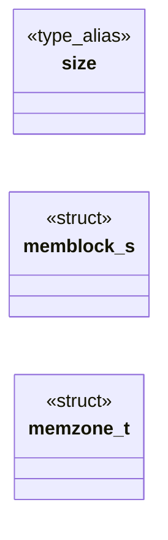
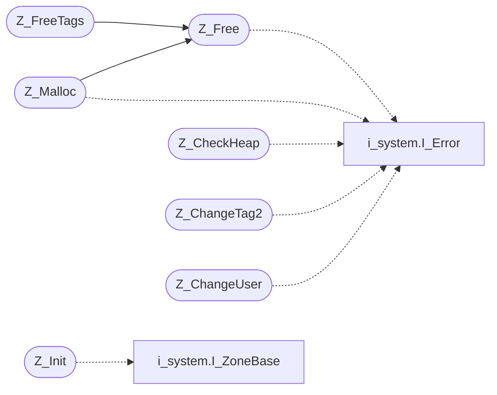

# `progs/doomgeneric/z_zone.c`

> Source: [progs/doomgeneric/z_zone.c:1](../../progs/doomgeneric/z_zone.c#L1) | language `c` | coverage 52.6% | [API index](../index.md)

Copyright(C) 1993-1996 Id Software, Inc.

Copyright(C) 2005-2014 Simon Howard  This program is free software; you can redistribute it and/or modify it under the terms of the GNU General Public License as published by the Free Software Foundation; either version 2 of the License, or (at your option) any later version.  This program is distributed in the hope that it will be useful, but WITHOUT ANY WARRANTY; without even the implied warranty of MERCHANTABILITY or FITNESS FOR A PARTICULAR PURPOSE.  See the GNU General Public License for more details.  DESCRIPTION: Zone Memory Allocation. Neat.       ZONE MEMORY ALLOCATION  There is never any space between memblocks, and there will never be two contiguous free memblocks. The rover can be left pointing at a non-empty block.

## Contents

- **Structs:** [`memblock_s`](#memblock_s), [`memzone_t`](#memzone_t)
- **Type Aliases:** [`size`](#size)
- **Functions:** [`Z_ClearZone`](#z_clearzone), [`Z_Init`](#z_init), [`Z_Free`](#z_free), [`Z_Malloc`](#z_malloc), [`Z_FreeTags`](#z_freetags), [`Z_DumpHeap`](#z_dumpheap), [`Z_FileDumpHeap`](#z_filedumpheap), [`Z_CheckHeap`](#z_checkheap), [`Z_ChangeTag2`](#z_changetag2), [`Z_ChangeUser`](#z_changeuser), [`Z_FreeMemory`](#z_freememory), [`Z_ZoneSize`](#z_zonesize)
- **Macros:** [`MEM_ALIGN`](#mem_align), [`ZONEID`](#zoneid), [`MINFRAGMENT`](#minfragment)

## Type Diagram



## Call Graph

Solid arrows stay in this module, dashed arrows leave it.



## Structs

<a id="memblock_s"></a>

### `memblock_s`

`struct` | [progs/doomgeneric/z_zone.c:39](../../progs/doomgeneric/z_zone.c#L39)

```c
typedef struct memblock_s
```

---

<a id="memzone_t"></a>

### `memzone_t`

`struct` | [progs/doomgeneric/z_zone.c:50](../../progs/doomgeneric/z_zone.c#L50)

```c
typedef struct
```

---

## Type Aliases

<a id="size"></a>

### `size`

`type_alias` | [progs/doomgeneric/z_zone.c:38](../../progs/doomgeneric/z_zone.c#L38)

```c
typedef struct memblock_s { int size;
```

define MEM_ALIGN sizeof(void *) define ZONEID   0x1d4a11

---

## Functions

<a id="z_clearzone"></a>

### `Z_ClearZone`

`function` | [progs/doomgeneric/z_zone.c:71](../../progs/doomgeneric/z_zone.c#L71)

```c
void Z_ClearZone (memzone_t* zone)
```

Z_ClearZone

**Parameters**

| Name | Type | Default | Description |
|---|---|---|---|
| `zone` | `memzone_t*` |  |  |

---

<a id="z_init"></a>

### `Z_Init`

`function` | [progs/doomgeneric/z_zone.c:97](../../progs/doomgeneric/z_zone.c#L97)

```c
void Z_Init (void)
```

Z_Init

*Calls:* [`I_ZoneBase`](progs.doomgeneric.i_system.h.md#i_zonebase)

---

<a id="z_free"></a>

### `Z_Free`

`function` | [progs/doomgeneric/z_zone.c:126](../../progs/doomgeneric/z_zone.c#L126)

```c
void Z_Free (void* ptr)
```

Z_Free

**Parameters**

| Name | Type | Default | Description |
|---|---|---|---|
| `ptr` | `void*` |  |  |

*Calls:* [`I_Error`](progs.doomgeneric.i_system.h.md#i_error)

*Called by:* [`Z_FreeTags`](#z_freetags), [`Z_Malloc`](#z_malloc)

---

<a id="z_malloc"></a>

### `Z_Malloc`

`function` | [progs/doomgeneric/z_zone.c:185](../../progs/doomgeneric/z_zone.c#L185)

```c
void* Z_Malloc ( int size, int tag, void* user )
```

**Parameters**

| Name | Type | Default | Description |
|---|---|---|---|
| `size` | `int` |  |  |
| `tag` | `int` |  |  |
| `user` | `void*` |  |  |

**Returns:** `void*`

*Calls:* [`I_Error`](progs.doomgeneric.i_system.h.md#i_error), [`Z_Free`](#z_free)

---

<a id="z_freetags"></a>

### `Z_FreeTags`

`function` | [progs/doomgeneric/z_zone.c:298](../../progs/doomgeneric/z_zone.c#L298)

```c
void Z_FreeTags ( int lowtag, int hightag )
```

**Parameters**

| Name | Type | Default | Description |
|---|---|---|---|
| `lowtag` | `int` |  |  |
| `hightag` | `int` |  |  |

*Calls:* [`Z_Free`](#z_free)

---

<a id="z_dumpheap"></a>

### `Z_DumpHeap`

`function` | [progs/doomgeneric/z_zone.c:328](../../progs/doomgeneric/z_zone.c#L328)

```c
void Z_DumpHeap ( int lowtag, int hightag )
```

**Parameters**

| Name | Type | Default | Description |
|---|---|---|---|
| `lowtag` | `int` |  |  |
| `hightag` | `int` |  |  |

---

<a id="z_filedumpheap"></a>

### `Z_FileDumpHeap`

`function` | [progs/doomgeneric/z_zone.c:367](../../progs/doomgeneric/z_zone.c#L367)

```c
void Z_FileDumpHeap (FILE* f)
```

Z_FileDumpHeap

**Parameters**

| Name | Type | Default | Description |
|---|---|---|---|
| `f` | `FILE*` |  |  |

---

<a id="z_checkheap"></a>

### `Z_CheckHeap`

`function` | [progs/doomgeneric/z_zone.c:400](../../progs/doomgeneric/z_zone.c#L400)

```c
void Z_CheckHeap (void)
```

Z_CheckHeap

*Calls:* [`I_Error`](progs.doomgeneric.i_system.h.md#i_error)

---

<a id="z_changetag2"></a>

### `Z_ChangeTag2`

`function` | [progs/doomgeneric/z_zone.c:429](../../progs/doomgeneric/z_zone.c#L429)

```c
void Z_ChangeTag2(void *ptr, int tag, char *file, int line)
```

Z_ChangeTag

**Parameters**

| Name | Type | Default | Description |
|---|---|---|---|
| `ptr` | `void *` |  |  |
| `tag` | `int` |  |  |
| `file` | `char *` |  |  |
| `line` | `int` |  |  |

*Calls:* [`I_Error`](progs.doomgeneric.i_system.h.md#i_error)

---

<a id="z_changeuser"></a>

### `Z_ChangeUser`

`function` | [progs/doomgeneric/z_zone.c:446](../../progs/doomgeneric/z_zone.c#L446)

```c
void Z_ChangeUser(void *ptr, void **user)
```

**Parameters**

| Name | Type | Default | Description |
|---|---|---|---|
| `ptr` | `void *` |  |  |
| `user` | `void **` |  |  |

*Calls:* [`I_Error`](progs.doomgeneric.i_system.h.md#i_error)

---

<a id="z_freememory"></a>

### `Z_FreeMemory`

`function` | [progs/doomgeneric/z_zone.c:466](../../progs/doomgeneric/z_zone.c#L466)

```c
int Z_FreeMemory (void)
```

Z_FreeMemory

**Returns:** `int`

---

<a id="z_zonesize"></a>

### `Z_ZoneSize`

`function` | [progs/doomgeneric/z_zone.c:484](../../progs/doomgeneric/z_zone.c#L484)

```c
unsigned int Z_ZoneSize(void)
```

**Returns:** `unsigned int`

---

## Macros

<a id="mem_align"></a>

### `MEM_ALIGN`

`macro` | [progs/doomgeneric/z_zone.c:36](../../progs/doomgeneric/z_zone.c#L36)

```c
#define MEM_ALIGN
```

---

<a id="zoneid"></a>

### `ZONEID`

`macro` | [progs/doomgeneric/z_zone.c:37](../../progs/doomgeneric/z_zone.c#L37)

```c
#define ZONEID
```

---

<a id="minfragment"></a>

### `MINFRAGMENT`

`macro` | [progs/doomgeneric/z_zone.c:181](../../progs/doomgeneric/z_zone.c#L181)

```c
#define MINFRAGMENT
```

Z_Malloc You can pass a NULL user if the tag is < PU_PURGELEVEL.

---
