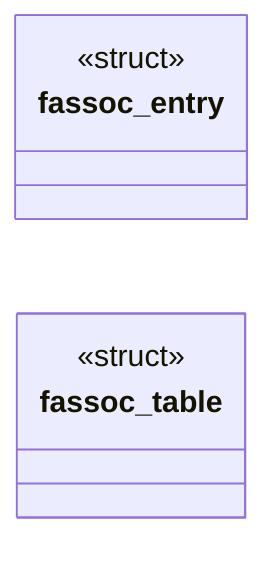
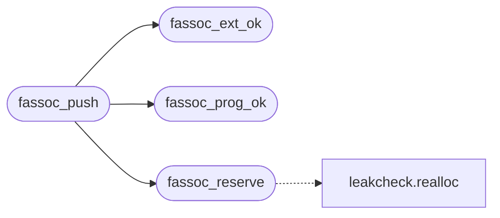

# `progs/file/file_assoc.h`

> Source: [progs/file/file_assoc.h:1](../../progs/file/file_assoc.h#L1) | language `h` | coverage 64.7% | [API index](../index.md)

Docstring: dynamic association table for the MiniOS file browser.

## Contents

- **Structs:** [`fassoc_entry`](#fassoc_entry), [`fassoc_table`](#fassoc_table)
- **Functions:** [`fassoc_ext_ok`](#fassoc_ext_ok), [`fassoc_prog_ok`](#fassoc_prog_ok), [`fassoc_clear`](#fassoc_clear), [`fassoc_free`](#fassoc_free), [`fassoc_reserve`](#fassoc_reserve), [`fassoc_push`](#fassoc_push), [`fassoc_lookup`](#fassoc_lookup), [`fassoc_count`](#fassoc_count)
- **Macros:** [`FASSOC_EXT_MAX`](#fassoc_ext_max), [`FASSOC_PROG_MAX`](#fassoc_prog_max), [`FASSOC_INIT_CAP`](#fassoc_init_cap), [`FASSOC_HARD_MAX`](#fassoc_hard_max), [`FASSOC_GROW_NUM`](#fassoc_grow_num), [`FASSOC_GROW_DEN`](#fassoc_grow_den)

## Type Diagram



## Call Graph

Solid arrows stay in this module, dashed arrows leave it.



## Structs

<a id="fassoc_entry"></a>

### `fassoc_entry`

`struct` | [progs/file/file_assoc.h:46](../../progs/file/file_assoc.h#L46)

```c
struct fassoc_entry
```

Docstring: one validated association entry, ext without dot.

---

<a id="fassoc_table"></a>

### `fassoc_table`

`struct` | [progs/file/file_assoc.h:52](../../progs/file/file_assoc.h#L52)

```c
struct fassoc_table
```

Docstring: dynamic table state, zero init is valid.

---

## Functions

<a id="fassoc_ext_ok"></a>

### `fassoc_ext_ok`

`function` `static` | [progs/file/file_assoc.h:59](../../progs/file/file_assoc.h#L59)

```c
static int fassoc_ext_ok(const char *ext)
```

Docstring: validate ext against the assoc line charset and bound.

**Parameters**

| Name | Type | Default | Description |
|---|---|---|---|
| `ext` | `char *` |  |  |

**Returns:** `int`

*Called by:* [`fassoc_push`](#fassoc_push)

---

<a id="fassoc_prog_ok"></a>

### `fassoc_prog_ok`

`function` `static` | [progs/file/file_assoc.h:73](../../progs/file/file_assoc.h#L73)

```c
static int fassoc_prog_ok(const char *prog)
```

Docstring: validate prog against shell, internal, or absolute path.

**Parameters**

| Name | Type | Default | Description |
|---|---|---|---|
| `prog` | `char *` |  |  |

**Returns:** `int`

*Called by:* [`fassoc_push`](#fassoc_push)

---

<a id="fassoc_clear"></a>

### `fassoc_clear`

`function` `static` | [progs/file/file_assoc.h:89](../../progs/file/file_assoc.h#L89)

```c
static void fassoc_clear(struct fassoc_table *t)
```

Docstring: reset table to empty without releasing capacity.

**Parameters**

| Name | Type | Default | Description |
|---|---|---|---|
| `t` | `struct fassoc_table *` |  |  |

---

<a id="fassoc_free"></a>

### `fassoc_free`

`function` `static` | [progs/file/file_assoc.h:95](../../progs/file/file_assoc.h#L95)

```c
static void fassoc_free(struct fassoc_table *t)
```

Docstring: release backing store and reset to zero init state.

**Parameters**

| Name | Type | Default | Description |
|---|---|---|---|
| `t` | `struct fassoc_table *` |  |  |

---

<a id="fassoc_reserve"></a>

### `fassoc_reserve`

`function` `static` | [progs/file/file_assoc.h:104](../../progs/file/file_assoc.h#L104)

```c
static int fassoc_reserve(struct fassoc_table *t, size_t want)
```

Docstring: ensure capacity for want entries, old data kept on failure.

**Parameters**

| Name | Type | Default | Description |
|---|---|---|---|
| `t` | `struct fassoc_table *` |  |  |
| `want` | `size_t` |  |  |

**Returns:** `int`

*Calls:* [`realloc`](headers.leakcheck.h.md#realloc)

*Called by:* [`fassoc_push`](#fassoc_push)

---

<a id="fassoc_push"></a>

### `fassoc_push`

`function` `static` | [progs/file/file_assoc.h:125](../../progs/file/file_assoc.h#L125)

```c
static int fassoc_push(struct fassoc_table *t, const char *ext, const char *prog)
```

Docstring: append one validated entry, fail closed without mutation.

**Parameters**

| Name | Type | Default | Description |
|---|---|---|---|
| `t` | `struct fassoc_table *` |  |  |
| `ext` | `char *` |  |  |
| `prog` | `char *` |  |  |

**Returns:** `int`

*Calls:* [`fassoc_ext_ok`](#fassoc_ext_ok), [`fassoc_prog_ok`](#fassoc_prog_ok), [`fassoc_reserve`](#fassoc_reserve)

---

<a id="fassoc_lookup"></a>

### `fassoc_lookup`

`function` `const` `static` | [progs/file/file_assoc.h:140](../../progs/file/file_assoc.h#L140)

```c
static const char *fassoc_lookup(const struct fassoc_table *t, const char *ext)
```

Docstring: program for ext in file order, empty string when unmapped.

**Parameters**

| Name | Type | Default | Description |
|---|---|---|---|
| `t` | `struct fassoc_table *` |  |  |
| `ext` | `char *` |  |  |

**Returns:** `char *`

---

<a id="fassoc_count"></a>

### `fassoc_count`

`function` `static` | [progs/file/file_assoc.h:150](../../progs/file/file_assoc.h#L150)

```c
static size_t fassoc_count(const struct fassoc_table *t)
```

Docstring: logical entry count, zero for null table.

**Parameters**

| Name | Type | Default | Description |
|---|---|---|---|
| `t` | `struct fassoc_table *` |  |  |

**Returns:** `size_t`

---

## Macros

<a id="fassoc_ext_max"></a>

### `FASSOC_EXT_MAX`

`macro` | [progs/file/file_assoc.h:22](../../progs/file/file_assoc.h#L22)

```c
#define FASSOC_EXT_MAX
```

---

<a id="fassoc_prog_max"></a>

### `FASSOC_PROG_MAX`

`macro` | [progs/file/file_assoc.h:26](../../progs/file/file_assoc.h#L26)

```c
#define FASSOC_PROG_MAX
```

---

<a id="fassoc_init_cap"></a>

### `FASSOC_INIT_CAP`

`macro` | [progs/file/file_assoc.h:30](../../progs/file/file_assoc.h#L30)

```c
#define FASSOC_INIT_CAP
```

---

<a id="fassoc_hard_max"></a>

### `FASSOC_HARD_MAX`

`macro` | [progs/file/file_assoc.h:34](../../progs/file/file_assoc.h#L34)

```c
#define FASSOC_HARD_MAX
```

---

<a id="fassoc_grow_num"></a>

### `FASSOC_GROW_NUM`

`macro` | [progs/file/file_assoc.h:38](../../progs/file/file_assoc.h#L38)

```c
#define FASSOC_GROW_NUM
```

---

<a id="fassoc_grow_den"></a>

### `FASSOC_GROW_DEN`

`macro` | [progs/file/file_assoc.h:42](../../progs/file/file_assoc.h#L42)

```c
#define FASSOC_GROW_DEN
```

---
