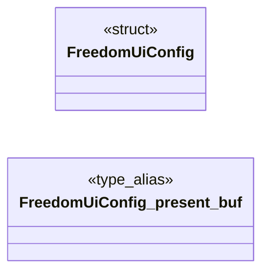

# `progs/freedomui/freedomui_minios.c`

> Source: [progs/freedomui/freedomui_minios.c:1](../../progs/freedomui/freedomui_minios.c#L1) | language `c` | coverage 40.9% | [API index](../index.md)

freedomui_minios - Real FreeDom browser on MiniOS, DOOM/Q2G pattern.

## Contents

- **Structs:** [`FreedomUiConfig`](#freedomuiconfig)
- **Functions:** [`net_dns_resolve`](#net_dns_resolve), [`tls_handshake`](#tls_handshake), [`tls_send`](#tls_send), [`tls_recv`](#tls_recv), [`tls_close`](#tls_close), [`freedomui_host_entry`](#freedomui_host_entry), [`main`](#main)
- **Macros:** [`FUI_COLS`](#fui_cols), [`FUI_TEXT_ROWS`](#fui_text_rows), [`FUI_BODY_CAP`](#fui_body_cap), [`FUI_HDR_MAX`](#fui_hdr_max), [`FUI_NET_BUF`](#fui_net_buf), [`FUI_REQ_MAX`](#fui_req_max), [`FUI_HOST_MAX`](#fui_host_max), [`FUI_PATH_MAX`](#fui_path_max), [`FUI_URL_MAX`](#fui_url_max), [`FUI_HOPS_MAX`](#fui_hops_max), [`FUI_FONT_W`](#fui_font_w), [`FUI_TITLE_MAX`](#fui_title_max)

## Type Diagram



## Structs

<a id="freedomuiconfig"></a>

### `FreedomUiConfig`

`struct` | [progs/freedomui/freedomui_minios.c:69](../../progs/freedomui/freedomui_minios.c#L69)

```c
typedef struct FreedomUiConfig
```

Centralized configuration for the MiniOS backend.

**Members**

| Member | Kind | Summary |
|---|---|---|
| [`present_buf`](#freedomuiconfig-present_buf) | type_alias | Centralized configuration for the MiniOS backend. |

<a id="freedomuiconfig-present_buf"></a>

#### `FreedomUiConfig.present_buf`

`type_alias` | [progs/freedomui/freedomui_minios.c:69](../../progs/freedomui/freedomui_minios.c#L69)

```c
typedef struct FreedomUiConfig { long present_buf;
```

Centralized configuration for the MiniOS backend.

---

## Functions

<a id="net_dns_resolve"></a>

### `net_dns_resolve`

`function` | [progs/freedomui/freedomui_minios.c:44](../../progs/freedomui/freedomui_minios.c#L44)

```c
int net_dns_resolve(const char *host);
```

**Parameters**

| Name | Type | Default | Description |
|---|---|---|---|
| `host` | `char *` |  |  |

**Returns:** `int`

---

<a id="tls_handshake"></a>

### `tls_handshake`

`function` | [progs/freedomui/freedomui_minios.c:45](../../progs/freedomui/freedomui_minios.c#L45)

```c
int tls_handshake(int fd, char *host);
```

Blocking TLS 1.2 handshake over an open TCP socket (net fd index). host is the SNI + certificate hostname.

Returns 0 on success, -1 with a diagnostic on the console. The session lives on the kernel heap.

**Parameters**

| Name | Type | Default | Description |
|---|---|---|---|
| `fd` | `int` |  |  |
| `host` | `char *` |  |  |

**Returns:** `int`

> **Inherited:** Documentation from [`tls_handshake`](#tls_handshake) (headers/tls.h:277).

---

<a id="tls_send"></a>

### `tls_send`

`function` | [progs/freedomui/freedomui_minios.c:46](../../progs/freedomui/freedomui_minios.c#L46)

```c
int tls_send(int fd, char *buf, int len);
```

Send len plaintext bytes as one TLS record.

All-or-error.

**Parameters**

| Name | Type | Default | Description |
|---|---|---|---|
| `fd` | `int` |  |  |
| `buf` | `char *` |  |  |
| `len` | `int` |  |  |

**Returns:** `int`

> **Inherited:** Documentation from [`tls_send`](#tls_send) (headers/tls.h:280).

---

<a id="tls_recv"></a>

### `tls_recv`

`function` | [progs/freedomui/freedomui_minios.c:47](../../progs/freedomui/freedomui_minios.c#L47)

```c
int tls_recv(int fd, char *buf, int len);
```

Receive decrypted application bytes.

0 = clean EOF (close_notify or FIN at a record boundary); -1 = protocol error / truncation (diagnostic).

**Parameters**

| Name | Type | Default | Description |
|---|---|---|---|
| `fd` | `int` |  |  |
| `buf` | `char *` |  |  |
| `len` | `int` |  |  |

**Returns:** `int`

> **Inherited:** Documentation from [`tls_recv`](#tls_recv) (headers/tls.h:284).

---

<a id="tls_close"></a>

### `tls_close`

`function` | [progs/freedomui/freedomui_minios.c:48](../../progs/freedomui/freedomui_minios.c#L48)

```c
void tls_close(int fd);
```

**Parameters**

| Name | Type | Default | Description |
|---|---|---|---|
| `fd` | `int` |  |  |

---

<a id="freedomui_host_entry"></a>

### `freedomui_host_entry`

`function` | [progs/freedomui/freedomui_minios.c:1067](../../progs/freedomui/freedomui_minios.c#L1067)

```c
int freedomui_host_entry(FreedomUiConfig *c)
```

Host harness entry for pure backend logic plus engine linkage.

**Parameters**

| Name | Type | Default | Description |
|---|---|---|---|
| `c` | `FreedomUiConfig *` |  |  |

**Returns:** `int`

---

<a id="main"></a>

### `main`

`function` | [progs/freedomui/freedomui_minios.c:1072](../../progs/freedomui/freedomui_minios.c#L1072)

```c
int main(int argc, char **argv)
```

Guest entry point shared by the MiniFS binary.

**Parameters**

| Name | Type | Default | Description |
|---|---|---|---|
| `argc` | `int` |  |  |
| `argv` | `char **` |  |  |

**Returns:** `int`

---

## Macros

<a id="fui_cols"></a>

### `FUI_COLS`

`macro` | [progs/freedomui/freedomui_minios.c:51](../../progs/freedomui/freedomui_minios.c#L51)

```c
#define FUI_COLS
```

Named limits for the browser.

---

<a id="fui_text_rows"></a>

### `FUI_TEXT_ROWS`

`macro` | [progs/freedomui/freedomui_minios.c:52](../../progs/freedomui/freedomui_minios.c#L52)

```c
#define FUI_TEXT_ROWS
```

---

<a id="fui_body_cap"></a>

### `FUI_BODY_CAP`

`macro` | [progs/freedomui/freedomui_minios.c:53](../../progs/freedomui/freedomui_minios.c#L53)

```c
#define FUI_BODY_CAP
```

---

<a id="fui_hdr_max"></a>

### `FUI_HDR_MAX`

`macro` | [progs/freedomui/freedomui_minios.c:54](../../progs/freedomui/freedomui_minios.c#L54)

```c
#define FUI_HDR_MAX
```

---

<a id="fui_net_buf"></a>

### `FUI_NET_BUF`

`macro` | [progs/freedomui/freedomui_minios.c:55](../../progs/freedomui/freedomui_minios.c#L55)

```c
#define FUI_NET_BUF
```

---

<a id="fui_req_max"></a>

### `FUI_REQ_MAX`

`macro` | [progs/freedomui/freedomui_minios.c:56](../../progs/freedomui/freedomui_minios.c#L56)

```c
#define FUI_REQ_MAX
```

---

<a id="fui_host_max"></a>

### `FUI_HOST_MAX`

`macro` | [progs/freedomui/freedomui_minios.c:57](../../progs/freedomui/freedomui_minios.c#L57)

```c
#define FUI_HOST_MAX
```

---

<a id="fui_path_max"></a>

### `FUI_PATH_MAX`

`macro` | [progs/freedomui/freedomui_minios.c:58](../../progs/freedomui/freedomui_minios.c#L58)

```c
#define FUI_PATH_MAX
```

---

<a id="fui_url_max"></a>

### `FUI_URL_MAX`

`macro` | [progs/freedomui/freedomui_minios.c:59](../../progs/freedomui/freedomui_minios.c#L59)

```c
#define FUI_URL_MAX
```

---

<a id="fui_hops_max"></a>

### `FUI_HOPS_MAX`

`macro` | [progs/freedomui/freedomui_minios.c:60](../../progs/freedomui/freedomui_minios.c#L60)

```c
#define FUI_HOPS_MAX
```

---

<a id="fui_font_w"></a>

### `FUI_FONT_W`

`macro` | [progs/freedomui/freedomui_minios.c:61](../../progs/freedomui/freedomui_minios.c#L61)

```c
#define FUI_FONT_W
```

---

<a id="fui_title_max"></a>

### `FUI_TITLE_MAX`

`macro` | [progs/freedomui/freedomui_minios.c:63](../../progs/freedomui/freedomui_minios.c#L63)

```c
#define FUI_TITLE_MAX
```

---
