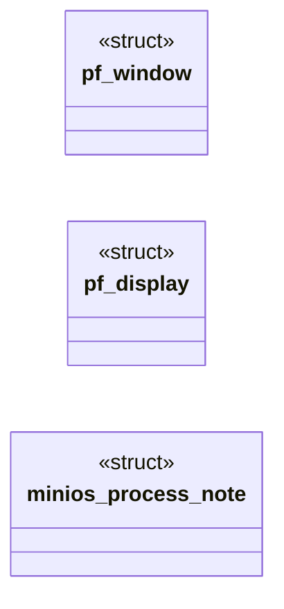
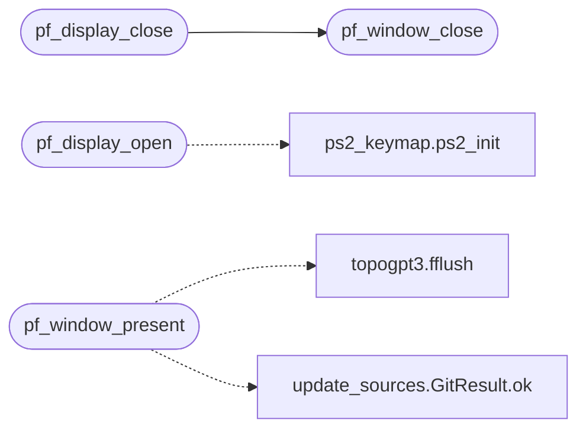

# `progs/freedomui/platform_minios.c`

> Source: [progs/freedomui/platform_minios.c:1](../../progs/freedomui/platform_minios.c#L1) | language `c` | coverage 32.4% | [API index](../index.md)

## Contents

- **Structs:** [`pf_window`](#pf_window), [`pf_display`](#pf_display), [`minios_process_note`](#minios_process_note)
- **Functions:** [`pf_display_open`](#pf_display_open), [`pf_display_close`](#pf_display_close), [`pf_display_flush`](#pf_display_flush), [`pf_display_set_cursor`](#pf_display_set_cursor), [`pf_display_wait`](#pf_display_wait), [`pf_clipboard_available`](#pf_clipboard_available), [`pf_clipboard_set_text`](#pf_clipboard_set_text), [`pf_clipboard_get_text`](#pf_clipboard_get_text), [`pf_window_open`](#pf_window_open), [`pf_window_close`](#pf_window_close), [`pf_window_surface`](#pf_window_surface), [`pf_window_present`](#pf_window_present), [`pf_window_set_title`](#pf_window_set_title), [`pf_window_set_maximized`](#pf_window_set_maximized), [`pf_window_set_fullscreen`](#pf_window_set_fullscreen), [`pf_window_minimize`](#pf_window_minimize), [`pf_window_begin_move`](#pf_window_begin_move), [`pf_window_begin_resize`](#pf_window_begin_resize)
- **Macros:** [`_GNU_SOURCE`](#_gnu_source), [`FREEDOM_GUI_TICK_MS`](#freedom_gui_tick_ms), [`FREEDOM_GUI_KBD_DRAIN_MAX`](#freedom_gui_kbd_drain_max), [`FREEDOM_GUI_TITLE_MAX`](#freedom_gui_title_max), [`FREEDOM_GUI_CLIP_MAX`](#freedom_gui_clip_max), [`FREEDOM_GUI_MALLOC_ARENAS`](#freedom_gui_malloc_arenas), [`FREEDOM_GUI_MOUSE_WORDS`](#freedom_gui_mouse_words), [`FREEDOM_GUI_MOUSE_X`](#freedom_gui_mouse_x), [`FREEDOM_GUI_MOUSE_Y`](#freedom_gui_mouse_y), [`FREEDOM_GUI_MOUSE_BUTTONS`](#freedom_gui_mouse_buttons), [`FREEDOM_GUI_MOUSE_WHEEL`](#freedom_gui_mouse_wheel), [`FREEDOM_GUI_BUTTONS`](#freedom_gui_buttons), [`FREEDOM_GUI_KEY_F4`](#freedom_gui_key_f4), [`FREEDOM_GUI_RGB_BPP`](#freedom_gui_rgb_bpp), [`FREEDOM_GUI_RGB_PRESENT`](#freedom_gui_rgb_present)

## Type Diagram



## Call Graph

Solid arrows stay in this module, dashed arrows leave it.



## Structs

<a id="pf_window"></a>

### `pf_window`

`struct` | [progs/freedomui/platform_minios.c:56](../../progs/freedomui/platform_minios.c#L56)

```c
struct pf_window
```

---

<a id="pf_display"></a>

### `pf_display`

`struct` | [progs/freedomui/platform_minios.c:68](../../progs/freedomui/platform_minios.c#L68)

```c
struct pf_display
```

---

<a id="minios_process_note"></a>

### `minios_process_note`

`struct` | [progs/freedomui/platform_minios.c:124](../../progs/freedomui/platform_minios.c#L124)

```c
struct minios_process_note
```

Run as a process, never in the shell's pid-0 exec frame: the browser's fetch threads, renderer fork and /proc/self/exe tab workers need real process semantics (minios_abi.h, process note).

---

## Functions

<a id="pf_display_open"></a>

### `pf_display_open`

`function` | [progs/freedomui/platform_minios.c:137](../../progs/freedomui/platform_minios.c#L137)

```c
pf_status pf_display_open(pf_display **out)
```

**Parameters**

| Name | Type | Default | Description |
|---|---|---|---|
| `out` | `pf_display **` |  |  |

**Returns:** `pf_status`

*Calls:* [`ps2_init`](progs.freedomui.ps2_keymap.h.md#ps2_init)

---

<a id="pf_display_close"></a>

### `pf_display_close`

`function` | [progs/freedomui/platform_minios.c:153](../../progs/freedomui/platform_minios.c#L153)

```c
void pf_display_close(pf_display *d)
```

**Parameters**

| Name | Type | Default | Description |
|---|---|---|---|
| `d` | `pf_display *` |  |  |

*Calls:* [`pf_window_close`](#pf_window_close)

---

<a id="pf_display_flush"></a>

### `pf_display_flush`

`function` | [progs/freedomui/platform_minios.c:162](../../progs/freedomui/platform_minios.c#L162)

```c
void pf_display_flush(pf_display *d)
```

**Parameters**

| Name | Type | Default | Description |
|---|---|---|---|
| `d` | `pf_display *` |  |  |

---

<a id="pf_display_set_cursor"></a>

### `pf_display_set_cursor`

`function` | [progs/freedomui/platform_minios.c:166](../../progs/freedomui/platform_minios.c#L166)

```c
void pf_display_set_cursor(pf_display *d, pf_cursor c)
```

**Parameters**

| Name | Type | Default | Description |
|---|---|---|---|
| `d` | `pf_display *` |  |  |
| `c` | `pf_cursor` |  |  |

---

<a id="pf_display_wait"></a>

### `pf_display_wait`

`function` | [progs/freedomui/platform_minios.c:268](../../progs/freedomui/platform_minios.c#L268)

```c
int pf_display_wait(pf_display *d, struct pollfd *extra, int n, int timeout_ms)
```

**Parameters**

| Name | Type | Default | Description |
|---|---|---|---|
| `d` | `pf_display *` |  |  |
| `extra` | `struct pollfd *` |  |  |
| `n` | `int` |  |  |
| `timeout_ms` | `int` |  |  |

**Returns:** `int`

---

<a id="pf_clipboard_available"></a>

### `pf_clipboard_available`

`function` | [progs/freedomui/platform_minios.c:293](../../progs/freedomui/platform_minios.c#L293)

```c
int pf_clipboard_available(const pf_display *d)
```

**Parameters**

| Name | Type | Default | Description |
|---|---|---|---|
| `d` | `pf_display *` |  |  |

**Returns:** `int`

---

<a id="pf_clipboard_set_text"></a>

### `pf_clipboard_set_text`

`function` | [progs/freedomui/platform_minios.c:297](../../progs/freedomui/platform_minios.c#L297)

```c
pf_status pf_clipboard_set_text(pf_display *d, const char *text)
```

**Parameters**

| Name | Type | Default | Description |
|---|---|---|---|
| `d` | `pf_display *` |  |  |
| `text` | `char *` |  |  |

**Returns:** `pf_status`

---

<a id="pf_clipboard_get_text"></a>

### `pf_clipboard_get_text`

`function` | [progs/freedomui/platform_minios.c:304](../../progs/freedomui/platform_minios.c#L304)

```c
pf_status pf_clipboard_get_text(pf_display *d, char **out, size_t *out_len)
```

**Parameters**

| Name | Type | Default | Description |
|---|---|---|---|
| `d` | `pf_display *` |  |  |
| `out` | `char **` |  |  |
| `out_len` | `size_t *` |  |  |

**Returns:** `pf_status`

---

<a id="pf_window_open"></a>

### `pf_window_open`

`function` | [progs/freedomui/platform_minios.c:320](../../progs/freedomui/platform_minios.c#L320)

```c
pf_status pf_window_open(pf_display *d, const pf_window_opts *o, const pf_window_handlers *h, void *ud, pf_window **out)
```

**Parameters**

| Name | Type | Default | Description |
|---|---|---|---|
| `d` | `pf_display *` |  |  |
| `o` | `pf_window_opts *` |  |  |
| `h` | `pf_window_handlers *` |  |  |
| `ud` | `void *` |  |  |
| `out` | `pf_window **` |  |  |

**Returns:** `pf_status`

---

<a id="pf_window_close"></a>

### `pf_window_close`

`function` | [progs/freedomui/platform_minios.c:342](../../progs/freedomui/platform_minios.c#L342)

```c
void pf_window_close(pf_window *w)
```

**Parameters**

| Name | Type | Default | Description |
|---|---|---|---|
| `w` | `pf_window *` |  |  |

*Called by:* [`pf_display_close`](#pf_display_close)

---

<a id="pf_window_surface"></a>

### `pf_window_surface`

`function` | [progs/freedomui/platform_minios.c:359](../../progs/freedomui/platform_minios.c#L359)

```c
cairo_surface_t *pf_window_surface(pf_window *w, int width, int height)
```

**Parameters**

| Name | Type | Default | Description |
|---|---|---|---|
| `w` | `pf_window *` |  |  |
| `width` | `int` |  |  |
| `height` | `int` |  |  |

**Returns:** `cairo_surface_t *`

---

<a id="pf_window_present"></a>

### `pf_window_present`

`function` | [progs/freedomui/platform_minios.c:374](../../progs/freedomui/platform_minios.c#L374)

```c
void pf_window_present(pf_window *w)
```

**Parameters**

| Name | Type | Default | Description |
|---|---|---|---|
| `w` | `pf_window *` |  |  |

*Calls:* [`fflush`](progs.topogpt3.topogpt3.c.md#fflush), [`GitResult.ok`](tools.update_sources.py.md#gitresult-ok)

---

<a id="pf_window_set_title"></a>

### `pf_window_set_title`

`function` | [progs/freedomui/platform_minios.c:408](../../progs/freedomui/platform_minios.c#L408)

```c
void pf_window_set_title(pf_window *w, const char *title)
```

**Parameters**

| Name | Type | Default | Description |
|---|---|---|---|
| `w` | `pf_window *` |  |  |
| `title` | `char *` |  |  |

---

<a id="pf_window_set_maximized"></a>

### `pf_window_set_maximized`

`function` | [progs/freedomui/platform_minios.c:424](../../progs/freedomui/platform_minios.c#L424)

```c
void pf_window_set_maximized(pf_window *w, int on)
```

**Parameters**

| Name | Type | Default | Description |
|---|---|---|---|
| `w` | `pf_window *` |  |  |
| `on` | `int` |  |  |

---

<a id="pf_window_set_fullscreen"></a>

### `pf_window_set_fullscreen`

`function` | [progs/freedomui/platform_minios.c:428](../../progs/freedomui/platform_minios.c#L428)

```c
void pf_window_set_fullscreen(pf_window *w, int on)
```

**Parameters**

| Name | Type | Default | Description |
|---|---|---|---|
| `w` | `pf_window *` |  |  |
| `on` | `int` |  |  |

---

<a id="pf_window_minimize"></a>

### `pf_window_minimize`

`function` | [progs/freedomui/platform_minios.c:432](../../progs/freedomui/platform_minios.c#L432)

```c
void pf_window_minimize(pf_window *w)
```

**Parameters**

| Name | Type | Default | Description |
|---|---|---|---|
| `w` | `pf_window *` |  |  |

---

<a id="pf_window_begin_move"></a>

### `pf_window_begin_move`

`function` | [progs/freedomui/platform_minios.c:436](../../progs/freedomui/platform_minios.c#L436)

```c
void pf_window_begin_move(pf_window *w)
```

**Parameters**

| Name | Type | Default | Description |
|---|---|---|---|
| `w` | `pf_window *` |  |  |

---

<a id="pf_window_begin_resize"></a>

### `pf_window_begin_resize`

`function` | [progs/freedomui/platform_minios.c:440](../../progs/freedomui/platform_minios.c#L440)

```c
void pf_window_begin_resize(pf_window *w, pf_edge edge)
```

**Parameters**

| Name | Type | Default | Description |
|---|---|---|---|
| `w` | `pf_window *` |  |  |
| `edge` | `pf_edge` |  |  |

---

## Macros

<a id="_gnu_source"></a>

### `_GNU_SOURCE`

`macro` | [progs/freedomui/platform_minios.c:11](../../progs/freedomui/platform_minios.c#L11)

```c
#define _GNU_SOURCE
```

platform_minios.c - MiniOS implementation of FreeDom's gui/platform.h.

Contract: FreeDom spec/platform.md plus docs/spec/network.md (freedom-gui).
The NK RGB back-buffer (MINIOS_NK_W x MINIOS_NK_H, 3 bytes per pixel) is
the only surface a process owns, so the most recently opened window is the
visible one and receives input; the window manager draws the chrome and the
pointer. FreeDom paints into a heap ARGB32 Cairo surface; present converts
it to RGB and hands it to GFX_PRESENT. Every MiniOS call goes through the
Linux syscall ABI with numbers from minios_abi.h.

---

<a id="freedom_gui_tick_ms"></a>

### `FREEDOM_GUI_TICK_MS`

`macro` | [progs/freedomui/platform_minios.c:27](../../progs/freedomui/platform_minios.c#L27)

```c
#define FREEDOM_GUI_TICK_MS
```

Granularity of the input wait loop, in milliseconds.

---

<a id="freedom_gui_kbd_drain_max"></a>

### `FREEDOM_GUI_KBD_DRAIN_MAX`

`macro` | [progs/freedomui/platform_minios.c:29](../../progs/freedomui/platform_minios.c#L29)

```c
#define FREEDOM_GUI_KBD_DRAIN_MAX
```

Keyboard bytes drained per input pump, so a stuck controller cannot spin.

---

<a id="freedom_gui_title_max"></a>

### `FREEDOM_GUI_TITLE_MAX`

`macro` | [progs/freedomui/platform_minios.c:31](../../progs/freedomui/platform_minios.c#L31)

```c
#define FREEDOM_GUI_TITLE_MAX
```

GFX_SET_TITLE accepts at most this many bytes.

---

<a id="freedom_gui_clip_max"></a>

### `FREEDOM_GUI_CLIP_MAX`

`macro` | [progs/freedomui/platform_minios.c:33](../../progs/freedomui/platform_minios.c#L33)

```c
#define FREEDOM_GUI_CLIP_MAX
```

Kernel clipboard capacity (kernel/clip.c CLIP_MAX); longer text is refused.

---

<a id="freedom_gui_malloc_arenas"></a>

### `FREEDOM_GUI_MALLOC_ARENAS`

`macro` | [progs/freedomui/platform_minios.c:35](../../progs/freedomui/platform_minios.c#L35)

```c
#define FREEDOM_GUI_MALLOC_ARENAS
```

malloc arenas: one, the main arena (see minios_malloc_single_arena).

---

<a id="freedom_gui_mouse_words"></a>

### `FREEDOM_GUI_MOUSE_WORDS`

`macro` | [progs/freedomui/platform_minios.c:38](../../progs/freedomui/platform_minios.c#L38)

```c
#define FREEDOM_GUI_MOUSE_WORDS
```

SYS_MOUSE reply: x, y, buttons, wheel delta.

---

<a id="freedom_gui_mouse_x"></a>

### `FREEDOM_GUI_MOUSE_X`

`macro` | [progs/freedomui/platform_minios.c:39](../../progs/freedomui/platform_minios.c#L39)

```c
#define FREEDOM_GUI_MOUSE_X
```

---

<a id="freedom_gui_mouse_y"></a>

### `FREEDOM_GUI_MOUSE_Y`

`macro` | [progs/freedomui/platform_minios.c:40](../../progs/freedomui/platform_minios.c#L40)

```c
#define FREEDOM_GUI_MOUSE_Y
```

---

<a id="freedom_gui_mouse_buttons"></a>

### `FREEDOM_GUI_MOUSE_BUTTONS`

`macro` | [progs/freedomui/platform_minios.c:41](../../progs/freedomui/platform_minios.c#L41)

```c
#define FREEDOM_GUI_MOUSE_BUTTONS
```

---

<a id="freedom_gui_mouse_wheel"></a>

### `FREEDOM_GUI_MOUSE_WHEEL`

`macro` | [progs/freedomui/platform_minios.c:42](../../progs/freedomui/platform_minios.c#L42)

```c
#define FREEDOM_GUI_MOUSE_WHEEL
```

---

<a id="freedom_gui_buttons"></a>

### `FREEDOM_GUI_BUTTONS`

`macro` | [progs/freedomui/platform_minios.c:44](../../progs/freedomui/platform_minios.c#L44)

```c
#define FREEDOM_GUI_BUTTONS
```

SYS_MOUSE button bits in PF_BUTTON order.

---

<a id="freedom_gui_key_f4"></a>

### `FREEDOM_GUI_KEY_F4`

`macro` | [progs/freedomui/platform_minios.c:46](../../progs/freedomui/platform_minios.c#L46)

```c
#define FREEDOM_GUI_KEY_F4
```

X11 keysym of F4: Alt+F4 asks the visible window to close.

---

<a id="freedom_gui_rgb_bpp"></a>

### `FREEDOM_GUI_RGB_BPP`

`macro` | [progs/freedomui/platform_minios.c:48](../../progs/freedomui/platform_minios.c#L48)

```c
#define FREEDOM_GUI_RGB_BPP
```

RGB bytes per pixel of the NK RGB back-buffer.

---

<a id="freedom_gui_rgb_present"></a>

### `FREEDOM_GUI_RGB_PRESENT`

`macro` | [progs/freedomui/platform_minios.c:50](../../progs/freedomui/platform_minios.c#L50)

```c
#define FREEDOM_GUI_RGB_PRESENT
```

SYS_FB_INFO fourth out-word value announcing the RGB back-buffer.

---
