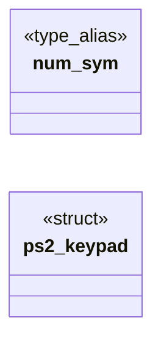

# `progs/freedomui/ps2_keymap.c`

> Source: [progs/freedomui/ps2_keymap.c:1](../../progs/freedomui/ps2_keymap.c#L1) | language `c` | coverage 5.2% | [API index](../index.md)

ps2_keymap.c - pure PS/2 set 1 scancode to keysym translator (US layout).

## Contents

- **Structs:** [`ps2_keypad`](#ps2_keypad)
- **Type Aliases:** [`num_sym`](#num_sym)
- **Functions:** [`ps2_init`](#ps2_init), [`ps2_feed`](#ps2_feed)
- **Macros:** [`PS2_PREFIX_EXTENDED`](#ps2_prefix_extended), [`PS2_PREFIX_PAUSE`](#ps2_prefix_pause), [`PS2_PAUSE_TAIL`](#ps2_pause_tail), [`PS2_BREAK_BIT`](#ps2_break_bit), [`PS2_CODE_MASK`](#ps2_code_mask), [`PS2_TABLE_SIZE`](#ps2_table_size), [`PS2_HELD_LSHIFT`](#ps2_held_lshift), [`PS2_HELD_RSHIFT`](#ps2_held_rshift), [`PS2_HELD_LCTRL`](#ps2_held_lctrl), [`PS2_HELD_RCTRL`](#ps2_held_rctrl), [`PS2_HELD_LALT`](#ps2_held_lalt), [`PS2_HELD_RALT`](#ps2_held_ralt), [`SC_ESCAPE`](#sc_escape), [`SC_BACKSPACE`](#sc_backspace), [`SC_TAB`](#sc_tab), [`SC_RETURN`](#sc_return), [`SC_CTRL`](#sc_ctrl), [`SC_LSHIFT`](#sc_lshift), [`SC_RSHIFT`](#sc_rshift), [`SC_KP_MUL`](#sc_kp_mul), [`SC_ALT`](#sc_alt), [`SC_CAPS`](#sc_caps), [`SC_F1`](#sc_f1), [`SC_F10`](#sc_f10), [`SC_NUMLOCK`](#sc_numlock), [`SC_SCROLL`](#sc_scroll), [`SC_KP_FIRST`](#sc_kp_first), [`SC_KP_LAST`](#sc_kp_last), [`SC_F11`](#sc_f11), [`SC_F12`](#sc_f12), [`SC_E0_KP_DIV`](#sc_e0_kp_div), [`SC_E0_PRINT`](#sc_e0_print), [`SC_E0_HOME`](#sc_e0_home), [`SC_E0_UP`](#sc_e0_up), [`SC_E0_PRIOR`](#sc_e0_prior), [`SC_E0_LEFT`](#sc_e0_left), [`SC_E0_RIGHT`](#sc_e0_right), [`SC_E0_END`](#sc_e0_end), [`SC_E0_DOWN`](#sc_e0_down), [`SC_E0_NEXT`](#sc_e0_next), [`SC_E0_INSERT`](#sc_e0_insert), [`SC_E0_DELETE`](#sc_e0_delete), [`SC_E0_SUPERL`](#sc_e0_superl), [`SC_E0_SUPERR`](#sc_e0_superr), [`SC_E0_MENU`](#sc_e0_menu), [`KS_F1`](#ks_f1), [`KS_F11`](#ks_f11), [`KS_INSERT`](#ks_insert), [`KS_PRINT`](#ks_print), [`KS_MENU`](#ks_menu), [`KS_SCROLL_LOCK`](#ks_scroll_lock), [`KS_NUM_LOCK`](#ks_num_lock), [`KS_SUPER_L`](#ks_super_l), [`KS_SUPER_R`](#ks_super_r), [`KS_KP_HOME`](#ks_kp_home), [`KS_KP_LEFT`](#ks_kp_left), [`KS_KP_UP`](#ks_kp_up), [`KS_KP_RIGHT`](#ks_kp_right), [`KS_KP_DOWN`](#ks_kp_down), [`KS_KP_PRIOR`](#ks_kp_prior), [`KS_KP_NEXT`](#ks_kp_next), [`KS_KP_END`](#ks_kp_end), [`KS_KP_BEGIN`](#ks_kp_begin), [`KS_KP_INSERT`](#ks_kp_insert), [`KS_KP_MULTIPLY`](#ks_kp_multiply), [`KS_KP_DECIMAL`](#ks_kp_decimal), [`KS_KP_DIVIDE`](#ks_kp_divide), [`ASCII_BS`](#ascii_bs), [`ASCII_TAB`](#ascii_tab), [`ASCII_CR`](#ascii_cr), [`ASCII_ESC`](#ascii_esc), [`ASCII_DEL`](#ascii_del)

## Type Diagram



## Structs

<a id="ps2_keypad"></a>

### `ps2_keypad`

`struct` | [progs/freedomui/ps2_keymap.c:122](../../progs/freedomui/ps2_keymap.c#L122)

```c
typedef struct ps2_keypad
```

Keypad 0x47..0x53: keysym and text with Num Lock on, keysym with it off.

---

## Type Aliases

<a id="num_sym"></a>

### `num_sym`

`type_alias` | [progs/freedomui/ps2_keymap.c:122](../../progs/freedomui/ps2_keymap.c#L122)

```c
typedef struct ps2_keypad { uint32_t num_sym;
```

Keypad 0x47..0x53: keysym and text with Num Lock on, keysym with it off.

---

## Functions

<a id="ps2_init"></a>

### `ps2_init`

`function` | [progs/freedomui/ps2_keymap.c:144](../../progs/freedomui/ps2_keymap.c#L144)

```c
void ps2_init(ps2_state *s)
```

Resets the state: nothing held, Caps Lock off, Num Lock on.

**Parameters**

| Name | Type | Default | Description |
|---|---|---|---|
| `s` | `ps2_state *` |  |  |

> **Inherited:** Documentation from [`ps2_init`](#ps2_init) (progs/freedomui/ps2_keymap.h:47).

---

<a id="ps2_feed"></a>

### `ps2_feed`

`function` | [progs/freedomui/ps2_keymap.c:253](../../progs/freedomui/ps2_keymap.c#L253)

```c
int ps2_feed(ps2_state *s, uint8_t byte, ps2_key *out)
```

**Parameters**

| Name | Type | Default | Description |
|---|---|---|---|
| `s` | `ps2_state *` |  |  |
| `byte` | `uint8_t` |  |  |
| `out` | `ps2_key *` |  |  |

**Returns:** `int`

---

## Macros

<a id="ps2_prefix_extended"></a>

### `PS2_PREFIX_EXTENDED`

`macro` | [progs/freedomui/ps2_keymap.c:13](../../progs/freedomui/ps2_keymap.c#L13)

```c
#define PS2_PREFIX_EXTENDED
```

---

<a id="ps2_prefix_pause"></a>

### `PS2_PREFIX_PAUSE`

`macro` | [progs/freedomui/ps2_keymap.c:14](../../progs/freedomui/ps2_keymap.c#L14)

```c
#define PS2_PREFIX_PAUSE
```

---

<a id="ps2_pause_tail"></a>

### `PS2_PAUSE_TAIL`

`macro` | [progs/freedomui/ps2_keymap.c:15](../../progs/freedomui/ps2_keymap.c#L15)

```c
#define PS2_PAUSE_TAIL
```

---

<a id="ps2_break_bit"></a>

### `PS2_BREAK_BIT`

`macro` | [progs/freedomui/ps2_keymap.c:16](../../progs/freedomui/ps2_keymap.c#L16)

```c
#define PS2_BREAK_BIT
```

---

<a id="ps2_code_mask"></a>

### `PS2_CODE_MASK`

`macro` | [progs/freedomui/ps2_keymap.c:17](../../progs/freedomui/ps2_keymap.c#L17)

```c
#define PS2_CODE_MASK
```

---

<a id="ps2_table_size"></a>

### `PS2_TABLE_SIZE`

`macro` | [progs/freedomui/ps2_keymap.c:18](../../progs/freedomui/ps2_keymap.c#L18)

```c
#define PS2_TABLE_SIZE
```

---

<a id="ps2_held_lshift"></a>

### `PS2_HELD_LSHIFT`

`macro` | [progs/freedomui/ps2_keymap.c:20](../../progs/freedomui/ps2_keymap.c#L20)

```c
#define PS2_HELD_LSHIFT
```

---

<a id="ps2_held_rshift"></a>

### `PS2_HELD_RSHIFT`

`macro` | [progs/freedomui/ps2_keymap.c:21](../../progs/freedomui/ps2_keymap.c#L21)

```c
#define PS2_HELD_RSHIFT
```

---

<a id="ps2_held_lctrl"></a>

### `PS2_HELD_LCTRL`

`macro` | [progs/freedomui/ps2_keymap.c:22](../../progs/freedomui/ps2_keymap.c#L22)

```c
#define PS2_HELD_LCTRL
```

---

<a id="ps2_held_rctrl"></a>

### `PS2_HELD_RCTRL`

`macro` | [progs/freedomui/ps2_keymap.c:23](../../progs/freedomui/ps2_keymap.c#L23)

```c
#define PS2_HELD_RCTRL
```

---

<a id="ps2_held_lalt"></a>

### `PS2_HELD_LALT`

`macro` | [progs/freedomui/ps2_keymap.c:24](../../progs/freedomui/ps2_keymap.c#L24)

```c
#define PS2_HELD_LALT
```

---

<a id="ps2_held_ralt"></a>

### `PS2_HELD_RALT`

`macro` | [progs/freedomui/ps2_keymap.c:25](../../progs/freedomui/ps2_keymap.c#L25)

```c
#define PS2_HELD_RALT
```

---

<a id="sc_escape"></a>

### `SC_ESCAPE`

`macro` | [progs/freedomui/ps2_keymap.c:27](../../progs/freedomui/ps2_keymap.c#L27)

```c
#define SC_ESCAPE
```

---

<a id="sc_backspace"></a>

### `SC_BACKSPACE`

`macro` | [progs/freedomui/ps2_keymap.c:28](../../progs/freedomui/ps2_keymap.c#L28)

```c
#define SC_BACKSPACE
```

---

<a id="sc_tab"></a>

### `SC_TAB`

`macro` | [progs/freedomui/ps2_keymap.c:29](../../progs/freedomui/ps2_keymap.c#L29)

```c
#define SC_TAB
```

---

<a id="sc_return"></a>

### `SC_RETURN`

`macro` | [progs/freedomui/ps2_keymap.c:30](../../progs/freedomui/ps2_keymap.c#L30)

```c
#define SC_RETURN
```

---

<a id="sc_ctrl"></a>

### `SC_CTRL`

`macro` | [progs/freedomui/ps2_keymap.c:31](../../progs/freedomui/ps2_keymap.c#L31)

```c
#define SC_CTRL
```

---

<a id="sc_lshift"></a>

### `SC_LSHIFT`

`macro` | [progs/freedomui/ps2_keymap.c:32](../../progs/freedomui/ps2_keymap.c#L32)

```c
#define SC_LSHIFT
```

---

<a id="sc_rshift"></a>

### `SC_RSHIFT`

`macro` | [progs/freedomui/ps2_keymap.c:33](../../progs/freedomui/ps2_keymap.c#L33)

```c
#define SC_RSHIFT
```

---

<a id="sc_kp_mul"></a>

### `SC_KP_MUL`

`macro` | [progs/freedomui/ps2_keymap.c:34](../../progs/freedomui/ps2_keymap.c#L34)

```c
#define SC_KP_MUL
```

---

<a id="sc_alt"></a>

### `SC_ALT`

`macro` | [progs/freedomui/ps2_keymap.c:35](../../progs/freedomui/ps2_keymap.c#L35)

```c
#define SC_ALT
```

---

<a id="sc_caps"></a>

### `SC_CAPS`

`macro` | [progs/freedomui/ps2_keymap.c:36](../../progs/freedomui/ps2_keymap.c#L36)

```c
#define SC_CAPS
```

---

<a id="sc_f1"></a>

### `SC_F1`

`macro` | [progs/freedomui/ps2_keymap.c:37](../../progs/freedomui/ps2_keymap.c#L37)

```c
#define SC_F1
```

---

<a id="sc_f10"></a>

### `SC_F10`

`macro` | [progs/freedomui/ps2_keymap.c:38](../../progs/freedomui/ps2_keymap.c#L38)

```c
#define SC_F10
```

---

<a id="sc_numlock"></a>

### `SC_NUMLOCK`

`macro` | [progs/freedomui/ps2_keymap.c:39](../../progs/freedomui/ps2_keymap.c#L39)

```c
#define SC_NUMLOCK
```

---

<a id="sc_scroll"></a>

### `SC_SCROLL`

`macro` | [progs/freedomui/ps2_keymap.c:40](../../progs/freedomui/ps2_keymap.c#L40)

```c
#define SC_SCROLL
```

---

<a id="sc_kp_first"></a>

### `SC_KP_FIRST`

`macro` | [progs/freedomui/ps2_keymap.c:41](../../progs/freedomui/ps2_keymap.c#L41)

```c
#define SC_KP_FIRST
```

---

<a id="sc_kp_last"></a>

### `SC_KP_LAST`

`macro` | [progs/freedomui/ps2_keymap.c:42](../../progs/freedomui/ps2_keymap.c#L42)

```c
#define SC_KP_LAST
```

---

<a id="sc_f11"></a>

### `SC_F11`

`macro` | [progs/freedomui/ps2_keymap.c:43](../../progs/freedomui/ps2_keymap.c#L43)

```c
#define SC_F11
```

---

<a id="sc_f12"></a>

### `SC_F12`

`macro` | [progs/freedomui/ps2_keymap.c:44](../../progs/freedomui/ps2_keymap.c#L44)

```c
#define SC_F12
```

---

<a id="sc_e0_kp_div"></a>

### `SC_E0_KP_DIV`

`macro` | [progs/freedomui/ps2_keymap.c:45](../../progs/freedomui/ps2_keymap.c#L45)

```c
#define SC_E0_KP_DIV
```

---

<a id="sc_e0_print"></a>

### `SC_E0_PRINT`

`macro` | [progs/freedomui/ps2_keymap.c:46](../../progs/freedomui/ps2_keymap.c#L46)

```c
#define SC_E0_PRINT
```

---

<a id="sc_e0_home"></a>

### `SC_E0_HOME`

`macro` | [progs/freedomui/ps2_keymap.c:47](../../progs/freedomui/ps2_keymap.c#L47)

```c
#define SC_E0_HOME
```

---

<a id="sc_e0_up"></a>

### `SC_E0_UP`

`macro` | [progs/freedomui/ps2_keymap.c:48](../../progs/freedomui/ps2_keymap.c#L48)

```c
#define SC_E0_UP
```

---

<a id="sc_e0_prior"></a>

### `SC_E0_PRIOR`

`macro` | [progs/freedomui/ps2_keymap.c:49](../../progs/freedomui/ps2_keymap.c#L49)

```c
#define SC_E0_PRIOR
```

---

<a id="sc_e0_left"></a>

### `SC_E0_LEFT`

`macro` | [progs/freedomui/ps2_keymap.c:50](../../progs/freedomui/ps2_keymap.c#L50)

```c
#define SC_E0_LEFT
```

---

<a id="sc_e0_right"></a>

### `SC_E0_RIGHT`

`macro` | [progs/freedomui/ps2_keymap.c:51](../../progs/freedomui/ps2_keymap.c#L51)

```c
#define SC_E0_RIGHT
```

---

<a id="sc_e0_end"></a>

### `SC_E0_END`

`macro` | [progs/freedomui/ps2_keymap.c:52](../../progs/freedomui/ps2_keymap.c#L52)

```c
#define SC_E0_END
```

---

<a id="sc_e0_down"></a>

### `SC_E0_DOWN`

`macro` | [progs/freedomui/ps2_keymap.c:53](../../progs/freedomui/ps2_keymap.c#L53)

```c
#define SC_E0_DOWN
```

---

<a id="sc_e0_next"></a>

### `SC_E0_NEXT`

`macro` | [progs/freedomui/ps2_keymap.c:54](../../progs/freedomui/ps2_keymap.c#L54)

```c
#define SC_E0_NEXT
```

---

<a id="sc_e0_insert"></a>

### `SC_E0_INSERT`

`macro` | [progs/freedomui/ps2_keymap.c:55](../../progs/freedomui/ps2_keymap.c#L55)

```c
#define SC_E0_INSERT
```

---

<a id="sc_e0_delete"></a>

### `SC_E0_DELETE`

`macro` | [progs/freedomui/ps2_keymap.c:56](../../progs/freedomui/ps2_keymap.c#L56)

```c
#define SC_E0_DELETE
```

---

<a id="sc_e0_superl"></a>

### `SC_E0_SUPERL`

`macro` | [progs/freedomui/ps2_keymap.c:57](../../progs/freedomui/ps2_keymap.c#L57)

```c
#define SC_E0_SUPERL
```

---

<a id="sc_e0_superr"></a>

### `SC_E0_SUPERR`

`macro` | [progs/freedomui/ps2_keymap.c:58](../../progs/freedomui/ps2_keymap.c#L58)

```c
#define SC_E0_SUPERR
```

---

<a id="sc_e0_menu"></a>

### `SC_E0_MENU`

`macro` | [progs/freedomui/ps2_keymap.c:59](../../progs/freedomui/ps2_keymap.c#L59)

```c
#define SC_E0_MENU
```

---

<a id="ks_f1"></a>

### `KS_F1`

`macro` | [progs/freedomui/ps2_keymap.c:61](../../progs/freedomui/ps2_keymap.c#L61)

```c
#define KS_F1
```

---

<a id="ks_f11"></a>

### `KS_F11`

`macro` | [progs/freedomui/ps2_keymap.c:62](../../progs/freedomui/ps2_keymap.c#L62)

```c
#define KS_F11
```

---

<a id="ks_insert"></a>

### `KS_INSERT`

`macro` | [progs/freedomui/ps2_keymap.c:63](../../progs/freedomui/ps2_keymap.c#L63)

```c
#define KS_INSERT
```

---

<a id="ks_print"></a>

### `KS_PRINT`

`macro` | [progs/freedomui/ps2_keymap.c:64](../../progs/freedomui/ps2_keymap.c#L64)

```c
#define KS_PRINT
```

---

<a id="ks_menu"></a>

### `KS_MENU`

`macro` | [progs/freedomui/ps2_keymap.c:65](../../progs/freedomui/ps2_keymap.c#L65)

```c
#define KS_MENU
```

---

<a id="ks_scroll_lock"></a>

### `KS_SCROLL_LOCK`

`macro` | [progs/freedomui/ps2_keymap.c:66](../../progs/freedomui/ps2_keymap.c#L66)

```c
#define KS_SCROLL_LOCK
```

---

<a id="ks_num_lock"></a>

### `KS_NUM_LOCK`

`macro` | [progs/freedomui/ps2_keymap.c:67](../../progs/freedomui/ps2_keymap.c#L67)

```c
#define KS_NUM_LOCK
```

---

<a id="ks_super_l"></a>

### `KS_SUPER_L`

`macro` | [progs/freedomui/ps2_keymap.c:68](../../progs/freedomui/ps2_keymap.c#L68)

```c
#define KS_SUPER_L
```

---

<a id="ks_super_r"></a>

### `KS_SUPER_R`

`macro` | [progs/freedomui/ps2_keymap.c:69](../../progs/freedomui/ps2_keymap.c#L69)

```c
#define KS_SUPER_R
```

---

<a id="ks_kp_home"></a>

### `KS_KP_HOME`

`macro` | [progs/freedomui/ps2_keymap.c:70](../../progs/freedomui/ps2_keymap.c#L70)

```c
#define KS_KP_HOME
```

---

<a id="ks_kp_left"></a>

### `KS_KP_LEFT`

`macro` | [progs/freedomui/ps2_keymap.c:71](../../progs/freedomui/ps2_keymap.c#L71)

```c
#define KS_KP_LEFT
```

---

<a id="ks_kp_up"></a>

### `KS_KP_UP`

`macro` | [progs/freedomui/ps2_keymap.c:72](../../progs/freedomui/ps2_keymap.c#L72)

```c
#define KS_KP_UP
```

---

<a id="ks_kp_right"></a>

### `KS_KP_RIGHT`

`macro` | [progs/freedomui/ps2_keymap.c:73](../../progs/freedomui/ps2_keymap.c#L73)

```c
#define KS_KP_RIGHT
```

---

<a id="ks_kp_down"></a>

### `KS_KP_DOWN`

`macro` | [progs/freedomui/ps2_keymap.c:74](../../progs/freedomui/ps2_keymap.c#L74)

```c
#define KS_KP_DOWN
```

---

<a id="ks_kp_prior"></a>

### `KS_KP_PRIOR`

`macro` | [progs/freedomui/ps2_keymap.c:75](../../progs/freedomui/ps2_keymap.c#L75)

```c
#define KS_KP_PRIOR
```

---

<a id="ks_kp_next"></a>

### `KS_KP_NEXT`

`macro` | [progs/freedomui/ps2_keymap.c:76](../../progs/freedomui/ps2_keymap.c#L76)

```c
#define KS_KP_NEXT
```

---

<a id="ks_kp_end"></a>

### `KS_KP_END`

`macro` | [progs/freedomui/ps2_keymap.c:77](../../progs/freedomui/ps2_keymap.c#L77)

```c
#define KS_KP_END
```

---

<a id="ks_kp_begin"></a>

### `KS_KP_BEGIN`

`macro` | [progs/freedomui/ps2_keymap.c:78](../../progs/freedomui/ps2_keymap.c#L78)

```c
#define KS_KP_BEGIN
```

---

<a id="ks_kp_insert"></a>

### `KS_KP_INSERT`

`macro` | [progs/freedomui/ps2_keymap.c:79](../../progs/freedomui/ps2_keymap.c#L79)

```c
#define KS_KP_INSERT
```

---

<a id="ks_kp_multiply"></a>

### `KS_KP_MULTIPLY`

`macro` | [progs/freedomui/ps2_keymap.c:80](../../progs/freedomui/ps2_keymap.c#L80)

```c
#define KS_KP_MULTIPLY
```

---

<a id="ks_kp_decimal"></a>

### `KS_KP_DECIMAL`

`macro` | [progs/freedomui/ps2_keymap.c:81](../../progs/freedomui/ps2_keymap.c#L81)

```c
#define KS_KP_DECIMAL
```

---

<a id="ks_kp_divide"></a>

### `KS_KP_DIVIDE`

`macro` | [progs/freedomui/ps2_keymap.c:82](../../progs/freedomui/ps2_keymap.c#L82)

```c
#define KS_KP_DIVIDE
```

---

<a id="ascii_bs"></a>

### `ASCII_BS`

`macro` | [progs/freedomui/ps2_keymap.c:84](../../progs/freedomui/ps2_keymap.c#L84)

```c
#define ASCII_BS
```

---

<a id="ascii_tab"></a>

### `ASCII_TAB`

`macro` | [progs/freedomui/ps2_keymap.c:85](../../progs/freedomui/ps2_keymap.c#L85)

```c
#define ASCII_TAB
```

---

<a id="ascii_cr"></a>

### `ASCII_CR`

`macro` | [progs/freedomui/ps2_keymap.c:86](../../progs/freedomui/ps2_keymap.c#L86)

```c
#define ASCII_CR
```

---

<a id="ascii_esc"></a>

### `ASCII_ESC`

`macro` | [progs/freedomui/ps2_keymap.c:87](../../progs/freedomui/ps2_keymap.c#L87)

```c
#define ASCII_ESC
```

---

<a id="ascii_del"></a>

### `ASCII_DEL`

`macro` | [progs/freedomui/ps2_keymap.c:88](../../progs/freedomui/ps2_keymap.c#L88)

```c
#define ASCII_DEL
```

---
