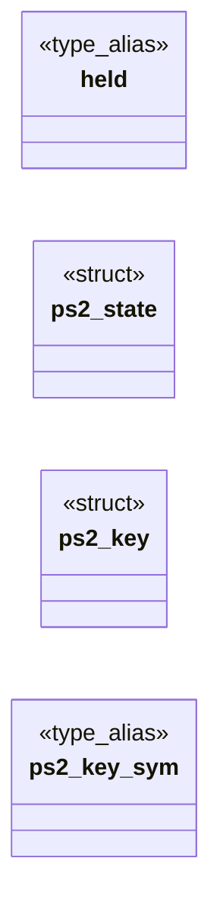

# `progs/freedomui/ps2_keymap.h`

> Source: [progs/freedomui/ps2_keymap.h:1](../../progs/freedomui/ps2_keymap.h#L1) | language `h` | coverage 61.5% | [API index](../index.md)

ps2_keymap.h - pure PS/2 set 1 scancode to keysym translator (US layout).

## Contents

- **Structs:** [`ps2_state`](#ps2_state), [`ps2_key`](#ps2_key)
- **Type Aliases:** [`held`](#held)
- **Functions:** [`ps2_init`](#ps2_init), [`arguments`](#arguments)
- **Macros:** [`PS2_EV_NONE`](#ps2_ev_none), [`PS2_EV_PRESS`](#ps2_ev_press), [`PS2_EV_RELEASE`](#ps2_ev_release), [`PS2_CODE_EXTENDED`](#ps2_code_extended), [`PS2_CODE_LIMIT`](#ps2_code_limit), [`PS2_TEXT_MAX`](#ps2_text_max)

## Type Diagram



## Structs

<a id="ps2_state"></a>

### `ps2_state`

`struct` | [progs/freedomui/ps2_keymap.h:29](../../progs/freedomui/ps2_keymap.h#L29)

```c
typedef struct ps2_state
```

Translator state: held modifiers, lock toggles and pending prefixes.

---

<a id="ps2_key"></a>

### `ps2_key`

`struct` | [progs/freedomui/ps2_keymap.h:38](../../progs/freedomui/ps2_keymap.h#L38)

```c
typedef struct ps2_key
```

One translated key event.

**Members**

| Member | Kind | Summary |
|---|---|---|
| [`sym`](#ps2_key-sym) | type_alias | One translated key event. |

<a id="ps2_key-sym"></a>

#### `ps2_key.sym`

`type_alias` | [progs/freedomui/ps2_keymap.h:38](../../progs/freedomui/ps2_keymap.h#L38)

```c
typedef struct ps2_key { uint32_t sym;
```

One translated key event.

---

## Type Aliases

<a id="held"></a>

### `held`

`type_alias` | [progs/freedomui/ps2_keymap.h:29](../../progs/freedomui/ps2_keymap.h#L29)

```c
typedef struct ps2_state { unsigned held;
```

Translator state: held modifiers, lock toggles and pending prefixes.

---

## Functions

<a id="ps2_init"></a>

### `ps2_init`

`function` | [progs/freedomui/ps2_keymap.h:47](../../progs/freedomui/ps2_keymap.h#L47)

```c
void ps2_init(ps2_state *s);
```

Resets the state: nothing held, Caps Lock off, Num Lock on.

**Parameters**

| Name | Type | Default | Description |
|---|---|---|---|
| `s` | `ps2_state *` |  |  |

*Called by:* [`pf_display_open`](progs.freedomui.platform_minios.c.md#pf_display_open)

---

<a id="arguments"></a>

### `arguments`

`function` | [progs/freedomui/ps2_keymap.h:51](../../progs/freedomui/ps2_keymap.h#L51)

```c
* arguments (out is then left untouched). */ int ps2_feed(ps2_state *s, uint8_t byte, ps2_key *out);
```

**Parameters**

| Name | Type | Default | Description |
|---|---|---|---|
| `untouched` | `is then left` |  |  |

**Returns:** `*`

---

## Macros

<a id="ps2_ev_none"></a>

### `PS2_EV_NONE`

`macro` | [progs/freedomui/ps2_keymap.h:16](../../progs/freedomui/ps2_keymap.h#L16)

```c
#define PS2_EV_NONE
```

---

<a id="ps2_ev_press"></a>

### `PS2_EV_PRESS`

`macro` | [progs/freedomui/ps2_keymap.h:17](../../progs/freedomui/ps2_keymap.h#L17)

```c
#define PS2_EV_PRESS
```

---

<a id="ps2_ev_release"></a>

### `PS2_EV_RELEASE`

`macro` | [progs/freedomui/ps2_keymap.h:18](../../progs/freedomui/ps2_keymap.h#L18)

```c
#define PS2_EV_RELEASE
```

---

<a id="ps2_code_extended"></a>

### `PS2_CODE_EXTENDED`

`macro` | [progs/freedomui/ps2_keymap.h:21](../../progs/freedomui/ps2_keymap.h#L21)

```c
#define PS2_CODE_EXTENDED
```

Bit set in ps2_key.code for keys sent behind the E0 prefix.

---

<a id="ps2_code_limit"></a>

### `PS2_CODE_LIMIT`

`macro` | [progs/freedomui/ps2_keymap.h:24](../../progs/freedomui/ps2_keymap.h#L24)

```c
#define PS2_CODE_LIMIT
```

Upper bound of ps2_key.code, for callers that track held keys.

---

<a id="ps2_text_max"></a>

### `PS2_TEXT_MAX`

`macro` | [progs/freedomui/ps2_keymap.h:26](../../progs/freedomui/ps2_keymap.h#L26)

```c
#define PS2_TEXT_MAX
```

---
