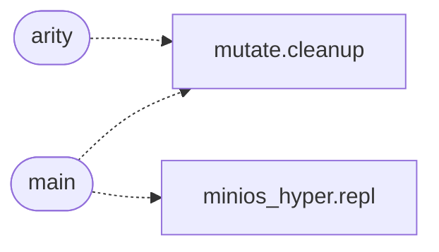

# `progs/lisp/lisp.c`

> Source: [progs/lisp/lisp.c:1](../../progs/lisp/lisp.c#L1) | language `c` | coverage 57.9% | [API index](../index.md)

## Contents

- **Structs:** [`ParseResult`](#parseresult), [`Node`](#node), [`Binding`](#binding), [`Env`](#env), [`AllocTracker`](#alloctracker), [`Runtime`](#runtime), [`Reader`](#reader), [`StringBuilder`](#stringbuilder), [`PrimEntry`](#primentry)
- **Enums:** [`LispConfig`](#lispconfig)
- **Type Aliases:** [`Runtime`](#runtime), [`Node`](#node), [`Env`](#env), [`Binding`](#binding), [`AllocTracker`](#alloctracker)
- **Functions:** [`numbers`](#numbers), [`arity`](#arity), [`main`](#main)

## Type Diagram


## Call Graph

Solid arrows stay in this module, dashed arrows leave it.



## Structs

<a id="parseresult"></a>

### `ParseResult`

`struct` | [progs/lisp/lisp.c:104](../../progs/lisp/lisp.c#L104)

```c
typedef struct
```

Result of a single read step with a bounded diagnostic.

---

<a id="node"></a>

### `Node`

`struct` | [progs/lisp/lisp.c:113](../../progs/lisp/lisp.c#L113)

```c
struct Node
```

Runtime value node with one payload per type.

---

<a id="binding"></a>

### `Binding`

`struct` | [progs/lisp/lisp.c:140](../../progs/lisp/lisp.c#L140)

```c
struct Binding
```

Single name binding inside an environment frame.

---

<a id="env"></a>

### `Env`

`struct` | [progs/lisp/lisp.c:149](../../progs/lisp/lisp.c#L149)

```c
struct Env
```

Lexical environment frame with a parent chain.

---

<a id="alloctracker"></a>

### `AllocTracker`

`struct` | [progs/lisp/lisp.c:157](../../progs/lisp/lisp.c#L157)

```c
struct AllocTracker
```

Allocation record so the whole heap frees at exit.

---

<a id="runtime"></a>

### `Runtime`

`struct` | [progs/lisp/lisp.c:165](../../progs/lisp/lisp.c#L165)

```c
struct Runtime
```

Interpreter runtime with globals, streams and resource tables.

---

<a id="reader"></a>

### `Reader`

`struct` | [progs/lisp/lisp.c:181](../../progs/lisp/lisp.c#L181)

```c
typedef struct
```

Character cursor over an immutable source buffer.

---

<a id="stringbuilder"></a>

### `StringBuilder`

`struct` | [progs/lisp/lisp.c:192](../../progs/lisp/lisp.c#L192)

```c
typedef struct
```

Growable byte buffer for tokens and strings.

---

<a id="primentry"></a>

### `PrimEntry`

`struct` | [progs/lisp/lisp.c:1960](../../progs/lisp/lisp.c#L1960)

```c
typedef struct
```

========================================================================= Primitive registry ========================================================================= A flat name -> function table instead of ~30 repeated bind_primitive() calls.

Adding a builtin is now one row here; init_env() itself never needs to change again to register it. =========================================================================

---

## Enums

<a id="lispconfig"></a>

### `LispConfig`

`enum` | [progs/lisp/lisp.c:41](../../progs/lisp/lisp.c#L41)

```c
enum LispConfig
```

Central configuration for every bound in the interpreter.

No other literal below controls a limit, a port, a syscall number or a
user-visible string twice; edits happen here. Every array sized by one
of these constants below (open_files[], argv[], message[]) MUST spell
the constant, not the number, so this enum stays the single source of
truth it claims to be.

---

## Type Aliases

<a id="runtime"></a>

### `Runtime`

`type_alias` | [progs/lisp/lisp.c:65](../../progs/lisp/lisp.c#L65)

```c
typedef struct Runtime Runtime;
```

---

<a id="node"></a>

### `Node`

`type_alias` | [progs/lisp/lisp.c:67](../../progs/lisp/lisp.c#L67)

```c
typedef struct Node Node;
```

---

<a id="env"></a>

### `Env`

`type_alias` | [progs/lisp/lisp.c:68](../../progs/lisp/lisp.c#L68)

```c
typedef struct Env Env;
```

---

<a id="binding"></a>

### `Binding`

`type_alias` | [progs/lisp/lisp.c:69](../../progs/lisp/lisp.c#L69)

```c
typedef struct Binding Binding;
```

---

<a id="alloctracker"></a>

### `AllocTracker`

`type_alias` | [progs/lisp/lisp.c:70](../../progs/lisp/lisp.c#L70)

```c
typedef struct AllocTracker AllocTracker;
```

---

## Functions

<a id="numbers"></a>

### `numbers`

`function` | [progs/lisp/lisp.c:9](../../progs/lisp/lisp.c#L9)

```c
* * Language surface: numbers (int64), strings, symbols, cons cells, closures * with lexical scope, and the special forms quote, if, begin, define, set!, * lambda and let. Diagnostics go to stderr, va
```

**Returns:** `* * Language surface:`

---

<a id="arity"></a>

### `arity`

`function` | [progs/lisp/lisp.c:1300](../../progs/lisp/lisp.c#L1300)

```c
* * Variable arity (0 or 1);
```

**Parameters**

| Name | Type | Default | Description |
|---|---|---|---|
| `or` |  |  |  |

**Returns:** `* * Variable`

*Calls:* [`cleanup`](tools.mutate.sh.md#cleanup)

---

<a id="main"></a>

### `main`

`function` | [progs/lisp/lisp.c:2190](../../progs/lisp/lisp.c#L2190)

```c
int main(int argc, char **argv)
```

Entry point with -e, script and REPL modes plus bounded arguments.

**Parameters**

| Name | Type | Default | Description |
|---|---|---|---|
| `argc` | `int` |  |  |
| `argv` | `char **` |  |  |

**Returns:** `int`

*Calls:* [`repl`](tools.minios_hyper.py.md#repl), [`cleanup`](tools.mutate.sh.md#cleanup)

---
