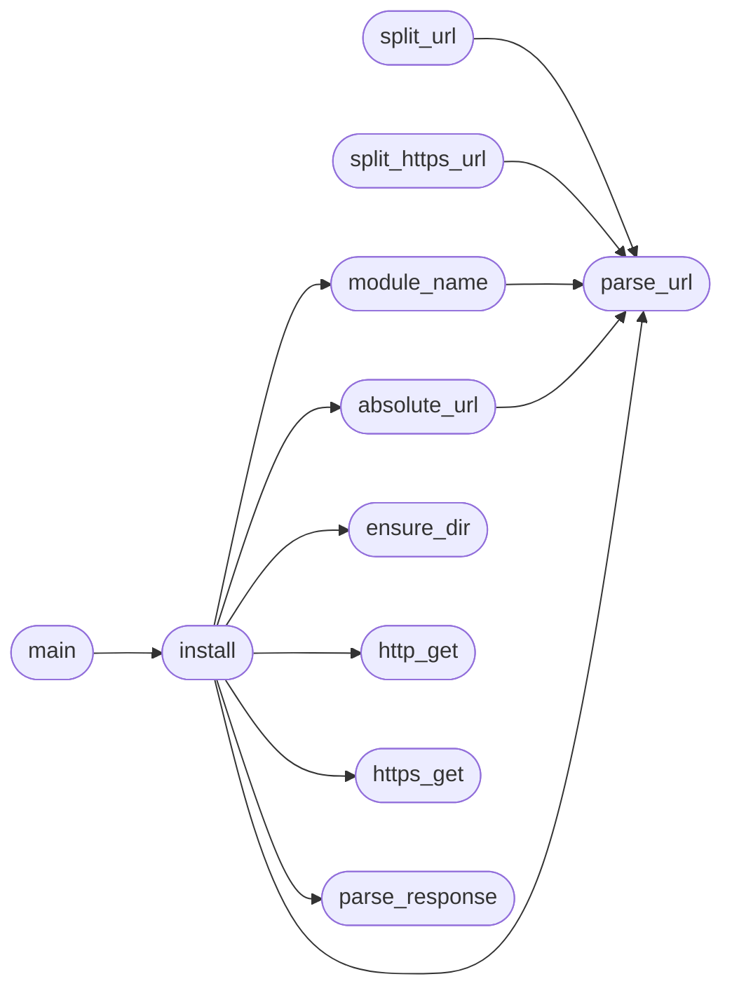

# `progs.micropython.variants.minios.lib.mip`

> Source: [progs/micropython/variants/minios/lib/mip.py:1](../../progs/micropython/variants/minios/lib/mip.py#L1) | language `py` | coverage 100.0% | [API index](../index.md)

mip.py -- MiniOS package installer (frozen module).

Minimal pip for the MiniOS MicroPython port: fetches one .py module over
HTTP (or HTTPS through the ring-3 TLS engine) and installs it into a
directory on sys.path. Frozen with the port (lib/manifest freeze), so it
is always importable.

Policy, fail closed:

- http and https only. Inside MiniOS, https runs `bin/tlsget` (the
  userspace TLS stack with pinned roots) through SYS_SPAWN and reads the
  captured response; on host CPython https raises OSError (no minios
  module), so host tests cover the http and refusal paths.
- one module per URL and the file name must be a bare identifier plus
  .py ([A-Za-z_][A-Za-z0-9_]*), so a hostile server cannot write outside
  dest (no traversal, subdirectories, percent escapes or dots).
- the download is written to <dest>/<name>.py.part and renamed on
  success: a failed fetch never leaves a half module on sys.path.
- HTTP/1.0 + Connection: close; chunked responses and mismatched
  Content-Length are refused; MAX_BODY caps the download.
- a successful install appends dest to sys.path so the module imports
  in the same session.

Usage inside MiniOS::

    import mip
    mip.install('http://host:8899/pkg.py')          # into ./lib
    mip.install('https://host/pkg.py', 'mylib')     # TLS through tlsget
    micropython -c "import mip; raise SystemExit(mip.main())" install <url>

## Contents

- **Functions:** [`parse_url`](#parse_url), [`split_url`](#split_url), [`split_https_url`](#split_https_url), [`module_name`](#module_name), [`parse_response`](#parse_response), [`absolute_url`](#absolute_url), [`http_get`](#http_get), [`ensure_dir`](#ensure_dir), [`https_get`](#https_get), [`install`](#install), [`main`](#main)
- **Constants:** [`DEFAULT_DEST`](#default_dest), [`HTTP_PORT_DEFAULT`](#http_port_default), [`HTTPS_PORT_DEFAULT`](#https_port_default), [`MAX_BODY`](#max_body), [`MAX_HEAD_BYTES`](#max_head_bytes), [`MAX_REDIRECTS`](#max_redirects), [`READ_CHUNK`](#read_chunk), [`SOCKET_TIMEOUT_S`](#socket_timeout_s), [`REDIRECT_STATUS`](#redirect_status), [`TLSGET_PATH`](#tlsget_path), [`TLSGET_OUT`](#tlsget_out), [`EEXIST`](#eexist)

## Call Graph

Solid arrows stay in this module, dashed arrows leave it.



## Functions

<a id="parse_url"></a>

### `parse_url`

`function` | [progs/micropython/variants/minios/lib/mip.py:49](../../progs/micropython/variants/minios/lib/mip.py#L49)

```python
def parse_url(url)
```

Split an http/https URL into (scheme, host, port, path).

Raises ValueError for any other scheme, a missing or malformed
authority, a port outside 1..65535, or control characters in the
host or path (request-line injection).

**Parameters**

| Name | Type | Default | Description |
|---|---|---|---|
| `url` |  |  |  |

**Raises**

- `ValueError`: (raised in the body, not documented)

*Called by:* [`absolute_url`](#absolute_url), [`install`](#install), [`module_name`](#module_name), [`split_https_url`](#split_https_url), [`split_url`](#split_url)

---

<a id="split_url"></a>

### `split_url`

`function` | [progs/micropython/variants/minios/lib/mip.py:98](../../progs/micropython/variants/minios/lib/mip.py#L98)

```python
def split_url(url)
```

Split an http URL into (host, port, path); https is refused here.

**Parameters**

| Name | Type | Default | Description |
|---|---|---|---|
| `url` |  |  |  |

**Raises**

- `ValueError`: (raised in the body, not documented)

*Calls:* [`parse_url`](#parse_url)

---

<a id="split_https_url"></a>

### `split_https_url`

`function` | [progs/micropython/variants/minios/lib/mip.py:106](../../progs/micropython/variants/minios/lib/mip.py#L106)

```python
def split_https_url(url)
```

Split an https URL into (host, port, path); http is refused here.

**Parameters**

| Name | Type | Default | Description |
|---|---|---|---|
| `url` |  |  |  |

**Raises**

- `ValueError`: (raised in the body, not documented)

*Calls:* [`parse_url`](#parse_url)

---

<a id="module_name"></a>

### `module_name`

`function` | [progs/micropython/variants/minios/lib/mip.py:114](../../progs/micropython/variants/minios/lib/mip.py#L114)

```python
def module_name(url)
```

Return the .py file name a URL installs, validating it is bare.

The last path segment (query and fragment dropped) must be
[A-Za-z_][A-Za-z0-9_]*.py and no path segment may be "." or "..";
anything else raises ValueError so a hostile URL cannot escape the
destination directory.

**Parameters**

| Name | Type | Default | Description |
|---|---|---|---|
| `url` |  |  |  |

**Raises**

- `ValueError`: (raised in the body, not documented)

*Calls:* [`parse_url`](#parse_url)

*Called by:* [`install`](#install)

---

<a id="parse_response"></a>

### `parse_response`

`function` | [progs/micropython/variants/minios/lib/mip.py:150](../../progs/micropython/variants/minios/lib/mip.py#L150)

```python
def parse_response(data)
```

Split one HTTP/1.x response into (status, headers, body).

Headers are lowercased keys with stripped values. Fails closed:
a missing terminator, malformed status line or header, a chunked
transfer-encoding, or a Content-Length that disagrees with the body
all raise ValueError.

**Parameters**

| Name | Type | Default | Description |
|---|---|---|---|
| `data` |  |  |  |

**Raises**

- `ValueError`: (raised in the body, not documented)

*Called by:* [`install`](#install)

---

<a id="absolute_url"></a>

### `absolute_url`

`function` | [progs/micropython/variants/minios/lib/mip.py:202](../../progs/micropython/variants/minios/lib/mip.py#L202)

```python
def absolute_url(base, location)
```

Resolve a redirect Location against base; http and https survive.

Absolute locations pass through unchanged (re-validated by the
caller's next parse_url), path-absolute locations keep base's scheme
and authority; truly relative locations raise ValueError.

**Parameters**

| Name | Type | Default | Description |
|---|---|---|---|
| `base` |  |  |  |
| `location` |  |  |  |

**Raises**

- `ValueError`: (raised in the body, not documented)

*Calls:* [`parse_url`](#parse_url)

*Called by:* [`install`](#install)

---

<a id="http_get"></a>

### `http_get`

`function` | [progs/micropython/variants/minios/lib/mip.py:222](../../progs/micropython/variants/minios/lib/mip.py#L222)

```python
def http_get(host, port, path)
```

Fetch http://host:port/path, returning the raw response bytes.

One HTTP/1.0 request with Connection: close, read to EOF over a
timed socket; the response is capped at MAX_BODY + MAX_HEAD_BYTES.

**Parameters**

| Name | Type | Default | Description |
|---|---|---|---|
| `host` |  |  |  |
| `port` |  |  |  |
| `path` |  |  |  |

**Raises**

- `OSError`: (raised in the body, not documented)
- `ValueError`: (raised in the body, not documented)

*Called by:* [`install`](#install)

---

<a id="ensure_dir"></a>

### `ensure_dir`

`function` | [progs/micropython/variants/minios/lib/mip.py:276](../../progs/micropython/variants/minios/lib/mip.py#L276)

```python
def ensure_dir(path)
```

Create path and its parents; existing directories are fine.

The final write reports real errors, so a mkdir refusal here is not
fatal (the directory may already exist).

**Parameters**

| Name | Type | Default | Description |
|---|---|---|---|
| `path` |  |  |  |

*Called by:* [`install`](#install)

---

<a id="https_get"></a>

### `https_get`

`function` | [progs/micropython/variants/minios/lib/mip.py:298](../../progs/micropython/variants/minios/lib/mip.py#L298)

```python
def https_get(host, port, path)
```

Fetch https://host:port/path through the ring-3 TLS engine.

Spawns bin/tlsget (the userspace TLS stack with pinned roots, the
same engine freedom uses) through the minios module's SYS_SPAWN and
reads the response from the capture file. -q keeps tlsget's success
diagnostic out of the capture, so the file holds exactly the raw
HTTP response. This is MiniOS-only: on host CPython there is no
minios module and OSError says so.

**Parameters**

| Name | Type | Default | Description |
|---|---|---|---|
| `host` |  |  |  |
| `port` |  |  |  |
| `path` |  |  |  |

**Raises**

- `OSError`: (raised in the body, not documented)
- `ValueError`: (raised in the body, not documented)

*Called by:* [`install`](#install)

---

<a id="install"></a>

### `install`

`function` | [progs/micropython/variants/minios/lib/mip.py:336](../../progs/micropython/variants/minios/lib/mip.py#L336)

```python
def install(url, dest=DEFAULT_DEST)
```

Fetch url and write it as <dest>/<module>.py; returns the path.

Follows up to MAX_REDIRECTS redirects across http and https;
refuses non-200 answers, unsafe module names and chunked responses.
The file appears atomically (write to .part, then rename) and dest
joins sys.path so the module imports in the same session.

**Parameters**

| Name | Type | Default | Description |
|---|---|---|---|
| `url` |  |  |  |
| `dest` |  | `DEFAULT_DEST` |  |

**Raises**

- `OSError`: (raised in the body, not documented)
- `ValueError`: (raised in the body, not documented)

*Calls:* [`absolute_url`](#absolute_url), [`ensure_dir`](#ensure_dir), [`http_get`](#http_get), [`https_get`](#https_get), [`module_name`](#module_name), [`parse_response`](#parse_response), [`parse_url`](#parse_url)

*Called by:* [`main`](#main)

---

<a id="main"></a>

### `main`

`function` | [progs/micropython/variants/minios/lib/mip.py:394](../../progs/micropython/variants/minios/lib/mip.py#L394)

```python
def main(argv=None)
```

CLI entry point: install <url> [dest]; returns the exit code.

MicroPython's -c puts the code first in sys.argv and every argument
after it next, so the shell form is::

    micropython -c "import mip; raise SystemExit(mip.main())" install <url> [dest]

**Parameters**

| Name | Type | Default | Description |
|---|---|---|---|
| `argv` |  | `None` |  |

*Calls:* [`install`](#install)

---

## Constants

<a id="default_dest"></a>

### `DEFAULT_DEST`

`constant` | [progs/micropython/variants/minios/lib/mip.py:35](../../progs/micropython/variants/minios/lib/mip.py#L35)

```python
DEFAULT_DEST = 'lib'
```

---

<a id="http_port_default"></a>

### `HTTP_PORT_DEFAULT`

`constant` | [progs/micropython/variants/minios/lib/mip.py:36](../../progs/micropython/variants/minios/lib/mip.py#L36)

```python
HTTP_PORT_DEFAULT = 80
```

---

<a id="https_port_default"></a>

### `HTTPS_PORT_DEFAULT`

`constant` | [progs/micropython/variants/minios/lib/mip.py:37](../../progs/micropython/variants/minios/lib/mip.py#L37)

```python
HTTPS_PORT_DEFAULT = 443
```

---

<a id="max_body"></a>

### `MAX_BODY`

`constant` | [progs/micropython/variants/minios/lib/mip.py:38](../../progs/micropython/variants/minios/lib/mip.py#L38)

```python
MAX_BODY = 262144
```

---

<a id="max_head_bytes"></a>

### `MAX_HEAD_BYTES`

`constant` | [progs/micropython/variants/minios/lib/mip.py:39](../../progs/micropython/variants/minios/lib/mip.py#L39)

```python
MAX_HEAD_BYTES = 8192
```

---

<a id="max_redirects"></a>

### `MAX_REDIRECTS`

`constant` | [progs/micropython/variants/minios/lib/mip.py:40](../../progs/micropython/variants/minios/lib/mip.py#L40)

```python
MAX_REDIRECTS = 3
```

---

<a id="read_chunk"></a>

### `READ_CHUNK`

`constant` | [progs/micropython/variants/minios/lib/mip.py:41](../../progs/micropython/variants/minios/lib/mip.py#L41)

```python
READ_CHUNK = 4096
```

---

<a id="socket_timeout_s"></a>

### `SOCKET_TIMEOUT_S`

`constant` | [progs/micropython/variants/minios/lib/mip.py:42](../../progs/micropython/variants/minios/lib/mip.py#L42)

```python
SOCKET_TIMEOUT_S = 10.0
```

---

<a id="redirect_status"></a>

### `REDIRECT_STATUS`

`constant` | [progs/micropython/variants/minios/lib/mip.py:43](../../progs/micropython/variants/minios/lib/mip.py#L43)

```python
REDIRECT_STATUS = (301, 302, 303, 307, 308)
```

---

<a id="tlsget_path"></a>

### `TLSGET_PATH`

`constant` | [progs/micropython/variants/minios/lib/mip.py:44](../../progs/micropython/variants/minios/lib/mip.py#L44)

```python
TLSGET_PATH = '/bin/tlsget'
```

---

<a id="tlsget_out"></a>

### `TLSGET_OUT`

`constant` | [progs/micropython/variants/minios/lib/mip.py:45](../../progs/micropython/variants/minios/lib/mip.py#L45)

```python
TLSGET_OUT = '/tmp/mip_tlsget.out'
```

---

<a id="eexist"></a>

### `EEXIST`

`constant` | [progs/micropython/variants/minios/lib/mip.py:46](../../progs/micropython/variants/minios/lib/mip.py#L46)

```python
EEXIST = 17
```

---
