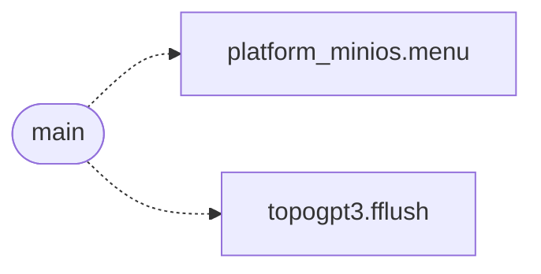

# `progs/minicraft/minicraft.c`

> Source: [progs/minicraft/minicraft.c:1](../../progs/minicraft/minicraft.c#L1) | language `c` | coverage 7.0% | [API index](../index.md)

minicraft.c - Minecraft-like voxel walker for MiniOS (ring 3, static ELF).

## Contents

- **Structs:** [`Recipe`](#recipe), [`Pig`](#pig), [`RayHit`](#rayhit), [`SaveHeaderV3`](#saveheaderv3), [`SaveHeader`](#saveheader), [`ChunkHeader`](#chunkheader)
- **Functions:** [`main`](#main)
- **Macros:** [`MC_CHUNK`](#mc_chunk), [`MC_LOAD_R`](#mc_load_r), [`MC_CHUNKS`](#mc_chunks), [`MC_CVOL`](#mc_cvol), [`MC_COLS`](#mc_cols), [`FB_W`](#fb_w), [`BACKBUF`](#backbuf), [`BACKBUF`](#backbuf), [`SAVE_PATH`](#save_path), [`SAVE_TMP_PATH`](#save_tmp_path), [`MC_SAVE_MAGIC`](#mc_save_magic), [`MC_SAVE_VERSION`](#mc_save_version), [`MC_SAVE_CRC_SEED`](#mc_save_crc_seed), [`MC_CHUNK_MAGIC`](#mc_chunk_magic), [`MC_CHUNK_VERSION`](#mc_chunk_version), [`MC_EYE`](#mc_eye), [`MC_GRAV`](#mc_grav), [`MC_JUMP`](#mc_jump), [`MC_MAXFALL`](#mc_maxfall), [`MC_SPEED`](#mc_speed), [`MC_FLY_SPEED`](#mc_fly_speed), [`MC_SPRINT`](#mc_sprint), [`MC_MOUSE`](#mc_mouse), [`MC_REACH`](#mc_reach), [`MC_VIEW`](#mc_view), [`MC_DDA_STEPS`](#mc_dda_steps), [`MC_BREAK_MS`](#mc_break_ms), [`MC_BREAK_GRACE_MS`](#mc_break_grace_ms), [`MC_PLACE_MS`](#mc_place_ms), [`MC_WATER_GRAV`](#mc_water_grav), [`MC_WATER_SINK`](#mc_water_sink), [`MC_WATER_SWIM`](#mc_water_swim), [`MC_INV_MAX`](#mc_inv_max), [`MC_PITCH_MAX`](#mc_pitch_max), [`MC_AUTOSTEP`](#mc_autostep), [`MC_HP_MAX`](#mc_hp_max), [`MC_PIGS`](#mc_pigs), [`MC_CREEPS_MAX`](#mc_creeps_max), [`MC_CREEPS_DEF`](#mc_creeps_def), [`MC_CREEP_HP`](#mc_creep_hp), [`MC_FUSE_MS`](#mc_fuse_ms), [`MC_BOOM_R`](#mc_boom_r), [`MC_CREEP_SENSE`](#mc_creep_sense), [`MC_CREEP_DZ_MAX`](#mc_creep_dz_max), [`MC_CREEP_FUSE_D`](#mc_creep_fuse_d), [`MC_CREEP_DEFUSE_D`](#mc_creep_defuse_d), [`MC_RESPAWN_MS`](#mc_respawn_ms), [`MC_CREEP_NIGHT_MS`](#mc_creep_night_ms), [`MC_PIG_DAY_MS`](#mc_pig_day_ms), [`MC_NIGHT_LIGHT`](#mc_night_light), [`MC_CREEP_SEP_D`](#mc_creep_sep_d), [`MC_PORK_HEAL`](#mc_pork_heal), [`MC_HUNGER_MAX`](#mc_hunger_max), [`MC_HUNGER_MS`](#mc_hunger_ms), [`MC_PIG_HP`](#mc_pig_hp), [`MC_PIG_HURT_MS`](#mc_pig_hurt_ms), [`MC_DAY_MS`](#mc_day_ms), [`MC_SAVE_SECS`](#mc_save_secs), [`MC_BAYER_N`](#mc_bayer_n), [`MC_H_BASE`](#mc_h_base), [`MC_H_WT_DET`](#mc_h_wt_det), [`MC_H_WT_MID`](#mc_h_wt_mid), [`MC_H_WT_COARSE`](#mc_h_wt_coarse), [`SC_ESC`](#sc_esc), [`SC_1`](#sc_1), [`SC_9`](#sc_9), [`SC_Q`](#sc_q), [`SC_W`](#sc_w), [`SC_E`](#sc_e), [`SC_R`](#sc_r), [`SC_T`](#sc_t), [`SC_U`](#sc_u), [`SC_I`](#sc_i), [`SC_O`](#sc_o), [`SC_P`](#sc_p), [`SC_J`](#sc_j), [`SC_A`](#sc_a), [`SC_S`](#sc_s), [`SC_D`](#sc_d), [`SC_F`](#sc_f), [`SC_G`](#sc_g), [`SC_K`](#sc_k), [`SC_L`](#sc_l), [`SC_C`](#sc_c), [`SC_V`](#sc_v), [`SC_B`](#sc_b), [`SC_N`](#sc_n), [`SC_ENTER`](#sc_enter), [`SC_BACK`](#sc_back), [`SC_0`](#sc_0), [`MC_SEED_MAX`](#mc_seed_max), [`MC_KBD_SEQ_SPINS`](#mc_kbd_seq_spins), [`SC_SPACE`](#sc_space), [`SC_LSHIFT`](#sc_lshift), [`SC_RSHIFT`](#sc_rshift), [`SC_CTRL`](#sc_ctrl), [`EXT_UP`](#ext_up), [`EXT_DOWN`](#ext_down), [`EXT_LEFT`](#ext_left), [`EXT_RIGHT`](#ext_right), [`EXT_F11`](#ext_f11), [`MOB_PIG`](#mob_pig), [`MOB_CREEP`](#mob_creep), [`SER_STASH_CAP`](#ser_stash_cap), [`MC_VORO_DESERT_CELL`](#mc_voro_desert_cell), [`MC_VORO_SNOW_CELL`](#mc_voro_snow_cell), [`MC_LEGACY_WORLD`](#mc_legacy_world)

## Type Diagram


## Call Graph

Solid arrows stay in this module, dashed arrows leave it.



## Structs

<a id="recipe"></a>

### `Recipe`

`struct` | [progs/minicraft/minicraft.c:216](../../progs/minicraft/minicraft.c#L216)

```c
typedef struct
```

---

<a id="pig"></a>

### `Pig`

`struct` | [progs/minicraft/minicraft.c:295](../../progs/minicraft/minicraft.c#L295)

```c
typedef struct
```

---

<a id="rayhit"></a>

### `RayHit`

`struct` | [progs/minicraft/minicraft.c:1650](../../progs/minicraft/minicraft.c#L1650)

```c
typedef struct
```

---

<a id="saveheaderv3"></a>

### `SaveHeaderV3`

`struct` | [progs/minicraft/minicraft.c:2878](../../progs/minicraft/minicraft.c#L2878)

```c
typedef struct
```

Frozen v3 header (saves already on disk); v4 appends mobs_n.

---

<a id="saveheader"></a>

### `SaveHeader`

`struct` | [progs/minicraft/minicraft.c:2892](../../progs/minicraft/minicraft.c#L2892)

```c
typedef struct
```

---

<a id="chunkheader"></a>

### `ChunkHeader`

`struct` | [progs/minicraft/minicraft.c:2907](../../progs/minicraft/minicraft.c#L2907)

```c
typedef struct
```

---

## Functions

<a id="main"></a>

### `main`

`function` | [progs/minicraft/minicraft.c:4095](../../progs/minicraft/minicraft.c#L4095)

```c
int main(int argc, char **argv)
```

**Parameters**

| Name | Type | Default | Description |
|---|---|---|---|
| `argc` | `int` |  |  |
| `argv` | `char **` |  |  |

**Returns:** `int`

*Calls:* [`menu`](progs.pokemon.platform_minios.c.md#menu), [`fflush`](progs.topogpt3.topogpt3.c.md#fflush)

---

## Macros

<a id="mc_chunk"></a>

### `MC_CHUNK`

`macro` | [progs/minicraft/minicraft.c:35](../../progs/minicraft/minicraft.c#L35)

```c
#define MC_CHUNK
```

---

<a id="mc_load_r"></a>

### `MC_LOAD_R`

`macro` | [progs/minicraft/minicraft.c:36](../../progs/minicraft/minicraft.c#L36)

```c
#define MC_LOAD_R
```

---

<a id="mc_chunks"></a>

### `MC_CHUNKS`

`macro` | [progs/minicraft/minicraft.c:37](../../progs/minicraft/minicraft.c#L37)

```c
#define MC_CHUNKS
```

---

<a id="mc_cvol"></a>

### `MC_CVOL`

`macro` | [progs/minicraft/minicraft.c:38](../../progs/minicraft/minicraft.c#L38)

```c
#define MC_CVOL
```

---

<a id="mc_cols"></a>

### `MC_COLS`

`macro` | [progs/minicraft/minicraft.c:39](../../progs/minicraft/minicraft.c#L39)

```c
#define MC_COLS
```

---

<a id="fb_w"></a>

### `FB_W`

`macro` | [progs/minicraft/minicraft.c:41](../../progs/minicraft/minicraft.c#L41)

```c
#define FB_W
```

---

<a id="backbuf"></a>

### `BACKBUF`

`macro` | [progs/minicraft/minicraft.c:45](../../progs/minicraft/minicraft.c#L45)

```c
#define BACKBUF
```

---

<a id="backbuf"></a>

### `BACKBUF`

`macro` | [progs/minicraft/minicraft.c:47](../../progs/minicraft/minicraft.c#L47)

```c
#define BACKBUF
```

---

<a id="save_path"></a>

### `SAVE_PATH`

`macro` | [progs/minicraft/minicraft.c:50](../../progs/minicraft/minicraft.c#L50)

```c
#define SAVE_PATH
```

---

<a id="save_tmp_path"></a>

### `SAVE_TMP_PATH`

`macro` | [progs/minicraft/minicraft.c:51](../../progs/minicraft/minicraft.c#L51)

```c
#define SAVE_TMP_PATH
```

---

<a id="mc_save_magic"></a>

### `MC_SAVE_MAGIC`

`macro` | [progs/minicraft/minicraft.c:52](../../progs/minicraft/minicraft.c#L52)

```c
#define MC_SAVE_MAGIC
```

---

<a id="mc_save_version"></a>

### `MC_SAVE_VERSION`

`macro` | [progs/minicraft/minicraft.c:53](../../progs/minicraft/minicraft.c#L53)

```c
#define MC_SAVE_VERSION
```

---

<a id="mc_save_crc_seed"></a>

### `MC_SAVE_CRC_SEED`

`macro` | [progs/minicraft/minicraft.c:54](../../progs/minicraft/minicraft.c#L54)

```c
#define MC_SAVE_CRC_SEED
```

---

<a id="mc_chunk_magic"></a>

### `MC_CHUNK_MAGIC`

`macro` | [progs/minicraft/minicraft.c:55](../../progs/minicraft/minicraft.c#L55)

```c
#define MC_CHUNK_MAGIC
```

---

<a id="mc_chunk_version"></a>

### `MC_CHUNK_VERSION`

`macro` | [progs/minicraft/minicraft.c:56](../../progs/minicraft/minicraft.c#L56)

```c
#define MC_CHUNK_VERSION
```

---

<a id="mc_eye"></a>

### `MC_EYE`

`macro` | [progs/minicraft/minicraft.c:59](../../progs/minicraft/minicraft.c#L59)

```c
#define MC_EYE
```

Tunables: every magic lives here, never scattered in logic.

---

<a id="mc_grav"></a>

### `MC_GRAV`

`macro` | [progs/minicraft/minicraft.c:60](../../progs/minicraft/minicraft.c#L60)

```c
#define MC_GRAV
```

---

<a id="mc_jump"></a>

### `MC_JUMP`

`macro` | [progs/minicraft/minicraft.c:61](../../progs/minicraft/minicraft.c#L61)

```c
#define MC_JUMP
```

---

<a id="mc_maxfall"></a>

### `MC_MAXFALL`

`macro` | [progs/minicraft/minicraft.c:62](../../progs/minicraft/minicraft.c#L62)

```c
#define MC_MAXFALL
```

---

<a id="mc_speed"></a>

### `MC_SPEED`

`macro` | [progs/minicraft/minicraft.c:63](../../progs/minicraft/minicraft.c#L63)

```c
#define MC_SPEED
```

---

<a id="mc_fly_speed"></a>

### `MC_FLY_SPEED`

`macro` | [progs/minicraft/minicraft.c:64](../../progs/minicraft/minicraft.c#L64)

```c
#define MC_FLY_SPEED
```

---

<a id="mc_sprint"></a>

### `MC_SPRINT`

`macro` | [progs/minicraft/minicraft.c:65](../../progs/minicraft/minicraft.c#L65)

```c
#define MC_SPRINT
```

---

<a id="mc_mouse"></a>

### `MC_MOUSE`

`macro` | [progs/minicraft/minicraft.c:66](../../progs/minicraft/minicraft.c#L66)

```c
#define MC_MOUSE
```

---

<a id="mc_reach"></a>

### `MC_REACH`

`macro` | [progs/minicraft/minicraft.c:67](../../progs/minicraft/minicraft.c#L67)

```c
#define MC_REACH
```

---

<a id="mc_view"></a>

### `MC_VIEW`

`macro` | [progs/minicraft/minicraft.c:68](../../progs/minicraft/minicraft.c#L68)

```c
#define MC_VIEW
```

---

<a id="mc_dda_steps"></a>

### `MC_DDA_STEPS`

`macro` | [progs/minicraft/minicraft.c:69](../../progs/minicraft/minicraft.c#L69)

```c
#define MC_DDA_STEPS
```

---

<a id="mc_break_ms"></a>

### `MC_BREAK_MS`

`macro` | [progs/minicraft/minicraft.c:70](../../progs/minicraft/minicraft.c#L70)

```c
#define MC_BREAK_MS
```

---

<a id="mc_break_grace_ms"></a>

### `MC_BREAK_GRACE_MS`

`macro` | [progs/minicraft/minicraft.c:71](../../progs/minicraft/minicraft.c#L71)

```c
#define MC_BREAK_GRACE_MS
```

---

<a id="mc_place_ms"></a>

### `MC_PLACE_MS`

`macro` | [progs/minicraft/minicraft.c:72](../../progs/minicraft/minicraft.c#L72)

```c
#define MC_PLACE_MS
```

---

<a id="mc_water_grav"></a>

### `MC_WATER_GRAV`

`macro` | [progs/minicraft/minicraft.c:73](../../progs/minicraft/minicraft.c#L73)

```c
#define MC_WATER_GRAV
```

---

<a id="mc_water_sink"></a>

### `MC_WATER_SINK`

`macro` | [progs/minicraft/minicraft.c:74](../../progs/minicraft/minicraft.c#L74)

```c
#define MC_WATER_SINK
```

---

<a id="mc_water_swim"></a>

### `MC_WATER_SWIM`

`macro` | [progs/minicraft/minicraft.c:75](../../progs/minicraft/minicraft.c#L75)

```c
#define MC_WATER_SWIM
```

---

<a id="mc_inv_max"></a>

### `MC_INV_MAX`

`macro` | [progs/minicraft/minicraft.c:76](../../progs/minicraft/minicraft.c#L76)

```c
#define MC_INV_MAX
```

---

<a id="mc_pitch_max"></a>

### `MC_PITCH_MAX`

`macro` | [progs/minicraft/minicraft.c:77](../../progs/minicraft/minicraft.c#L77)

```c
#define MC_PITCH_MAX
```

---

<a id="mc_autostep"></a>

### `MC_AUTOSTEP`

`macro` | [progs/minicraft/minicraft.c:78](../../progs/minicraft/minicraft.c#L78)

```c
#define MC_AUTOSTEP
```

---

<a id="mc_hp_max"></a>

### `MC_HP_MAX`

`macro` | [progs/minicraft/minicraft.c:79](../../progs/minicraft/minicraft.c#L79)

```c
#define MC_HP_MAX
```

---

<a id="mc_pigs"></a>

### `MC_PIGS`

`macro` | [progs/minicraft/minicraft.c:80](../../progs/minicraft/minicraft.c#L80)

```c
#define MC_PIGS
```

---

<a id="mc_creeps_max"></a>

### `MC_CREEPS_MAX`

`macro` | [progs/minicraft/minicraft.c:81](../../progs/minicraft/minicraft.c#L81)

```c
#define MC_CREEPS_MAX
```

---

<a id="mc_creeps_def"></a>

### `MC_CREEPS_DEF`

`macro` | [progs/minicraft/minicraft.c:82](../../progs/minicraft/minicraft.c#L82)

```c
#define MC_CREEPS_DEF
```

---

<a id="mc_creep_hp"></a>

### `MC_CREEP_HP`

`macro` | [progs/minicraft/minicraft.c:83](../../progs/minicraft/minicraft.c#L83)

```c
#define MC_CREEP_HP
```

---

<a id="mc_fuse_ms"></a>

### `MC_FUSE_MS`

`macro` | [progs/minicraft/minicraft.c:84](../../progs/minicraft/minicraft.c#L84)

```c
#define MC_FUSE_MS
```

---

<a id="mc_boom_r"></a>

### `MC_BOOM_R`

`macro` | [progs/minicraft/minicraft.c:85](../../progs/minicraft/minicraft.c#L85)

```c
#define MC_BOOM_R
```

---

<a id="mc_creep_sense"></a>

### `MC_CREEP_SENSE`

`macro` | [progs/minicraft/minicraft.c:88](../../progs/minicraft/minicraft.c#L88)

```c
#define MC_CREEP_SENSE
```

Creeper senses: 3D range, vertical gate (no oler al que vuela alto), fuse only on 3D contact, defuse past the wider radius or the gate.

---

<a id="mc_creep_dz_max"></a>

### `MC_CREEP_DZ_MAX`

`macro` | [progs/minicraft/minicraft.c:89](../../progs/minicraft/minicraft.c#L89)

```c
#define MC_CREEP_DZ_MAX
```

---

<a id="mc_creep_fuse_d"></a>

### `MC_CREEP_FUSE_D`

`macro` | [progs/minicraft/minicraft.c:90](../../progs/minicraft/minicraft.c#L90)

```c
#define MC_CREEP_FUSE_D
```

---

<a id="mc_creep_defuse_d"></a>

### `MC_CREEP_DEFUSE_D`

`macro` | [progs/minicraft/minicraft.c:91](../../progs/minicraft/minicraft.c#L91)

```c
#define MC_CREEP_DEFUSE_D
```

---

<a id="mc_respawn_ms"></a>

### `MC_RESPAWN_MS`

`macro` | [progs/minicraft/minicraft.c:98](../../progs/minicraft/minicraft.c#L98)

```c
#define MC_RESPAWN_MS
```

Dead mobs come back after MC_RESPAWN_MS; at night (day_light below MC_NIGHT_LIGHT, the same dusk threshold the chase speed uses) dead creepers regenerate after MC_CREEP_NIGHT_MS instead, so the dark stays dangerous, while by day (day_light at or above the threshold) dead pigs regenerate after MC_PIG_DAY_MS instead, so there is always pork around to hunt and heal (MC_PORK_HEAL).

---

<a id="mc_creep_night_ms"></a>

### `MC_CREEP_NIGHT_MS`

`macro` | [progs/minicraft/minicraft.c:99](../../progs/minicraft/minicraft.c#L99)

```c
#define MC_CREEP_NIGHT_MS
```

---

<a id="mc_pig_day_ms"></a>

### `MC_PIG_DAY_MS`

`macro` | [progs/minicraft/minicraft.c:100](../../progs/minicraft/minicraft.c#L100)

```c
#define MC_PIG_DAY_MS
```

---

<a id="mc_night_light"></a>

### `MC_NIGHT_LIGHT`

`macro` | [progs/minicraft/minicraft.c:101](../../progs/minicraft/minicraft.c#L101)

```c
#define MC_NIGHT_LIGHT
```

---

<a id="mc_creep_sep_d"></a>

### `MC_CREEP_SEP_D`

`macro` | [progs/minicraft/minicraft.c:102](../../progs/minicraft/minicraft.c#L102)

```c
#define MC_CREEP_SEP_D
```

---

<a id="mc_pork_heal"></a>

### `MC_PORK_HEAL`

`macro` | [progs/minicraft/minicraft.c:103](../../progs/minicraft/minicraft.c#L103)

```c
#define MC_PORK_HEAL
```

---

<a id="mc_hunger_max"></a>

### `MC_HUNGER_MAX`

`macro` | [progs/minicraft/minicraft.c:104](../../progs/minicraft/minicraft.c#L104)

```c
#define MC_HUNGER_MAX
```

---

<a id="mc_hunger_ms"></a>

### `MC_HUNGER_MS`

`macro` | [progs/minicraft/minicraft.c:105](../../progs/minicraft/minicraft.c#L105)

```c
#define MC_HUNGER_MS
```

---

<a id="mc_pig_hp"></a>

### `MC_PIG_HP`

`macro` | [progs/minicraft/minicraft.c:106](../../progs/minicraft/minicraft.c#L106)

```c
#define MC_PIG_HP
```

---

<a id="mc_pig_hurt_ms"></a>

### `MC_PIG_HURT_MS`

`macro` | [progs/minicraft/minicraft.c:107](../../progs/minicraft/minicraft.c#L107)

```c
#define MC_PIG_HURT_MS
```

---

<a id="mc_day_ms"></a>

### `MC_DAY_MS`

`macro` | [progs/minicraft/minicraft.c:108](../../progs/minicraft/minicraft.c#L108)

```c
#define MC_DAY_MS
```

---

<a id="mc_save_secs"></a>

### `MC_SAVE_SECS`

`macro` | [progs/minicraft/minicraft.c:109](../../progs/minicraft/minicraft.c#L109)

```c
#define MC_SAVE_SECS
```

---

<a id="mc_bayer_n"></a>

### `MC_BAYER_N`

`macro` | [progs/minicraft/minicraft.c:110](../../progs/minicraft/minicraft.c#L110)

```c
#define MC_BAYER_N
```

---

<a id="mc_h_base"></a>

### `MC_H_BASE`

`macro` | [progs/minicraft/minicraft.c:111](../../progs/minicraft/minicraft.c#L111)

```c
#define MC_H_BASE
```

---

<a id="mc_h_wt_det"></a>

### `MC_H_WT_DET`

`macro` | [progs/minicraft/minicraft.c:112](../../progs/minicraft/minicraft.c#L112)

```c
#define MC_H_WT_DET
```

---

<a id="mc_h_wt_mid"></a>

### `MC_H_WT_MID`

`macro` | [progs/minicraft/minicraft.c:113](../../progs/minicraft/minicraft.c#L113)

```c
#define MC_H_WT_MID
```

---

<a id="mc_h_wt_coarse"></a>

### `MC_H_WT_COARSE`

`macro` | [progs/minicraft/minicraft.c:114](../../progs/minicraft/minicraft.c#L114)

```c
#define MC_H_WT_COARSE
```

---

<a id="sc_esc"></a>

### `SC_ESC`

`macro` | [progs/minicraft/minicraft.c:117](../../progs/minicraft/minicraft.c#L117)

```c
#define SC_ESC
```

Named scancodes (Set 1): no bare 0x11/0x01 in logic.

---

<a id="sc_1"></a>

### `SC_1`

`macro` | [progs/minicraft/minicraft.c:118](../../progs/minicraft/minicraft.c#L118)

```c
#define SC_1
```

---

<a id="sc_9"></a>

### `SC_9`

`macro` | [progs/minicraft/minicraft.c:119](../../progs/minicraft/minicraft.c#L119)

```c
#define SC_9
```

---

<a id="sc_q"></a>

### `SC_Q`

`macro` | [progs/minicraft/minicraft.c:120](../../progs/minicraft/minicraft.c#L120)

```c
#define SC_Q
```

---

<a id="sc_w"></a>

### `SC_W`

`macro` | [progs/minicraft/minicraft.c:121](../../progs/minicraft/minicraft.c#L121)

```c
#define SC_W
```

---

<a id="sc_e"></a>

### `SC_E`

`macro` | [progs/minicraft/minicraft.c:122](../../progs/minicraft/minicraft.c#L122)

```c
#define SC_E
```

---

<a id="sc_r"></a>

### `SC_R`

`macro` | [progs/minicraft/minicraft.c:123](../../progs/minicraft/minicraft.c#L123)

```c
#define SC_R
```

---

<a id="sc_t"></a>

### `SC_T`

`macro` | [progs/minicraft/minicraft.c:124](../../progs/minicraft/minicraft.c#L124)

```c
#define SC_T
```

---

<a id="sc_u"></a>

### `SC_U`

`macro` | [progs/minicraft/minicraft.c:125](../../progs/minicraft/minicraft.c#L125)

```c
#define SC_U
```

---

<a id="sc_i"></a>

### `SC_I`

`macro` | [progs/minicraft/minicraft.c:126](../../progs/minicraft/minicraft.c#L126)

```c
#define SC_I
```

---

<a id="sc_o"></a>

### `SC_O`

`macro` | [progs/minicraft/minicraft.c:127](../../progs/minicraft/minicraft.c#L127)

```c
#define SC_O
```

---

<a id="sc_p"></a>

### `SC_P`

`macro` | [progs/minicraft/minicraft.c:128](../../progs/minicraft/minicraft.c#L128)

```c
#define SC_P
```

---

<a id="sc_j"></a>

### `SC_J`

`macro` | [progs/minicraft/minicraft.c:129](../../progs/minicraft/minicraft.c#L129)

```c
#define SC_J
```

---

<a id="sc_a"></a>

### `SC_A`

`macro` | [progs/minicraft/minicraft.c:130](../../progs/minicraft/minicraft.c#L130)

```c
#define SC_A
```

---

<a id="sc_s"></a>

### `SC_S`

`macro` | [progs/minicraft/minicraft.c:131](../../progs/minicraft/minicraft.c#L131)

```c
#define SC_S
```

---

<a id="sc_d"></a>

### `SC_D`

`macro` | [progs/minicraft/minicraft.c:132](../../progs/minicraft/minicraft.c#L132)

```c
#define SC_D
```

---

<a id="sc_f"></a>

### `SC_F`

`macro` | [progs/minicraft/minicraft.c:133](../../progs/minicraft/minicraft.c#L133)

```c
#define SC_F
```

---

<a id="sc_g"></a>

### `SC_G`

`macro` | [progs/minicraft/minicraft.c:134](../../progs/minicraft/minicraft.c#L134)

```c
#define SC_G
```

---

<a id="sc_k"></a>

### `SC_K`

`macro` | [progs/minicraft/minicraft.c:135](../../progs/minicraft/minicraft.c#L135)

```c
#define SC_K
```

---

<a id="sc_l"></a>

### `SC_L`

`macro` | [progs/minicraft/minicraft.c:136](../../progs/minicraft/minicraft.c#L136)

```c
#define SC_L
```

---

<a id="sc_c"></a>

### `SC_C`

`macro` | [progs/minicraft/minicraft.c:137](../../progs/minicraft/minicraft.c#L137)

```c
#define SC_C
```

---

<a id="sc_v"></a>

### `SC_V`

`macro` | [progs/minicraft/minicraft.c:138](../../progs/minicraft/minicraft.c#L138)

```c
#define SC_V
```

---

<a id="sc_b"></a>

### `SC_B`

`macro` | [progs/minicraft/minicraft.c:139](../../progs/minicraft/minicraft.c#L139)

```c
#define SC_B
```

---

<a id="sc_n"></a>

### `SC_N`

`macro` | [progs/minicraft/minicraft.c:140](../../progs/minicraft/minicraft.c#L140)

```c
#define SC_N
```

---

<a id="sc_enter"></a>

### `SC_ENTER`

`macro` | [progs/minicraft/minicraft.c:141](../../progs/minicraft/minicraft.c#L141)

```c
#define SC_ENTER
```

---

<a id="sc_back"></a>

### `SC_BACK`

`macro` | [progs/minicraft/minicraft.c:142](../../progs/minicraft/minicraft.c#L142)

```c
#define SC_BACK
```

---

<a id="sc_0"></a>

### `SC_0`

`macro` | [progs/minicraft/minicraft.c:143](../../progs/minicraft/minicraft.c#L143)

```c
#define SC_0
```

---

<a id="mc_seed_max"></a>

### `MC_SEED_MAX`

`macro` | [progs/minicraft/minicraft.c:144](../../progs/minicraft/minicraft.c#L144)

```c
#define MC_SEED_MAX
```

---

<a id="mc_kbd_seq_spins"></a>

### `MC_KBD_SEQ_SPINS`

`macro` | [progs/minicraft/minicraft.c:145](../../progs/minicraft/minicraft.c#L145)

```c
#define MC_KBD_SEQ_SPINS
```

---

<a id="sc_space"></a>

### `SC_SPACE`

`macro` | [progs/minicraft/minicraft.c:146](../../progs/minicraft/minicraft.c#L146)

```c
#define SC_SPACE
```

---

<a id="sc_lshift"></a>

### `SC_LSHIFT`

`macro` | [progs/minicraft/minicraft.c:147](../../progs/minicraft/minicraft.c#L147)

```c
#define SC_LSHIFT
```

---

<a id="sc_rshift"></a>

### `SC_RSHIFT`

`macro` | [progs/minicraft/minicraft.c:148](../../progs/minicraft/minicraft.c#L148)

```c
#define SC_RSHIFT
```

---

<a id="sc_ctrl"></a>

### `SC_CTRL`

`macro` | [progs/minicraft/minicraft.c:149](../../progs/minicraft/minicraft.c#L149)

```c
#define SC_CTRL
```

---

<a id="ext_up"></a>

### `EXT_UP`

`macro` | [progs/minicraft/minicraft.c:150](../../progs/minicraft/minicraft.c#L150)

```c
#define EXT_UP
```

---

<a id="ext_down"></a>

### `EXT_DOWN`

`macro` | [progs/minicraft/minicraft.c:151](../../progs/minicraft/minicraft.c#L151)

```c
#define EXT_DOWN
```

---

<a id="ext_left"></a>

### `EXT_LEFT`

`macro` | [progs/minicraft/minicraft.c:152](../../progs/minicraft/minicraft.c#L152)

```c
#define EXT_LEFT
```

---

<a id="ext_right"></a>

### `EXT_RIGHT`

`macro` | [progs/minicraft/minicraft.c:153](../../progs/minicraft/minicraft.c#L153)

```c
#define EXT_RIGHT
```

---

<a id="ext_f11"></a>

### `EXT_F11`

`macro` | [progs/minicraft/minicraft.c:154](../../progs/minicraft/minicraft.c#L154)

```c
#define EXT_F11
```

---

<a id="mob_pig"></a>

### `MOB_PIG`

`macro` | [progs/minicraft/minicraft.c:308](../../progs/minicraft/minicraft.c#L308)

```c
#define MOB_PIG
```

---

<a id="mob_creep"></a>

### `MOB_CREEP`

`macro` | [progs/minicraft/minicraft.c:309](../../progs/minicraft/minicraft.c#L309)

```c
#define MOB_CREEP
```

---

<a id="ser_stash_cap"></a>

### `SER_STASH_CAP`

`macro` | [progs/minicraft/minicraft.c:369](../../progs/minicraft/minicraft.c#L369)

```c
#define SER_STASH_CAP
```

Serial stash: the game loop must not eat the pause menu's bytes.

GETC_RAW consumes with no peek, so non-ESC bytes skipped in game wait here in order for the menus; menus always read through here, never past it. Bounded and app-local.

---

<a id="mc_voro_desert_cell"></a>

### `MC_VORO_DESERT_CELL`

`macro` | [progs/minicraft/minicraft.c:858](../../progs/minicraft/minicraft.c#L858)

```c
#define MC_VORO_DESERT_CELL
```

Voronoi (Worley) biomes: each lattice cell owns one jittered site; the query belongs to the nearest site, so borders are organic polygons instead of squares.

Position-pure from (x, y, seed): identical on regen, O(1) per column, no allocation. Keeping the old 22%/12% site rates keeps the census distribution; only the shapes change. jc_voronoi.h was considered and rejected: it builds a full clipped edge graph with malloc per diagram, made for finite point sets, not for infinite streaming per-column queries.

---

<a id="mc_voro_snow_cell"></a>

### `MC_VORO_SNOW_CELL`

`macro` | [progs/minicraft/minicraft.c:859](../../progs/minicraft/minicraft.c#L859)

```c
#define MC_VORO_SNOW_CELL
```

---

<a id="mc_legacy_world"></a>

### `MC_LEGACY_WORLD`

`macro` | [progs/minicraft/minicraft.c:2916](../../progs/minicraft/minicraft.c#L2916)

```c
#define MC_LEGACY_WORLD
```

---
