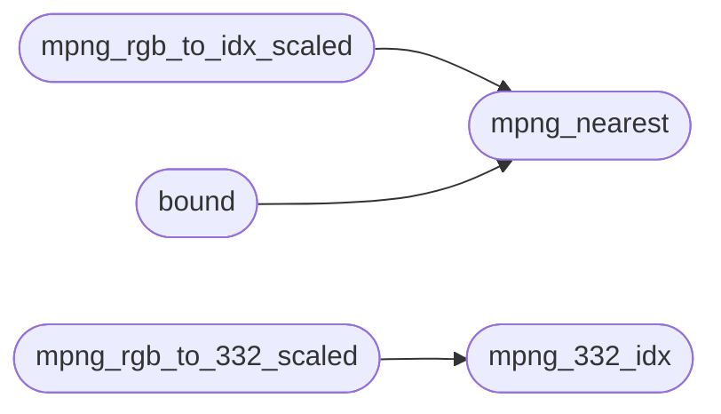

# `progs/minios_png.h`

> Source: [progs/minios_png.h:1](../../progs/minios_png.h#L1) | language `h` | coverage 52.4% | [API index](../index.md)

Docstring: shared ring-3 PNG helpers for MiniOS apps (progs/minios_png.h).

## Contents

- **Functions:** [`mpng_332_idx`](#mpng_332_idx), [`mpng_nearest`](#mpng_nearest), [`mpng_center`](#mpng_center), [`mpng_fit_scale`](#mpng_fit_scale), [`mpng_rgb_to_idx_scaled`](#mpng_rgb_to_idx_scaled), [`bound`](#bound), [`mpng_rgb_to_332_scaled`](#mpng_rgb_to_332_scaled), [`mpng_blit_idx`](#mpng_blit_idx), [`mpng_load_file`](#mpng_load_file)
- **Macros:** [`MPNG_FILE_MAX`](#mpng_file_max), [`MPNG_MAX_DIM`](#mpng_max_dim), [`MPNG_BIG_DIM`](#mpng_big_dim), [`MPNG_PAL_N`](#mpng_pal_n), [`MPNG_PAL_BYTES`](#mpng_pal_bytes), [`MPNG_PATH_MAX`](#mpng_path_max), [`MPNG_RIGHT_PATH`](#mpng_right_path), [`MPNG_LEFT_N`](#mpng_left_n), [`MPNG_ERR_OK`](#mpng_err_ok), [`MPNG_ERR_BOUND`](#mpng_err_bound), [`MPNG_ERR_EMPTY`](#mpng_err_empty)

## Call Graph

Solid arrows stay in this module, dashed arrows leave it.



## Functions

<a id="mpng_332_idx"></a>

### `mpng_332_idx`

`function` `static` | [progs/minios_png.h:58](../../progs/minios_png.h#L58)

```c
static int mpng_332_idx(unsigned r, unsigned g, unsigned b)
```

Docstring: direct 3-3-2 index for one RGB triple, the pokemon ramp.

**Parameters**

| Name | Type | Default | Description |
|---|---|---|---|
| `r` | `unsigned` |  |  |
| `g` | `unsigned` |  |  |
| `b` | `unsigned` |  |  |

**Returns:** `int`

*Called by:* [`mpng_rgb_to_332_scaled`](#mpng_rgb_to_332_scaled)

---

<a id="mpng_nearest"></a>

### `mpng_nearest`

`function` `static` | [progs/minios_png.h:63](../../progs/minios_png.h#L63)

```c
static int mpng_nearest(const unsigned char *pal, long pal_n, unsigned r, unsigned g, unsigned b)
```

Docstring: nearest palette index by squared RGB distance, fail closed.

**Parameters**

| Name | Type | Default | Description |
|---|---|---|---|
| `pal` | `unsigned char *` |  |  |
| `pal_n` | `long` |  |  |
| `r` | `unsigned` |  |  |
| `g` | `unsigned` |  |  |
| `b` | `unsigned` |  |  |

**Returns:** `int`

*Called by:* [`bound`](#bound), [`mpng_rgb_to_idx_scaled`](#mpng_rgb_to_idx_scaled)

---

<a id="mpng_center"></a>

### `mpng_center`

`function` `static` | [progs/minios_png.h:84](../../progs/minios_png.h#L84)

```c
static int mpng_center(int outer, int inner)
```

Docstring: centered offset of inner inside outer, negative when unfit.

**Parameters**

| Name | Type | Default | Description |
|---|---|---|---|
| `outer` | `int` |  |  |
| `inner` | `int` |  |  |

**Returns:** `int`

---

<a id="mpng_fit_scale"></a>

### `mpng_fit_scale`

`function` `static` | [progs/minios_png.h:93](../../progs/minios_png.h#L93)

```c
static int mpng_fit_scale(int sw, int sh, int boxw, int boxh)
```

Docstring: integer scale that fits src inside a box, at least 1.

**Parameters**

| Name | Type | Default | Description |
|---|---|---|---|
| `sw` | `int` |  |  |
| `sh` | `int` |  |  |
| `boxw` | `int` |  |  |
| `boxh` | `int` |  |  |

**Returns:** `int`

---

<a id="mpng_rgb_to_idx_scaled"></a>

### `mpng_rgb_to_idx_scaled`

`function` `static` | [progs/minios_png.h:108](../../progs/minios_png.h#L108)

```c
static int mpng_rgb_to_idx_scaled(const unsigned char *rgb, int sw, int sh, const unsigned char *pal, long pal_n, unsigned char *dst, int dw, int dh)
```

Docstring: scale RGB into indexed dst with nearest neighbour.

**Parameters**

| Name | Type | Default | Description |
|---|---|---|---|
| `rgb` | `unsigned char *` |  |  |
| `sw` | `int` |  |  |
| `sh` | `int` |  |  |
| `pal` | `unsigned char *` |  |  |
| `pal_n` | `long` |  |  |
| `dst` | `unsigned char *` |  |  |
| `dw` | `int` |  |  |
| `dh` | `int` |  |  |

**Returns:** `int`

*Calls:* [`mpng_nearest`](#mpng_nearest)

---

<a id="bound"></a>

### `bound`

`function` | [progs/minios_png.h:140](../../progs/minios_png.h#L140)

```c
* its 512 source bound (pinned by the host suite), so icon and policy * art never grow through t...
```

**Parameters**

| Name | Type | Default | Description |
|---|---|---|---|
| `suite` | `pinned by the host` |  |  |

**Returns:** `* its 512 source`

*Calls:* [`mpng_nearest`](#mpng_nearest)

---

<a id="mpng_rgb_to_332_scaled"></a>

### `mpng_rgb_to_332_scaled`

`function` `static` | [progs/minios_png.h:172](../../progs/minios_png.h#L172)

```c
static int mpng_rgb_to_332_scaled(const unsigned char *rgb, int sw, int sh, unsigned char *dst, int dw, int dh)
```

Docstring: scale RGB into 3-3-2 indexed dst with nearest neighbour.

**Parameters**

| Name | Type | Default | Description |
|---|---|---|---|
| `rgb` | `unsigned char *` |  |  |
| `sw` | `int` |  |  |
| `sh` | `int` |  |  |
| `dst` | `unsigned char *` |  |  |
| `dw` | `int` |  |  |
| `dh` | `int` |  |  |

**Returns:** `int`

*Calls:* [`mpng_332_idx`](#mpng_332_idx)

---

<a id="mpng_blit_idx"></a>

### `mpng_blit_idx`

`function` `static` | [progs/minios_png.h:196](../../progs/minios_png.h#L196)

```c
static int mpng_blit_idx(unsigned char *fb, int fw, int fh, const unsigned char *tile, int tw, int th, int ox, int oy)
```

Docstring: blit an indexed tile into an indexed frame, clipped.

**Parameters**

| Name | Type | Default | Description |
|---|---|---|---|
| `fb` | `unsigned char *` |  |  |
| `fw` | `int` |  |  |
| `fh` | `int` |  |  |
| `tile` | `unsigned char *` |  |  |
| `tw` | `int` |  |  |
| `th` | `int` |  |  |
| `ox` | `int` |  |  |
| `oy` | `int` |  |  |

**Returns:** `int`

---

<a id="mpng_load_file"></a>

### `mpng_load_file`

`function` `static` | [progs/minios_png.h:222](../../progs/minios_png.h#L222)

```c
static int mpng_load_file(const char *path, unsigned char **out, long *out_n, long cap)
```

Docstring: bounded whole-file read, malloced, caller frees.

**Parameters**

| Name | Type | Default | Description |
|---|---|---|---|
| `path` | `char *` |  |  |
| `out` | `unsigned char **` |  |  |
| `out_n` | `long *` |  |  |
| `cap` | `long` |  |  |

**Returns:** `int`

---

## Macros

<a id="mpng_file_max"></a>

### `MPNG_FILE_MAX`

`macro` | [progs/minios_png.h:28](../../progs/minios_png.h#L28)

```c
#define MPNG_FILE_MAX
```

Central configuration: every bound, path and limit lives here.

---

<a id="mpng_max_dim"></a>

### `MPNG_MAX_DIM`

`macro` | [progs/minios_png.h:29](../../progs/minios_png.h#L29)

```c
#define MPNG_MAX_DIM
```

---

<a id="mpng_big_dim"></a>

### `MPNG_BIG_DIM`

`macro` | [progs/minios_png.h:33](../../progs/minios_png.h#L33)

```c
#define MPNG_BIG_DIM
```

Large-source cap for user-selected previews (the 800x600 wallpaper): the plain scaler stays at 512 for icons and policy art, while previews may downscale sources up to this.

Destination stays at MAX_DIM.

---

<a id="mpng_pal_n"></a>

### `MPNG_PAL_N`

`macro` | [progs/minios_png.h:34](../../progs/minios_png.h#L34)

```c
#define MPNG_PAL_N
```

---

<a id="mpng_pal_bytes"></a>

### `MPNG_PAL_BYTES`

`macro` | [progs/minios_png.h:35](../../progs/minios_png.h#L35)

```c
#define MPNG_PAL_BYTES
```

---

<a id="mpng_path_max"></a>

### `MPNG_PATH_MAX`

`macro` | [progs/minios_png.h:36](../../progs/minios_png.h#L36)

```c
#define MPNG_PATH_MAX
```

---

<a id="mpng_right_path"></a>

### `MPNG_RIGHT_PATH`

`macro` | [progs/minios_png.h:37](../../progs/minios_png.h#L37)

```c
#define MPNG_RIGHT_PATH
```

---

<a id="mpng_left_n"></a>

### `MPNG_LEFT_N`

`macro` | [progs/minios_png.h:38](../../progs/minios_png.h#L38)

```c
#define MPNG_LEFT_N
```

---

<a id="mpng_err_ok"></a>

### `MPNG_ERR_OK`

`macro` | [progs/minios_png.h:39](../../progs/minios_png.h#L39)

```c
#define MPNG_ERR_OK
```

---

<a id="mpng_err_bound"></a>

### `MPNG_ERR_BOUND`

`macro` | [progs/minios_png.h:40](../../progs/minios_png.h#L40)

```c
#define MPNG_ERR_BOUND
```

---

<a id="mpng_err_empty"></a>

### `MPNG_ERR_EMPTY`

`macro` | [progs/minios_png.h:41](../../progs/minios_png.h#L41)

```c
#define MPNG_ERR_EMPTY
```

---
