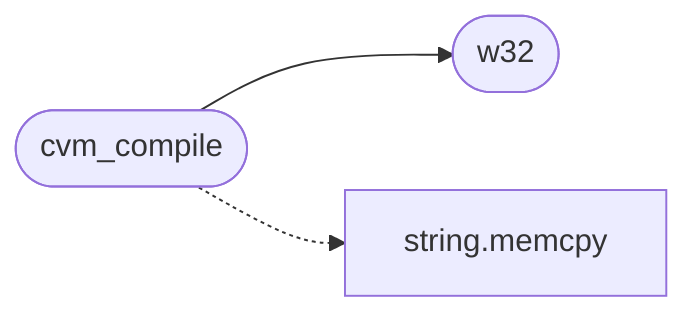

# `progs/nuklear/cvm_emit.c`

> Source: [progs/nuklear/cvm_emit.c:1](../../progs/nuklear/cvm_emit.c#L1) | language `c` | coverage 8.7% | [API index](../index.md)

cvm_emit.c — node-graph to CVM bytecode compiler.

## Contents

- **Structs:** [`codebuf`](#codebuf)
- **Functions:** [`module`](#module), [`code`](#code), [`cvm_compile`](#cvm_compile), [`w32`](#w32)
- **Macros:** [`CVM_MAGIC_0`](#cvm_magic_0), [`CVM_MAGIC_1`](#cvm_magic_1), [`CVM_MAGIC_2`](#cvm_magic_2), [`CVM_MAGIC_3`](#cvm_magic_3), [`CVM_VERSION_MAJOR`](#cvm_version_major), [`CVM_MODULE_HEADER_SIZE`](#cvm_module_header_size), [`CVM_FUNC_ENTRY_SIZE`](#cvm_func_entry_size), [`CVM_GLOBAL_ENTRY_SIZE`](#cvm_global_entry_size), [`CVM_NATIVE_ENTRY_SIZE`](#cvm_native_entry_size), [`OP_PUSH_IMM64`](#op_push_imm64), [`OP_PUSH_IMM32`](#op_push_imm32), [`OP_PUSH_IMM8`](#op_push_imm8), [`OP_PUSH_ZERO`](#op_push_zero), [`OP_PUSH_LOCAL`](#op_push_local), [`OP_STORE_LOCAL`](#op_store_local), [`OP_ADD`](#op_add), [`OP_SUB`](#op_sub), [`OP_MUL`](#op_mul), [`OP_DIV`](#op_div), [`OP_MOD`](#op_mod), [`OP_NEG`](#op_neg), [`OP_AND`](#op_and), [`OP_OR`](#op_or), [`OP_XOR`](#op_xor), [`OP_NOT`](#op_not), [`OP_SHL`](#op_shl), [`OP_SHR`](#op_shr), [`OP_CMP_EQ`](#op_cmp_eq), [`OP_CMP_NE`](#op_cmp_ne), [`OP_CMP_LT`](#op_cmp_lt), [`OP_CMP_LE`](#op_cmp_le), [`OP_CMP_GT`](#op_cmp_gt), [`OP_CMP_GE`](#op_cmp_ge), [`OP_LNOT`](#op_lnot), [`OP_JMP`](#op_jmp), [`OP_JZ`](#op_jz), [`OP_CALL_NATIVE`](#op_call_native), [`OP_LEA_DATA`](#op_lea_data), [`OP_HALT`](#op_halt), [`CVM_MAX_NODES`](#cvm_max_nodes)

## Call Graph

Solid arrows stay in this module, dashed arrows leave it.



## Structs

<a id="codebuf"></a>

### `codebuf`

`struct` | [progs/nuklear/cvm_emit.c:73](../../progs/nuklear/cvm_emit.c#L73)

```c
struct codebuf
```

---

## Functions

<a id="module"></a>

### `module`

`function` | [progs/nuklear/cvm_emit.c:3](../../progs/nuklear/cvm_emit.c#L3)

```c
* * Emits a cvm2 module (format v2) from a dataflow graph. Nodes are * topologically sorted (a true DAG order, so the editor can connect nodes in * any sequence);
```

**Parameters**

| Name | Type | Default | Description |
|---|---|---|---|
| `v2` | `format` |  |  |

**Returns:** `* * Emits a cvm2`

---

<a id="code"></a>

### `code`

`function` | [progs/nuklear/cvm_emit.c:8](../../progs/nuklear/cvm_emit.c#L8)

```c
* exit code (OP_HALT leaves the operand-stack top as the exit status, which * the shell reports as `exit code: N`). * * Module layout follows cvm_load_module exactly: * header | func table | global table | native table | string table | * code | RLE-compressed data | string pool */ #include <stdio.h> #include <stdlib.h> #include <string.h>
```

**Parameters**

| Name | Type | Default | Description |
|---|---|---|---|
| `status` | `OP_HALT leaves the operand-stack top as the exit` |  |  |
| `N` | `` which * the shell reports as `exit code: ` `` |  |  |

**Returns:** `* exit`

---

<a id="cvm_compile"></a>

### `cvm_compile`

`function` | [progs/nuklear/cvm_emit.c:236](../../progs/nuklear/cvm_emit.c#L236)

```c
int cvm_compile(const struct cvm_node *nodes, int n, unsigned char **out, size_t *out_size, char *err, size_t err_cap)
```

**Parameters**

| Name | Type | Default | Description |
|---|---|---|---|
| `nodes` | `struct cvm_node *` |  |  |
| `n` | `int` |  |  |
| `out` | `unsigned char **` |  |  |
| `out_size` | `size_t *` |  |  |
| `err` | `char *` |  |  |
| `err_cap` | `size_t` |  |  |

**Returns:** `int`

*Calls:* [`memcpy`](kernel.string.c.md#memcpy), [`w32`](#w32)

---

<a id="w32"></a>

### `w32`

`function` | [progs/nuklear/cvm_emit.c:491](../../progs/nuklear/cvm_emit.c#L491)

```c
void w32(void *p, unsigned v)
```

minor

**Parameters**

| Name | Type | Default | Description |
|---|---|---|---|
| `p` | `void *` |  |  |
| `v` | `unsigned` |  |  |

*Called by:* [`cvm_compile`](#cvm_compile)

---

## Macros

<a id="cvm_magic_0"></a>

### `CVM_MAGIC_0`

`macro` | [progs/nuklear/cvm_emit.c:29](../../progs/nuklear/cvm_emit.c#L29)

```c
#define CVM_MAGIC_0
```

cvm2 constants mirrored here so the emitter needs no cvm headers.

---

<a id="cvm_magic_1"></a>

### `CVM_MAGIC_1`

`macro` | [progs/nuklear/cvm_emit.c:30](../../progs/nuklear/cvm_emit.c#L30)

```c
#define CVM_MAGIC_1
```

---

<a id="cvm_magic_2"></a>

### `CVM_MAGIC_2`

`macro` | [progs/nuklear/cvm_emit.c:31](../../progs/nuklear/cvm_emit.c#L31)

```c
#define CVM_MAGIC_2
```

---

<a id="cvm_magic_3"></a>

### `CVM_MAGIC_3`

`macro` | [progs/nuklear/cvm_emit.c:32](../../progs/nuklear/cvm_emit.c#L32)

```c
#define CVM_MAGIC_3
```

---

<a id="cvm_version_major"></a>

### `CVM_VERSION_MAJOR`

`macro` | [progs/nuklear/cvm_emit.c:33](../../progs/nuklear/cvm_emit.c#L33)

```c
#define CVM_VERSION_MAJOR
```

---

<a id="cvm_module_header_size"></a>

### `CVM_MODULE_HEADER_SIZE`

`macro` | [progs/nuklear/cvm_emit.c:34](../../progs/nuklear/cvm_emit.c#L34)

```c
#define CVM_MODULE_HEADER_SIZE
```

---

<a id="cvm_func_entry_size"></a>

### `CVM_FUNC_ENTRY_SIZE`

`macro` | [progs/nuklear/cvm_emit.c:35](../../progs/nuklear/cvm_emit.c#L35)

```c
#define CVM_FUNC_ENTRY_SIZE
```

---

<a id="cvm_global_entry_size"></a>

### `CVM_GLOBAL_ENTRY_SIZE`

`macro` | [progs/nuklear/cvm_emit.c:36](../../progs/nuklear/cvm_emit.c#L36)

```c
#define CVM_GLOBAL_ENTRY_SIZE
```

---

<a id="cvm_native_entry_size"></a>

### `CVM_NATIVE_ENTRY_SIZE`

`macro` | [progs/nuklear/cvm_emit.c:37](../../progs/nuklear/cvm_emit.c#L37)

```c
#define CVM_NATIVE_ENTRY_SIZE
```

---

<a id="op_push_imm64"></a>

### `OP_PUSH_IMM64`

`macro` | [progs/nuklear/cvm_emit.c:40](../../progs/nuklear/cvm_emit.c#L40)

```c
#define OP_PUSH_IMM64
```

Opcodes (cvm.h).

---

<a id="op_push_imm32"></a>

### `OP_PUSH_IMM32`

`macro` | [progs/nuklear/cvm_emit.c:41](../../progs/nuklear/cvm_emit.c#L41)

```c
#define OP_PUSH_IMM32
```

---

<a id="op_push_imm8"></a>

### `OP_PUSH_IMM8`

`macro` | [progs/nuklear/cvm_emit.c:42](../../progs/nuklear/cvm_emit.c#L42)

```c
#define OP_PUSH_IMM8
```

---

<a id="op_push_zero"></a>

### `OP_PUSH_ZERO`

`macro` | [progs/nuklear/cvm_emit.c:43](../../progs/nuklear/cvm_emit.c#L43)

```c
#define OP_PUSH_ZERO
```

---

<a id="op_push_local"></a>

### `OP_PUSH_LOCAL`

`macro` | [progs/nuklear/cvm_emit.c:44](../../progs/nuklear/cvm_emit.c#L44)

```c
#define OP_PUSH_LOCAL
```

---

<a id="op_store_local"></a>

### `OP_STORE_LOCAL`

`macro` | [progs/nuklear/cvm_emit.c:45](../../progs/nuklear/cvm_emit.c#L45)

```c
#define OP_STORE_LOCAL
```

---

<a id="op_add"></a>

### `OP_ADD`

`macro` | [progs/nuklear/cvm_emit.c:46](../../progs/nuklear/cvm_emit.c#L46)

```c
#define OP_ADD
```

---

<a id="op_sub"></a>

### `OP_SUB`

`macro` | [progs/nuklear/cvm_emit.c:47](../../progs/nuklear/cvm_emit.c#L47)

```c
#define OP_SUB
```

---

<a id="op_mul"></a>

### `OP_MUL`

`macro` | [progs/nuklear/cvm_emit.c:48](../../progs/nuklear/cvm_emit.c#L48)

```c
#define OP_MUL
```

---

<a id="op_div"></a>

### `OP_DIV`

`macro` | [progs/nuklear/cvm_emit.c:49](../../progs/nuklear/cvm_emit.c#L49)

```c
#define OP_DIV
```

---

<a id="op_mod"></a>

### `OP_MOD`

`macro` | [progs/nuklear/cvm_emit.c:50](../../progs/nuklear/cvm_emit.c#L50)

```c
#define OP_MOD
```

---

<a id="op_neg"></a>

### `OP_NEG`

`macro` | [progs/nuklear/cvm_emit.c:51](../../progs/nuklear/cvm_emit.c#L51)

```c
#define OP_NEG
```

---

<a id="op_and"></a>

### `OP_AND`

`macro` | [progs/nuklear/cvm_emit.c:52](../../progs/nuklear/cvm_emit.c#L52)

```c
#define OP_AND
```

---

<a id="op_or"></a>

### `OP_OR`

`macro` | [progs/nuklear/cvm_emit.c:53](../../progs/nuklear/cvm_emit.c#L53)

```c
#define OP_OR
```

---

<a id="op_xor"></a>

### `OP_XOR`

`macro` | [progs/nuklear/cvm_emit.c:54](../../progs/nuklear/cvm_emit.c#L54)

```c
#define OP_XOR
```

---

<a id="op_not"></a>

### `OP_NOT`

`macro` | [progs/nuklear/cvm_emit.c:55](../../progs/nuklear/cvm_emit.c#L55)

```c
#define OP_NOT
```

---

<a id="op_shl"></a>

### `OP_SHL`

`macro` | [progs/nuklear/cvm_emit.c:56](../../progs/nuklear/cvm_emit.c#L56)

```c
#define OP_SHL
```

---

<a id="op_shr"></a>

### `OP_SHR`

`macro` | [progs/nuklear/cvm_emit.c:57](../../progs/nuklear/cvm_emit.c#L57)

```c
#define OP_SHR
```

---

<a id="op_cmp_eq"></a>

### `OP_CMP_EQ`

`macro` | [progs/nuklear/cvm_emit.c:58](../../progs/nuklear/cvm_emit.c#L58)

```c
#define OP_CMP_EQ
```

---

<a id="op_cmp_ne"></a>

### `OP_CMP_NE`

`macro` | [progs/nuklear/cvm_emit.c:59](../../progs/nuklear/cvm_emit.c#L59)

```c
#define OP_CMP_NE
```

---

<a id="op_cmp_lt"></a>

### `OP_CMP_LT`

`macro` | [progs/nuklear/cvm_emit.c:60](../../progs/nuklear/cvm_emit.c#L60)

```c
#define OP_CMP_LT
```

---

<a id="op_cmp_le"></a>

### `OP_CMP_LE`

`macro` | [progs/nuklear/cvm_emit.c:61](../../progs/nuklear/cvm_emit.c#L61)

```c
#define OP_CMP_LE
```

---

<a id="op_cmp_gt"></a>

### `OP_CMP_GT`

`macro` | [progs/nuklear/cvm_emit.c:62](../../progs/nuklear/cvm_emit.c#L62)

```c
#define OP_CMP_GT
```

---

<a id="op_cmp_ge"></a>

### `OP_CMP_GE`

`macro` | [progs/nuklear/cvm_emit.c:63](../../progs/nuklear/cvm_emit.c#L63)

```c
#define OP_CMP_GE
```

---

<a id="op_lnot"></a>

### `OP_LNOT`

`macro` | [progs/nuklear/cvm_emit.c:64](../../progs/nuklear/cvm_emit.c#L64)

```c
#define OP_LNOT
```

---

<a id="op_jmp"></a>

### `OP_JMP`

`macro` | [progs/nuklear/cvm_emit.c:65](../../progs/nuklear/cvm_emit.c#L65)

```c
#define OP_JMP
```

---

<a id="op_jz"></a>

### `OP_JZ`

`macro` | [progs/nuklear/cvm_emit.c:66](../../progs/nuklear/cvm_emit.c#L66)

```c
#define OP_JZ
```

---

<a id="op_call_native"></a>

### `OP_CALL_NATIVE`

`macro` | [progs/nuklear/cvm_emit.c:67](../../progs/nuklear/cvm_emit.c#L67)

```c
#define OP_CALL_NATIVE
```

---

<a id="op_lea_data"></a>

### `OP_LEA_DATA`

`macro` | [progs/nuklear/cvm_emit.c:68](../../progs/nuklear/cvm_emit.c#L68)

```c
#define OP_LEA_DATA
```

---

<a id="op_halt"></a>

### `OP_HALT`

`macro` | [progs/nuklear/cvm_emit.c:69](../../progs/nuklear/cvm_emit.c#L69)

```c
#define OP_HALT
```

---

<a id="cvm_max_nodes"></a>

### `CVM_MAX_NODES`

`macro` | [progs/nuklear/cvm_emit.c:71](../../progs/nuklear/cvm_emit.c#L71)

```c
#define CVM_MAX_NODES
```

---
