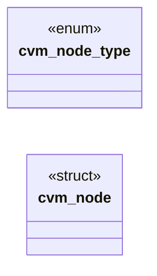

# `progs/nuklear/cvm_emit.h`

> Source: [progs/nuklear/cvm_emit.h:1](../../progs/nuklear/cvm_emit.h#L1) | language `h` | coverage 66.7% | [API index](../index.md)

cvm_emit.h — node-graph compiler for CVM (cvm2 module format v2).

## Contents

- **Structs:** [`cvm_node`](#cvm_node)
- **Enums:** [`cvm_node_type`](#cvm_node_type)
- **Functions:** [`graph`](#graph), [`err`](#err)
- **Macros:** [`CVM_NODE_STR_MAX`](#cvm_node_str_max)

## Type Diagram



## Call Graph

Solid arrows stay in this module, dashed arrows leave it.


## Structs

<a id="cvm_node"></a>

### `cvm_node`

`struct` | [progs/nuklear/cvm_emit.h:56](../../progs/nuklear/cvm_emit.h#L56)

```c
struct cvm_node
```

One node in the graph.

Inputs are indices of other nodes; a negative input means open, in which case the per-input literal is used when use_lit[k] is set, otherwise compilation fails with a node-context diagnostic. Output nodes (PRINT/PRINTS/EXIT) terminate the compiled program and can never be used as an input source.

---

## Enums

<a id="cvm_node_type"></a>

### `cvm_node_type`

`enum` | [progs/nuklear/cvm_emit.h:22](../../progs/nuklear/cvm_emit.h#L22)

```c
enum cvm_node_type
```

Node types the graph compiler understands.

---

## Functions

<a id="graph"></a>

### `graph`

`function` | [progs/nuklear/cvm_emit.h:6](../../progs/nuklear/cvm_emit.h#L6)

```c
* * A node graph (constants, arithmetic, bitwise, comparisons, a conditional * select, and string constants feeding PRINT/PRINTS/EXIT sinks) is compiled * into a self-contained .cvm module: a single e
```

**Parameters**

| Name | Type | Default | Description |
|---|---|---|---|
| `select` | `a conditional *` |  |  |
| `sinks` | `and string constants feeding PRINT/PRINTS/EXIT` |  |  |

**Returns:** `* * A node`

---

<a id="err"></a>

### `err`

`function` | [progs/nuklear/cvm_emit.h:67](../../progs/nuklear/cvm_emit.h#L67)

```c
* err (err_cap bytes). The module is heap-allocated and owned by the caller * (free it). */ int cvm_compile(const struct cvm_node *nodes, int n, unsigned char **out, size_t *out_size, char *err, size_
```

**Parameters**

| Name | Type | Default | Description |
|---|---|---|---|
| `bytes` | `err_cap` |  |  |

**Returns:** `*`

---

## Macros

<a id="cvm_node_str_max"></a>

### `CVM_NODE_STR_MAX`

`macro` | [progs/nuklear/cvm_emit.h:19](../../progs/nuklear/cvm_emit.h#L19)

```c
#define CVM_NODE_STR_MAX
```

String payload bound for STR constants and PRINT formats.

*Calls:* [`address`](headers.arch.x86.boot.bootdefs.h.md#address)

---
