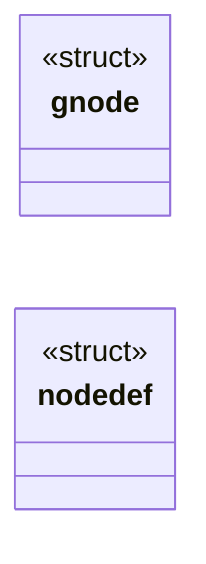
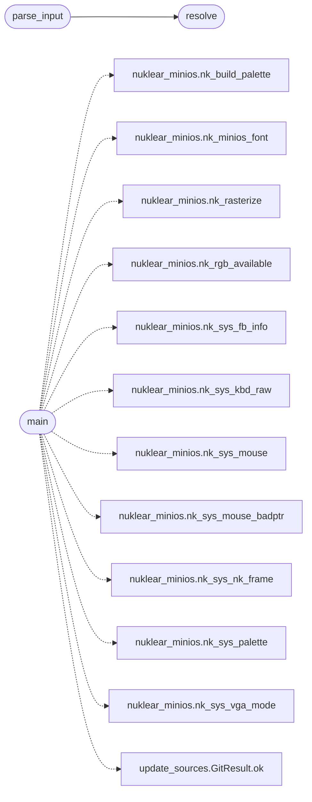

# `progs/nuklear/node_editor.c`

> Source: [progs/nuklear/node_editor.c:1](../../progs/nuklear/node_editor.c#L1) | language `c` | coverage 37.5% | [API index](../index.md)

node_editor.c — visual low-code editor that compiles to CVM bytecode.

## Contents

- **Structs:** [`gnode`](#gnode), [`nodedef`](#nodedef)
- **Functions:** [`addrep`](#addrep), [`adderr`](#adderr), [`resolve`](#resolve), [`parse_input`](#parse_input), [`main`](#main)
- **Macros:** [`MAX_NODES`](#max_nodes), [`STR_MAX`](#str_max), [`UI_MEMORY`](#ui_memory), [`NODE_W`](#node_w), [`PIN_R`](#pin_r), [`PIN_DIAM`](#pin_diam), [`BEZIER_PAD`](#bezier_pad), [`GRID_SIZE`](#grid_size)

## Type Diagram



## Call Graph

Solid arrows stay in this module, dashed arrows leave it.



## Structs

<a id="gnode"></a>

### `gnode`

`struct` | [progs/nuklear/node_editor.c:44](../../progs/nuklear/node_editor.c#L44)

```c
struct gnode
```

---

<a id="nodedef"></a>

### `nodedef`

`struct` | [progs/nuklear/node_editor.c:55](../../progs/nuklear/node_editor.c#L55)

```c
struct nodedef
```

Single registry: name, text-format word, inputs, outputs, color.

---

## Functions

<a id="addrep"></a>

### `addrep`

`function` | [progs/nuklear/node_editor.c:183](../../progs/nuklear/node_editor.c#L183)

```c
void addrep(const char *s)
```

**Parameters**

| Name | Type | Default | Description |
|---|---|---|---|
| `s` | `char *` |  |  |

---

<a id="adderr"></a>

### `adderr`

`function` | [progs/nuklear/node_editor.c:193](../../progs/nuklear/node_editor.c#L193)

```c
void adderr(const char *s)
```

**Parameters**

| Name | Type | Default | Description |
|---|---|---|---|
| `s` | `char *` |  |  |

---

<a id="resolve"></a>

### `resolve`

`function` | [progs/nuklear/node_editor.c:437](../../progs/nuklear/node_editor.c#L437)

```c
int resolve(const char *nme, int upto)
```

**Parameters**

| Name | Type | Default | Description |
|---|---|---|---|
| `nme` | `char *` |  |  |
| `upto` | `int` |  |  |

**Returns:** `int`

*Called by:* [`parse_input`](#parse_input)

---

<a id="parse_input"></a>

### `parse_input`

`function` | [progs/nuklear/node_editor.c:443](../../progs/nuklear/node_editor.c#L443)

```c
int parse_input(const char *tok, int idx, int k)
```

Parse one input token: name, #literal, or #- (open, no literal).

**Parameters**

| Name | Type | Default | Description |
|---|---|---|---|
| `tok` | `char *` |  |  |
| `idx` | `int` |  |  |
| `k` | `int` |  |  |

**Returns:** `int`

*Calls:* [`resolve`](#resolve)

---

<a id="main"></a>

### `main`

`function` | [progs/nuklear/node_editor.c:983](../../progs/nuklear/node_editor.c#L983)

```c
int main(int argc, char **argv)
```

**Parameters**

| Name | Type | Default | Description |
|---|---|---|---|
| `argc` | `int` |  |  |
| `argv` | `char **` |  |  |

**Returns:** `int`

*Calls:* [`nk_build_palette`](progs.nuklear.nuklear_minios.h.md#nk_build_palette), [`nk_minios_font`](progs.nuklear.nuklear_minios.h.md#nk_minios_font), [`nk_rasterize`](progs.nuklear.nuklear_minios.h.md#nk_rasterize), [`nk_rgb_available`](progs.nuklear.nuklear_minios.h.md#nk_rgb_available), [`nk_sys_fb_info`](progs.nuklear.nuklear_minios.h.md#nk_sys_fb_info), [`nk_sys_kbd_raw`](progs.nuklear.nuklear_minios.h.md#nk_sys_kbd_raw), [`nk_sys_mouse`](progs.nuklear.nuklear_minios.h.md#nk_sys_mouse), [`nk_sys_mouse_badptr`](progs.nuklear.nuklear_minios.h.md#nk_sys_mouse_badptr), [`nk_sys_nk_frame`](progs.nuklear.nuklear_minios.h.md#nk_sys_nk_frame), [`nk_sys_palette`](progs.nuklear.nuklear_minios.h.md#nk_sys_palette), [`nk_sys_vga_mode`](progs.nuklear.nuklear_minios.h.md#nk_sys_vga_mode), [`GitResult.ok`](tools.update_sources.py.md#gitresult-ok)

---

## Macros

<a id="max_nodes"></a>

### `MAX_NODES`

`macro` | [progs/nuklear/node_editor.c:33](../../progs/nuklear/node_editor.c#L33)

```c
#define MAX_NODES
```

---- Graph model (mirrors cvm_node, plus canvas position) ----

---

<a id="str_max"></a>

### `STR_MAX`

`macro` | [progs/nuklear/node_editor.c:34](../../progs/nuklear/node_editor.c#L34)

```c
#define STR_MAX
```

---

<a id="ui_memory"></a>

### `UI_MEMORY`

`macro` | [progs/nuklear/node_editor.c:500](../../progs/nuklear/node_editor.c#L500)

```c
#define UI_MEMORY
```

---- Nuklear UI state ----

---

<a id="node_w"></a>

### `NODE_W`

`macro` | [progs/nuklear/node_editor.c:514](../../progs/nuklear/node_editor.c#L514)

```c
#define NODE_W
```

Node geometry constants.

---

<a id="pin_r"></a>

### `PIN_R`

`macro` | [progs/nuklear/node_editor.c:516](../../progs/nuklear/node_editor.c#L516)

```c
#define PIN_R
```

---

<a id="pin_diam"></a>

### `PIN_DIAM`

`macro` | [progs/nuklear/node_editor.c:517](../../progs/nuklear/node_editor.c#L517)

```c
#define PIN_DIAM
```

---

<a id="bezier_pad"></a>

### `BEZIER_PAD`

`macro` | [progs/nuklear/node_editor.c:518](../../progs/nuklear/node_editor.c#L518)

```c
#define BEZIER_PAD
```

---

<a id="grid_size"></a>

### `GRID_SIZE`

`macro` | [progs/nuklear/node_editor.c:519](../../progs/nuklear/node_editor.c#L519)

```c
#define GRID_SIZE
```

---
