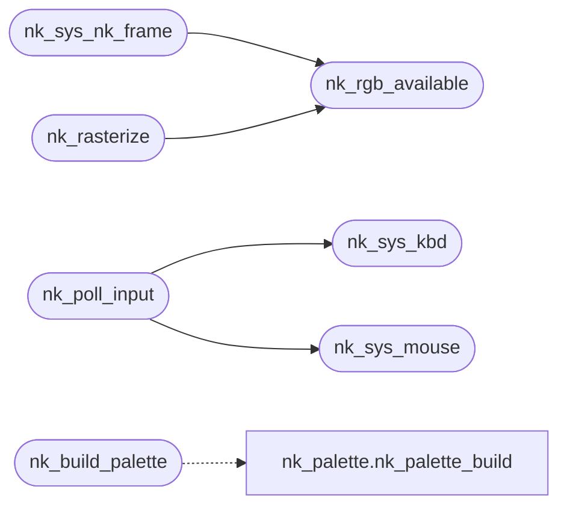

# `progs/nuklear/nuklear_minios.c`

> Source: [progs/nuklear/nuklear_minios.c:1](../../progs/nuklear/nuklear_minios.c#L1) | language `c` | coverage 41.7% | [API index](../index.md)

nuklear_minios.c — MiniOS platform layer for Nuklear.

## Contents

- **Functions:** [`list`](#list), [`nk_sys_time_ms`](#nk_sys_time_ms), [`nk_sys_kbd`](#nk_sys_kbd), [`nk_sys_palette`](#nk_sys_palette), [`nk_sys_kbd_raw`](#nk_sys_kbd_raw), [`nk_sys_getpid`](#nk_sys_getpid), [`nk_sys_vga_mode`](#nk_sys_vga_mode), [`nk_sys_fb_info`](#nk_sys_fb_info), [`nk_rgb_available`](#nk_rgb_available), [`nk_idx_to_rgb`](#nk_idx_to_rgb), [`nk_sys_mouse`](#nk_sys_mouse), [`nk_sys_mouse_badptr`](#nk_sys_mouse_badptr), [`nk_sys_nk_frame`](#nk_sys_nk_frame), [`nk_sys_gfx_set_title`](#nk_sys_gfx_set_title), [`nk_build_palette`](#nk_build_palette), [`nk_rasterize`](#nk_rasterize), [`nk_foreach`](#nk_foreach), [`nk_minios_font`](#nk_minios_font), [`nk_set_scancode_hook`](#nk_set_scancode_hook), [`nk_poll_input`](#nk_poll_input), [`nk_set_window_origin`](#nk_set_window_origin), [`nk_quit_requested`](#nk_quit_requested)
- **Macros:** [`NK_IMPLEMENTATION`](#nk_implementation)
- **Variables:** [`program_invocation_short_name`](#program_invocation_short_name)

## Call Graph

Solid arrows stay in this module, dashed arrows leave it.



## Functions

<a id="list"></a>

### `list`

`function` `abstract` | [progs/nuklear/nuklear_minios.c:4](../../progs/nuklear/nuklear_minios.c#L4)

```c
* abstract draw command list (nk__begin/nk__next);
```

**Parameters**

| Name | Type | Default | Description |
|---|---|---|---|
| `nk__next` | `nk__begin/` |  |  |

**Returns:** `* draw command`

---

<a id="nk_sys_time_ms"></a>

### `nk_sys_time_ms`

`function` | [progs/nuklear/nuklear_minios.c:33](../../progs/nuklear/nuklear_minios.c#L33)

```c
long nk_sys_time_ms(void)
```

---- MiniOS syscalls (canonical table from minios_abi.h) ----

**Returns:** `long`

---

<a id="nk_sys_kbd"></a>

### `nk_sys_kbd`

`function` | [progs/nuklear/nuklear_minios.c:38](../../progs/nuklear/nuklear_minios.c#L38)

```c
long nk_sys_kbd(void)
```

**Returns:** `long`

*Called by:* [`nk_poll_input`](#nk_poll_input)

---

<a id="nk_sys_palette"></a>

### `nk_sys_palette`

`function` | [progs/nuklear/nuklear_minios.c:43](../../progs/nuklear/nuklear_minios.c#L43)

```c
long nk_sys_palette(const unsigned char *pal)
```

**Parameters**

| Name | Type | Default | Description |
|---|---|---|---|
| `pal` | `unsigned char *` |  |  |

**Returns:** `long`

---

<a id="nk_sys_kbd_raw"></a>

### `nk_sys_kbd_raw`

`function` | [progs/nuklear/nuklear_minios.c:48](../../progs/nuklear/nuklear_minios.c#L48)

```c
long nk_sys_kbd_raw(int on)
```

**Parameters**

| Name | Type | Default | Description |
|---|---|---|---|
| `on` | `int` |  |  |

**Returns:** `long`

---

<a id="nk_sys_getpid"></a>

### `nk_sys_getpid`

`function` | [progs/nuklear/nuklear_minios.c:53](../../progs/nuklear/nuklear_minios.c#L53)

```c
long nk_sys_getpid(void)
```

**Returns:** `long`

---

<a id="nk_sys_vga_mode"></a>

### `nk_sys_vga_mode`

`function` | [progs/nuklear/nuklear_minios.c:114](../../progs/nuklear/nuklear_minios.c#L114)

```c
long nk_sys_vga_mode(int on)
```

**Parameters**

| Name | Type | Default | Description |
|---|---|---|---|
| `on` | `int` |  |  |

**Returns:** `long`

---

<a id="nk_sys_fb_info"></a>

### `nk_sys_fb_info`

`function` | [progs/nuklear/nuklear_minios.c:121](../../progs/nuklear/nuklear_minios.c#L121)

```c
long nk_sys_fb_info(int *w, int *h, int *pitch)
```

**Parameters**

| Name | Type | Default | Description |
|---|---|---|---|
| `w` | `int *` |  |  |
| `h` | `int *` |  |  |
| `pitch` | `int *` |  |  |

**Returns:** `long`

---

<a id="nk_rgb_available"></a>

### `nk_rgb_available`

`function` | [progs/nuklear/nuklear_minios.c:147](../../progs/nuklear/nuklear_minios.c#L147)

```c
int nk_rgb_available(void)
```

1 when the kernel maps NK_RGB_BUF (cached probe, 0 on old kernels).

**Returns:** `int`

> **Inherited:** Documentation from [`nk_rgb_available`](#nk_rgb_available) (progs/nuklear/nuklear_minios.h:33).

*Called by:* [`nk_rasterize`](#nk_rasterize), [`nk_sys_nk_frame`](#nk_sys_nk_frame)

---

<a id="nk_idx_to_rgb"></a>

### `nk_idx_to_rgb`

`function` | [progs/nuklear/nuklear_minios.c:170](../../progs/nuklear/nuklear_minios.c#L170)

```c
void nk_idx_to_rgb(int idx, unsigned char *r, unsigned char *g, unsigned char *b)
```

Resolve one hybrid palette index to its exact RGB triple (canvas and preview mirrors that own indexed pixels reuse the same table the rasterizer draws through, so both buffers agree pixel for pixel).

**Parameters**

| Name | Type | Default | Description |
|---|---|---|---|
| `idx` | `int` |  |  |
| `r` | `unsigned char *` |  |  |
| `g` | `unsigned char *` |  |  |
| `b` | `unsigned char *` |  |  |

> **Inherited:** Documentation from [`nk_idx_to_rgb`](#nk_idx_to_rgb) (progs/nuklear/nuklear_minios.h:37).

---

<a id="nk_sys_mouse"></a>

### `nk_sys_mouse`

`function` | [progs/nuklear/nuklear_minios.c:193](../../progs/nuklear/nuklear_minios.c#L193)

```c
long nk_sys_mouse(int *xybw)
```

**Parameters**

| Name | Type | Default | Description |
|---|---|---|---|
| `xybw` | `int *` |  |  |

**Returns:** `long`

*Called by:* [`nk_poll_input`](#nk_poll_input)

---

<a id="nk_sys_mouse_badptr"></a>

### `nk_sys_mouse_badptr`

`function` | [progs/nuklear/nuklear_minios.c:198](../../progs/nuklear/nuklear_minios.c#L198)

```c
long nk_sys_mouse_badptr(void)
```

Call SYS_MOUSE with a pointer that is NOT in the user window; the kernel must reject it with -EFAULT.

Used by --selftest to prove the pointer validation, so a mutant that drops the bounds check is killed.

**Returns:** `long`

> **Inherited:** Documentation from [`nk_sys_mouse_badptr`](#nk_sys_mouse_badptr) (progs/nuklear/nuklear_minios.h:51).

---

<a id="nk_sys_nk_frame"></a>

### `nk_sys_nk_frame`

`function` | [progs/nuklear/nuklear_minios.c:280](../../progs/nuklear/nuklear_minios.c#L280)

```c
long nk_sys_nk_frame(int *origin)
```

**Parameters**

| Name | Type | Default | Description |
|---|---|---|---|
| `origin` | `int *` |  |  |

**Returns:** `long`

*Calls:* [`nk_rgb_available`](#nk_rgb_available)

---

<a id="nk_sys_gfx_set_title"></a>

### `nk_sys_gfx_set_title`

`function` | [progs/nuklear/nuklear_minios.c:409](../../progs/nuklear/nuklear_minios.c#L409)

```c
long nk_sys_gfx_set_title(const char *t)
```

int[2]: window content origin

**Parameters**

| Name | Type | Default | Description |
|---|---|---|---|
| `t` | `char *` |  |  |

**Returns:** `long`

> **Inherited:** Documentation from [`nk_sys_gfx_set_title`](#nk_sys_gfx_set_title) (progs/nuklear/nuklear_minios.h:53).

---

<a id="nk_build_palette"></a>

### `nk_build_palette`

`function` | [progs/nuklear/nuklear_minios.c:418](../../progs/nuklear/nuklear_minios.c#L418)

```c
void nk_build_palette(unsigned char *pal768)
```

The desktop-exact hybrid palette lives once in progs/nk_palette.h; this wrapper keeps the platform signature while sharing the table.

**Parameters**

| Name | Type | Default | Description |
|---|---|---|---|
| `pal768` | `unsigned char *` |  |  |

*Calls:* [`nk_palette_build`](progs.nk_palette.h.md#nk_palette_build)

---

<a id="nk_rasterize"></a>

### `nk_rasterize`

`function` | [progs/nuklear/nuklear_minios.c:636](../../progs/nuklear/nuklear_minios.c#L636)

```c
void nk_rasterize(struct nk_context *ctx)
```

Rasterize the Nuklear command list into the back-buffer.

**Parameters**

| Name | Type | Default | Description |
|---|---|---|---|
| `ctx` | `struct nk_context *` |  |  |

> **Inherited:** Documentation from [`nk_rasterize`](#nk_rasterize) (progs/nuklear/nuklear_minios.h:66).

*Calls:* [`nk_rgb_available`](#nk_rgb_available)

---

<a id="nk_foreach"></a>

### `nk_foreach`

`function` | [progs/nuklear/nuklear_minios.c:641](../../progs/nuklear/nuklear_minios.c#L641)

```c
nk_foreach(cmd, ctx)
```

---

<a id="nk_minios_font"></a>

### `nk_minios_font`

`function` | [progs/nuklear/nuklear_minios.c:819](../../progs/nuklear/nuklear_minios.c#L819)

```c
struct nk_user_font nk_minios_font(void)
```

The nk_user_font for this backend: 8x8 monospace.

**Returns:** `nk_user_font`

> **Inherited:** Documentation from [`nk_minios_font`](#nk_minios_font) (progs/nuklear/nuklear_minios.h:63).

---

<a id="nk_set_scancode_hook"></a>

### `nk_set_scancode_hook`

`function` | [progs/nuklear/nuklear_minios.c:861](../../progs/nuklear/nuklear_minios.c#L861)

```c
void nk_set_scancode_hook(nk_scancode_cb cb, void *ud)
```

**Parameters**

| Name | Type | Default | Description |
|---|---|---|---|
| `cb` | `nk_scancode_cb` |  |  |
| `ud` | `void *` |  |  |

---

<a id="nk_poll_input"></a>

### `nk_poll_input`

`function` | [progs/nuklear/nuklear_minios.c:961](../../progs/nuklear/nuklear_minios.c#L961)

```c
void nk_poll_input(struct nk_context *ctx)
```

**Parameters**

| Name | Type | Default | Description |
|---|---|---|---|
| `ctx` | `struct nk_context *` |  |  |

*Calls:* [`nk_sys_kbd`](#nk_sys_kbd), [`nk_sys_mouse`](#nk_sys_mouse)

---

<a id="nk_set_window_origin"></a>

### `nk_set_window_origin`

`function` | [progs/nuklear/nuklear_minios.c:1000](../../progs/nuklear/nuklear_minios.c#L1000)

```c
void nk_set_window_origin(int x, int y)
```

**Parameters**

| Name | Type | Default | Description |
|---|---|---|---|
| `x` | `int` |  |  |
| `y` | `int` |  |  |

---

<a id="nk_quit_requested"></a>

### `nk_quit_requested`

`function` | [progs/nuklear/nuklear_minios.c:1008](../../progs/nuklear/nuklear_minios.c#L1008)

```c
int nk_quit_requested(void)
```

WM quit gesture latch: ESC or Alt+F4 pressed since the last poll.

Returns 1 once per gesture, then clears. Every NK app polls this per frame so no window depends on the tiny title-bar X to close.

**Returns:** `int`

---

## Macros

<a id="nk_implementation"></a>

### `NK_IMPLEMENTATION`

`macro` | [progs/nuklear/nuklear_minios.c:17](../../progs/nuklear/nuklear_minios.c#L17)

```c
#define NK_IMPLEMENTATION
```

---

## Variables

<a id="program_invocation_short_name"></a>

### `program_invocation_short_name`

`variable` `extern` | [progs/nuklear/nuklear_minios.c:27](../../progs/nuklear/nuklear_minios.c#L27)

```c
extern char *program_invocation_short_name;
```

glibc program name for the mailbox box (GNU extension).

---
