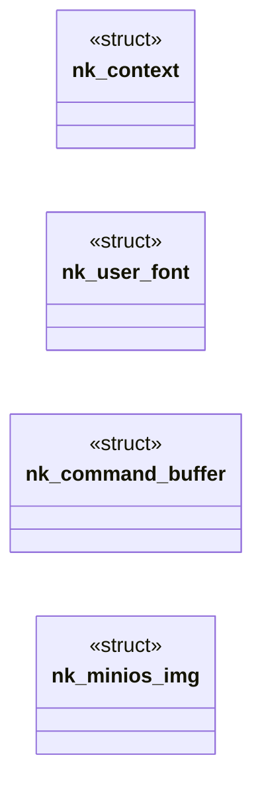

# `progs/nuklear/nuklear_minios.h`

> Source: [progs/nuklear/nuklear_minios.h:1](../../progs/nuklear/nuklear_minios.h#L1) | language `h` | coverage 53.6% | [API index](../index.md)

nuklear_minios.h — MiniOS platform layer for Nuklear.

## Contents

- **Structs:** [`nk_context`](#nk_context), [`nk_user_font`](#nk_user_font), [`nk_command_buffer`](#nk_command_buffer), [`nk_minios_img`](#nk_minios_img)
- **Functions:** [`nk_rgb_available`](#nk_rgb_available), [`nk_idx_to_rgb`](#nk_idx_to_rgb), [`nk_sys_time_ms`](#nk_sys_time_ms), [`nk_sys_kbd`](#nk_sys_kbd), [`nk_sys_palette`](#nk_sys_palette), [`nk_sys_kbd_raw`](#nk_sys_kbd_raw), [`nk_sys_vga_mode`](#nk_sys_vga_mode), [`nk_sys_fb_info`](#nk_sys_fb_info), [`nk_sys_mouse`](#nk_sys_mouse), [`nk_sys_mouse_badptr`](#nk_sys_mouse_badptr), [`nk_sys_nk_frame`](#nk_sys_nk_frame), [`nk_sys_gfx_set_title`](#nk_sys_gfx_set_title), [`nk_build_palette`](#nk_build_palette), [`nk_minios_font`](#nk_minios_font), [`nk_rasterize`](#nk_rasterize), [`SYS_NK_FRAME`](#sys_nk_frame), [`nk_poll_input`](#nk_poll_input), [`nk_quit_requested`](#nk_quit_requested), [`nk_set_scancode_hook`](#nk_set_scancode_hook)
- **Macros:** [`NK_W`](#nk_w), [`NK_BACKBUF`](#nk_backbuf), [`NK_RGB_BUF`](#nk_rgb_buf), [`NK_MINIOS_IMG_MAX`](#nk_minios_img_max)

## Type Diagram



## Structs

<a id="nk_context"></a>

### `nk_context`

`struct` | [progs/nuklear/nuklear_minios.h:20](../../progs/nuklear/nuklear_minios.h#L20)

```c
struct nk_context;
```

Forward declarations so this header is self-contained when included without nuklear.h first (font8x8.c does exactly that).

---

<a id="nk_user_font"></a>

### `nk_user_font`

`struct` | [progs/nuklear/nuklear_minios.h:21](../../progs/nuklear/nuklear_minios.h#L21)

```c
struct nk_user_font;
```

---

<a id="nk_command_buffer"></a>

### `nk_command_buffer`

`struct` | [progs/nuklear/nuklear_minios.h:22](../../progs/nuklear/nuklear_minios.h#L22)

```c
struct nk_command_buffer;
```

---

<a id="nk_minios_img"></a>

### `nk_minios_img`

`struct` | [progs/nuklear/nuklear_minios.h:74](../../progs/nuklear/nuklear_minios.h#L74)

```c
struct nk_minios_img
```

Caller-owned image for NK_COMMAND_IMAGE: palette-indexed pixels plus a 0/1 alpha mask (mask 0 skips the pixel, so icons keep transparency).

The app keeps the buffers alive while the image is used; the backend only reads. Bounds are fail closed: a null descriptor, a null plane or * a non-positive/excessive extent draws nothing. define NK_MINIOS_IMG_MAX 64

---

## Functions

<a id="nk_rgb_available"></a>

### `nk_rgb_available`

`function` | [progs/nuklear/nuklear_minios.h:33](../../progs/nuklear/nuklear_minios.h#L33)

```c
int nk_rgb_available(void);
```

1 when the kernel maps NK_RGB_BUF (cached probe, 0 on old kernels).

**Returns:** `int`

*Called by:* [`main`](progs.nuklear.node_editor.c.md#main)

---

<a id="nk_idx_to_rgb"></a>

### `nk_idx_to_rgb`

`function` | [progs/nuklear/nuklear_minios.h:37](../../progs/nuklear/nuklear_minios.h#L37)

```c
void nk_idx_to_rgb(int idx, unsigned char *r, unsigned char *g, unsigned char *b);
```

Resolve one hybrid palette index to its exact RGB triple (canvas and preview mirrors that own indexed pixels reuse the same table the rasterizer draws through, so both buffers agree pixel for pixel).

**Parameters**

| Name | Type | Default | Description |
|---|---|---|---|
| `idx` | `int` |  |  |
| `r` | `unsigned char *` |  |  |
| `g` | `unsigned char *` |  |  |
| `b` | `unsigned char *` |  |  |

---

<a id="nk_sys_time_ms"></a>

### `nk_sys_time_ms`

`function` | [progs/nuklear/nuklear_minios.h:41](../../progs/nuklear/nuklear_minios.h#L41)

```c
long nk_sys_time_ms(void);
```

MiniOS syscalls used by the platform.

**Returns:** `long`

*Called by:* [`rate`](progs.piano.piano.c.md#rate)

---

<a id="nk_sys_kbd"></a>

### `nk_sys_kbd`

`function` | [progs/nuklear/nuklear_minios.h:42](../../progs/nuklear/nuklear_minios.h#L42)

```c
long nk_sys_kbd(void);
```

**Returns:** `long`

---

<a id="nk_sys_palette"></a>

### `nk_sys_palette`

`function` | [progs/nuklear/nuklear_minios.h:43](../../progs/nuklear/nuklear_minios.h#L43)

```c
long nk_sys_palette(const unsigned char *pal768);
```

**Parameters**

| Name | Type | Default | Description |
|---|---|---|---|
| `pal768` | `unsigned char *` |  |  |

**Returns:** `long`

*Called by:* [`main`](progs.nuklear.node_editor.c.md#main)

---

<a id="nk_sys_kbd_raw"></a>

### `nk_sys_kbd_raw`

`function` | [progs/nuklear/nuklear_minios.h:44](../../progs/nuklear/nuklear_minios.h#L44)

```c
long nk_sys_kbd_raw(int on);
```

**Parameters**

| Name | Type | Default | Description |
|---|---|---|---|
| `on` | `int` |  |  |

**Returns:** `long`

*Called by:* [`main`](progs.nuklear.node_editor.c.md#main)

---

<a id="nk_sys_vga_mode"></a>

### `nk_sys_vga_mode`

`function` | [progs/nuklear/nuklear_minios.h:45](../../progs/nuklear/nuklear_minios.h#L45)

```c
long nk_sys_vga_mode(int on);
```

**Parameters**

| Name | Type | Default | Description |
|---|---|---|---|
| `on` | `int` |  |  |

**Returns:** `long`

*Called by:* [`main`](progs.nuklear.node_editor.c.md#main)

---

<a id="nk_sys_fb_info"></a>

### `nk_sys_fb_info`

`function` | [progs/nuklear/nuklear_minios.h:46](../../progs/nuklear/nuklear_minios.h#L46)

```c
long nk_sys_fb_info(int *w, int *h, int *pitch);
```

**Parameters**

| Name | Type | Default | Description |
|---|---|---|---|
| `w` | `int *` |  |  |
| `h` | `int *` |  |  |
| `pitch` | `int *` |  |  |

**Returns:** `long`

*Called by:* [`main`](progs.nuklear.node_editor.c.md#main)

---

<a id="nk_sys_mouse"></a>

### `nk_sys_mouse`

`function` | [progs/nuklear/nuklear_minios.h:47](../../progs/nuklear/nuklear_minios.h#L47)

```c
long nk_sys_mouse(int *xybw);
```

**Parameters**

| Name | Type | Default | Description |
|---|---|---|---|
| `xybw` | `int *` |  |  |

**Returns:** `long`

*Called by:* [`main`](progs.nuklear.node_editor.c.md#main)

---

<a id="nk_sys_mouse_badptr"></a>

### `nk_sys_mouse_badptr`

`function` | [progs/nuklear/nuklear_minios.h:51](../../progs/nuklear/nuklear_minios.h#L51)

```c
long nk_sys_mouse_badptr(void);
```

Call SYS_MOUSE with a pointer that is NOT in the user window; the kernel must reject it with -EFAULT.

Used by --selftest to prove the pointer validation, so a mutant that drops the bounds check is killed.

**Returns:** `long`

*Called by:* [`main`](progs.nuklear.node_editor.c.md#main)

---

<a id="nk_sys_nk_frame"></a>

### `nk_sys_nk_frame`

`function` | [progs/nuklear/nuklear_minios.h:52](../../progs/nuklear/nuklear_minios.h#L52)

```c
long nk_sys_nk_frame(int *origin);
```

**Parameters**

| Name | Type | Default | Description |
|---|---|---|---|
| `origin` | `int *` |  |  |

**Returns:** `long`

*Called by:* [`main`](progs.nuklear.node_editor.c.md#main)

---

<a id="nk_sys_gfx_set_title"></a>

### `nk_sys_gfx_set_title`

`function` | [progs/nuklear/nuklear_minios.h:53](../../progs/nuklear/nuklear_minios.h#L53)

```c
long nk_sys_gfx_set_title(const char *t);
```

int[2]: window content origin

**Parameters**

| Name | Type | Default | Description |
|---|---|---|---|
| `t` | `char *` |  |  |

**Returns:** `long`

---

<a id="nk_build_palette"></a>

### `nk_build_palette`

`function` | [progs/nuklear/nuklear_minios.h:57](../../progs/nuklear/nuklear_minios.h#L57)

```c
void nk_build_palette(unsigned char *pal768);
```

Hybrid palette: indices 0-14 are the desktop colors (kept so the desktop behind the window never recolors); 15-255 are the UI ramp.

**Parameters**

| Name | Type | Default | Description |
|---|---|---|---|
| `pal768` | `unsigned char *` |  |  |

*Called by:* [`main`](progs.nuklear.node_editor.c.md#main)

---

<a id="nk_minios_font"></a>

### `nk_minios_font`

`function` | [progs/nuklear/nuklear_minios.h:63](../../progs/nuklear/nuklear_minios.h#L63)

```c
struct nk_user_font nk_minios_font(void);
```

The nk_user_font for this backend: 8x8 monospace.

**Returns:** `nk_user_font`

*Called by:* [`main`](progs.nuklear.node_editor.c.md#main)

---

<a id="nk_rasterize"></a>

### `nk_rasterize`

`function` | [progs/nuklear/nuklear_minios.h:66](../../progs/nuklear/nuklear_minios.h#L66)

```c
void nk_rasterize(struct nk_context *ctx);
```

Rasterize the Nuklear command list into the back-buffer.

**Parameters**

| Name | Type | Default | Description |
|---|---|---|---|
| `ctx` | `struct nk_context *` |  |  |

*Called by:* [`main`](progs.nuklear.node_editor.c.md#main)

---

<a id="sys_nk_frame"></a>

### `SYS_NK_FRAME`

`function` | [progs/nuklear/nuklear_minios.h:85](../../progs/nuklear/nuklear_minios.h#L85)

```c
* SYS_NK_FRAME (nk_set_window_origin). */ void nk_set_window_origin(int x, int y);
```

**Returns:** `*`

---

<a id="nk_poll_input"></a>

### `nk_poll_input`

`function` | [progs/nuklear/nuklear_minios.h:87](../../progs/nuklear/nuklear_minios.h#L87)

```c
void nk_poll_input(struct nk_context *ctx);
```

**Parameters**

| Name | Type | Default | Description |
|---|---|---|---|
| `ctx` | `struct nk_context *` |  |  |

---

<a id="nk_quit_requested"></a>

### `nk_quit_requested`

`function` | [progs/nuklear/nuklear_minios.h:92](../../progs/nuklear/nuklear_minios.h#L92)

```c
int nk_quit_requested(void);
```

WM quit gesture: ESC or Alt+F4 since the last poll (1 once, then clears).

Every NK app checks this per frame so closing never depends on the title-bar X alone.

**Returns:** `int`

---

<a id="nk_set_scancode_hook"></a>

### `nk_set_scancode_hook`

`function` | [progs/nuklear/nuklear_minios.h:101](../../progs/nuklear/nuklear_minios.h#L101)

```c
void nk_set_scancode_hook(nk_scancode_cb cb, void *ud);
```

**Parameters**

| Name | Type | Default | Description |
|---|---|---|---|
| `cb` | `nk_scancode_cb` |  |  |
| `ud` | `void *` |  |  |

---

## Macros

<a id="nk_w"></a>

### `NK_W`

`macro` | [progs/nuklear/nuklear_minios.h:24](../../progs/nuklear/nuklear_minios.h#L24)

```c
#define NK_W
```

Nuklear UI back-buffer.

A ring-3 program (the node editor) renders a UI into a kernel-heap back-buffer mapped into the user window and calls SYS_NK_FRAME (220); the kernel composites it as a titled window on the desktop exactly like the DOOM window, so the shell stays visible. It sits in the reserved tail with the framebuffer, above DOOM_BACKBUF_ADDR (the brk cap), so neither a growing heap nor the mmap zone can ever reach it.

> **Inherited:** Documentation from [`NK_W`](#nk_w) (headers/vga_fb.h:67).

---

<a id="nk_backbuf"></a>

### `NK_BACKBUF`

`macro` | [progs/nuklear/nuklear_minios.h:26](../../progs/nuklear/nuklear_minios.h#L26)

```c
#define NK_BACKBUF
```

---

<a id="nk_rgb_buf"></a>

### `NK_RGB_BUF`

`macro` | [progs/nuklear/nuklear_minios.h:30](../../progs/nuklear/nuklear_minios.h#L30)

```c
#define NK_RGB_BUF
```

RGB companion buffer (R,G,B byte order, NK_W x NK_H).

Mapped only by ABI-v7 kernels; nk_rgb_available() probes it once via the fb_info 4th word, so old kernels keep the indexed path without ever faulting.

---

<a id="nk_minios_img_max"></a>

### `NK_MINIOS_IMG_MAX`

`macro` | [progs/nuklear/nuklear_minios.h:73](../../progs/nuklear/nuklear_minios.h#L73)

```c
#define NK_MINIOS_IMG_MAX
```

Caller-owned image for NK_COMMAND_IMAGE: palette-indexed pixels plus a 0/1 alpha mask (mask 0 skips the pixel, so icons keep transparency).

The app keeps the buffers alive while the image is used; the backend only reads. Bounds are fail closed: a null descriptor, a null plane or a non-positive/excessive extent draws nothing.

---
